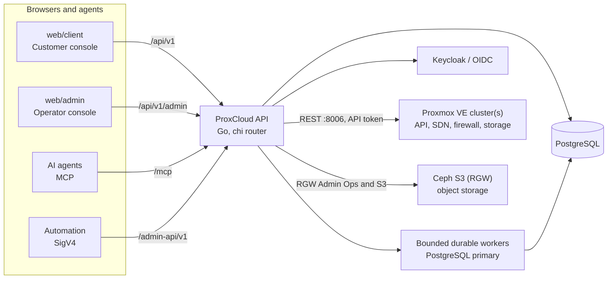

<div align="center">

# ProxCloud

**Multi-tenant cloud billing & self-service private-cloud portal for Proxmox VE**

<p>
  
  
  
  
  
</p>

<p>
  <a href="https://github.com/mutex-solutions/proxcloud/actions/workflows/test.yml"></a>
  <a href="https://github.com/mutex-solutions/proxcloud/actions/workflows/docker.yml"></a>
  <a href="https://github.com/mutex-solutions/proxcloud/actions/workflows/helm.yml"></a>
</p>

<p>
  <a href="#-quickstart"><b>Getting Started</b></a>
  · <a href="https://github.com/mutex-solutions/proxcloud/discussions">Community</a>
  · <a href="CHANGELOG.md">Changelog</a>
  · <a href="https://github.com/mutex-solutions/proxcloud/issues">Bug reports</a>
</p>

</div>

ProxCloud turns a Proxmox VE cluster into a product: customers sign up, launch and
manage compute / storage / network resources from a web console, and are billed
for what they use. Operators configure regions, pricing, invoicing, and
promotions from a separate admin console. A built-in MCP server exposes the same
capabilities to AI agents.

- **Customer console** (`web/client`) — self-service cloud + billing for end users.
- **Operator console** (`web/admin`) — pricing, regions, invoicing, and account administration.
- **API** (Go) — one backend serving three surfaces: the customer API, the SigV4-signed operator API, and an MCP endpoint.

> [!WARNING]
> **Proxmox VE backend.** ProxCloud provisions against a Proxmox VE cluster through
> the PVE API. Supported PVE releases are not pinned yet.

## Contents

- [Features](#-features)
- [Architecture overview](#-architecture-overview)
- [Quickstart](#-quickstart)
- [Repository layout](#-repository-layout)
- [Tech stack](#-tech-stack)
- [Documentation](#-documentation)
- [Build & test](#-build--test)
- [Contributing](#-contributing)
- [License](#-license)

## ✨ Features

- **Self-service cloud** — provision and manage servers, volumes, private networks (SDN), security groups, public IPs, project templates and keypairs on one or more Proxmox VE clusters, plus S3 object storage on Ceph RGW (buckets, per-key access, static websites).
- **Usage-based billing** — metered consumption rated against configurable price plans, resource types, currencies and tax rules.
- **Invoicing & payments** — automated invoices, account credits, card and bank-transfer payments (Stripe), and automated suspension for overdue accounts.
- **Savings plans & promotions** — commitment discounts, promotional credits, and sign-up bonuses.
- **Multi-org / multi-project RBAC** — organizations, projects, per-project roles, and user invitations.
- **Proxmox VE integration** — resource sync by polling the PVE API, usage metrics collection, with per-service enable/disable.
- **MCP server** — a Model Context Protocol endpoint so AI agents can drive the platform with the same auth and permissions as a user or operator.
- **Identity via OIDC** — Keycloak or any OpenID Connect provider, browser sign-in over authorization-code + PKCE.

## 🧭 Architecture overview



Full context and container views: [C1 context](docs/architecture/c4/c1-context.md)
and [C2 containers](docs/architecture/c4/c2-containers.md).

One Go process serves all three HTTP surfaces on port `8080`, runs bounded
PostgreSQL durable workers, and optionally schedules jobs (billing, sync, metrics).
Scheduler/debug gates default off; workers still finish already-enqueued work.
A separate management port (`8081`) exposes health and operational triggers.
No RabbitMQ is required. Existing deployments must follow the
[drain/reconcile and retain cutover runbook](docs/postgres-jobs-migration.md)
before upgrading; mail durability is a separate follow-up.

## 🚀 Quickstart

Broker-free defaults target the planned **v0.4.0** API/chart. Until a separately
approved release is published, build from a checkout containing the PostgreSQL
job engine (installer `images.build: true`) or pin known compatible new images;
do not use the older Rabbit-dependent API with these defaults.

**[`docs/quickstart.md`](docs/quickstart.md)** takes you from "what do I want" to a running
install: the components each path deploys, the inventory keys to fill, the one command, the
first login and the fixes for common first-install failures.

| You want to | Run | Guide |
|---|---|---|
| Try it on a laptop, no Proxmox | `docker compose up --build`, then `http://localhost:8082` (`demo`/`demo`) and `:8083` (`admin`/`admin`) | [A](docs/quickstart.md#a-laptop-docker-compose) |
| Evaluate on one Proxmox node | `make install`, with `mgmt.placement: pve-vm` and `network.kind: simple` | [B](docs/quickstart.md#b-one-proxmox-node-evaluation) |
| Run a production site | `make install`, one management host (`allinone`) | [C](docs/quickstart.md#c-production-one-management-host-allinone) |
| Sell managed Kubernetes, databases, sandboxes | `make install` with `mode: split` | [D](docs/quickstart.md#d-managed-kubernetes-databases-and-sandboxes-split) |
| Run only the portal on your Kubernetes | `helm install` with `values-quickstart.yaml` (no operators) or your values (production) | [E](docs/quickstart.md#e-install-on-kubernetes-with-helm) |

The installer in one go, from a Linux host that reaches the Proxmox API:

```sh
cd installer
cp -r inventory/example inventory/mysite   # fill pve.api_url and the keys your path needs
make preflight INVENTORY=inventory/mysite
make install INVENTORY=inventory/mysite
```

Every stage and option: [`docs/install.md`](docs/install.md). Chart values:
[`deploy/charts/proxcloud/README.md`](deploy/charts/proxcloud/README.md).

## 📂 Repository layout

<details>
<summary>Expand the full path-by-path map</summary>

| Path | Contents |
|------|----------|
| `cmd/api` | Service entrypoint — HTTP servers + background jobs |
| `internal/platform` | Business domains: `account`, `org`, `project`, `billing`, `payment`, `pricing`, `catalog`, `order`, `promotion`, `rbac`, `admin`, `adminapi`, `mcp`, `scheduler`, … |
| `internal/cloud` | Proxmox VE client and services (`pve`), resource cache and sync, Ceph RGW object store, usage metrics, managed K8s/DBaaS, cloud→billing bridge |
| `internal/{config,server,oidc,pgdoc,health}` | Wiring: config, HTTP server, auth, Postgres store, health |
| `pkg` | Reusable libraries: `auth`, `httpx`, `money`, `textcrypt`, `audit` |
| `deploy` | `Dockerfile`, Helm chart (`chart`), seed data |
| `installer` | One-shot installer (Ansible): `make install` and the day-2 targets |
| `images` | OS template pipeline (Packer) |
| `web/client` | Customer console (React SPA) |
| `web/admin` | Operator console (React SPA) |
| `test/integration` | Integration tests (build tag `integration`) |

</details>

## 🧰 Tech stack

- **Backend** — Go 1.25, [chi](https://github.com/go-chi/chi) router, PostgreSQL (jsonb document store and durable jobs via [pgx](https://github.com/jackc/pgx)), a Proxmox VE REST client (`internal/cloud/pve`), aws-sdk-go-v2 for S3, Stripe, the [MCP Go SDK](https://github.com/modelcontextprotocol/go-sdk), and [koanf](https://github.com/knadh/koanf) config (env + `application.yml`).
- **Frontends** — React 19 + Vite + TypeScript, Tailwind CSS v4, shadcn/ui + Radix, TanStack Query, and `react-oidc-context` (authorization-code + PKCE).
- **Identity** — Keycloak or any OIDC provider.

## 📚 Documentation

**Engineering docs** (this repo, under [`docs/`](docs/) — start at the [docs index](docs/README.md)):

- [Architecture](docs/architecture.md) — system overview, boot sequence, module map, request flow.
- [Data model](docs/data-model.md) — PostgreSQL/JSONB document tables + entity-relationship diagram.
- [Authentication](docs/auth.md) — OIDC resource server, realms, SigV4 admin keys, MCP auth.
- [API overview](docs/api.md) — the `/api/v1`, `/admin-api/v1`, and `/mcp` surfaces + conventions.
- [Billing](docs/billing.md) — pricing, accrual, bills, transactions, savings, suspension.
- [Cloud integration](docs/cloud-integration.md) — Proxmox VE providers, resource cache and sync, metrics, Ceph S3.
- [Jobs & scheduling](docs/jobs-scheduling.md) — the scheduler, distributed locking, durable charge jobs; [existing-site cutover](docs/postgres-jobs-migration.md).
- [Configuration](docs/configuration.md) — env / `application.yml` / Helm values reference.
- [Development](docs/development.md) · [Testing](docs/testing.md) · [Glossary](docs/glossary.md) · [Decision records](docs/adr/).

**Product / user documentation** ships inside the apps, served at `/docs` in each
console (source under `web/client/src/docs/content` and `web/admin/src/docs/content`):
the customer manual, operator manual, administrator manual, and the interactive
Admin API + MCP reference.

For operations and deployment, see the [Helm chart README](deploy/charts/proxcloud/README.md).
For contributing and local development, see [`CONTRIBUTING.md`](CONTRIBUTING.md).

## 🧪 Build & test

<details>
<summary>Backend, frontend, and image build commands</summary>

```sh
make build             # go build ./...
make vet               # go vet ./...
make test              # go test ./...
make test-integration  # integration tests (needs Docker — throwaway Postgres via testcontainers)
make binary            # static api binary -> bin/proxcloud-api
make image             # build the api container image
```

Frontends:

```sh
cd web/client   # or web/admin
npm install
npm run dev     # Vite dev server
npm run build   # type-check + production build
npm run lint    # oxlint
```

Container images (`proxcloud-api`, `proxcloud-web`, `proxcloud-admin`) and the Helm chart
are published to `ghcr.io/mutex-solutions` by CI on pushes to `main` and tagged
releases.

</details>

## 🤝 Contributing

Issues and pull requests are welcome — please read [`CONTRIBUTING.md`](CONTRIBUTING.md)
and our [Code of Conduct](CODE_OF_CONDUCT.md). To report a security issue, see
[`SECURITY.md`](SECURITY.md).

## 📄 License

ProxCloud is licensed under the **Apache License, Version 2.0**
(Apache-2.0). See [`LICENSE`](LICENSE).
