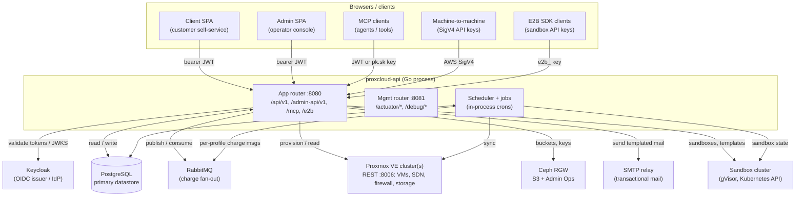
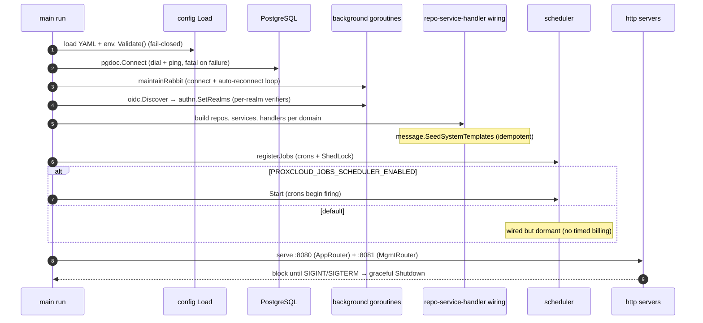
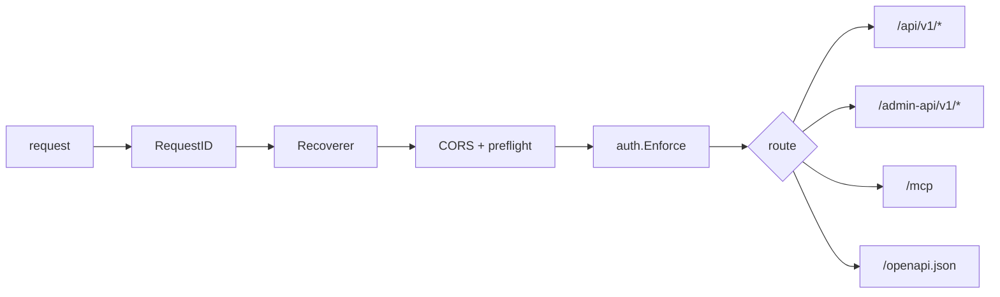
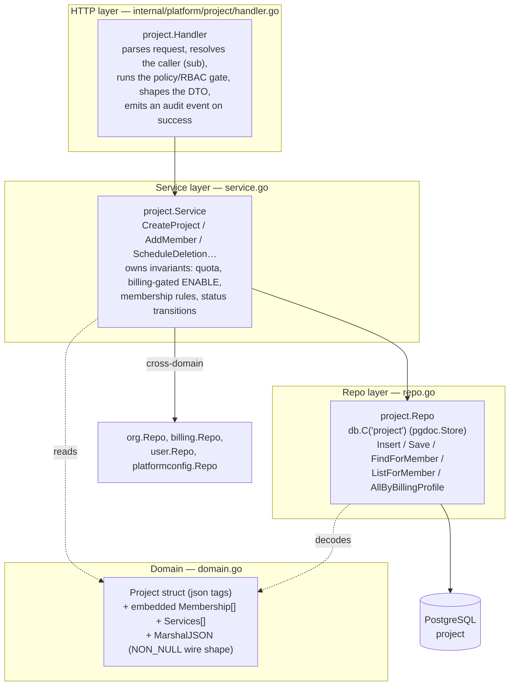
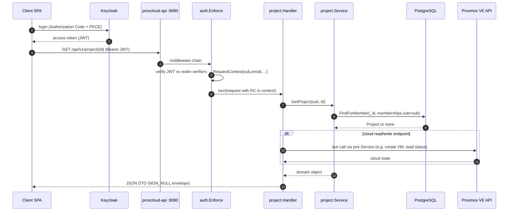
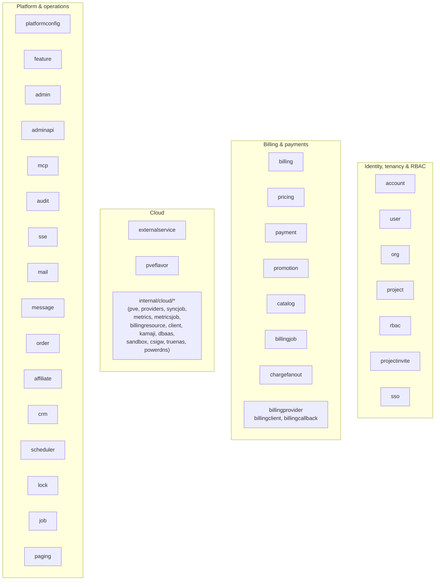
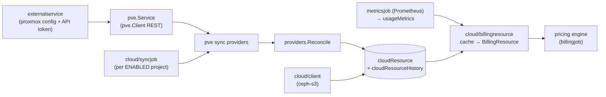

# ProxCloud — Architecture

ProxCloud is a self-service private-cloud portal for Proxmox VE: it lets customers organize into organizations and projects, provision and
manage cloud resources (servers, volumes, networks, security groups, public
IPs, buckets, …), and it meters that usage, prices it, bills it,
and collects payment. It is a single Go service (`proxcloud-api`) fronting a
PostgreSQL primary datastore, a RabbitMQ broker, an OIDC identity provider
(Keycloak), and one or more Proxmox VE clusters.

This document is the system-level map: how the process boots, how requests are
routed and authenticated, how the code is layered, and what the modules are. The
deep dives live in sibling docs:

- **[data-model.md](data-model.md)** — the PostgreSQL document tables and their relationships (ERD).
- **[auth.md](auth.md)** — token validation, the RBAC permission kernel, the SigV4 admin-API scheme.
- **[billing.md](billing.md)** — billing profiles, rating/pricing, bills, payments, suspension.
- **[cloud-integration.md](cloud-integration.md)** — the Proxmox VE client and services, the resource cache, sync, metrics.
- **[jobs-scheduling.md](jobs-scheduling.md)** — the cron catalog, cross-fleet locking, and the RabbitMQ charge fan-out.

**Architecture diagrams (C4):** [architecture/c4/](architecture/c4/README.md) — context, containers, components and code views with Implemented/Planned status, plus a change log of why the architecture changed.

---

## 1. System context (containers)

Not drawn: the other provider kinds the app router reaches the same way, per
provider on demand (RustFS, TrueNAS, PowerDNS, and the Kamaji and DBaaS management
clusters through ArgoCD); see [cloud-integration.md](cloud-integration.md).

The process listens on **two ports**. `:8080` is the public API surface behind
the ingress; `:8081` is the management/operations port (health probes, on-demand
job triggers, billing callbacks) and is never exposed to the internet.

PostgreSQL is connected **eagerly at startup** — dialed and pinged before the
service listens, so a failed connection aborts the boot — while RabbitMQ and OIDC
discovery happen on background goroutines, so those unreachable dependencies
degrade a capability rather than blocking the boot. Proxmox and other cloud
clients are not dialed at boot at all: they are built per provider on demand.

---

## 2. Boot sequence

`cmd/api/main.go` is the single entrypoint. `run()` performs a deterministic
wiring pass — construct repos, then services, then handlers, then the router and
jobs — and hands off to two HTTP servers.

Key properties of the boot, all visible in `run()`:

- **Config is fail-closed.** `config.Load()` reads a mounted YAML file overlaid
  by environment variables (env wins), and `cfg.Validate()` refuses to start a
  half-configured process.
- **Indexes are ensured in the background.** User/org/project/invite repos kick
  off `EnsureIndexes` on goroutines so a slow index build never blocks listen.
- **The authenticator starts empty and fills in.** `auth.New` is wired into the
  router immediately; realms arrive later from `oidc.Discover`. Until then,
  bearer tokens fail closed (401) — the service is always safe, never open.
- **Cloud clients are built per provider.** The project handler receives
  factories: `projectH.SetProxmox` (`pve.NewService` from the provider's
  `PVEConfig`), `SetKamaji`, `SetDbaas`, and ceph-s3 through `client.NewCephS3`.
  A Proxmox write returns `503 "proxmox client not ready"` when the provider
  cannot be reached.
- **Jobs are wired but gated.** Every cron is registered, but the scheduler only
  `Start()`s when `PROXCLOUD_JOBS_SCHEDULER_ENABLED=true`. A plain deploy therefore
  never charges a bill on a timer; operators drive the flow deterministically via
  the `:8081` `/debug/run-*` triggers when those are enabled.
- **Cross-service wiring uses setters to break import cycles.** For example the
  org handler can't import project, so `orgH.SetProjectMemberAdder(projectSvc)`
  injects the project service after both exist. The same pattern wires the
  activation service, cloud suspend/resume, and admin cloud operations.

---

## 3. Request routing & middleware

`internal/server/server.go` builds two routers with **chi**.

### App router (`:8080`)

A single middleware chain wraps every request, in order:

- **RequestID / Recoverer** — chi built-ins: correlation id + panic-to-500.
- **CORS** — echoes the specific allowed Origin (never `*`, because requests are
  credentialed with a bearer token) and answers `OPTIONS` preflight with `204`
  **before** auth runs, so preflight never 401s. Allowed origins are derived from
  the configured UI/admin base URLs plus an optional `PROXCLOUD_CORS_ALLOWED_ORIGINS`
  list.
- **auth.Enforce** — the gate. Public paths pass through (a valid token is still
  parsed if present, since some public DTOs vary by auth); every other request
  needs a valid credential or gets a `401` with an empty body and
  `WWW-Authenticate: Bearer`. See [auth.md](auth.md).

**Four route surfaces** share the port:

| Surface | Prefix | Auth scheme | Purpose |
|---|---|---|---|
| Client + operator API | `/api/v1/*` | OIDC bearer (client & admin realms), or a customer's `pk.sk` personal access token | The whole product: account, org, project, billing, cloud, admin. Admin endpoints live under `/api/v1/admin/**` and are gated by an `adminPermission` record, not a separate realm. |
| Public Admin API | `/admin-api/v1/*` | AWS SigV4 (hmac keys) **or** dedicated admin-api OIDC realm | Machine-to-machine integration surface with snake_case envelopes and keyset pagination. |
| MCP | `/mcp` | Dual scheme: realm JWT **or** `Bearer pk.sk` key (a customer's personal access token → client tools, an admin hmac key → admin tools) | Model Context Protocol endpoint; tool calls dispatch back through the app router in-process. |
| E2B-compatible sandboxes | `/e2b/*` | A project's `e2b_` sandbox API key (`X-API-Key` or bearer) | The E2B SDK's API over the platform's sandboxes ([e2b-compat.md](e2b-compat.md)). |

**Public-path whitelist** (`pkg/auth`, `IsPublic`): exact paths (`/error`,
`/api/v1/platform-configuration/default`, the billing config country/currency
lists, the RFC 9728 resource-metadata doc) and prefixes (`/openapi.json`, `/mcp`,
`/api/v1/auth/`, `/api/v1/download/`, `/api/v1/nocloud/`, `/api/v1/console/`,
`/api/v1/callbacks/`, `/api/v1/admin/onboarding/`, `/api/v1/internal/sandboxes/`,
`/e2b/`). These authenticate by their own scheme rather than a bearer the gate
checks: a token in the URL (download, VM seed, console), the MCP handler's own
gate, a sandbox provider's `proxyWakeToken` (the wake call), or a project's `e2b_`
sandbox API key. `/api/v1/admin/job/` is not public: the gate requires an admin
credential there.

### Management router (`:8081`)

A plain `net/http.ServeMux`: `GET /actuator/health` (liveness),
`GET /actuator/health/readiness` (PostgreSQL ping + RabbitMQ health),
`GET /actuator/info`, a build probe, the billing-service callbacks (when a shared
token is configured), and — when jobs are enabled or debug-triggers are on — a family of
`POST /debug/run-*` triggers to drive crons on demand (sync, the Proxmox state,
task and traffic samples, the sandbox state, builds and registry prune, SSO
reconcile, metrics, charge, collect, dunning, review, savings expiry, project
deletion, mail send, RabbitMQ self-test). HMAC key minting (`gen-hmac-key`) is
unauthenticated, so only debug-triggers exposes it, never the scheduler alone.

---

## 4. Layering: handler → service → repo

Each domain follows the same three-layer shape. Handlers speak HTTP and identity,
services hold business rules, repos own one PostgreSQL table. Using the
**project** domain as the worked example:

Concretely, `POST /api/v1/project` flows: the handler resolves the caller's `sub`
and target org, then `Service.CreateProject` builds memberships from the org's
members, defaults the project to `DISABLED`, and flips it to `ENABLED` only when
billing is unconfigured **or** the org's billing profile is `ACTIVE` (enforcing
the per-profile/platform project quota along the way). Persistence is
`Repo.Insert`, which stamps `createdAt`/`updatedAt` and reads back the generated
24-char hex id as the string `_id`.

Notable conventions this example shows:

- **Services depend on other domains' repos, never their handlers.** The project
  service holds `org.Repo`, `billing.Repo`, `user.Repo`, `platformconfig.Repo`.
  This keeps the dependency graph a DAG; the few genuine cycles are broken with
  setters wired in `main` (§2).
- **The wire shape is explicit.** Domain structs that serialize directly (like
  `Project`) carry a hand-written `MarshalJSON` implementing NON_NULL semantics:
  null fields are omitted, but non-null empty collections (`memberships:[]`,
  `services:[]`, `customInfo:{}`) are always present.
- **Embedded vs. referenced.** Memberships and attached services live **inside**
  the project document (queried via the `memberships.sub` and
  `services` paths), whereas organization and billing profile
  are referenced by id. See [data-model.md](data-model.md) for the full picture.

### A full authenticated request

Token **validation** is the only thing the API does with Keycloak on the hot
path — ProxCloud is a resource server, not the IdP. The authenticated `sub` becomes
the tenant principal; a domain `User` row is created only on the explicit user
init endpoint, so handlers that need a `User` look it up and return "User is not
initialized" if absent.

---

## 5. Module map

The code is organized as one Go module (`github.com/mutex-solutions/proxcloud`) with
`internal/platform/*` domain packages, an `internal/cloud/*` Proxmox / object-store subsystem,
and a handful of infrastructure packages (`internal/{config,server,oidc,pgdoc,
amqp,health,sandboxproxy}`, `pkg/{auth,httpx,textcrypt,money,audit,billingapi,certfile,safeurl}`).

### Identity, tenancy & RBAC

| Module | Responsibility |
|---|---|
| `account` | Customer User/Account own-record endpoints; the principal is resolved (get-or-create by `sub`) before these run. |
| `user` | The domain `User` — the tenant principal keyed by `sub`; get-or-create semantics, `users` table. |
| `org` | Organization slice: org CRUD, members, org-level RBAC, custom role definitions, and the org audit-log read. |
| `project` | Project slice: project CRUD, embedded memberships, project-level RBAC, and the client cloud read/write endpoints. |
| `rbac` | Pure authorization kernel: permission keys, the wildcard permission matcher, and the built-in role→permission tables (no DB). |
| `projectinvite` | Create/lookup/accept/decline project invitations (TTL-indexed), with the invite email and audit trail. |
| `sso` | Per-organization SSO: organization identity providers and verified domains in Keycloak, and the guard that refuses a session that must come through its organization's IdP. |

### Billing & payments

| Module | Responsibility |
|---|---|
| `billing` | Billing-profile domain + reads (billing summary), bills, account credit, savings plans/contracts, suspension/activation services, and the bill-finalization job. |
| `pricing` | The rating core: price plans, price-plan rules, tax rates, price-adjustment rules, and the engine that turns usage values into net amounts. |
| `payment` | Payment gateway operations (Stripe card charges/setup, add-funds, register-card, collect, bank transfer) plus the stuck-transaction scanner. |
| `promotion` | Promotion/deposit config reads and promo-code redemption into promotional credit. |
| `catalog` | Cloud-catalog config reads: flavor categories, image groups/categories, instance-metadata options (admin-configured document tables). |
| `billingjob` | The charge-cron driver: load active profiles + services, and rate each billable cloud resource per time unit. |
| `chargefanout` | The multi-pod alternative to the in-process charge loop: publish one RabbitMQ message per active profile; any pod's consumer drains the queue. |
| `billingprovider`, `billingclient`, `billingcallback` | The charge seam: `native` (in-process engine) or `external` (a separate billing service over `pkg/billingapi`), the client for that service, and its callbacks into ProxCloud (suspend/resume, activate projects, mail). |

### Cloud

| Module | Responsibility |
|---|---|
| `externalservice` | The `externalService` table: one record per provider (Proxmox API token, Ceph RGW keys, Kamaji/DBaaS kubeconfigs) with an encrypted-at-rest `secret` decrypted on read. |
| `pveflavor` | The Proxmox flavor catalog (sizes, GPU model and count) servers are created from. |
| `internal/cloud/*` | The cloud subsystem (see §6): `pve` (client, services, networks, firewall, scheduler, sync providers), `providers` (Reconcile), the resource cache + history, `syncjob`, `metrics`/`metricsjob` (Prometheus), `billingresource`, `client` (ceph-s3), `cephcred`, `kamaji`, `dbaas`, `sandbox` (the sandbox cluster), `csigw` (the CSI gateway), `truenas` (file shares), `powerdns` (DNS zones). Package map: [C3 components](architecture/c4/c3-components.md). |

### Platform & operations

| Module | Responsibility |
|---|---|
| `platformconfig` | The single per-deployment platform config doc (branding, date format, regions, project quota, login config) the UI bootstraps from. |
| `feature` | Feature-flag reads: the available feature set and per-feature enabled checks. |
| `admin` | The `/api/v1/admin/**` surface + admin authorization kernel: a caller is admin iff their `sub` has an `adminPermission` record whose role resolves to a permission set. |
| `adminapi` | The public `/admin-api/v1` machine-to-machine API (SigV4 or admin-api realm), snake_case envelopes, keyset pagination. |
| `mcp` | The Model Context Protocol endpoint with a client toolset and an admin toolset; tools dispatch in-process through the app router. |
| `audit` | The audit pipeline: the `auditEvent` domain, an async writer, and cursor-paginated queries; events are emitted by handlers after a successful mutation. |
| `sse` | The real-time event stream: an in-memory subscriber pool + per-connection heartbeat; pushes cloud-resource events to a project's open connections. |
| `mail` | The mail-send foundation: a mailer interface + SMTP gateway (no-op when unconfigured). |
| `message` | Named, admin-editable email templates rendered with `{{var}}` placeholders; system templates seeded if-absent at startup. |
| `order` | Provisioning-order reads (order-by-id). |
| `affiliate` | Affiliate endpoints: referral check + per-project affiliate config/log. |
| `crm` | CRM-sync integration point (contacts/segments/user sync) with a stub provider until a CRM is connected. |
| `scheduler` | The cron engine (seconds-enabled cron) wrapping each job in a cross-fleet lock. |
| `lock` | The `shedLock`-backed distributed lock so a scheduled job runs once across the pod fleet. |
| `job` | The operator job-trigger endpoints under `/api/v1/admin/job/*` (admin credential required: an hmac key or an admin-realm bearer; runs the in-process job, else returns 202). |
| `paging` | Keyset pagination helpers shared by the list endpoints. |
| `internal/sandboxproxy` | sandbox-proxy's routing of `https://<port>-<sandboxId>.<domain>`, the wake call and the certificate sync (`cmd/sandbox-proxy`). |

---

## 6. The cloud subsystem (`internal/cloud/*`)

The cloud layer is what makes ProxCloud a *cloud* platform: it turns Proxmox VE
and Ceph RGW state into a queryable cache, meters it, and prices it. It is
summarized here; the full treatment is in
**[cloud-integration.md](cloud-integration.md)** and the component view in
**[C3 components](architecture/c4/c3-components.md)** (C3b, C3c, C3e).

- **`pve`** — the Proxmox VE side: a typed REST client (`pve.Client`: cluster
  resources, QEMU, storage, SDN, firewall, pools, tasks, PCI mappings) and the
  project-scoped `pve.Service` (create/delete/resize/power servers, project
  templates, volumes, GPU slots, console). Networks (`network.go`) are SDN vnets
  with cluster firewall isolation; security groups are cluster firewall groups
  (`firewallsvc.go`); `PickNode` places VMs by capacity, the nodes where the
  storage profile is active, free space on that storage and free GPU slots;
  `capability.go` detects what each storage supports.
- **Sync providers + `providers.Reconcile`** — the PVE sync providers
  (`pve/syncprovider.go`, `NetworkSyncProvider`, `SecurityGroupSyncProvider`) map
  pool VMs, disks, templates, owned vnets and groups to cache rows; `Reconcile`
  creates, updates and archives rows against the live list, with a
  `cloudResourceHistory` soft-delete. The types produced are `SERVER`, `VOLUME`,
  `IMAGE`, `KEYPAIR`, `NETWORK`, `SECURITY_GROUP`, `FLOATING_IP` and `LOAD_BALANCER`
  (Proxmox), `BUCKET` (Ceph RGW, RustFS), `SHARE` (TrueNAS), `DNS_ZONE` (PowerDNS),
  `KUBERNETES_CLUSTER` / `DATABASE_CLUSTER` (ArgoCD) and `SANDBOX` (the sandbox cluster).
- **`syncjob`** — every 15 minutes walks every `ENABLED` project and, per attached
  provider and enabled service, reconciles the cache. Write paths update the cache
  directly, and a server GET does a best-effort live refresh.
- **`client`** — the Ceph RGW (S3 and Admin Ops) client, built with
  `client.NewCephS3`; with `cephcred` it holds the per-project RGW user and keys.
- **`metrics` / `metricsjob`** — opt-in traffic ingestion from a
  source per provider (`config.metrics.source`; Proxmox defaults to `pve`, its
  public-NIC counters, sampled every minute). Results land in the `usageMetrics` table.
- **`billingresource`** — the cloud→billing bridge: turns cached resources (plus
  traffic usage) into the priced `BillingResource`s the rating loop consumes:
  instance (+ instance traffic, server snapshots, server protection), volume,
  floating IP, image, bucket, share, kubernetes cluster, database cluster, sandbox
  and sandbox snapshot. A load balancer bills as the VM, disk and address it is
  made of.
- **`kamaji` / `kamajik8s` / `dbaas`** — managed Kubernetes and databases. A
  provider is a management cluster reached over a stored kubeconfig; each
  customer cluster is one ArgoCD `Application` written to that cluster's API.
  A database's endpoint is a MetalLB address, with no tenant network involved; a
  cluster's workers land in the project's pool and vnet through CAPMOX
  (`cloud_kamaji_create.go`). Guides:
  **[managed-k8s.md](managed-k8s.md)**, **[managed-dbaas.md](managed-dbaas.md)**.

---

## 7. Cross-cutting concerns

### Authentication & authorization (`pkg/auth`, `internal/oidc`)

Three OIDC realms are configured (`Auth.Main`, `Auth.Admin`, `Auth.AdminAPI`);
`oidc.Discover` builds a verifier per realm in the background. `auth.Enforce`
validates the bearer JWT against each realm's verifier and populates a
`RequestContext{sub, email, givenName, familyName, issuer, azp}`. The public
`/admin-api/v1` surface additionally accepts **AWS SigV4** signatures verified
against `hmac_keys` (`pkg/auth/sigv4.go`). Authorization is layered on top: the
`rbac` kernel resolves role→permission sets for org/project actions, and admin
access hinges on an `adminPermission` record for the caller's `sub`. Full detail
in **[auth.md](auth.md)**.

### Configuration (`internal/config`)

`config.Load()` reads a mounted YAML file overlaid by environment variables (env
always wins), and `Validate()` fails closed. Config groups: server/management
ports, the PostgreSQL DSN (`PROXCLOUD_DB_URL`), RabbitMQ, the data-at-rest `Encryption.DefaultKey` (used by
`pkg/textcrypt` to decrypt external-service secrets), self URLs (API/UI/admin base
URLs, which also seed CORS), the three auth realms, the default-region fallback
(`PROXCLOUD_DEFAULT_REGION` / `proxcloud.default-region`, default `default`), and the `Jobs` gates (`SchedulerEnabled`, `DebugTriggers`,
`RabbitFanout`).

### Async & scheduling (`internal/amqp`, `scheduler`, `lock`)

Scheduled work is driven by a seconds-enabled cron; every job is wrapped in a
`shedLock`-backed distributed lock (`atMostFor` / `atLeastFor`) so it runs **once
across the fleet**, not once per pod. The catalog is registered in
`main.registerJobs` — the minutely/hourly/monthly charge crons, Prometheus traffic metrics (`usageMetricsFetch`),
services sync, the minutely Proxmox state sample (`pveStateSync`), task poll
(`pveTaskPoll`) and public-NIC traffic sample (`pveTrafficSample`), the sandbox
jobs (`sandboxStateSync`, `sandboxTemplateAdopt`, `sandboxBuildSync`,
`sandboxRegistryPrune`), savings expiry + reminders, transaction scan,
auto-suspension (dunning), monthly bill finalization, monthly collect, and project
deletion. Under the external billing provider the seven billing jobs (savings
expiry and reminders, reminder dispatch, transaction scan, auto-suspension,
monthly bill, monthly collect) are not scheduled: the billing service runs its own.

The charge cron has two execution modes: an **in-process loop** by default, or a
**RabbitMQ fan-out** (`PROXCLOUD_JOBS_RABBIT_FANOUT=true`) that publishes one
message per active billing profile so any pod's consumer can charge one profile —
isolating per-profile failures across the fleet. RabbitMQ itself is maintained by
a background reconnect loop so readiness self-heals after a dropped connection.
Full catalog + cron expressions in **[jobs-scheduling.md](jobs-scheduling.md)**.

### Audit (`internal/platform/audit`)

Handlers emit audit events **after** a successful mutation through an async writer
(`LogAsync`), so auditing never blocks or fails the request. The `auditEvent`
table is queried by the client org/account audit-log endpoints with cursor
pagination.

### Money & serialization (`pkg/money`, `pkg/httpx`)

Monetary values are handled as `decimal.Decimal` (stored as a JSONB decimal
string, `"12.34"`) via `pkg/money` (no float
drift). `pkg/httpx` owns the response envelope, the `RequestContext` carried in
`context.Context`, and the shared 401/404/405 handlers — giving every surface a
consistent NON_NULL JSON shape.

---

## 8. Where to go next

- The document tables and their relationships → **[data-model.md](data-model.md)**
- How a token becomes a permission decision → **[auth.md](auth.md)**
- How usage becomes a bill and a payment → **[billing.md](billing.md)**
- How Proxmox state becomes a cached, metered resource → **[cloud-integration.md](cloud-integration.md)**
- The full cron catalog and locking model → **[jobs-scheduling.md](jobs-scheduling.md)**
