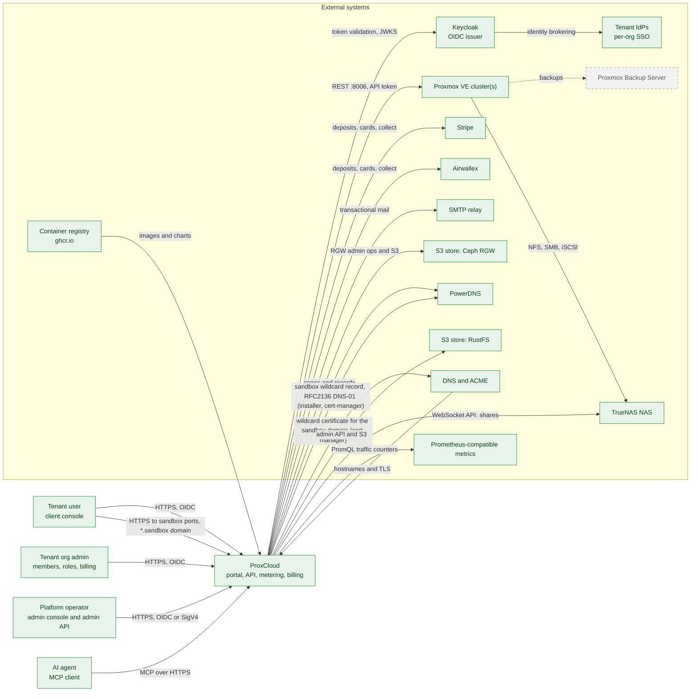

# C1: System context

ProxCloud is a multi-tenant private-cloud portal and billing system for Proxmox
VE. Tenants sign up, organize into organizations and projects, and provision
servers, networks, volumes, public IPs and buckets; ProxCloud meters that usage,
rates it against price plans, bills it and collects payment. Operators configure
providers, price plans and quotas.

Status legend and maintenance rule: [README.md](README.md).

## Actors

| Actor | Interaction with ProxCloud | Status |
|---|---|---|
| Tenant user | Uses the client console (`web/client`): servers, networks, security groups, volumes, public IPs, images, buckets, bills and payments. Signs in through Keycloak (OIDC, PKCE). | Implemented |
| Tenant user, per-org SSO login | Email-first login that redirects to the organization's own IdP through Keycloak. | Implemented |
| Tenant org admin | Manages organization members, custom roles, project members and invites, billing profiles. Members are matched by an IdP-verified email only. | Implemented |
| Tenant org admin, SSO self-service | Configures the organization's OIDC/SAML IdP, verified domains and group-to-role mapping. | Implemented |
| Platform operator | Uses the admin console (`web/admin`) and the admin routes under `/api/v1/admin/**`; automates through the public admin API `/admin-api/v1` (AWS SigV4 keys or the admin-api realm). Configures Proxmox providers, flavors, price plans, quotas, integrations. | Implemented |
| Platform operator, installer | One-command install, add-node and upgrade of the whole stack. | Implemented |
| Tenant user, sandbox ports | Reaches a port inside a running sandbox at `https://<port>-<sandboxId>.<sandbox domain>`: the platform's entry appliance passes TCP 443 to `sandbox-proxy`, where TLS ends; a sandbox created with `allowPublicTraffic: false` wants its traffic token. | Implemented |
| AI agent | Calls `/mcp` with the client toolset (customer realm token or personal access key) or the admin toolset (admin realm token or SigV4 key). Tools dispatch in-process through the same router as the HTTP API. | Implemented |

## External systems

| System | Interaction | Status |
|---|---|---|
| Proxmox VE cluster(s) | REST API on `:8006` with a least-privilege API token (see [proxmox-permissions.md](../../proxmox-permissions.md)). ProxCloud drives pools, full clones, VM config, SDN zones/vnets/subnets, the cluster and VM firewall, storage and PCI (GPU) mappings, and reads tasks and cluster resources. | Implemented |
| Proxmox Backup Server | Scheduled VM backups and tenant restore. | Planned |
| Keycloak | OIDC issuer with one realm per audience (customer, admin, admin API). ProxCloud is a resource server: it validates bearer tokens against the realm JWKS and reads `sub`, `email`, `email_verified`, `azp`. The chart can bundle Keycloak or point at an external one. | Implemented |
| Tenant IdPs | Per-organization OIDC/SAML IdPs brokered through Keycloak. | Implemented |
| Stripe | Deposits, saved cards, off-session collect, refunds. | Implemented |
| Airwallex | Second card gateway, chosen per integration. Deposits and saved cards through the browser Elements SDK, off-session collect, refunds. | Implemented |
| SMTP relay | Bills, reminders, invites, suspension notices. | Implemented |
| S3 store: Ceph RGW | Tenant buckets on sites with Ceph: RGW Admin Ops for per-project users, keys and quotas, S3 for bucket and object operations. | Implemented |
| S3 store: RustFS | Tenant buckets and internal backups on sites without Ceph. | Implemented |
| TrueNAS NAS | Capacity storage for Proxmox (NFS, SMB, iSCSI) and tenant file shares created through the TrueNAS WebSocket API. | Implemented (iSCSI not used) |
| Prometheus-compatible metrics | Optional per-provider source for per-VM network traffic counters, used to bill traffic. Proxmox providers default to their own public-NIC counters instead. | Implemented |
| DNS and ACME | Hostnames and TLS certificates for the portal, the API and Keycloak, provided by the hosting cluster (the chart renders the routes, not the certificates). The sandbox domain's wildcard certificate comes from an ACME CA through cert-manager on the services cluster (or a Secret the operator provides). | Implemented |
| PowerDNS Authoritative | Tenant DNS zones and records over its HTTP API, owned through the zone's account field. The sandbox domain's zone: installer stage 56 writes its wildcard record and a TSIG key that may update that zone alone, which cert-manager on the services cluster uses for the DNS-01 challenge (RFC2136). | Implemented |
| DNS TXT verification | Domain ownership checks for per-org SSO (`_proxcloud-challenge.<domain>`). | Implemented |
| Container registry (ghcr.io) | CI publishes the `proxcloud-api`, `proxcloud-web`, `proxcloud-admin` and `proxcloud-sandbox-proxy` images, the built-in sandbox template images (`sandbox-*`, digests pinned in `deploy/templates/images.yaml`) and the Helm charts; deployments pull from it. The sandbox nodes do not: the installer copies their images into the platform's sandbox registry. | Implemented |
| VM template pipelines | Image builds that publish OS and Kubernetes node templates into Proxmox. | Planned |
