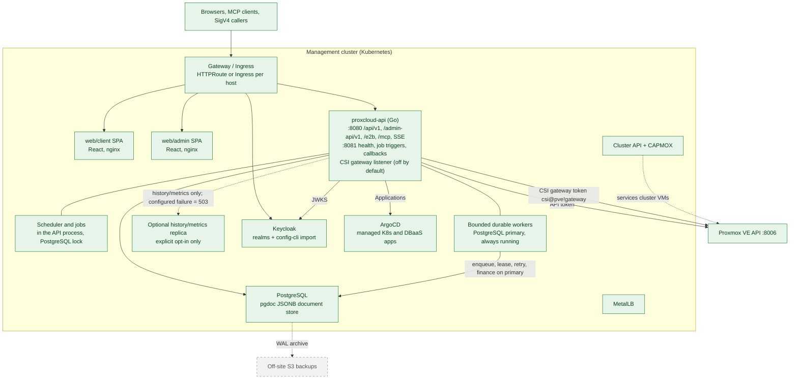
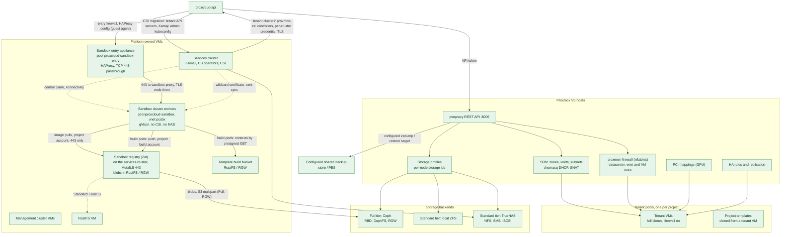
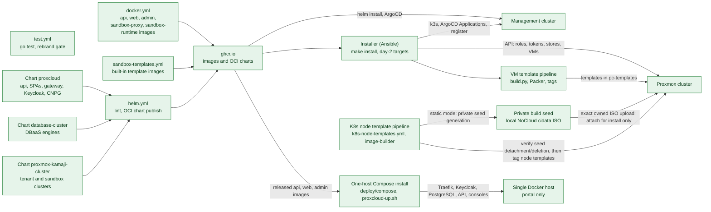

# C2: Containers

ProxCloud spans three zones: the **management cluster** (a Kubernetes cluster that
runs the portal), the **Proxmox cluster** (the hosts, the platform-owned VMs and
the tenant VMs), and **build and delivery** (CI, registry, charts). Storage comes in
two tiers, described at the end.

Status legend and maintenance rule: [README.md](README.md).

## C2a. Management cluster

ArgoCD is not deployed by the ProxCloud chart. The managed Kubernetes and DBaaS
providers expect an ArgoCD instance on a management cluster and write
`Application` objects to it (see [managed-k8s.md](../../managed-k8s.md) and
[managed-dbaas.md](../../managed-dbaas.md)). In split mode the installer builds that
management cluster, the services cluster, as VMs through Cluster API.

The API and durable workers always use the **writable primary** (`-rw` for CNPG).
The optional reader is for history/metrics only; empty means primary fallback,
configured failure means 503 for those reads. It is never a queue/finance endpoint.
Mail keeps its existing SMTP path until the separate durable outbox is wired.
Existing deployments follow the [drain/reconcile and retain runbook](../../postgres-jobs-migration.md):
Helm needs a prior stored retained manifest, Argo needs live `Prune=false,Delete=false`;
new defaults alone do not protect a historical broker/PVC.

### API surfaces

All surfaces are served by the single `proxcloud-api` binary (`cmd/api/main.go`,
router in `internal/server/server.go`).

| Surface | Port | Auth | Purpose | Status |
|---|---|---|---|---|
| `/api/v1/**` | 8080 | OIDC bearer (customer or admin realm) or personal access key `pk.sk` | Customer API, plus the operator routes under `/api/v1/admin/**` (admin realm, permission-gated) | Implemented |
| `/admin-api/v1/**` | 8080 | AWS SigV4 (`hmac_keys`) or the admin-api realm | Public admin API for automation | Implemented |
| `/mcp` + `/.well-known/oauth-protected-resource` | 8080 | OIDC bearer (RFC 9728 discovery) or a `pk.sk` API key | MCP server; tools dispatch in-process through the app router | Implemented |
| `/api/v1/events/{projectId}` | 8080 | OIDC bearer (a short-lived stream token is not built yet) | Server-sent events per project | Implemented |
| `/openapi.json` | 8080 | public | Stub document | Implemented |
| `/actuator/health*`, `/__build` | 8081 | none; not routed by the chart's gateway or ingress | Liveness, readiness, build info | Implemented |
| `POST /debug/<job>` | 8081 | none; not routed by the chart's gateway or ingress | Manual job triggers (with the scheduler or debug triggers on; `gen-hmac-key` with debug triggers only) | Implemented |
| Billing service callbacks | 8081 | shared token | Suspend/resume and mail callbacks from an external billing service | Implemented |
| CSI gateway `/api2/json/**` | `PROXCLOUD_CSI_GATEWAY_ADDR` (TLS only; off when empty) | per-cluster credential `csi@proxcloud!<clusterId>`, only its SHA-256 stored | The PVE calls a tenant cluster's proxmox-csi controller may make, each checked for ownership, sent on with one gateway token. Called by the proxmox-csi controllers of new tenant clusters, which run on the services cluster (`PROXCLOUD_CSI_GATEWAY_URL`); only the services nodes reach the port (chart NetworkPolicy) | Implemented |
| `/e2b/**` | 8080 | a project's `e2b_` sandbox API key (`X-API-Key` or bearer), only its SHA-256 stored | E2B-compatible sandbox API ([e2b-compat.md](../../e2b-compat.md)) | Implemented |
| `/api/v1/internal/sandboxes/**` | 8080 | the sandbox provider's `proxyWakeToken` | sandbox-proxy's wake call for a paused sandbox | Implemented |
| `/api/v1/nocloud/**` | 8080 | the per-VM seed token in the path | cloud-init seeds of servers | Implemented |
| `/api/v1/console/**` | 8080 | the console token in the path | VNC console WebSocket proxy | Implemented |
| SSO discovery and per-org SSO routes (`/api/v1/auth/sso/discover`, `/api/v1/organizations/{id}/sso`, `/api/v1/admin/sso`) | 8080 | public / OIDC | Email-first login, SSO self-service, operator stop | Implemented |

## C2b. Proxmox cluster and storage tiers

| Element | What ProxCloud does with it | Status |
|---|---|---|
| Project pool (`<poolPrefix><projectId>`, default prefix `pc-`) | Created at project bootstrap; every tenant VM and template lives in it; sync and teardown are scoped to it. | Implemented |
| Tenant VMs | Full clones of an admin template or a project template; flavor, cloud-init, tags; firewall on before first boot. User-data, vendor-data and instance metadata arrive by a platform NoCloud seed: a per-VM token URL on the API on a vnet with DHCP, a `cidata` CD otherwise. | Implemented |
| SDN zones and vnets | One vnet per tenant network, ownership alias `st:<projectId>:<name>`. Isolation mode `shared` (one zone) or `evpn-per-project` (one EVPN zone per project); the cluster firewall rule set separates tenants in both. | Implemented |
| proxmox-firewall | Cluster isolation rules (reconciled every sync), per-VM anti-spoof (ipfilter, macfilter), security groups as cluster firewall groups. Test connection refuses a cluster with the datacenter firewall off or a node on the legacy iptables firewall. | Implemented |
| Load balancers | HAProxy on a platform-owned VM in the project's pool, one NIC on a project network, one on a public network; config pushed through the guest agent, so the API talks to the guest only through PVE. | Implemented |
| Public networks | Admin-designated bridges with an IPv4 pool; a public NIC (`net1`) gets one address, pinned by ipfilter. The management bridge is refused. | Implemented |
| PCI mappings | GPU flavors reserve concrete mappings on the scheduled node. | Implemented |
| HA rules and replication | Protected VMs with replication and node-affinity rules. | Implemented |
| Platform-owned VMs | Management cluster VMs and the RustFS VM in a dedicated system pool, the platform token has `NoAccess` there. | Implemented |
| Services cluster VMs | The services cluster, in the same system pool. | Implemented |
| Sandbox cluster | A platform-owned Kamaji cluster from the cluster chart: control plane on the services cluster, workers in pool `proxcloud-sandbox` on their own vnet, gVisor (`runsc`, systrap, `allow-suid` on by default so `sudo` works as on E2B) for tenant code, a Cilium egress guardrail, no CSI token and no NAS dataset. Its CAPMOX token `capmox@pve!sandbox` sees only a node-local ISO store. Its `node-setup` DaemonSet installs E2B's envd and `sandbox-init` on every node (runtime image `proxcloud-sandbox-runtime`), so a provider with envd on and a sandbox domain runs envd as each sandbox's agent (SB5). Tenants reach it only through the portal: the native API (SB3) and the E2B-compatible API at `/e2b` with a project's sandbox API key (SB5); the portal creates, execs into, reads the logs of and deletes Sandbox CRs with its service account, bills them per minute and refuses all new usage while a release gate does not hold, on both APIs alike. Release gates: isolation drops for the sandbox CIDR in both directions (in place, `sandboxCidrs`), NodeRestriction on its control plane (checked by stage 55), single-stack IPv4 (checked by stage 55), per-NIC VM firewall with address pinning and the `unsecured` taint until it is in place (in place, kept by the portal's sync with a narrow `ProxCloudSandboxGuard` role on the pool). Egress leaves through its own SNAT address on the exit node (`sandbox.network.snat`). The portal checks NodeRestriction, the isolation drops and the fence itself before a sandbox provider goes live and again before each create ([managed-sandbox.md §3](../../managed-sandbox.md#3-tenant-api-billing-quota-suspension-and-release-gates-sb3)). Built by installer stage 55 from `deploy/sandbox-cluster/`, with a `sandbox-system` node group (CAPI-set label, tainted) where `sandbox-proxy` runs apart from tenant code when a sandbox domain is set; stage 60 registers its sandbox provider `DISABLED` for the operator to set live once the gates hold. | Implemented |
| Sandbox entry | Sandbox ports at `https://<port>-<id>.<domain>` (SB4): a platform HAProxy appliance (the P8-1 appliance with one TCP listener) in its own pool, one NIC public and one on the sandbox vnet, passes 443 to `sandbox-proxy`'s MetalLB address; TLS ends in `sandbox-proxy` with a wildcard certificate cert-manager issues on the services cluster (DNS-01 through PowerDNS with a TSIG key limited to the sandbox zone, or the operator's Secret) and `cert-sync` copies across. The workers' VM firewall admits the appliance alone to that address. Installer stage 56 builds it; the portal's sync keeps the appliance's firewall and HAProxy config ([managed-sandbox.md §4](../../managed-sandbox.md#4-public-entry-tls-and-wake-sb4)). | Implemented |
| Sandbox registry | Zot on the services cluster behind one MetalLB address, TLS from a CA of its own, its blobs in a bucket of the object store (RustFS on Standard, RGW on Full) with a service user limited to that bucket (SB6a). The sandbox nodes pull the built-in templates and `sandbox-proxy` from it (the envd runtime image of SB5 still comes from `images.registry`), each project with an account of its own that reads `library/**` and its own `t/<project>/**` only; template builds push with a per-project build account that writes only its own `t/<project>/**` (SB6b), and the portal can inspect/dry-run unreferenced candidates with its `gc` credential; both real manifest deletion paths are currently held, so the credential is not an automatic pruning authorization. An account sync next to Zot (`sandbox-proxy registry-users`) derives the accounts from the sandbox cluster's tenant namespaces. Installer stage 55 (registry) copies the digest-pinned images of `deploy/templates/images.yaml` in and pre-pulls them on every node; the workers' VM firewall admits that one address and port ([managed-sandbox.md §6](../../managed-sandbox.md#6-the-sandbox-registry-sb6a)). | Implemented |
| Template build bucket | A bucket of the same object store as the registry's blobs, its own service user (SB6b). The portal streams E2B build contexts into it (multipart, `UNSIGNED-PAYLOAD`); build pods on the sandbox workers fetch them with presigned GETs, so the workers' VM firewall and the build namespace's policy admit its one endpoint ([managed-sandbox.md §7](../../managed-sandbox.md#7-custom-templates-sb6b)). | Implemented |
| Shared backup storage / PBS | Owned vzdump archives, guarded tenant restore/delete and configured backup-store selection exist; automatic PBS provisioning and universal schedule/storage acceptance are not implied. | Implemented integration; site prerequisites required |

### Storage tiers

| Tier | Backend | Used for | Status |
|---|---|---|---|
| Full | Ceph RBD / CephFS as Proxmox storage | VM disks on Ceph sites (referenced through storage profiles) | Implemented |
| Full | Ceph RGW | Tenant buckets: per-project RGW user, keys, quotas, bucket settings | Implemented |
| Standard | Local ZFS (`zfspool`) | VM disks, pinned to the node holding the storage | Implemented |
| Standard | TrueNAS NFS as a capacity-class profile ("Capacity HDD (NFS)") | Bulk data volumes only: no boot disks, databases or snapshots (API-enforced) | Implemented |
| Standard | TrueNAS NFS and SMB tenant file shares, NAS-created stores for templates and backups | `SHARE` product through the WebSocket API; datasets `nas-templates`, `nas-backup` | Implemented |
| Standard | TrueNAS NFS dataset per tenant cluster, csi-driver-nfs | Kubernetes RWX (`shared-file` class) | Implemented |
| Standard | Shared LVM on a TrueNAS iSCSI LUN | Boot-capable shared profile, no snapshots (site setup, no code) | Implemented |
| Standard | TrueNAS storage plugin, multipath, LINSTOR, democratic-csi iSCSI | Other shared block | Planned |
| Standard | RustFS | Internal bucket store on sites without Ceph, deployed by the installer | Implemented |
| Standard | RustFS tenant buckets | Bucket product on sites without Ceph | Implemented |
| Both | Admin-declared profile flags (`shared`, `snapshots`, `thin`, `liveMigrate`, `replication`), validated on save against detection | Shown to tenants as volume-type specs | Implemented |
| Both | Per-storage capability detection (type table: tier, default class, flags; per-node active/avail) + admin class override | Provider Storage tab; profile validation; scheduler node restriction and free-space filter; template placement | Implemented |
| Both | Profile `tier` / `class` (derived from its storages) and `bootDisk` / `dbaas` caps, API-gated | Capacity class refuses boot disks (create, retype), server snapshots with an attached capacity disk, and database storage classes named after it; volume billing attributes `profile` and `storage_class` | Implemented |
| Both | HA / replication gating per profile | Protected add-on | Implemented |

A storage profile is a slug mapped to a storage id per node (or `*`) plus
capability flags that may only be a subset of what the detected storage supports.
The scheduler restricts placement to the nodes where the profile's storage is
currently active (`*` = every such node) and skips a node whose profile storage
would drop below `config.storageHeadroomPct` (default 10 %) free after the disk;
a data-volume create checks the same on the server's node. PVE clones to another
node only from shared to shared storage: a template whose volumes all sit on
shared storage (NFS, RBD, CephFS) is full-cloned to a picked node whose profile
storage is shared too; a local template or a local profile is created on the
template's own node only, and a profile not active on that node answers 409. A
detached volume on local storage attaches only to a server on its VM's node (PVE's
disk reassign needs one node, even on shared storage). On shared storage it attaches
to any server on a node where that storage is active: the disk rides a new holder VM (a
carrier, which nothing else may use), which migrates offline without copying data, and
is reassigned on the target's node. `LIST_ATTACH_TARGETS` lists the eligible servers;
anything else is 409. Retype moves the disk to another
profile's storage on the same node (`move_disk`, source deleted); the volume row is
marked moving for the copy, so a sync that sees the new volid first keeps the row, and
the row then follows the disk and keeps its id. The wait and the follow outlive the
request, and a sync leaves a row alone that took its new volid after the sync listed. A retype of a row still marked moving answers 409. A detached volume can be deleted on its
own. PVE has no name for a disk: the name a tenant gives a volume is the row's
(`data.volume.label`), and a sync carries it over. A profile's class is the lowest effective class
of its storages (admin override, else detected); a capacity-class profile never
takes boot disks, managed databases or snapshots, whatever it claims, and a save
that claims them is refused. Each volume row carries its own profile and storage
class, so price rules can filter on them.

## C2c. Build and delivery

The one-host Compose install (`deploy/compose`) runs the same released API and console
images on a single Docker host behind Traefik, with Keycloak and PostgreSQL next to them.
It carries the portal only: no management cluster, no ArgoCD and no managed services.
Its Keycloak realm files are generated from the chart's realm templates and a test keeps
them equal.

Both SPA images normalize only nginx's public document root to 0755 directories
and 0644 files; the entrypoint also sets generated `config.js` to 0644 so nginx
workers can serve public assets regardless of checkout or runtime umask.

The Kubernetes template workflow's static build mode delivers a private local
NoCloud `cidata` ISO, not an HTTP seed that depends on a first DHCP lease. Its
network configuration applies to both the live installer and installed build
system, with an explicit Packer SSH address. This seed crosses the runner-to-PVE
storage boundary with temporary build credentials and topology: never publish it
as an artifact or serve it from a public listener. Final guest sanitization and
seed media detachment/deletion precede template publication. Failure or forced
termination is not evidence of cleanup; private per-run state records the exact
owned seed volume for reviewed recovery without indiscriminate deletion. Static
mode refuses same-name existing templates rather than treating NIC removal as
proof of in-guest sanitization. The existing DHCP mode remains an explicit
alternative, not a reason to enable a competing host DHCP server. This delivery
path is covered by synthetic tests; full ISO boot/reboot acceptance remains a
separate controlled canary.

## Container table

| Container | Technology | Runs where | Status |
|---|---|---|---|
| `web/client` | React, Vite, TypeScript, OIDC PKCE; served by nginx (`web/Dockerfile`) | Management cluster | Implemented |
| `web/admin` | React, Vite, TypeScript; served by nginx | Management cluster | Implemented |
| `proxcloud-api` | Go, chi router, one binary (`cmd/api`) | Management cluster | Implemented |
| Scheduler and durable workers | Cron producers require `PROXCLOUD_JOBS_SCHEDULER_ENABLED`; bounded durable workers always start, including with scheduler/debug off. Owner+epoch and DB-time CAS fence native per-profile billing attempts | Inside every API pod | Implemented (engine/billing; mail outbox follow-up) |
| PostgreSQL | JSONB document store via `internal/pgdoc`; CloudNativePG cluster (default), bundled subchart, or external. A chart hook Job (`seed`) writes the platform and billing configuration into empty tables on install and upgrade | Management cluster | Implemented |
| Legacy RabbitMQ | Not connected to the API or readiness. Default absent; explicit migration-only retain with Helm keep + Argo prune/delete protection. Drain/reconcile and snapshots required **before** omission; no PVC cleanup | Historical management-cluster resource only | Deprecated, retained for recovery |
| Keycloak | codecentric keycloakx subchart + keycloak-config-cli realm import, or an external issuer. The API manages per-org identity providers through the Admin API with the `proxcloud-idp-admin` service account | Management cluster | Implemented |
| Gateway / Ingress | Gateway API `HTTPRoute` or `Ingress` per host (`deploy/charts/proxcloud/templates/gateway`, `api`, `web`) | Management cluster | Implemented |
| ArgoCD | Reconciles the platform (installer `Application` objects with inline values); receives `Application` objects for managed K8s and DBaaS | Management cluster (deployed by the installer, not the chart) | Implemented |
| Cluster API + CAPMOX, MetalLB | Services cluster and tenant K8s workers on Proxmox, load-balancer IPs | Management and services clusters | Implemented |
| Services cluster | Kamaji, DB operators, proxmox-csi (its own, and the controller of each new tenant cluster, against the CSI gateway), csi-driver-nfs | VMs in a system pool | Implemented, without csi-driver-nfs |
| Proxmox VE hosts | pveproxy, SDN, proxmox-firewall (nftables), storage, PCI mappings | Proxmox cluster | Implemented |
| Tenant VMs | QEMU full clones in the project pool | Proxmox cluster | Implemented |
| HA rules and replication | `ha-manager` rules, `pvesr` | Proxmox cluster | Implemented |
| Ceph (Full tier) | RBD/CephFS for disks, RGW for buckets | Ceph cluster | Implemented |
| TrueNAS (Standard tier) | NFS, SMB, iSCSI, WebSocket API | Appliance outside the Proxmox cluster | Implemented |
| RustFS (Standard tier) | S3 + admin API, deployed by the installer with internal buckets; also serves tenant buckets (provider `rustfs`, registered by the installer) | VM in the system pool, or TrueNAS app | Implemented |
| Configured shared backup store / PBS | PVE vzdump/restore target; guarded archive operations in the API, no automatic PBS appliance installation | Operator-provided storage | Implemented integration; site acceptance required |
| Helm chart `proxcloud` | `deploy/charts/proxcloud` | ghcr OCI | Implemented |
| Helm chart `database-cluster` | `deploy/charts/database-cluster` | ghcr OCI | Implemented |
| Helm chart `proxmox-kamaji-cluster` | `deploy/charts/proxmox-kamaji-cluster` (tag `proxmox-kamaji-cluster-v*`) | ghcr OCI | Implemented |
| CI | GitHub Actions `test.yml`, `docker.yml` (api, web, admin, sandbox-proxy, sandbox-runtime), `helm.yml`, `sandbox-templates.yml`, and the self-hosted `vm-templates.yml` and `k8s-node-templates.yml` | GitHub | Implemented |
| Installer | Ansible playbooks and Makefile (`installer/`): allinone, split service stages and day-2 targets exist; published-artifact fresh install and current full split acceptance remain separate | Operator workstation | Implemented code; do not infer production acceptance |
| VM template pipeline | `images/build.py` + Packer, `vm-templates.yml`; tag-published, one copy per node on local-disk sites | Self-hosted runner in the Proxmox network, or the installer from the first management host | Implemented |
| K8s node template pipeline | image-builder; static NoCloud seed ISO or explicit DHCP mode | Self-hosted runner with PVE API and build-guest SSH access; no guest-to-runner HTTP needed in static mode | Implemented; static ISO runtime acceptance pending |

The implemented sandbox components above do not enable managed saved lifecycle:
[saved-runtime admission](../../saved-runtime-admission.md) keeps pause/resume,
paused wake/connect, fork and AutoPause/AutoResume held. Registry dry-run metadata
also does not authorize real manifest deletion. Consult those explicit safety
boundaries rather than an unqualified `Implemented` component label.

## Trust boundaries

| Boundary | Credential / control | Status |
|---|---|---|
| Browser or agent to API | OIDC bearer JWT validated per realm (`azp` bound), or `pk.sk` personal access key | Implemented |
| Automation to admin API | AWS SigV4 with `hmac_keys`, or the admin-api realm | Implemented |
| E2B SDK to `/e2b` | A project's `e2b_` sandbox API key (SHA-256 stored); its creator's project rights are checked on every call | Implemented |
| sandbox-proxy to the wake endpoint | The sandbox provider's `proxyWakeToken` (bearer) | Implemented |
| A VM or a browser console to `/api/v1/nocloud/`, `/api/v1/console/` | A per-VM seed token or a console token in the path | Implemented |
| Management port `:8081` | On the cluster Service only, never on the gateway or ingress. Billing callbacks are mounted only when a shared token is configured | Implemented |
| API to Proxmox | Privilege-separated API token with the `ProxCloudPlatform` role; test connection warns on missing privileges and on `root@pam` | Implemented |
| Tenant to tenant on the SDN | Cluster firewall rules (forward and input DROP inside the CIDR pool, per-project ACCEPT), reconciled every sync; non-overlapping CIDRs; optional per-project EVPN zone | Implemented |
| Tenant VM to the network | VM firewall `policy_in DROP`, ipfilter/macfilter anti-spoof, security groups | Implemented |
| Public NIC to management network | Public networks on the management bridge are refused at test connection and at attach. What the uplink itself routes is filtered at the operator's edge | Implemented |
| Identity matching by email | Only IdP-verified emails resolve to a user for add-member and invites | Implemented |
| Tenant IdP to customer realm | Keycloak brokering; a guard on every API request holds the IdP to its verified domains and its own accounts; enforced SSO | Implemented |
