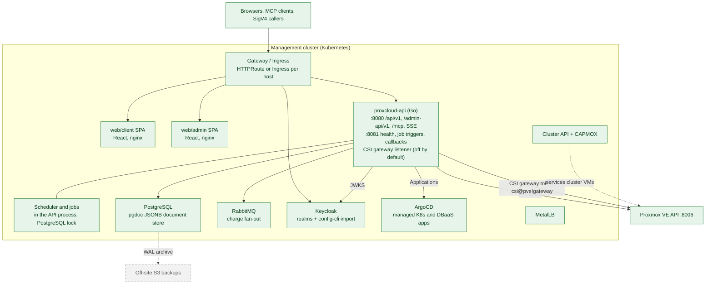
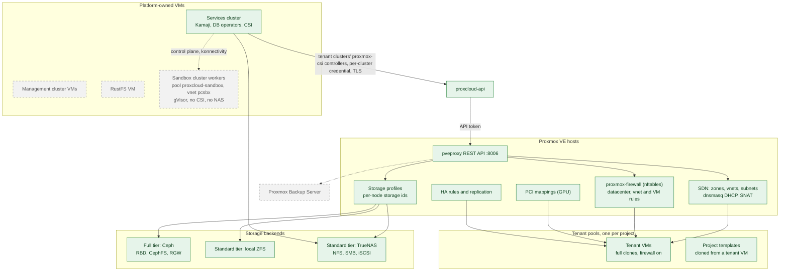
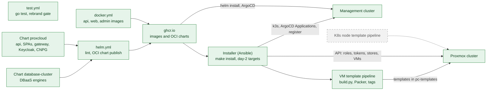

# C2: Containers

ProxCloud spans three zones: the **management cluster** (a Kubernetes cluster that
runs the portal), the **Proxmox cluster** (the hosts, the platform-owned VMs and
the tenant VMs), and **build and delivery** (CI, registry, charts). Storage comes in
two tiers, described at the end.

Status legend and maintenance rule: [README.md](README.md).

## C2a. Management cluster

ArgoCD is not deployed by the ProxCloud chart. The managed Kubernetes and DBaaS
providers expect an ArgoCD instance on a management cluster and write
`Application` objects to it (see [managed-k8s.md](../../managed-k8s.md) and
[managed-dbaas.md](../../managed-dbaas.md)). In split mode the installer builds that
management cluster, the services cluster, as VMs through Cluster API.

### API surfaces

All surfaces are served by the single `proxcloud-api` binary (`cmd/api/main.go`,
router in `internal/server/server.go`).

| Surface | Port | Auth | Purpose | Status |
|---|---|---|---|---|
| `/api/v1/**` | 8080 | OIDC bearer (customer or admin realm) or personal access key `pk.sk` | Customer API, plus the operator routes under `/api/v1/admin/**` (admin realm, permission-gated) | Implemented |
| `/admin-api/v1/**` | 8080 | AWS SigV4 (`hmac_keys`) or the admin-api realm | Public admin API for automation | Implemented |
| `/mcp` + `/.well-known/oauth-protected-resource` | 8080 | OIDC bearer (RFC 9728 discovery) or a `pk.sk` API key | MCP server; tools dispatch in-process through the app router | Implemented |
| `/api/v1/events/{projectId}` | 8080 | OIDC bearer (a short-lived stream token is not built yet) | Server-sent events per project | Implemented |
| `/openapi.json` | 8080 | public | Stub document | Implemented |
| `/actuator/health*`, `/__build` | 8081 | none; not routed by the chart's gateway or ingress | Liveness, readiness, build info | Implemented |
| `POST /debug/<job>` | 8081 | none; not routed by the chart's gateway or ingress | Manual job triggers (when the scheduler is enabled) | Implemented |
| Billing service callbacks | 8081 | shared token | Suspend/resume and mail callbacks from an external billing service | Implemented |
| CSI gateway `/api2/json/**` | `PROXCLOUD_CSI_GATEWAY_ADDR` (TLS only; off when empty) | per-cluster credential `csi@proxcloud!<clusterId>`, only its SHA-256 stored | The PVE calls a tenant cluster's proxmox-csi controller may make, each checked for ownership, sent on with one gateway token. Called by the proxmox-csi controllers of new tenant clusters, which run on the services cluster (`PROXCLOUD_CSI_GATEWAY_URL`); only the services nodes reach the port (chart NetworkPolicy) | Implemented |
| SSO discovery and per-org SSO routes (`/api/v1/auth/sso/discover`, `/api/v1/organizations/{id}/sso`, `/api/v1/admin/sso`) | 8080 | public / OIDC | Email-first login, SSO self-service, operator stop | Implemented |

## C2b. Proxmox cluster and storage tiers

| Element | What ProxCloud does with it | Status |
|---|---|---|
| Project pool (`<poolPrefix><projectId>`, default prefix `pc-`) | Created at project bootstrap; every tenant VM and template lives in it; sync and teardown are scoped to it. | Implemented |
| Tenant VMs | Full clones of an admin template or a project template; flavor, cloud-init, tags; firewall on before first boot. User-data, vendor-data and instance metadata arrive by a platform NoCloud seed: a per-VM token URL on the API on a vnet with DHCP, a `cidata` CD otherwise. | Implemented |
| SDN zones and vnets | One vnet per tenant network, ownership alias `st:<projectId>:<name>`. Isolation mode `shared` (one zone) or `evpn-per-project` (one EVPN zone per project); the cluster firewall rule set separates tenants in both. | Implemented |
| proxmox-firewall | Cluster isolation rules (reconciled every sync), per-VM anti-spoof (ipfilter, macfilter), security groups as cluster firewall groups. Test connection refuses a cluster with the datacenter firewall off or a node on the legacy iptables firewall. | Implemented |
| Load balancers | HAProxy on a platform-owned VM in the project's pool, one NIC on a project network, one on a public network; config pushed through the guest agent, so the API talks to the guest only through PVE. | Implemented |
| Public networks | Admin-designated bridges with an IPv4 pool; a public NIC (`net1`) gets one address, pinned by ipfilter. The management bridge is refused. | Implemented |
| PCI mappings | GPU flavors reserve concrete mappings on the scheduled node. | Implemented |
| HA rules and replication | Protected VMs with replication and node-affinity rules. | Implemented |
| Platform-owned VMs | Management cluster VMs and the RustFS VM in a dedicated system pool, the platform token has `NoAccess` there. | Implemented |
| Services cluster VMs | The services cluster, in the same system pool. | Implemented |
| Sandbox cluster | A platform-owned Kamaji cluster from the cluster chart: control plane on the services cluster, workers in pool `proxcloud-sandbox` on their own vnet, gVisor (`runsc`, systrap) for tenant code, a Cilium egress guardrail, no CSI token and no NAS dataset. Its CAPMOX token `capmox@pve!sandbox` sees only a node-local ISO store. Built by installer stage 55 from `deploy/sandbox-cluster/`; nothing routes tenants to it yet. Release gates: isolation drops for the sandbox CIDR in both directions (in place, `sandboxCidrs`), NodeRestriction on its control plane (checked by stage 55), single-stack IPv4 (checked by stage 55), per-NIC VM firewall (SB2b, missing). Spike and SB2a results: [managed-sandbox.md](../../managed-sandbox.md). | Planned |
| Proxmox Backup Server | Operator nightly backups, then tenant backup schedules and restore. | Planned |

### Storage tiers

| Tier | Backend | Used for | Status |
|---|---|---|---|
| Full | Ceph RBD / CephFS as Proxmox storage | VM disks on Ceph sites (referenced through storage profiles) | Implemented |
| Full | Ceph RGW | Tenant buckets: per-project RGW user, keys, quotas, bucket settings | Implemented |
| Standard | Local ZFS (`zfspool`) | VM disks, pinned to the node holding the storage | Implemented |
| Standard | TrueNAS NFS as a capacity-class profile ("Capacity HDD (NFS)") | Bulk data volumes only: no boot disks, databases or snapshots (API-enforced) | Implemented |
| Standard | TrueNAS NFS and SMB tenant file shares, NAS-created stores for templates and backups | `SHARE` product through the WebSocket API; datasets `nas-templates`, `nas-backup` | Implemented |
| Standard | TrueNAS NFS dataset per tenant cluster, csi-driver-nfs | Kubernetes RWX (`shared-file` class) | Implemented |
| Standard | Shared LVM on a TrueNAS iSCSI LUN | Boot-capable shared profile, no snapshots (site setup, no code) | Implemented |
| Standard | TrueNAS storage plugin, multipath, LINSTOR, democratic-csi iSCSI | Other shared block | Planned |
| Standard | RustFS | Internal bucket store on sites without Ceph, deployed by the installer | Implemented |
| Standard | RustFS tenant buckets | Bucket product on sites without Ceph | Implemented |
| Both | Admin-declared profile flags (`shared`, `snapshots`, `thin`, `liveMigrate`, `replication`), validated on save against detection | Shown to tenants as volume-type specs | Implemented |
| Both | Per-storage capability detection (type table: tier, default class, flags; per-node active/avail) + admin class override | Provider Storage tab; profile validation; scheduler node restriction and free-space filter; template placement | Implemented |
| Both | Profile `tier` / `class` (derived from its storages) and `bootDisk` / `dbaas` caps, API-gated | Capacity class refuses boot disks (create, retype), server snapshots with an attached capacity disk, and database storage classes named after it; volume billing attributes `profile` and `storage_class` | Implemented |
| Both | HA / replication gating per profile | Protected add-on | Implemented |

A storage profile is a slug mapped to a storage id per node (or `*`) plus
capability flags that may only be a subset of what the detected storage supports.
The scheduler restricts placement to the nodes where the profile's storage is
currently active (`*` = every such node) and skips a node whose profile storage
would drop below `config.storageHeadroomPct` (default 10 %) free after the disk;
a data-volume create checks the same on the server's node. PVE clones to another
node only from shared to shared storage: a template whose volumes all sit on
shared storage (NFS, RBD, CephFS) is full-cloned to a picked node whose profile
storage is shared too; a local template or a local profile is created on the
template's own node only, and a profile not active on that node answers 409. A
detached volume on local storage attaches only to a server on its VM's node (PVE's
disk reassign needs one node, even on shared storage). On shared storage it attaches
to any server on a node where that storage is active: the disk rides a new holder VM (a
carrier, which nothing else may use), which migrates offline without copying data, and
is reassigned on the target's node. `LIST_ATTACH_TARGETS` lists the eligible servers;
anything else is 409. Retype moves the disk to another
profile's storage on the same node (`move_disk`, source deleted); the volume row is
marked moving for the copy, so a sync that sees the new volid first keeps the row, and
the row then follows the disk and keeps its id. The wait and the follow outlive the
request, and a sync leaves a row alone that took its new volid after the sync listed. A retype of a row still marked moving answers 409. A detached volume can be deleted on its
own. PVE has no name for a disk: the name a tenant gives a volume is the row's
(`data.volume.label`), and a sync carries it over. A profile's class is the lowest effective class
of its storages (admin override, else detected); a capacity-class profile never
takes boot disks, managed databases or snapshots, whatever it claims, and a save
that claims them is refused. Each volume row carries its own profile and storage
class, so price rules can filter on them.

## C2c. Build and delivery

## Container table

| Container | Technology | Runs where | Status |
|---|---|---|---|
| `web/client` | React, Vite, TypeScript, OIDC PKCE; served by nginx (`web/Dockerfile`) | Management cluster | Implemented |
| `web/admin` | React, Vite, TypeScript; served by nginx | Management cluster | Implemented |
| `proxcloud-api` | Go, chi router, one binary (`cmd/api`) | Management cluster | Implemented |
| Scheduler and jobs | robfig/cron with a PostgreSQL distributed lock (`internal/platform/scheduler`, `lock`); disabled unless `PROXCLOUD_JOBS_SCHEDULER_ENABLED` | Inside the API pod | Implemented |
| PostgreSQL | JSONB document store via `internal/pgdoc`; CloudNativePG cluster (default), bundled subchart, or external | Management cluster | Implemented |
| RabbitMQ | AMQP (`internal/amqp`), optional per-profile charge fan-out; RabbitMQ Cluster Operator (default), bundled subchart, or external | Management cluster | Implemented |
| Keycloak | codecentric keycloakx subchart + keycloak-config-cli realm import, or an external issuer. The API manages per-org identity providers through the Admin API with the `proxcloud-idp-admin` service account | Management cluster | Implemented |
| Gateway / Ingress | Gateway API `HTTPRoute` or `Ingress` per host (`deploy/charts/proxcloud/templates/gateway`, `api`, `web`) | Management cluster | Implemented |
| ArgoCD | Reconciles the platform (installer `Application` objects with inline values); receives `Application` objects for managed K8s and DBaaS | Management cluster (deployed by the installer, not the chart) | Implemented |
| Cluster API + CAPMOX, MetalLB | Services cluster and tenant K8s workers on Proxmox, load-balancer IPs | Management and services clusters | Implemented |
| Services cluster | Kamaji, DB operators, proxmox-csi (its own, and the controller of each new tenant cluster, against the CSI gateway), csi-driver-nfs | VMs in a system pool | Implemented, without csi-driver-nfs |
| Proxmox VE hosts | pveproxy, SDN, proxmox-firewall (nftables), storage, PCI mappings | Proxmox cluster | Implemented |
| Tenant VMs | QEMU full clones in the project pool | Proxmox cluster | Implemented |
| HA rules and replication | `ha-manager` rules, `pvesr` | Proxmox cluster | Implemented |
| Ceph (Full tier) | RBD/CephFS for disks, RGW for buckets | Ceph cluster | Implemented |
| TrueNAS (Standard tier) | NFS, SMB, iSCSI, WebSocket API | Appliance outside the Proxmox cluster | Implemented |
| RustFS (Standard tier) | S3 + admin API, deployed by the installer with internal buckets; also serves tenant buckets (provider `rustfs`, registered by the installer) | VM in the system pool, or TrueNAS app | Implemented |
| Proxmox Backup Server | vzdump target | Separate machine | Planned |
| Helm chart `proxcloud` | `deploy/charts/proxcloud` | ghcr OCI | Implemented |
| Helm chart `database-cluster` | `deploy/charts/database-cluster` | ghcr OCI | Implemented |
| CI | GitHub Actions `test.yml`, `docker.yml`, `helm.yml` | GitHub | Implemented |
| Installer | Ansible playbooks and Makefile (`installer/`): one-shot install, `allinone` mode, day-2 targets; `split` mode is Planned | Operator workstation | Implemented |
| VM template pipeline | `images/build.py` + Packer, `vm-templates.yml`; tag-published, one copy per node on local-disk sites | Self-hosted runner in the Proxmox network, or the installer from the first management host | Implemented |
| K8s node template pipeline | image-builder | Self-hosted runner in the Proxmox network | Implemented, script run by hand |

## Trust boundaries

| Boundary | Credential / control | Status |
|---|---|---|
| Browser or agent to API | OIDC bearer JWT validated per realm (`azp` bound), or `pk.sk` personal access key | Implemented |
| Automation to admin API | AWS SigV4 with `hmac_keys`, or the admin-api realm | Implemented |
| Management port `:8081` | On the cluster Service only, never on the gateway or ingress. Billing callbacks are mounted only when a shared token is configured | Implemented |
| API to Proxmox | Privilege-separated API token with the `ProxCloudPlatform` role; test connection warns on missing privileges and on `root@pam` | Implemented |
| Tenant to tenant on the SDN | Cluster firewall rules (forward and input DROP inside the CIDR pool, per-project ACCEPT), reconciled every sync; non-overlapping CIDRs; optional per-project EVPN zone | Implemented |
| Tenant VM to the network | VM firewall `policy_in DROP`, ipfilter/macfilter anti-spoof, security groups | Implemented |
| Public NIC to management network | Public networks on the management bridge are refused at test connection and at attach. What the uplink itself routes is filtered at the operator's edge | Implemented |
| Identity matching by email | Only IdP-verified emails resolve to a user for add-member and invites | Implemented |
| Tenant IdP to customer realm | Keycloak brokering; a guard on every API request holds the IdP to its verified domains and its own accounts; enforced SSO | Implemented |
