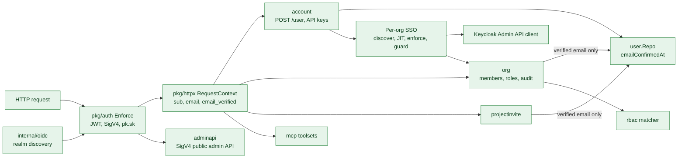
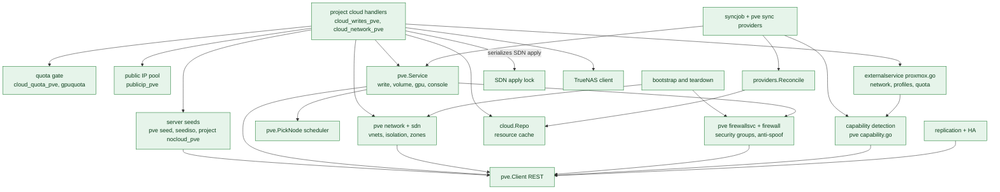
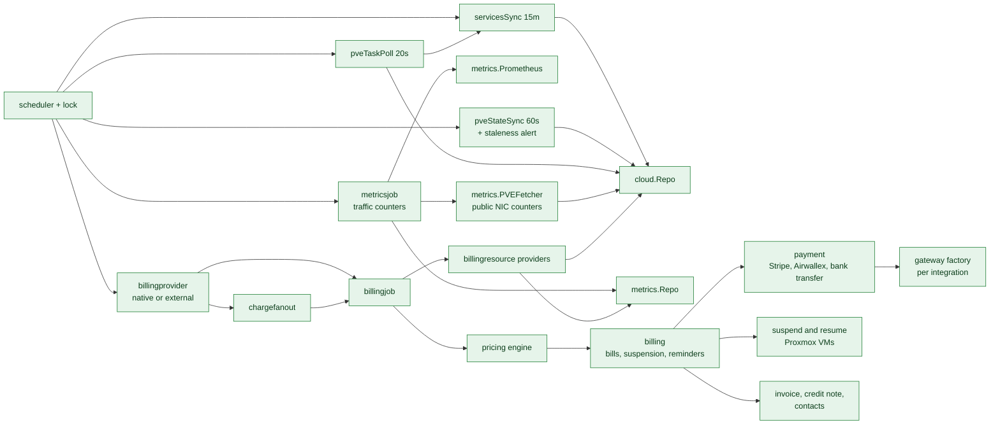
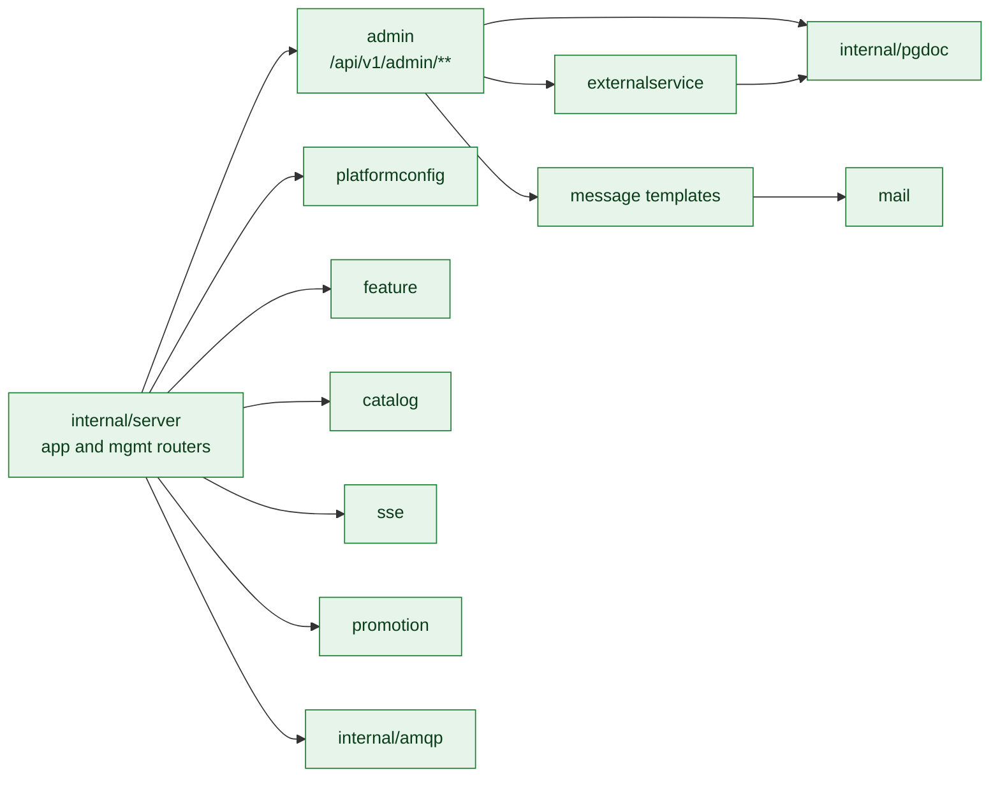
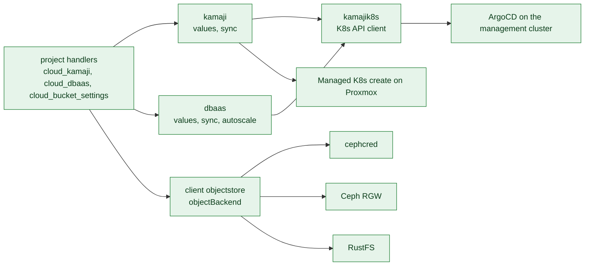

# C3: Components of `proxcloud-api`

The API is one Go binary. Packages follow a handler, service, repository layering
over the PostgreSQL document store ([ADR-0002](../../adr/0002-go-and-layered-architecture.md)).
This page groups the packages by area. Paths are relative to the repository root;
every Implemented path exists on the default branch.

Status legend and maintenance rule: [README.md](README.md).

## C3a. Identity and access

| Component | Path | Responsibility | Status |
|---|---|---|---|
| Authenticator | `pkg/auth/auth.go` (`Enforce`, `verifyJWT`, `claimTrue`), `sigv4.go`, `sigv4sign.go`, `clientkey.go` | Validates OIDC JWTs per realm (bound to `azp`), AWS SigV4 for the admin API, and `pk.sk` personal access keys. Reads `email_verified` (fail closed: absent means false). | Implemented |
| Request context | `pkg/httpx/context.go` | Per-request principal: `Sub`, `Email`, `EmailVerified`, `Issuer`, `Azp`, `SigV4KeyID`. | Implemented |
| OIDC discovery | `internal/oidc/oidc.go` | Discovers the configured realms (customer, admin, admin API). | Implemented |
| Config | `internal/config/config.go` | koanf config: auth realms, ports `8080`/`8081`, `PROXCLOUD_*` env overrides. | Implemented |
| Account | `internal/platform/account/account.go`, `account_apikeys.go`, `dto.go` | `POST /user` creates or refreshes the user from the token claims; personal access keys. | Implemented |
| User | `internal/platform/user/user.go` (`FindVerifiedByEmail`, `EmailVerified`) | User store keyed by `sub`; `emailConfirmedAt` mirrors the IdP's `email_verified` for the current email. | Implemented |
| Organization | `internal/platform/org/` (`handler.go` `addMember`, `role_*.go`, `audit_handler.go`, `billing_handler.go`) | Organizations, members, custom roles, org audit log, billing-profile reads. Add-member resolves only IdP-verified emails. | Implemented |
| Project invites | `internal/platform/projectinvite/projectinvite.go` (`callerEmail`) | Token invites to a project. Invites match the caller only once their email is verified. | Implemented |
| RBAC | `internal/platform/rbac/` (`matcher.go`, `permission.go`, `roles.go`) | Permission kernel for org, project and admin permissions. | Implemented |
| Public admin API | `internal/platform/adminapi/` | `/admin-api/v1`: users, organizations, billing profiles, projects, bills, credits, service providers. | Implemented |
| MCP server | `internal/platform/mcp/` (`mcp.go`, `tools_client.go`, `tools_admin*.go`) | Client and admin toolsets, dispatched in-process through the app router. | Implemented |
| Audit | `internal/platform/audit/`, `pkg/audit/` | Audit events, field-level diffs, cursor paging. | Implemented |
| Per-org SSO | `internal/platform/sso/` (`service.go`, `guard.go`, `kcadmin.go`, `fetch.go`, `repo.go`, `handler.go`) | Org IdP and domain documents, Keycloak Admin API client, DNS TXT verification, email-first discovery, JIT membership. `Guard` runs from `pkg/auth.Enforce` on every request: domain gate, account binding, enforcement, break-glass. | Implemented |

The Keycloak Admin API client also backs the operator console's Create user and Delete user
(`internal/platform/admin/user.go`): same service account, which already holds `manage-users`.

## C3b. Cloud / IaaS on Proxmox

| Component | Path | Responsibility | Status |
|---|---|---|---|
| PVE client (fails over across `apiUrls`, pins the cluster CA) | `internal/cloud/pve/client.go`, `cluster.go`, `qemu.go`, `storage.go`, `sdn.go`, `firewall.go`, `pool.go`, `access.go`, `task.go`, `mapping.go`, `form.go` | Typed REST client: cluster resources, VMs, storage, SDN, cluster/VM firewall, pools, privilege checks, tasks, PCI mappings. Includes the preflight reads `DatacenterFirewallEnabled`, `NodesWithoutNFTables`, `ManagementBridges`. | Implemented |
| PVE service | `internal/cloud/pve/service.go`, `write.go`, `volume.go`, `gpu.go`, `console.go` | Project-scoped IaaS: pools, create/delete/resize/power/rename servers, project templates, volumes (add, extend, detach, attach with cross-node gating and attach targets, retype, delete detached), GPU inventory and slot picking, VNC/serial console. | Implemented |
| Networks and isolation | `internal/cloud/pve/network.go` (`CreateNetwork`, `ReconcileIsolation`, `EnsureProjectZone`, `ZoneIDFor`, `TeardownProjectNetworks`), `sdn.go` | Tenant vnets and subnets, ownership alias, cluster firewall isolation rules, per-project EVPN zones, staged SDN changes and apply. | Implemented |
| Firewall service | `internal/cloud/pve/firewallsvc.go` (`SecureVM`, `SetIPFilter`, `EnsureDefaultSecurityGroup`, `ServerSecurityGroups`, `DeleteProjectSecurityGroups`) | Security groups as cluster firewall groups, the project default group, VM firewall options, per-NIC ipfilter sets. | Implemented |
| Scheduler | `internal/cloud/pve/scheduler.go` (`PickNode`), `capability.go` (`StorageHasRoom`, `TemplateShared`) | Capacity-ranked node choice with CPU overcommit, storage-profile node restriction, free space on the profile's storage (with headroom), template locality and free GPU slots. | Implemented |
| Sync providers | `internal/cloud/pve/syncprovider.go`, `network.go` (`NetworkSyncProvider`), `firewallsvc.go` (`SecurityGroupSyncProvider`) | Map pool VMs, disks, templates, owned vnets and groups to cache rows. | Implemented |
| Reconcile | `internal/cloud/providers/providers.go` (`Reconcile`, `Deletable`), `compare.go`, `niche_sync.go`, `write.go` | Create, update and archive cache rows against the live list. | Implemented |
| Sync job | `internal/cloud/syncjob/job.go` (`syncProxmoxService`, `SyncOne`, `detectProxmoxCapabilities`) | 15-minute sync of every enabled project, plus on-demand single-project sync; each cycle also re-detects every Proxmox provider's storage capabilities. | Implemented |
| Resource cache | `internal/cloud/repo.go`, `resource.go`, `history.go` | The `cloudResource` table and its archive; the source for reads, quota usage and billing. | Implemented |
| Project cloud handlers | `internal/platform/project/cloud_writes.go`, `cloud_writes_pve.go` (`pveCreateServer`, `pveAction`, `pveDeleteResource`), `cloud_reads.go`, `clientcloud.go` | `/project/{id}/cloud` create, delete, actions and reads; Proxmox branch for servers, keypairs, volumes, security groups, images. `/init/{projectId}` returns the menu (minus `hiddenServices`) and per-provider `features` (`cloudFeatures`) that the client uses to hide actions the backend would reject. | Implemented |
| Network handlers | `internal/platform/project/cloud_network_pve.go` (`pveCreateNetwork`, `pveDeleteNetwork`, `pvePickCIDR`, `pvePublicNetworkAction`, `pveTeardownNetworks`) | Network create/delete under the SDN apply lock, CIDR pick, public NIC attach/detach. | Implemented |
| Quota | `internal/platform/project/cloud_quota_pve.go` (`checkPVEQuota`), `cloud_writes_pve.go` (`pveResizeDemand`, `enforcePVEGPUQuota`), `gpuquota.go`, `quota_usage.go` | Platform-side quota for servers, vCPUs, RAM, disk, networks, public IPs and GPUs; fails closed when usage cannot be read. | Implemented |
| Public IP pool | `internal/platform/project/publicip_pve.go` (`PublicIPRepo`, `pickPublicIP`) | Per public network IPv4 pool in the `pvePublicIp` table; the primary key is the race guard. | Implemented |
| Bootstrap | `internal/platform/project/bootstrap.go` (`BootstrapProxmoxOnto`) | Project pool, default security group, provider default quota seeded onto the project. | Implemented |
| Teardown | `internal/platform/project/teardown.go` (`TeardownProject`), `deletion.go` | Destroys pool VMs and the pool, vnets, EVPN zone, security groups, releases public IPs, archives cache rows. | Implemented |
| Provider config | `internal/platform/externalservice/proxmox.go` (`PVENetworkConfig`, `PVEStorageProfiles`, `PVECapabilities`, `PVEStorageClasses`, `PVEDefaultQuota`) | Typed view of a Proxmox provider: API endpoint and token, zones, `cidrPool`, isolation mode, public networks, storage profiles (with derived tier and class and the `bootDisk` / `dbaas` caps), detected storage capabilities and class overrides, the per-disk profile resolver for volume billing, GPU aliases, default quota. | Implemented |
| Admin provider tools | `internal/platform/admin/pveadmin.go` (`proxmoxAuth`, `tokenWarnings`, `checkNodeFirewalls`, `checkPublicNetworks`), `cloudadmin.go`, `pveflavors.go`, `projectquota.go` | Test connection with preflight, provider CRUD, flavor catalog, per-project quota edits. | Implemented |
| Flavor catalog | `internal/platform/pveflavor/pveflavor.go` | Admin-curated flavors for Proxmox, including GPU model and count and a storage profile. | Implemented |
| GPU | `internal/cloud/gpu.go`, `gpu_usage.go`, `internal/platform/project/gpucapacity.go` | GPU alias normalization, usage by project, capacity view. | Implemented |
| Template discovery | `internal/cloud/pve/templates.go` (`DiscoverTemplates`), `externalservice/proxmox.go` (`PVEImageCatalog`), `project/cloud_writes_pve.go` (`pveImageCatalog`, per-node copy in `pveCreateServer`) | Catalog read from the cluster: templates in pool `pc-templates` tagged `pc-public`, grouped by `pc-img-<slug>`, newest `pc-v-*` per node. `config.templates` pins or overlays. | Implemented |
| Capability detection | `internal/cloud/pve/capability.go` (`DetectStorage`, `classify`, `StorageHasRoom`, `TemplateShared`), `externalservice/proxmox.go` (`ValidatePVEStorageProfiles`, `DetectPVECapabilities`, `PVEEffectiveStorageClass`), `syncjob/job.go` (`detectProxmoxCapabilities`), `admin/pveadmin.go` (`proxmoxDetectStorage`, `proxmoxStorageClasses`, `validatePVEStorageProfiles`) | Per storage from `GET /storage` + `/cluster/resources type=storage`: type, shared, content, snapshots, thin, live migrate, replication, tier and a default class from a static type table, plus per-node active/avail. Persisted under `config.capabilities` every sync cycle and on admin Re-detect. Storage-profile saves are rejected when a storage is missing, inactive, lacks `images`, or the profile claims a flag the storage lacks. Admin class override (`config.storageClasses.<id>.class`) wins; the installer's `suggestedClass` is display-only. Feeds placement (active nodes, free space, template and clone-target locality), same-node attach gating and the capacity-class gates (boot disk, snapshots, DBaaS). HA readiness is still Planned. | Implemented |
| Replication and HA | `internal/cloud/pve/protect.go`, `internal/platform/project/cloud_protect_pve.go` | `pvesr` jobs and strict HA node-affinity rules for protected VMs, gating, RPO state, memory reservation. | Implemented |
| Metering reads | `internal/cloud/pve/syncprovider.go` (`SampledServerProvider`, `SampledImageProvider`, `Superseded`), `task.go` (`NodeTasks`), `qemu.go` (`VMStatus.NICs`), `gpu.go` (`GPUSpecsFromConfig`), `service.go` (`CreatedTag`) | The Proxmox side of metering: rows built from one `/cluster/resources` page, the VM identity stamp `pc-c-<unix>`, node task logs, per-tap counters, GPU count from `hostpciN mapping=`. See C3c. | Implemented |
| Server seeds | `internal/cloud/pve/seed.go` (`RenderSeed`, `RenderNetworkConfig`, `AttachSeedISO`, `SetSeedURL`), `seediso.go` (`BuildSeedISO`), `internal/platform/project/nocloud_pve.go` (`pveSeedStep`, `pveWriteSeed`, `nocloudFile`, `SeedRepo`) | NoCloud seed of a server with user-data, vendor-data or metadata: a token URL served by `GET /api/v1/nocloud/{token}/{file}`, or a `cidata` CD where the vnet has no DHCP. | Implemented |
| Server snapshots | `internal/cloud/pve/snapshot.go`, `internal/platform/project/snapshot_pve.go` | VM snapshots, refused on storage without them, newest-only rollback on ZFS. | Implemented |
| Image import | `internal/cloud/pve/imageimport.go`, `internal/platform/project/imageimport_pve.go`, `pkg/safeurl` | A customer image from a URL: SSRF probe in the portal, `download-url` + `import-from` on a node, template in the project pool. | Implemented |
| Server backups | `internal/cloud/pve/backup.go`, `internal/platform/project/backup_pve.go` | vzdump to `config.backupStorage` (NFS, CephFS, PBS), ownership by a project stamp in the archive notes, in-place restore that refuses what it would lose, archives removed with the server and on project teardown. | Implemented |
| Holder VMs | `internal/cloud/pve/holder.go` | Volumes without a server: one never-started VM per (project, node), hidden from the server sync, billing, quota and the scheduler. | Implemented |
| TrueNAS client | `internal/cloud/truenas/`, `internal/platform/project/cloud_shares.go` | JSON-RPC over WebSocket; NFS and SMB shares as dataset + refquota + export, limited to the project's addresses: every release of an address goes through the exports first (`PublicIPRepo.release`, `withShareAccessRevoked`) and the sync reconciles them. NFS squashes root. Optional per-provider `snatSources` keep a site's NAT addresses on every export, at the cost of isolation between tenants behind that NAT. | Implemented |

## C3c. Metering and billing

| Component | Path | Responsibility | Status |
|---|---|---|---|
| Scheduler | `internal/platform/scheduler/scheduler.go`, `internal/platform/lock/shedlock.go` | Cron specs (charge every minute, hour and month; sync every 15 minutes; dunning, collect, bill send) run once across pods. | Implemented |
| Operator job triggers | `internal/platform/job/job.go` | `/api/v1/admin/job/*` triggers for charge, metrics, sync, collect. | Implemented |
| Metrics | `internal/cloud/metrics/` (`prometheus.go`, `pve.go`, `service.go`, `repo.go`), `internal/cloud/metricsjob/job.go` | Month-to-date VM traffic per provider: Proxmox public-NIC counters by default, sampled every minute with reset-aware deltas (`nicCounter`), or a Prometheus-compatible source hourly. | Implemented |
| Proxmox state sampler | `internal/cloud/syncjob/pve_meter.go` (`RunPVEState`), `internal/cloud/providers/providers.go` (`Reconcile`: `Replaceable`, `VanishGrace`) | Every minute, one `/cluster/resources` page per provider reconciles SERVER, IMAGE and FLOATING_IP rows of every project. A reused vmid gets a new row (archive + insert); a row is not archived for being absent in its first 2 minutes, nor resurrected in the 2 minutes after archiving (pmxcfs lag). An empty page never archives. | Implemented |
| Proxmox task poller | `internal/cloud/syncjob/pve_meter.go` (`RunPVETasks`), `internal/cloud/meter.go` (`TaskEvent`), `internal/platform/project/cloud_writes_pve.go` (`pveServerEvents`) | Every 20 seconds, finished VM tasks past each node's cursor: deduped on UPID, served by `LIST_EVENTS`, audited when another user ran them, and their project re-synced, so a change outside the portal lands in seconds. | Implemented |
| Staleness policy | `internal/cloud/meter.go` (`MeterState`, `MeterStaleAfter`), `syncjob/pve_meter.go` (`meterFailed`), `billingjob.go` (`billingResources`), `pricing/bill_build.go` (`SkipInterval`) | Last-known state for 30 minutes without a good sample, then the provider's resources stop billing and the gap is written off; alert by `ERROR` log and audit event. | Implemented |
| Billing resources | `internal/cloud/billingresource/` (`billingresource.go` `GetBillingResources`, `server.go`, `volume.go`, `floatingip.go`, `image.go`, `bucket.go`, `kubernetescluster.go`, `databasecluster.go`, `catalog.go`) | Turn cache rows into billable units with typed attributes; servers yield an instance unit plus a traffic unit; volumes carry `profile` and `storage_class` for per-profile price rules; public IPs (one row per allocation) and project templates bill too. `GetArchivedBillingResources` feeds rows archived this cycle back in with `DeletedAt` for their last partial interval. | Implemented |
| Billing provider | `internal/platform/billingprovider/billingprovider.go` | Native (rate in process) or external (resolve here, rate in a separate billing service). | Implemented |
| Billing job | `internal/platform/billingjob/billingjob.go` (`Charge`, `ChargeProfileByID`), `remote.go` | Per active billing profile and provider: resolve billing resources, pick price plans, rate onto the current bill. | Implemented |
| Charge fan-out | `internal/platform/chargefanout/chargefanout.go` | One RabbitMQ message per profile, off by default. | Implemented |
| Billing client and callbacks | `internal/platform/billingclient/`, `internal/platform/billingcallback/`, `pkg/billingapi/` | Wire contract and callbacks for an external billing service. | Implemented |
| Pricing | `internal/platform/pricing/` (`engine.go`, `charge.go`, `planselect.go`, `bill_build.go`, `adjustments.go`, `tax.go`, `fx.go`, `settle.go`) | Rating engine, bill items, savings and price adjustments, tax, currency, settlement. | Implemented |
| Billing | `internal/platform/billing/` (`balance.go`, `sendbill.go`, `suspension_job.go`, `activationservice.go`, `reminder.go`, `savings.go`, `billpdf.go`, `paybill.go`) | Billing profiles, balance, bill finalization, PDF, dunning and suspension, reminders, savings contracts. PREPAID or POSTPAID payment mode per profile; an operator can record an offline payment on a SENT bill (`PayService.RecordManualPayment`, `POST /admin/bill/{id}/record-payment`, MCP `record_bill_payment`). | Implemented |
| Invoice, credit note, contacts | `internal/platform/billing/` (`invoice.go`, `creditnote.go`, `contacts.go`) | Sequential invoice number `INV-<year>-<seq>` stamped once when a bill leaves OPEN (counter row per year), tax invoice and credit note PDFs with the operator as issuer, validated invoice recipients (max 10) that every billing mail also goes to. Bill and refund mails carry the PDF. | Implemented |
| Proxmox suspend/resume | `cmd/api/main.go` (`billingCloudSuspender`) | Suspends and resumes a suspended profile's Proxmox VMs. | Implemented |
| Payment | `internal/platform/payment/` (`stripe.go`, `airwallex.go`, `factory.go`, `addfunds.go`, `collect.go`, `registercard.go`, `scanner.go`, `banktransfer.go`) | Card deposits, cards, collect, refunds and the transaction scanner over one `Gateway` interface. Gateway secrets are read from the integration doc (decrypted on load). Confirm callbacks re-read the intent from the gateway and settle through an atomic PENDING to PROCESSING claim, so a repeated or concurrent callback credits once. Bank transfer: the customer submits date, bank reference and proof (2 MiB cap), finance is mailed, an operator approves or rejects. | Implemented |
| Gateway factory | `internal/platform/payment/factory.go` (`NewGateway`) | Picks the gateway for an integration: Stripe by `secret.privateKey`; Airwallex by `config.clientId`, `secret.apiKey` and `config.sandbox` (demo host), one cached instance per credential so the login token is shared. BankTransfer is not a card gateway. | Implemented |
| Protected VM billing | `internal/cloud/billingresource/server.go` (`protectionBR`) | `server_protection` per replicated GB, from the first sync until disabled. | Implemented |

## C3d. Platform services

| Component | Path | Responsibility | Status |
|---|---|---|---|
| Routers | `internal/server/server.go` | App router (`:8080`) and management router (`:8081`). | Implemented |
| Admin | `internal/platform/admin/` | All operator routes: users, organizations, projects, providers, price plans, billing config, transactions, integrations, admin roles, HMAC keys, audit. | Implemented |
| External services | `internal/platform/externalservice/` (`externalservice.go`, `proxmox.go`, `kamaji.go`, `dbaas.go`, `service.go`, `repo.go`) | Provider records (Proxmox, Ceph S3, Kamaji, DBaaS) with encrypted secrets. | Implemented |
| Platform config | `internal/platform/platformconfig/` | Branding, regions, login and provisioning settings; `hiddenServices` hides managed services from every tenant menu. | Implemented |
| Feature flags | `internal/platform/feature/handler.go` | Feature set the SPAs query. | Implemented |
| Catalog | `internal/platform/catalog/catalog.go` | Flavor categories, image groups. | Implemented |
| Mail and templates | `internal/platform/mail/` (`smtp.go`, `service.go`), `internal/platform/message/` | SMTP delivery, templated messages. | Implemented |
| SSE | `internal/platform/sse/` | Per-project event stream. | Implemented |
| Promotion, affiliate | `internal/platform/promotion/`, `internal/platform/affiliate/` | Promotion codes, affiliate config. | Implemented |
| Order | `internal/platform/order/order.go` | Order read by id. | Implemented |
| CRM | `internal/platform/crm/crm.go` | CRM sync interface with a no-op provider. | Implemented |
| Paging | `internal/platform/paging/` | Cursor paging. | Implemented |
| Data store | `internal/pgdoc/` | PostgreSQL JSONB document API used by every repository. | Implemented |
| Broker | `internal/amqp/amqp.go` | RabbitMQ connection and reconnect. | Implemented |
| Health | `internal/health/` | Liveness and readiness. | Implemented |

## C3e. Managed services and object storage

| Component | Path | Responsibility | Status |
|---|---|---|---|
| Managed Kubernetes | `internal/cloud/kamaji/`, `internal/cloud/kamajik8s/`, `internal/platform/project/cloud_kamaji.go` | Cluster values builder, Kubernetes API client, sync, read and delete of Kamaji clusters through ArgoCD `Application` objects. | Implemented |
| Managed K8s create on Proxmox | `internal/platform/project/cloud_kamaji_create.go`, `internal/cloud/pve/access.go`, `deploy/charts/proxmox-kamaji-cluster` | Flavors to VM sizes and tags, network pick, address reservation, per-cluster PVE tokens, one machine pool per PVE node; proxmox-csi and MetalLB through CAAPH. Create, scale and PVC verified on a lab in `sharedWorkers` mode; project pool and minted tokens against a fake PVE only. | Implemented |
| DBaaS | `internal/cloud/dbaas/`, `internal/platform/project/cloud_dbaas.go`, `deploy/charts/database-cluster` | Database cluster values, sync, autoscale, read and delete. Create refuses a storage class named after a Proxmox storage profile closed to databases (capacity class). | Implemented |
| Object store client | `internal/cloud/client/client.go`, `objectstore.go`, `objectstore_ceph.go`, `objectstore_ceph_policy.go`, `objectstore_ceph_settings.go` | `objectBackend` + `Caps()`: bucket and object operations, policies, settings. `cephBackend` talks to RGW. | Implemented |
| Ceph credentials | `internal/cloud/cephcred/` | Per-project RGW user and S3 keys, secret encrypted at rest. | Implemented |
| Bucket settings | `internal/platform/project/cloud_bucket_settings.go` | Bucket actions (versioning, object lock, quota, lifecycle, CORS, tags, policy, per-key grants) and project S3 keys. | Implemented |
| RustFS backend | `internal/cloud/client/objectstore_rustfs.go` | Second `objectBackend`: reuses the S3 data plane; ownership in the project policy, project quota in the API, keep-last-value usage, website gated off. | Implemented |
