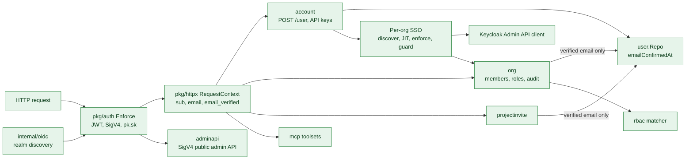
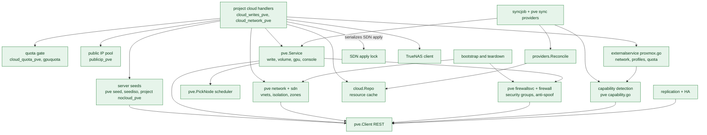
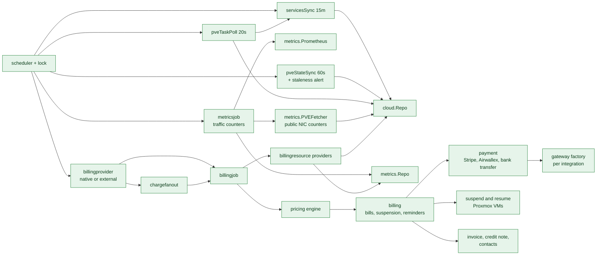
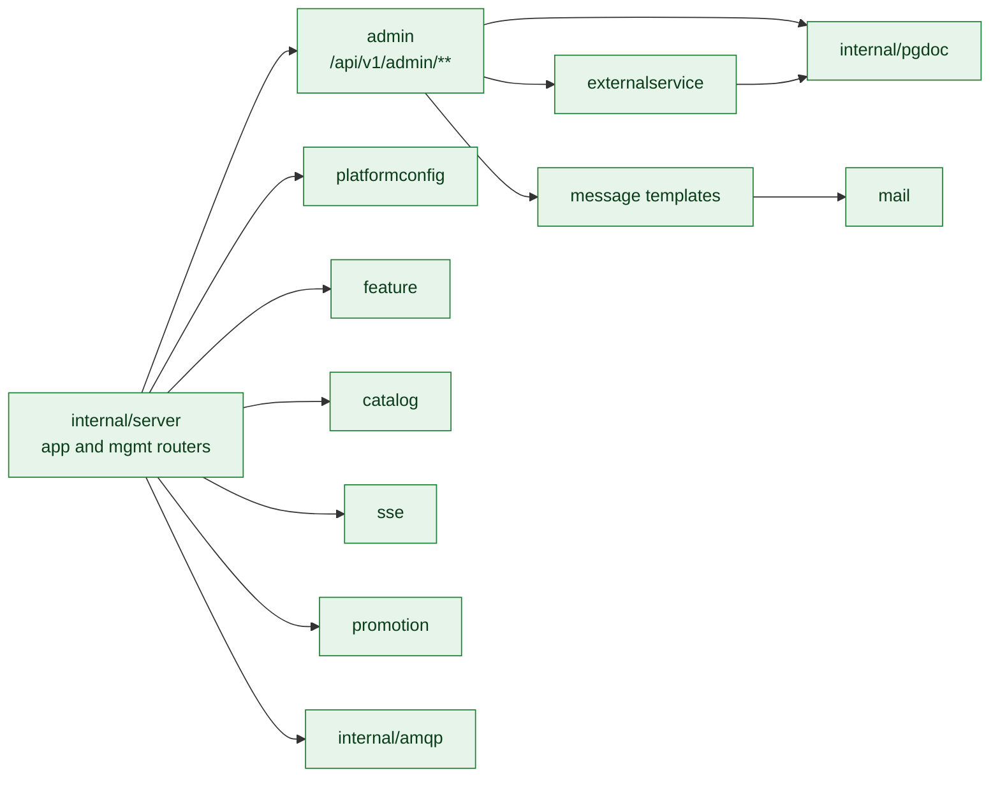
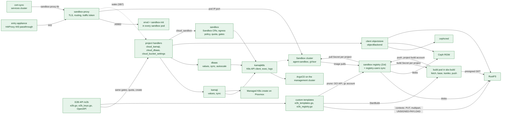

# C3: Components of `proxcloud-api`

The API is one Go binary. Packages follow a handler, service, repository layering
over the PostgreSQL document store ([ADR-0002](../../adr/0002-go-and-layered-architecture.md)).
This page groups the packages by area. Paths are relative to the repository root;
every Implemented path exists on the default branch.

Status legend and maintenance rule: [README.md](README.md).

## C3a. Identity and access

| Component | Path | Responsibility | Status |
|---|---|---|---|
| Authenticator | `pkg/auth/auth.go` (`Enforce`, `verifyJWT`, `claimTrue`), `sigv4.go`, `sigv4sign.go`, `clientkey.go` | Validates OIDC JWTs per realm (bound to `azp`), AWS SigV4 for the admin API, and `pk.sk` personal access keys. Reads `email_verified` (fail closed: absent means false). | Implemented |
| Request context | `pkg/httpx/context.go` | Per-request principal: `Sub`, `Email`, `EmailVerified`, `Issuer`, `Azp`, `SigV4KeyID`. | Implemented |
| OIDC discovery | `internal/oidc/oidc.go` | Discovers the configured realms (customer, admin, admin API). | Implemented |
| Config | `internal/config/config.go` | koanf config: auth realms, ports `8080`/`8081`, `PROXCLOUD_*` env overrides. | Implemented |
| Account | `internal/platform/account/account.go`, `account_apikeys.go`, `dto.go` | `POST /user` creates or refreshes the user from the token claims; personal access keys. | Implemented |
| User | `internal/platform/user/user.go` (`FindVerifiedByEmail`, `EmailVerified`) | User store keyed by `sub`; `emailConfirmedAt` mirrors the IdP's `email_verified` for the current email. | Implemented |
| Organization | `internal/platform/org/` (`handler.go` `addMember`, `role_*.go`, `audit_handler.go`, `billing_handler.go`) | Organizations, members, custom roles, org audit log, billing-profile reads. Add-member resolves only IdP-verified emails. | Implemented |
| Project invites | `internal/platform/projectinvite/projectinvite.go` (`callerEmail`) | Token invites to a project. Invites match the caller only once their email is verified. | Implemented |
| RBAC | `internal/platform/rbac/` (`matcher.go`, `permission.go`, `roles.go`) | Permission kernel for org, project and admin permissions. | Implemented |
| Public admin API | `internal/platform/adminapi/` | `/admin-api/v1`: users, organizations, billing profiles, projects, bills, credits, service providers. | Implemented |
| MCP server | `internal/platform/mcp/` (`mcp.go`, `tools_client.go`, `tools_admin*.go`) | Client and admin toolsets, dispatched in-process through the app router. | Implemented |
| Audit | `internal/platform/audit/`, `pkg/audit/` | Audit events, field-level diffs, cursor paging. | Implemented |
| Per-org SSO | `internal/platform/sso/` (`service.go`, `guard.go`, `kcadmin.go`, `fetch.go`, `repo.go`, `handler.go`) | Org IdP and domain documents, Keycloak Admin API client, DNS TXT verification, email-first discovery, JIT membership. `Guard` runs from `pkg/auth.Enforce` on every request: domain gate, account binding, enforcement, break-glass. | Implemented |

The Keycloak Admin API client also backs the operator console's Create user and Delete user
(`internal/platform/admin/user.go`): same service account, which already holds `manage-users`.

## C3b. Cloud / IaaS on Proxmox

| Component | Path | Responsibility | Status |
|---|---|---|---|
| PVE client (fails over across `apiUrls`, pins the cluster CA) | `internal/cloud/pve/client.go`, `cluster.go`, `qemu.go`, `storage.go`, `sdn.go`, `firewall.go`, `pool.go`, `access.go`, `task.go`, `mapping.go`, `form.go` | Typed REST client: cluster resources, VMs, storage, SDN, cluster/VM firewall, pools, privilege checks, tasks, PCI mappings. Includes the preflight reads `DatacenterFirewallEnabled`, `NodesWithoutNFTables`, `ManagementBridges`. | Implemented |
| PVE service | `internal/cloud/pve/service.go`, `write.go`, `volume.go`, `gpu.go`, `console.go` | Project-scoped IaaS: pools, create/delete/resize/power/rename servers, project templates, volumes (add, extend, detach, attach with cross-node gating and attach targets, retype, delete detached), GPU inventory and slot picking, VNC/serial console. | Implemented |
| Networks and isolation | `internal/cloud/pve/network.go` (`CreateNetwork`, `ReconcileIsolation`, `EnsureProjectZone`, `ZoneIDFor`, `TeardownProjectNetworks`), `sdn.go` | Tenant vnets and subnets, ownership alias, cluster firewall isolation rules (the sandbox network in `sandboxCidrs` fenced both ways), per-project EVPN zones, staged SDN changes and apply. `sandboxfw.go`: the sandbox workers' VM firewall (layer 1: one generation of cluster group and IP sets, address pinning, drift repair, sweep). | Implemented |
| Firewall service | `internal/cloud/pve/firewallsvc.go` (`SecureVM`, `SetIPFilter`, `EnsureDefaultSecurityGroup`, `ServerSecurityGroups`, `DeleteProjectSecurityGroups`) | Security groups as cluster firewall groups, the project default group, VM firewall options, per-NIC ipfilter sets. | Implemented |
| Scheduler | `internal/cloud/pve/scheduler.go` (`PickNode`), `capability.go` (`StorageHasRoom`, `TemplateShared`) | Capacity-ranked node choice with CPU overcommit, storage-profile node restriction, free space on the profile's storage (with headroom), template locality and free GPU slots. | Implemented |
| Sync providers | `internal/cloud/pve/syncprovider.go`, `network.go` (`NetworkSyncProvider`), `firewallsvc.go` (`SecurityGroupSyncProvider`) | Map pool VMs, disks, templates, owned vnets and groups to cache rows. | Implemented |
| Reconcile | `internal/cloud/providers/providers.go` (`Reconcile`, `Deletable`), `compare.go`, `niche_sync.go`, `write.go` | Create, update and archive cache rows against the live list. A row the provider can list but not read stays (`UnreadKeeper`). | Implemented |
| Sync job | `internal/cloud/syncjob/job.go` (`syncProxmoxService`, `SyncOne`, `detectProxmoxCapabilities`), `syncjob/sandboxfw.go` (`reconcileSandboxWorkers`) | 15-minute sync of every enabled project, plus on-demand single-project sync; each cycle also re-detects every Proxmox provider's storage capabilities and, with `config.sandbox`, fences the sandbox workers' VMs and takes the unsecured taint off the fenced ones (nodes-only kubeconfig of the sandbox cluster). Sandbox providers: the project's `SANDBOX` rows follow the cluster (`syncSandboxService`, and every minute `RunSandboxState` before the minutely charge; a vanished row is ended and archived with its start); `sandboxgate.go` reads the release gates for the portal. | Implemented |
| CSI gateway | `internal/cloud/csigw/` (`Handler`, `Store`, `ControllerSecret`, `ReleaseCluster`, `VolumeRows`, `CertFiles`), `pve.Client.Raw` | Allowlist of the PVE calls proxmox-csi-plugin v0.22.0 makes. Owns the `csiVolume` registry (written before a disk exists, so a name is taken once), `csiGatewayCredential` and `csiTask`. Workers are read with the portal token on every VM call, never cached (pool + `pc-k8s-<id>` tag, the tag checked again on the VM config); every forwarded call uses the gateway token. Quota check and registry write share a per-project advisory lock. Refusals go to the audit log. Mints a cluster's credential and controller config at create, revokes it and deletes the cluster's remaining disks at release; `VolumeRows` turns the registry into the project's VOLUME rows (`k8sCluster`) and settles rows against PVE in the sync. Older clusters move onto it by an operator action (`project.MigrateClusterCSI`, `kamaji.SwitchCSIGateway`): their PVs' disks are adopted into the registry when no other cluster's PV (nor the services cluster's) names them and their workers, and only they, hold them (a detached disk only when the operator names its PV), the controller switches in one chart bump, the tenant's old config Secret and `csi@pve!<id>` go. | Implemented |
| Resource cache | `internal/cloud/repo.go`, `resource.go`, `history.go` | The `cloudResource` table and its archive; the source for reads, quota usage and billing. | Implemented |
| Project cloud handlers | `internal/platform/project/cloud_writes.go`, `cloud_writes_pve.go` (`pveCreateServer`, `pveAction`, `pveDeleteResource`), `cloud_reads.go`, `clientcloud.go` | `/project/{id}/cloud` create, delete, actions and reads; Proxmox branch for servers, keypairs, volumes, security groups, images. `/init/{projectId}` returns the menu (minus `hiddenServices`) and per-provider `features` (`cloudFeatures`) that the client uses to hide actions the backend would reject. | Implemented |
| Network handlers | `internal/platform/project/cloud_network_pve.go` (`pveCreateNetwork`, `pveDeleteNetwork`, `pvePickCIDR`, `pvePublicNetworkAction`, `pveTeardownNetworks`) | Network create/delete under the SDN apply lock, CIDR pick, public NIC attach/detach. | Implemented |
| Quota | `internal/platform/project/cloud_quota_pve.go` (`checkPVEQuota`), `cloud_writes_pve.go` (`pveResizeDemand`, `enforcePVEGPUQuota`), `gpuquota.go`, `quota_usage.go` | Platform-side quota for servers, vCPUs, RAM, disk, networks, public IPs and GPUs; fails closed when usage cannot be read. | Implemented |
| Public IP pool | `internal/platform/project/publicip_pve.go` (`PublicIPRepo`, `pickPublicIP`) | Per public network IPv4 pool in the `pvePublicIp` table; the primary key is the race guard. | Implemented |
| Bootstrap | `internal/platform/project/bootstrap.go` (`BootstrapProxmoxOnto`) | Project pool, default security group, provider default quota seeded onto the project. | Implemented |
| Teardown | `internal/platform/project/teardown.go` (`TeardownProject`), `deletion.go` | Destroys pool VMs and the pool, vnets, EVPN zone, security groups, releases public IPs, archives cache rows. | Implemented |
| Provider config | `internal/platform/externalservice/proxmox.go` (`PVENetworkConfig`, `PVEStorageProfiles`, `PVECapabilities`, `PVEStorageClasses`, `PVEDefaultQuota`) | Typed view of a Proxmox provider: API endpoint and token, zones, `cidrPool`, isolation mode, public networks, storage profiles (with derived tier and class and the `bootDisk` / `dbaas` caps), detected storage capabilities and class overrides, the per-disk profile resolver for volume billing, GPU aliases, default quota. | Implemented |
| Admin provider tools | `internal/platform/admin/pveadmin.go` (`proxmoxAuth`, `tokenWarnings`, `checkNodeFirewalls`, `checkPublicNetworks`, `storeReachWarnings`, `bootISOWarnings`), `cloudadmin.go`, `pveflavors.go`, `projectquota.go` | Test connection with preflight (a warning for each network store tenant networks can reach, and for an unfit Kubernetes bootstrap ISO store), provider CRUD, flavor catalog, per-project quota edits. | Implemented |
| Flavor catalog | `internal/platform/pveflavor/pveflavor.go` | Admin-curated flavors for Proxmox, including GPU model and count and a storage profile. | Implemented |
| GPU | `internal/cloud/gpu.go`, `gpu_usage.go`, `internal/platform/project/gpucapacity.go` | GPU alias normalization, usage by project, capacity view. | Implemented |
| Template discovery | `internal/cloud/pve/templates.go` (`DiscoverTemplates`), `externalservice/proxmox.go` (`PVEImageCatalog`), `project/cloud_writes_pve.go` (`pveImageCatalog`, per-node copy in `pveCreateServer`) | Catalog read from the cluster: templates in pool `pc-templates` tagged `pc-public`, grouped by `pc-img-<slug>`, newest `pc-v-*` per node. `config.templates` pins or overlays. | Implemented |
| Capability detection | `internal/cloud/pve/capability.go` (`DetectStorage`, `classify`, `StorageHasRoom`, `TemplateShared`), `externalservice/proxmox.go` (`ValidatePVEStorageProfiles`, `DetectPVECapabilities`, `PVEEffectiveStorageClass`), `syncjob/job.go` (`detectProxmoxCapabilities`), `admin/pveadmin.go` (`proxmoxDetectStorage`, `proxmoxStorageClasses`, `validatePVEStorageProfiles`) | Per storage from `GET /storage` + `/cluster/resources type=storage`: type, shared, content, snapshots, thin, live migrate, replication, tier and a default class from a static type table, plus per-node active/avail. Persisted under `config.capabilities` every sync cycle and on admin Re-detect. Storage-profile saves are rejected when a storage is missing, inactive, lacks `images`, or the profile claims a flag the storage lacks. Admin class override (`config.storageClasses.<id>.class`) wins; the installer's `suggestedClass` is display-only. Feeds placement (active nodes, free space, template and clone-target locality), same-node attach gating and the capacity-class gates (boot disk, snapshots, DBaaS). HA readiness is still Planned. | Implemented |
| Replication and HA | `internal/cloud/pve/protect.go`, `internal/platform/project/cloud_protect_pve.go` | `pvesr` jobs and strict HA node-affinity rules for protected VMs on ZFS, HA alone on shared storage, gating, RPO state, memory reservation. | Implemented |
| Metering reads | `internal/cloud/pve/syncprovider.go` (`SampledServerProvider`, `SampledImageProvider`, `Superseded`), `task.go` (`NodeTasks`), `qemu.go` (`VMStatus.NICs`), `gpu.go` (`GPUSpecsFromConfig`), `service.go` (`CreatedTag`) | The Proxmox side of metering: rows built from one `/cluster/resources` page, the VM identity stamp `pc-c-<unix>`, node task logs, per-tap counters, GPU count from `hostpciN mapping=`. See C3c. | Implemented |
| Server seeds | `internal/cloud/pve/seed.go` (`RenderSeed`, `RenderNetworkConfig`, `AttachSeedISO`, `SetSeedURL`), `seediso.go` (`BuildSeedISO`), `internal/platform/project/nocloud_pve.go` (`pveSeedStep`, `pveWriteSeed`, `nocloudFile`, `SeedRepo`) | NoCloud seed of a server with user-data, vendor-data or metadata: a token URL served by `GET /api/v1/nocloud/{token}/{file}`, or a `cidata` CD where the vnet has no DHCP. | Implemented |
| Server snapshots | `internal/cloud/pve/snapshot.go`, `internal/platform/project/snapshot_pve.go` | VM snapshots, refused on storage without them, newest-only rollback on ZFS. | Implemented |
| Image import | `internal/cloud/pve/imageimport.go`, `internal/platform/project/imageimport_pve.go`, `pkg/safeurl` | A customer image from a URL: the portal fetches it under an address check at connect time and streams it to PVE's upload API, `import-from` on the profile's boot storage, a template in the project pool. A node never sees the URL. One import at a time per project; the disk counts against `diskGb`. | Implemented |
| Server backups | `internal/cloud/pve/backup.go`, `internal/platform/project/backup_pve.go` | vzdump to `config.backupStorage` (NFS, CephFS, PBS), ownership by a project stamp in the archive notes, in-place restore that refuses what it would lose, archives removed with the server and on project teardown. | Implemented |
| Holder VMs | `internal/cloud/pve/holder.go` | Volumes without a server: one never-started VM per (project, node), hidden from the server sync, billing, quota and the scheduler. A cross-node attach uses its own short-lived carrier. All holder use runs under a per-project PostgreSQL lock. | Implemented |
| TrueNAS client | `internal/cloud/truenas/`, `internal/platform/project/cloud_shares.go` | JSON-RPC over WebSocket; NFS and SMB shares as dataset + refquota + export, limited to the project's addresses: every release of an address goes through the exports first (`PublicIPRepo.release`, `withShareAccessRevoked`) and the sync reconciles them. NFS squashes root. Optional per-provider `snatSources` keep a site's NAT addresses on every export, at the cost of isolation between tenants behind that NAT. | Implemented |

## C3c. Metering and billing

| Component | Path | Responsibility | Status |
|---|---|---|---|
| Scheduler | `internal/platform/scheduler/scheduler.go`, `internal/platform/lock/shedlock.go` | Cron specs (charge every minute, hour and month; sync every 15 minutes; dunning, collect, bill send) run once across pods. | Implemented |
| Operator job triggers | `internal/platform/job/job.go` | `/api/v1/admin/job/*` triggers for charge, metrics, sync, collect. | Implemented |
| Metrics | `internal/cloud/metrics/` (`prometheus.go`, `pve.go`, `service.go`, `repo.go`), `internal/cloud/metricsjob/job.go` | Month-to-date VM traffic per provider: Proxmox public-NIC counters by default, sampled every minute with reset-aware deltas (`nicCounter`), or a Prometheus-compatible source hourly. | Implemented |
| Proxmox state sampler | `internal/cloud/syncjob/pve_meter.go` (`RunPVEState`), `internal/cloud/providers/providers.go` (`Reconcile`: `Replaceable`, `VanishGrace`) | Every minute, one `/cluster/resources` page per provider reconciles SERVER, IMAGE and FLOATING_IP rows of every project. A reused vmid gets a new row (archive + insert); a row is not archived for being absent in its first 2 minutes, nor resurrected in the 2 minutes after archiving (pmxcfs lag). An empty page never archives. | Implemented |
| Proxmox task poller | `internal/cloud/syncjob/pve_meter.go` (`RunPVETasks`), `internal/cloud/meter.go` (`TaskEvent`), `internal/platform/project/cloud_writes_pve.go` (`pveServerEvents`) | Every 20 seconds, finished VM tasks past each node's cursor: deduped on UPID, served by `LIST_EVENTS`, audited when another user ran them, and their project re-synced, so a change outside the portal lands in seconds. | Implemented |
| Staleness policy | `internal/cloud/meter.go` (`MeterState`, `MeterStaleAfter`), `syncjob/pve_meter.go` (`meterFailed`), `billingjob.go` (`billingResources`), `pricing/bill_build.go` (`SkipInterval`) | Last-known state for 30 minutes without a good sample, then the provider's resources stop billing and the gap is written off; alert by `ERROR` log and audit event. | Implemented |
| Billing resources | `internal/cloud/billingresource/` (`billingresource.go` `GetBillingResources`, `server.go`, `volume.go`, `floatingip.go`, `image.go`, `bucket.go`, `kubernetescluster.go`, `databasecluster.go`, `sandbox.go`, `sandboxsnapshot.go`, `catalog.go`) | Turn cache rows into billable units with typed attributes; servers yield an instance unit plus a traffic unit; volumes carry `profile` and `storage_class` for per-profile price rules; public IPs (one row per allocation) and project templates bill too; a sandbox bills per minute from the minute it became Ready in (or, never read Ready, its last pending read) for its runtime rounded up to whole minutes, a sandbox snapshot per GB-hour (no writer before SB7). `GetArchivedBillingResources` feeds rows archived this cycle back in with `DeletedAt` for their last partial interval; a `DeletedAt` past the charge's cycle moves the item's watermark there, so the next charge does not rate that unit again. | Implemented |
| Billing provider | `internal/platform/billingprovider/billingprovider.go` | Native (rate in process) or external (resolve here, rate in a separate billing service). | Implemented |
| Billing job | `internal/platform/billingjob/billingjob.go` (`Charge`, `ChargeProfileByID`), `remote.go` | Per active billing profile and provider: resolve billing resources, pick price plans, rate onto the current bill. | Implemented |
| Charge fan-out | `internal/platform/chargefanout/chargefanout.go` | One RabbitMQ message per profile, off by default. | Implemented |
| Billing client and callbacks | `internal/platform/billingclient/`, `internal/platform/billingcallback/`, `pkg/billingapi/` | Wire contract and callbacks for an external billing service. | Implemented |
| Pricing | `internal/platform/pricing/` (`engine.go`, `charge.go`, `planselect.go`, `bill_build.go`, `adjustments.go`, `tax.go`, `fx.go`, `settle.go`) | Rating engine, bill items, savings and price adjustments, tax, currency, settlement. | Implemented |
| Billing | `internal/platform/billing/` (`balance.go`, `sendbill.go`, `suspension_job.go`, `activationservice.go`, `reminder.go`, `savings.go`, `billpdf.go`, `paybill.go`) | Billing profiles, balance, bill finalization, PDF, dunning and suspension, reminders, savings contracts. PREPAID or POSTPAID payment mode per profile; an operator can record an offline payment on a SENT bill (`PayService.RecordManualPayment`, `POST /admin/bill/{id}/record-payment`, MCP `record_bill_payment`). | Implemented |
| Invoice, credit note, contacts | `internal/platform/billing/` (`invoice.go`, `creditnote.go`, `contacts.go`) | Sequential invoice number `INV-<year>-<seq>` stamped once when a bill leaves OPEN (counter row per year), tax invoice and credit note PDFs with the operator as issuer, validated invoice recipients (max 10) that every billing mail also goes to. Bill and refund mails carry the PDF. | Implemented |
| Proxmox suspend/resume | `cmd/api/main.go` (`billingCloudSuspender`) | Suspends and resumes a suspended profile's Proxmox VMs. | Implemented |
| Payment | `internal/platform/payment/` (`stripe.go`, `airwallex.go`, `factory.go`, `addfunds.go`, `collect.go`, `registercard.go`, `scanner.go`, `banktransfer.go`) | Card deposits, cards, collect, refunds and the transaction scanner over one `Gateway` interface. Gateway secrets are read from the integration doc (decrypted on load). Confirm callbacks re-read the intent from the gateway and settle through an atomic PENDING to PROCESSING claim, so a repeated or concurrent callback credits once. Bank transfer: the customer submits date, bank reference and proof (2 MiB cap), finance is mailed, an operator approves or rejects. | Implemented |
| Gateway factory | `internal/platform/payment/factory.go` (`NewGateway`) | Picks the gateway for an integration: Stripe by `secret.privateKey`; Airwallex by `config.clientId`, `secret.apiKey` and `config.sandbox` (demo host), one cached instance per credential so the login token is shared. BankTransfer is not a card gateway. | Implemented |
| Protected VM billing | `internal/cloud/billingresource/server.go` (`protectionBR`) | `server_protection` per replicated GB, from the first sync until disabled. | Implemented |

## C3d. Platform services

| Component | Path | Responsibility | Status |
|---|---|---|---|
| Routers | `internal/server/server.go` | App router (`:8080`) and management router (`:8081`). | Implemented |
| Admin | `internal/platform/admin/` | All operator routes: users, organizations, projects, providers, price plans, billing config, transactions, integrations, admin roles, HMAC keys, audit. | Implemented |
| External services | `internal/platform/externalservice/` (`externalservice.go`, `proxmox.go`, `kamaji.go`, `dbaas.go`, `sandbox.go`, `service.go`, `repo.go`) | Provider records (Proxmox, Ceph S3, Kamaji, DBaaS, sandbox) with encrypted secrets. A `sandbox` row may be stored DISABLED at any time; create or update leaving it live answers 409 unless its release gates hold (`admin/sandboxprovider.go`, `POST /admin/service/{id}/sandbox/release-check`). | Implemented |
| Platform config | `internal/platform/platformconfig/` | Branding, regions, login and provisioning settings; `hiddenServices` hides managed services from every tenant menu. | Implemented |
| Feature flags | `internal/platform/feature/handler.go` | Feature set the SPAs query. | Implemented |
| Catalog | `internal/platform/catalog/catalog.go` | Flavor categories, image groups. | Implemented |
| Mail and templates | `internal/platform/mail/` (`smtp.go`, `service.go`), `internal/platform/message/` | SMTP delivery, templated messages. | Implemented |
| SSE | `internal/platform/sse/` | Per-project event stream. | Implemented |
| Promotion, affiliate | `internal/platform/promotion/`, `internal/platform/affiliate/` | Promotion codes, affiliate config. | Implemented |
| Order | `internal/platform/order/order.go` | Order read by id. | Implemented |
| CRM | `internal/platform/crm/crm.go` | CRM sync interface with a no-op provider. | Implemented |
| Paging | `internal/platform/paging/` | Cursor paging. | Implemented |
| Data store | `internal/pgdoc/` | PostgreSQL JSONB document API used by every repository. | Implemented |
| Broker | `internal/amqp/amqp.go` | RabbitMQ connection and reconnect. | Implemented |
| Health | `internal/health/` | Liveness and readiness. | Implemented |

## C3e. Managed services and object storage

| Component | Path | Responsibility | Status |
|---|---|---|---|
| Managed Kubernetes | `internal/cloud/kamaji/`, `internal/cloud/kamajik8s/`, `internal/platform/project/cloud_kamaji.go` | Cluster values builder, Kubernetes API client, sync, read and delete of Kamaji clusters through ArgoCD `Application` objects. | Implemented |
| Managed K8s create on Proxmox | `internal/platform/project/cloud_kamaji_create.go`, `internal/cloud/pve/access.go`, `internal/cloud/pve/bootiso.go`, `deploy/charts/proxmox-kamaji-cluster` | Flavors to VM sizes and tags, worker quota, network pick, address reservation, a per-cluster CAPMOX token (no CSI token), one machine pool per PVE node; MetalLB through CAAPH. proxmox-csi: with the CSI gateway (new clusters, and older ones after the migration action `POST /admin/service/{id}/k8s-clusters/{clusterId}/csi-gateway`) every profile, the controller on the services cluster (`templates/csi-controller.yaml`) and no PVE credential in the tenant; without it none (`sharedWorkers` keeps the operator's token in the tenant). A provider config setting the removed `csiSharedStores` or `pveCsiUrl` is refused. Every tenant API server runs `NodeRestriction` (chart 0.1.6 and later), so a worker's kubelet credential reaches only its own Node and no Secret through a pod of its own. Bootstrap ISOs (join tokens) on one node-local store per token, checked at create; the sweep's live-cluster hook (`OnClusterLive`, `KamajiPinBootISO`) moves older clusters' grants. Create, scale, RWX, suspend and delete verified on a lab in the project pool with minted tokens. | Implemented |
| DBaaS | `internal/cloud/dbaas/`, `internal/platform/project/cloud_dbaas.go`, `deploy/charts/database-cluster` | Database cluster values, sync, autoscale, read and delete. Create refuses a storage class named after a Proxmox storage profile closed to databases (capacity class). | Implemented |
| Kubernetes API client | `internal/cloud/kamajik8s/` (`client.go`, `exec.go`, `kubeconfig.go`) | Hand-rolled REST over a kubeconfig or the pod's service account (`NewInCluster`, token re-read every minute): server-side apply, get, delete and merge patch of any namespaced custom or core object, list across namespaces, nodes, pod logs, and exec over the API server's WebSocket (`v5.channel.k8s.io`, `v4` fallback). Transport failures wrap `ErrUnreachable`; a refused exec upgrade is a 404 (pod gone) or 403 (no `pods/exec`), and an exec stream that ends without its status frame is an error, not exit 0. Shared by Managed K8s, DBaaS and sandboxes. | Implemented |
| Sandboxes | `internal/cloud/sandbox/`, `internal/platform/externalservice/sandbox.go`, `internal/platform/project/cloud_sandbox.go` | One agent-sandbox `Sandbox` CR per sandbox in `sb-<project>` on a platform sandbox cluster: gVisor runtime class, no service account token, per-namespace ResourceQuota, per-sandbox Cilium egress policy, GPU capacity, template builds, snapshots, sync payloads. Labels in `proxcloud.io/`; the GPU placement label in `node-restriction.kubernetes.io/`. Template registry from `config.sandbox.templateRegistry`. Native REST (SB3): `SANDBOX` create, list, delete and the actions EXEC, GET_LOGS, SET_TIMEOUT, REFRESH and GET_ACCESS (host and traffic token, from the live CR) on the project cloud routes; the project quota (`sandbox.ProjectQuota`, D10) is checked against the live sandboxes and carried by the namespace ResourceQuota; the release gates (`sandbox.Gate`, `syncjob.SandboxReleaseGates`) and the suspension gate run before anything that adds usage; a billing suspension deletes running sandboxes (`project.DeleteProjectSandboxes`); project teardown deletes them and the namespace. | Implemented |
| Sandbox proxy | `cmd/sandbox-proxy`, `internal/sandboxproxy/`, `pkg/certfile`, `deploy/sandbox-cluster/sandbox-proxy.yaml` | The data path to sandbox ports (SB4): `<port>-<id>.<domain>` to the ready pod's IP and port, envd's control routes refused, the traffic token enforced; TLS ends here with the wildcard certificate from a mounted Secret, read again on renewal; it runs only on the sandbox cluster's `sandbox-system` nodes (a CAPI-set `node-restriction.kubernetes.io/` label and a taint), never next to tenant code. A miss can ask the portal's wake endpoint (`POST /api/v1/internal/sandboxes/{id}/wake`, `project/sandbox_wake.go`, a provider's `proxyWakeToken`), which stage 56 leaves off until SB7. Its `cert-sync` mode runs on the services cluster and copies the certificate cert-manager issued there to the sandbox cluster, only when it is valid now and covers `*.<domain>`. | Implemented |
| E2B-compatible API | `internal/platform/project/e2b.go`, `e2b_keys.go`, `e2b_openapi.go` + `e2b_openapi.json` (generated by `e2b_openapi_gen.py`), `cmd/sandbox-init`, `deploy/sandbox-runtime.Dockerfile`, `deploy/templates/`, `tests/e2b-compat/` | SB5: `/e2b/*` (public in `pkg/auth`, its own `X-API-Key` gate) serves the stock E2B SDKs: sandbox create, list, get, kill, timeout, refreshes, connect, network, logs, metrics and the built-in templates, in E2B's request and `{code, message}` error shapes. A key (`e2b_` + 40 hex) belongs to one project and acts as its creator, re-checked on every call (cloud-resource permission); only its SHA-256 is stored (`sandbox_api_keys`), and the client console's Sandboxes > API keys tab and `/api/v1/project/{id}/sandbox-api-keys` mint, list and revoke them. Create, a timeout, and an extension through refreshes or connect call the native `sandboxUsageGate` (suspension, DISABLED provider, release gates) and the project quota, and create the row the native API does, so billing is the same. A provider runs envd only with `config.sandbox.envd` and a `domain`: `sandbox-init` (PID 1, from the node runtime dir) starts envd and pushes its token, env and user. `GET /e2b/openapi.json` is E2B's own document cut to these routes; `TestE2BOpenAPIParity` fails when router and document disagree. | Implemented |
| Sandbox entry appliance | `internal/cloud/pve/sandboxentry.go`, `internal/cloud/syncjob/sandboxfw.go`, `installer/playbooks/56-sandbox-edge.yml` | The P8-1 HAProxy appliance as a platform VM: the installer builds it, the Proxmox provider's sync keeps its firewall and its one TCP listener to `sandbox-proxy` (`SandboxEntryConfig`, `PushHAProxy`) and adds the workers' rule that admits it alone (`SandboxFirewall.entryRule`). | Implemented |
| Sandbox registry | `internal/sandboxproxy/registryusers.go`, `cmd/sandbox-proxy` (`registry-users`), `installer/playbooks/55-sandbox-registry.yml`, `templates/sandbox-registry.yml.j2`, `templates/sandbox-prepull.yml.j2`, `deploy/sandbox-cluster/registry.yaml`, `deploy/templates/` | Zot on the services cluster with an S3 backend (SB6a). The account sync, a native sidecar of Zot, lists the sandbox cluster's tenant namespaces every 30 s and writes Zot's `htpasswd` and access rules (`pull-<project>`: `library/**` and `t/<project>/**`; `build-<project>`: the same reads and writes on `t/<project>/**` (SB6b); `pull-nodes`: `library/**`; `gc`: read and delete on `t/**` (SB6b); `admin`) with HMAC-derived project passwords, plus one pull Secret per project, one build Secret per project in `sbx-build` (applied without reading Secrets there) and the nodes' one; a failed list keeps the users Zot has. Sandbox pods name the project's Secret for every image on the registry's host (`Config.pullsFromRegistry`); the portal no longer copies a shared one. Image adoption: `project.AdoptSandboxImages` (job `sandboxTemplateAdopt`) moves a built-in template to the digest the prepull DaemonSet runs once every node has it (`sandbox.Adoptions`, `externalservice.SetTemplateImage`, compare-and-set). The workers' firewall admits the registry's address and port alone (`SandboxFirewall.RegistryAddress`, `config.sandbox.registry`). | Implemented |
| Custom templates | `internal/platform/project/e2b_templates.go`, `e2b_template_base.go`, `e2b_console.go`, `e2b_registry.go`, `internal/cloud/sandbox/build.go`, `installer/playbooks/templates/sandbox-builds.yml.j2` | The E2B v3 template API (SB6b, ported from EE): records in `sandbox_templates`, contexts streamed into the provider's build bucket (one PUT up to 16 MiB, else multipart, `UNSIGNED-PAYLOAD`), one gVisor build pod per build in `sbx-build` (fetch with presigned GETs, base pulls with the project's build account or the caller's `fromImageRegistry` credentials, kaniko offline with no credential, crane push with the build account; crane trusts the registry CA), billed as a sandbox row `build-<id>`. `fromImageRegistry` type `aws` refused (no ECR client). A project's ready build is a template for its own sandboxes (E2B and native create). Job `sandboxBuildSync` records builds nobody polls; job `sandboxRegistryPrune` deletes unreferenced `t/` images older than a day through the OCI distribution API with the `gc` account (live set: clusters, records, clusters again, recheck after 2 min). Console tab Templates (list, builds, logs, delete). Project teardown deletes the project's templates, build pods, contexts and its `t/<project>/` images. Two builds per project at once under an advisory lock; contexts capped at 10 GiB per project; trimming keeps tagged and building builds. The workers' firewall admits the bucket's endpoint (`SandboxFirewall.BuildStorageAddress`, `config.sandbox.buildStorage`). | Implemented |
| Object store client | `internal/cloud/client/client.go`, `objectstore.go`, `objectstore_ceph.go`, `objectstore_ceph_policy.go`, `objectstore_ceph_settings.go` | `objectBackend` + `Caps()`: bucket and object operations, policies, settings. `cephBackend` talks to RGW. | Implemented |
| Ceph credentials | `internal/cloud/cephcred/` | Per-project RGW user and S3 keys, secret encrypted at rest. | Implemented |
| Bucket settings | `internal/platform/project/cloud_bucket_settings.go` | Bucket actions (versioning, object lock, quota, lifecycle, CORS, tags, policy, per-key grants) and project S3 keys. | Implemented |
| RustFS backend | `internal/cloud/client/objectstore_rustfs.go` | Second `objectBackend`: reuses the S3 data plane; ownership in the project policy, project quota in the API, keep-last-value usage, website gated off. | Implemented |
