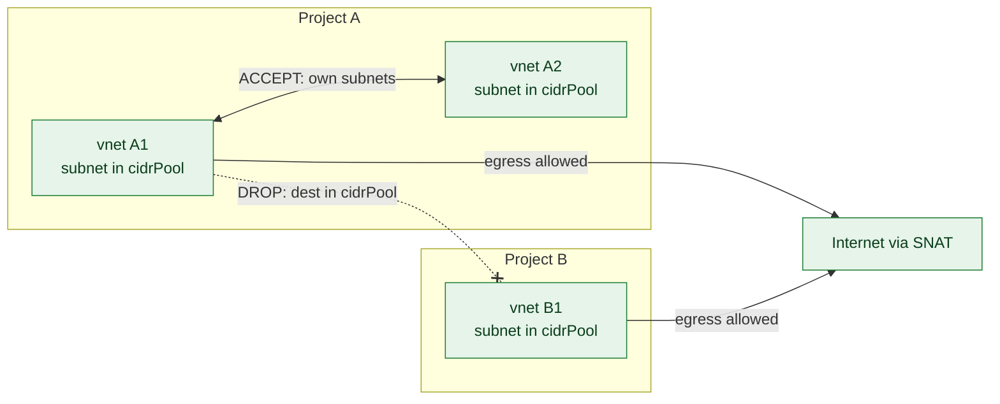
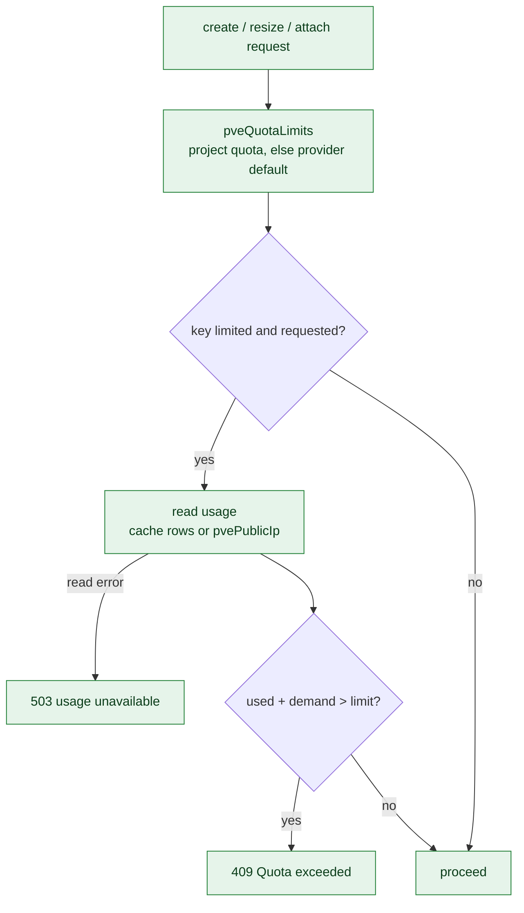
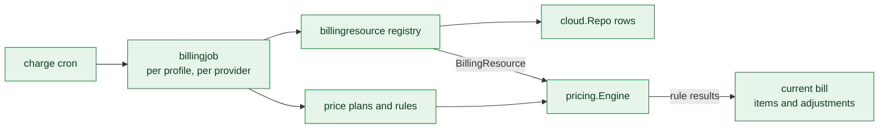
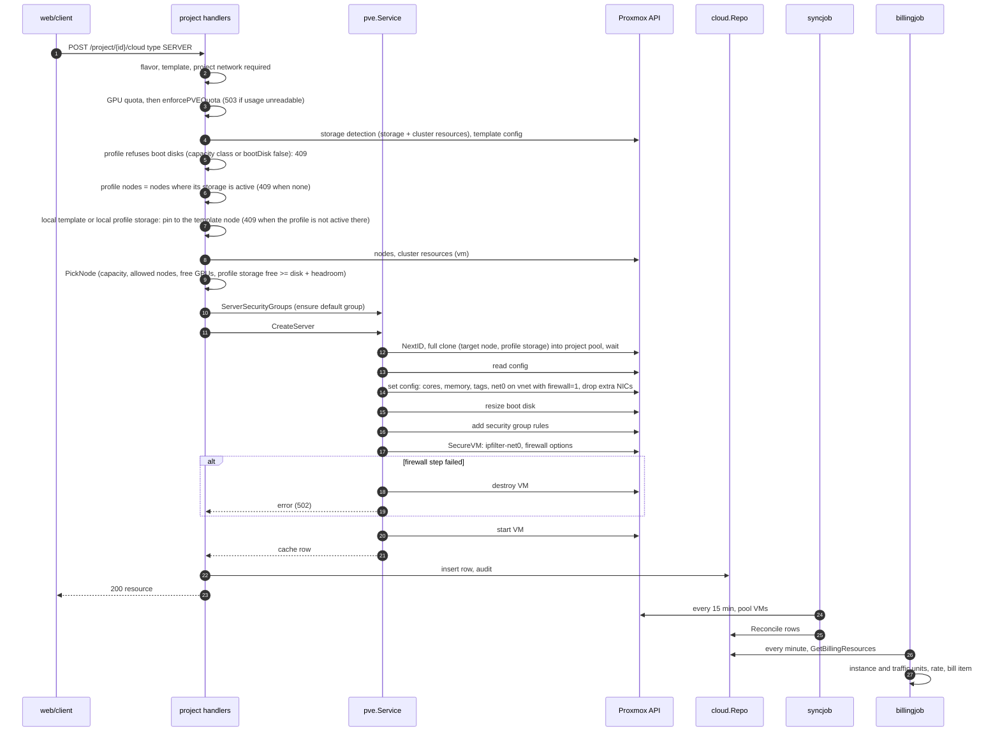
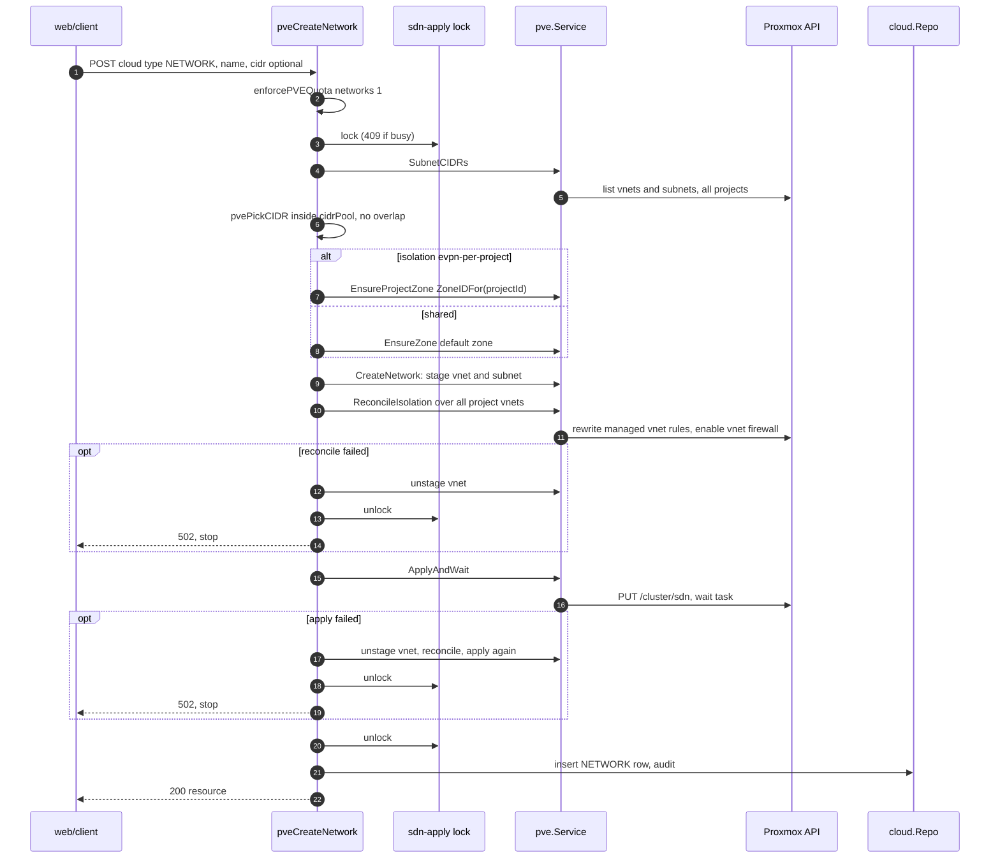
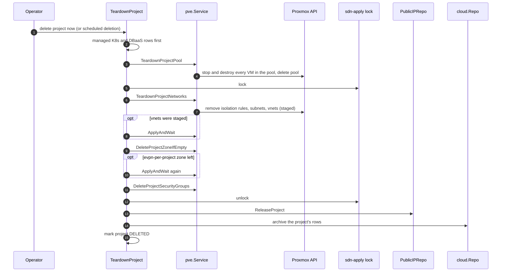
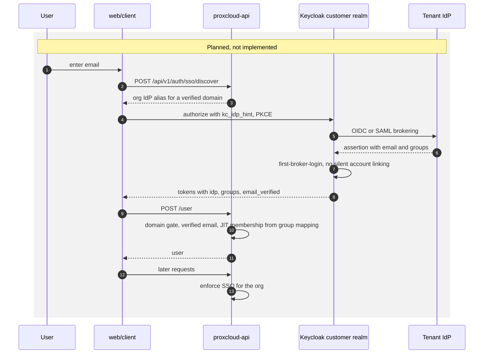

# C4: Code

Code-level views of the components where a mistake costs the most: tenant network
isolation, the VM firewall and public IPs, quota enforcement, and the billing
rating path. Each section lists the key functions with `file:line` (a snapshot,
see the [maintenance rule](README.md#maintenance-rule)), then explains the
invariants the code holds. Four sequence diagrams follow.

Status legend: [README.md](README.md). Everything on this page is **Implemented**
except sequence (d), which is **Planned**.

## C4.1 Tenant network isolation

| Symbol | Location | Role |
|---|---|---|
| `pveCreateNetwork` | `internal/platform/project/cloud_network_pve.go:78` | `POST /project/{id}/cloud {type:NETWORK}` on a Proxmox provider |
| `lockSDN`, `withSDNLock` | `cloud_network_pve.go:38`, `:54` | Platform-wide `sdn-apply` lock (PostgreSQL); busy returns 409, a crashed holder expires after 3 minutes |
| `pvePickCIDR` | `cloud_network_pve.go:255` | Requested CIDR must sit inside `cidrPool`, be `/29` or larger and overlap nothing; blank picks the first free `/24` |
| `Service.SubnetCIDRs` | `internal/cloud/pve/network.go:298` | Every subnet on the cluster (all zones, all projects, foreign vnets), read under the lock |
| `Service.CreateNetwork` | `network.go:157` | Stages vnet `v<5 base36>` with alias `st:<projectId>:<name>`, then its subnet (gateway, DHCP range, SNAT) |
| `ZoneIDFor` | `network.go:341` | Per-project EVPN zone id: `p` + 7 base36 chars of `sha256(projectId)` (8 chars, the PVE limit) |
| `Service.EnsureProjectZone` | `network.go:353` | Stages the project zone from the default EVPN zone template; next free VRF VNI (from 10000); refuses an id collision with another owner |
| `isolationRules` | `network.go:443` | The managed rule set for one vnet (below) |
| `Service.ReconcileIsolation` | `network.go:455` | Rewrites every vnet of the project to the rule set over all its subnets and enables the vnet firewall |
| `Service.ensureVnetRules` | `network.go:488` | Touches only rules tagged `proxcloud:isolation`; adds bottom-up so a wrong insert order fails closed |
| `Service.ApplyAndWait` | `network.go:553` | `PUT /cluster/sdn` and wait for the task |
| `pveDeleteNetwork` | `cloud_network_pve.go:175` | Refuses while a pool VM NIC uses the vnet; deletes, re-reconciles, applies, then removes an empty project zone in a second apply |
| `Client.AddVnetFirewallRule`, `EnableVnetFirewall` | `internal/cloud/pve/firewall.go:118`, `:128` | Vnet firewall REST calls |

**Isolation modes** (`config.network.isolation` on the provider):

- `shared` (default): every tenant vnet sits in the provider's default zone. Each
  vnet carries the managed rule set, so traffic between tenants is dropped even
  though they share one routing domain.
- `evpn-per-project`: each project gets its own EVPN zone (its own VRF) with id
  `ZoneIDFor(projectId)`. The same vnet rules still apply, because exit nodes leak
  every VRF into the default table and the VRF alone is not a wall.

**Managed rule set per vnet**, top to bottom, all `forward` rules:

1. `ACCEPT source=<all project subnets> dest=<all project subnets>` (omitted when
   the project has no subnets, since an empty field means "any").
2. `DROP dest=<cidrPool>`.

Forward rules see both directions, so a packet from tenant A to tenant B is dropped
on both vnets. There is deliberately no `DROP source=<cidrPool>`: every tenant
source is in the pool, and that rule would also drop egress to the internet through
SNAT.

Invariants:

- The CIDR pick and the vnet staging happen under the same lock, so two concurrent
  creates cannot land on one range, and `SubnetCIDRs` also sees staged networks.
- A vnet gets its isolation rules **before** the SDN apply, so it never goes live
  unisolated. If reconcile or apply fails, the vnet is unstaged and the apply re-run.
- The test connection (`internal/platform/admin/pveadmin.go:47`) refuses a cluster
  whose datacenter firewall is off or where a node still runs the legacy iptables
  firewall (it ignores vnet rules), so the rules above are actually enforced.

## C4.2 VM firewall, default security group and public IPs

| Symbol | Location | Role |
|---|---|---|
| `Service.CreateServer` | `internal/cloud/pve/write.go:68` | Clone, configure, resize, firewall, start |
| `nicFirewallParams`, `extraNICKeys` | `internal/cloud/pve/firewallsvc.go:193`, `:211` | `firewall=1` on every NIC; drop every cloned NIC beyond `net0` and its `ipconfigN` |
| `vmFirewallOptions` | `firewallsvc.go:243` | `enable=1 ipfilter=1 macfilter=1 dhcp=1 policy_in=DROP policy_out=ACCEPT` |
| `Service.SecureVM` | `firewallsvc.go:257` | `ipfilter-netN` = the vnet's subnets for each NIC on a tenant vnet, then the VM firewall options |
| `Service.SetIPFilter` | `firewallsvc.go:295` | Makes an ipfilter set hold exactly the given CIDRs; a changed set is dropped and rebuilt (fail closed) |
| `defaultGroupRules`, `EnsureDefaultSecurityGroup` | `firewallsvc.go:351`, `:361` | Project `default` group: ingress from `cidrPool` only (other tenants are already dropped by the vnet rules) |
| `Service.ServerSecurityGroups` | `firewallsvc.go:386` | Resolve the user's group names or ids to owned groups; none given means the default group |
| `pvePublicNetworkAction` | `internal/platform/project/cloud_network_pve.go:315` | `ATTACH_PUBLIC_NETWORK` / `DETACH_PUBLIC_NETWORK` on a server |
| `PublicIPRepo.Allocate`, `allocatePublicIP`, `pickPublicIP` | `internal/platform/project/publicip_pve.go:75`, `:101`, `:125` | Lowest free address of the network's pool; insert with primary key `serviceId/networkId/ip`, retry on a duplicate |
| `Client.ManagementBridges` | `internal/cloud/pve/cluster.go:85` | Bridges carrying a node's own IP or gateway; a public network on one is refused |

Invariants:

- A server must sit on one of the project's own networks. The template's NIC is
  replaced by `net0` on the tenant vnet; any other cloned NIC is removed, so a
  template made from a VM with a public NIC cannot hand out that VM's bridge or
  ipfilter.
- The firewall is configured **before the first boot**. If adding a group or
  `SecureVM` fails, the VM is destroyed rather than started open.
- A NIC on a bridge that is not a tenant vnet gets an empty ipfilter set, which
  drops its IPv4 egress until the public IP pool pins an address to it.
- Public attach order: quota check (`floatingIps`), allocate, `SecureVM`,
  `ipfilter-net1` = the address `/32`, then plug `net1` with `firewall=1`. Detach
  empties the ipfilter set first, unplugs, and only then returns the address.
  Server delete and project teardown release the server's or project's addresses.

## C4.3 Quota enforcement

| Symbol | Location | Role |
|---|---|---|
| `pveQuotaLimits` | `internal/platform/project/cloud_quota_pve.go:40` | The project's quota, else the provider default (`config.provisioning.quota`) |
| `Handler.enforcePVEQuota` | `cloud_quota_pve.go:49` | Gate a demand against the limits |
| `checkPVEQuota` | `cloud_quota_pve.go:70` | The pure gate: reads usage only for limited keys that are requested; a usage read error returns 503 |
| `Handler.pveQuotaUsage` | `cloud_quota_pve.go:103` | Sums the project's cache rows on the provider: servers, vCPUs, RAM, networks, volume GB |
| `pveResizeDemand` | `internal/platform/project/cloud_writes_pve.go:591` | Resize demand = new flavor minus cached flavor for vCPUs, RAM and boot disk |
| `Handler.enforcePVEGPUQuota` | `cloud_writes_pve.go:605` | GPU quota per model; a resize frees the replaced flavor's GPUs first |
| `BootstrapProxmoxOnto` | `internal/platform/project/bootstrap.go:96` | Seeds the provider default quota onto a project that has none |

Keys: `servers`, `vcpus`, `ramMb`, `diskGb`, `networks`, `floatingIps`, plus the
`gpu` map. A key absent from a non-empty quota is unlimited; with no project quota
and no provider default, everything is unlimited. `floatingIps` usage is counted
from the `pvePublicIp` table, not the cache.

| Gate point | Demand |
|---|---|
| Server create | `servers 1`, flavor vCPUs and RAM, root disk (the user's root size when given) |
| Server resize | `pveResizeDemand` (shrinks count as 0) |
| Volume create / extend | size, or the growth |
| Network create | `networks 1` |
| Public IP attach (new address) | `floatingIps 1` |

## C4.4 Billing rating path

| Symbol | Location | Role |
|---|---|---|
| `MinutelyChargeSpec` and siblings | `internal/platform/scheduler/scheduler.go:20` | Charge crons (minute, hour, month) |
| `nativeProvider.Charge` | `internal/platform/billingprovider/billingprovider.go:72` | In-process loop, or RabbitMQ fan-out when enabled |
| `Service.Charge`, `ChargeProfileByID` | `internal/platform/billingjob/billingjob.go:56`, `:105` | Per active billing profile |
| `Service.chargeBillingResource` | `billingjob.go:130` | Per provider: resolve resources, select plans and rules, rate |
| `Service.billingResources` | `billingjob.go:246` | Every active project of the profile bound to the provider |
| `GetBillingResources`, `stampResourceValues` | `internal/cloud/billingresource/billingresource.go:26`, `:55` | Cache rows to billing resources via the type registry; stamps region, service id, createdAt |
| Registry | `cmd/api/main.go:407` | Server, volume, floating IP, load balancer, K8s cluster, DB cluster, bucket |
| `ServerProvider.GetBillingInformation` | `internal/cloud/billingresource/server.go:34` | `instance` unit (flavor, GPU) plus `instance_traffic` unit; not billed in DELETED, ERROR, UNKNOWN, BUILD |
| `SelectPricePlansForService`, `ApplicableRules` | `internal/platform/pricing/planselect.go:46`, `:60` | Profile plans plus public plans for the provider, filtered by time unit |
| `ChargeBillingResources` | `internal/platform/pricing/charge.go:17` | Current bill, rate each resource, adjustments, save |
| `Repo.GetCurrentBill` | `internal/platform/pricing/billrepo.go:84` | Month bill, created on demand, leased with a wall-clock lock |
| `Engine.ApplyPricePlanRules` | `internal/platform/pricing/engine.go:30` | Filters, tiers, modifiers per rule |
| `SaveChargingToBill`, `getTimeUnitsDiff` | `internal/platform/pricing/bill_build.go:28`, `:155` | Bill item upsert; units elapsed since the last rating |
| `Service.billAdjuster` | `billingjob.go:167` | Savings-contract discounts and price-adjustment rules after rating |

Public IPs from the Proxmox pool and project templates are not billing units yet
(Planned); they are bounded by quota (`floatingIps`, `diskGb`) in the meantime.

---

## Sequence (a): create server

## Sequence (b): create network

## Sequence (c): project teardown

Triggered either by the operator's delete-project-now action (the `Teardown`
callback wired in `cmd/api/main.go`, run in the background) or by the scheduled
deletion job (`internal/platform/project/deletion.go`, through the
`projectTeardownDeleter` adapter in `cmd/api/main.go`). Both run `TeardownProject`
(`internal/platform/project/teardown.go:76`). Every Proxmox leg is idempotent, so a
failed teardown reports incomplete and can be re-run.

## Sequence (d): per-org SSO login (Planned)

Nothing in this sequence exists in the code yet. It records the intended design so
the change that implements it can update this diagram and the status columns.

