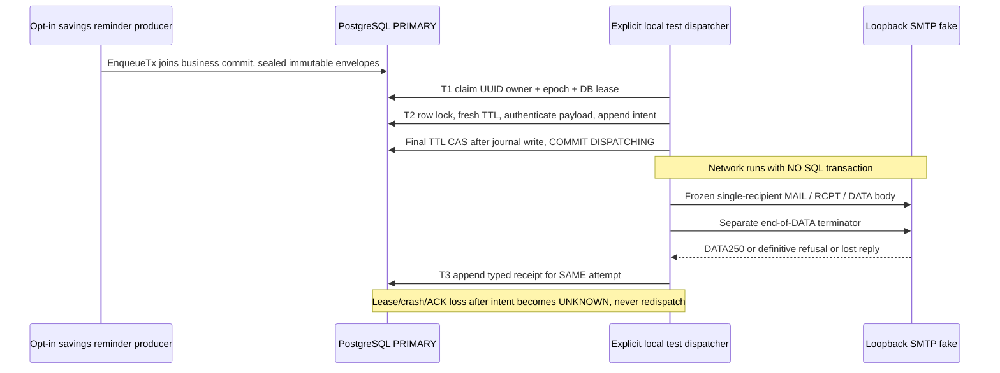
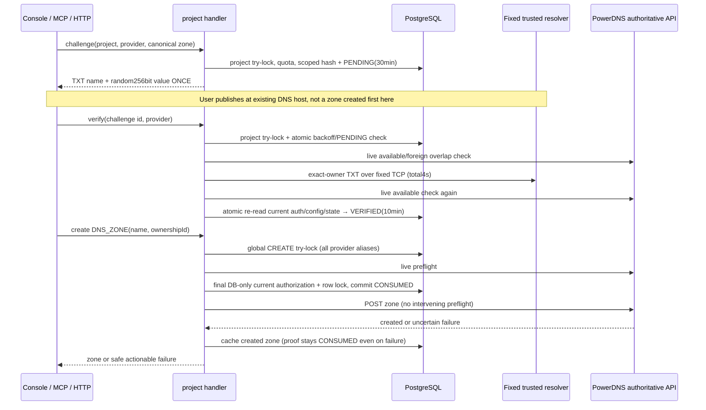
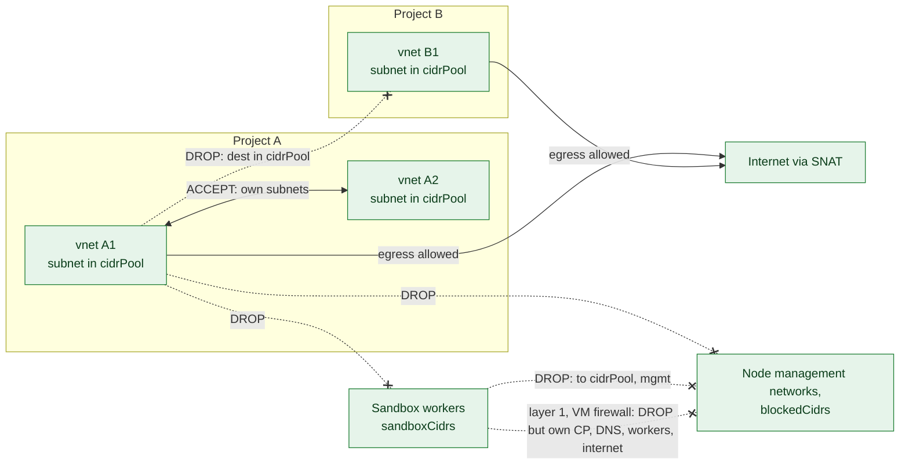
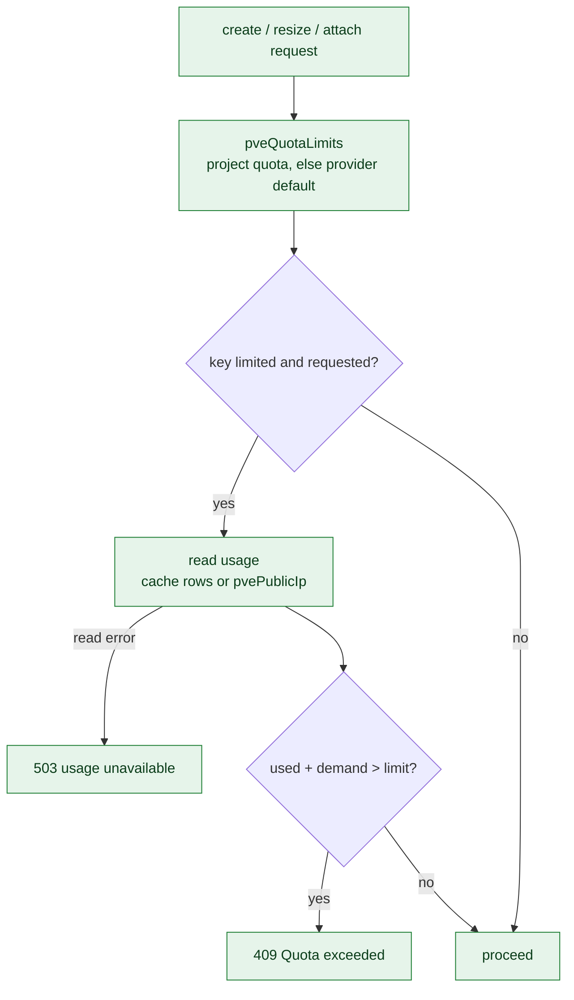
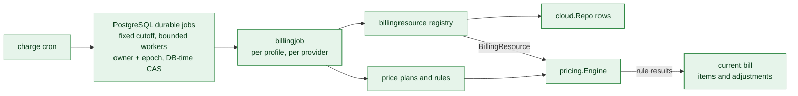
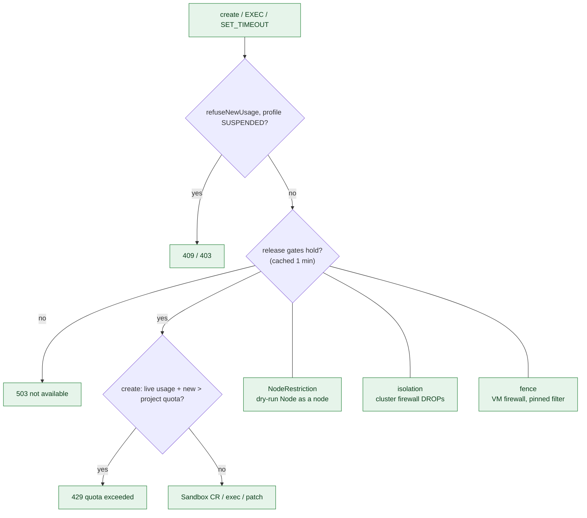
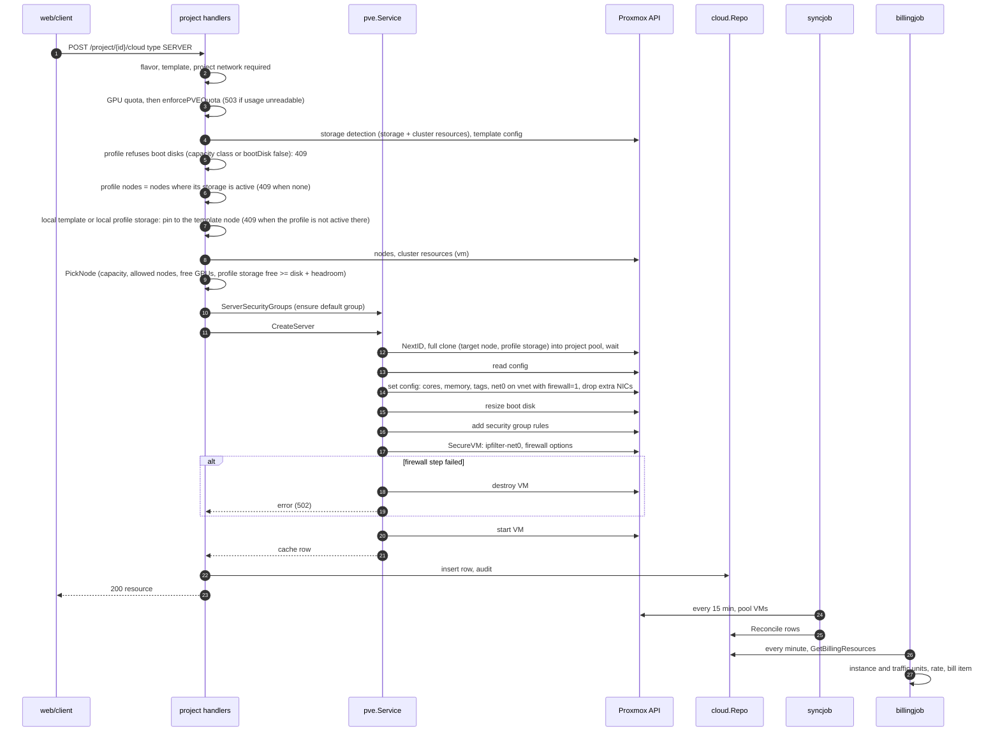
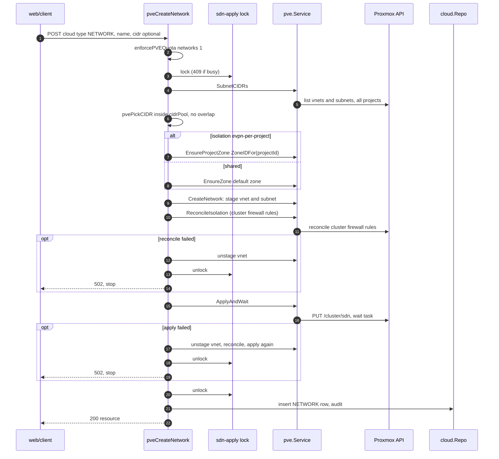
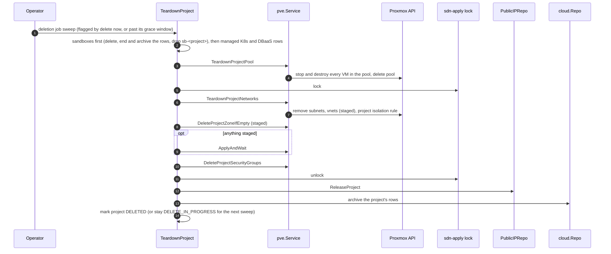
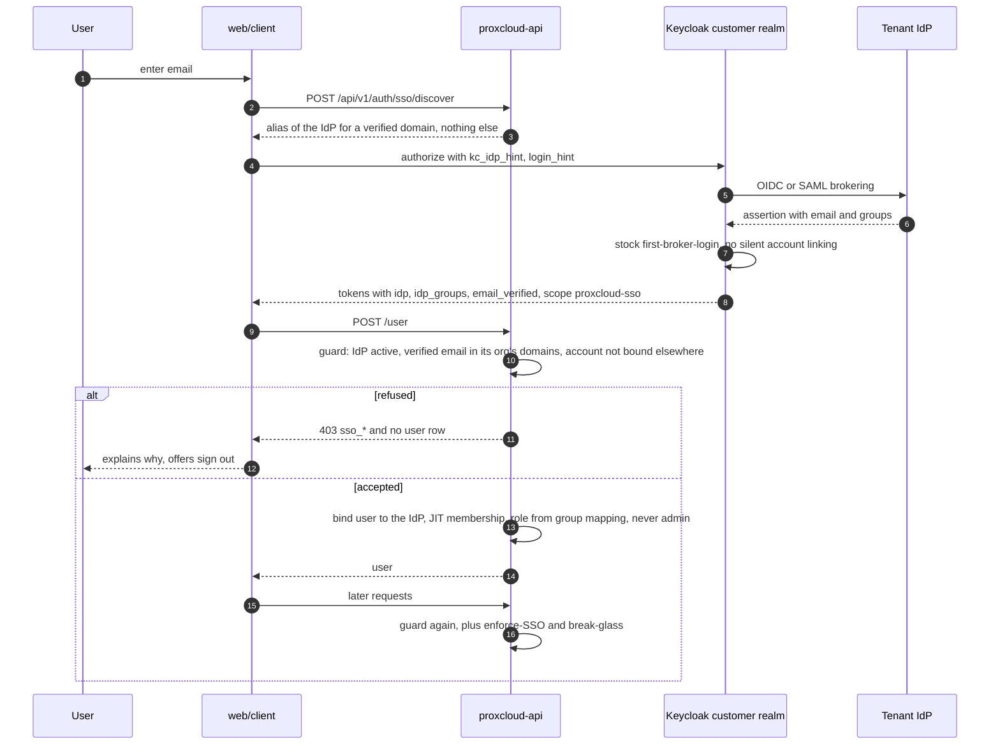

# C4: Code

Code-level views of the components where a mistake costs the most: tenant network
isolation, the VM firewall and public IPs, quota enforcement, and the billing
rating path. Each section lists the key functions with `file:line` (a snapshot,
see the [maintenance rule](README.md#maintenance-rule)), then explains the
invariants the code holds. Four sequence diagrams follow.

Status legend: [README.md](README.md). Everything on this page is **Implemented**.

## Primary durable native billing

**Why:** original billing cutoff, money mutation, retry ownership and accepted work must survive process crashes without relying on a broker ACK or lagging replica.

| Symbol | Primary invariant |
|---|---|
| `pgdoc.Connect`, `Tx`, `q` | Every new primary connection rejects recovery/read-only; raw transaction bridge and all Store SQL reject a different DB's context. |
| `durablejobs.EnqueueTx` | Same `pgdoc.WithTx` business transaction, fixed kinds, bounded immutable payload and unique kind/key; rollback has no accepted work. |
| `ClaimKinds`, `Renew`, `Retry`, `Complete` | DB-clock due/expiry, SKIP LOCKED; UUID owner + increasing epoch + unexpired CAS; post-row-lock fresh time check. Unsupported provider-mode jobs remain untouched. |
| `Worker.Run` | Bounded concurrency/poll, SQL-only handler deadline and cancellation; final expiry rolls back all effects, retry jitter/attempt bounds/dead letters. |
| `Cycle`, `WithChargeReceipt`, `ChargeBillingResources` | Frozen original cadence/cutoff, one existing profile money lock and joined whole-profile transaction across all services. Retained receipt prevents business-commit-before-ACK duplicate money/units; issued cycles never reopen. |
| `Engine.At`, `advanceWatermark`, `getTimeUnitsDiff` | Per-call original clock (no shared engine mutation), no accrual past cutoff/deletion or watermark rewind. Current cache/pricing are not historical snapshots. |
| `BillSendService.SetChargeBacklog` | Under primary profile money lock defer on original-cycle pending/running/dead jobs; a post-issuance late publish requires reconciliation instead of invoice mutation. |
| Admin durable status/replay | Existing primary RBAC first; history only may use read pool, always marked lag-tolerant. Replay validates fixed original payload and atomically writes operator audit; no arbitrary code/payload editing. |

```mermaid
sequenceDiagram
  participant P as Cron / operator producer
  participant D as PostgreSQL PRIMARY
  participant W as Bounded API worker
  participant H as Optional read-only history pool
  P->>D: EnqueueTx same business commit (original profile/unit/cutoff)
  W->>D: SKIP LOCKED claim UUID owner + epoch + DB lease
  W->>D: begin WithTx; lock job, verify owner/epoch/unexpired
  W->>D: profile money lock; retained receipt check
  W->>D: DB cache resolve; all service bill mutations + receipt
  W->>D: final unexpired owner/epoch ACK CAS; COMMIT
  Note over W,D: Error/expiry/cancel rolls back money + receipt + ACK
  W->>D: fenced bounded retry or visible dead letter
  P->>H: lag-tolerant status only, never claims/auth/finance
```

This is at-least-once execution with atomic native financial effects, NOT exactly-once SMTP/HTTP/cloud execution. External billing HTTP behavior remains separate with no native fallback. Mail/invite delivery remains best-effort; SSE stays pod-local. Schema/resource deployment and legacy queue drain/removal are separate rollout work. [Operator contract](../../durable-jobs.md).

## Durable savings reminder decisions (PR A + enqueue-only PR B)

**Implemented, producer opt-in only:** `PROXCLOUD_MAIL_REMINDER_OUTBOX_ENABLED=false`
by default. True requires the strict >=32-byte key and atomically queues savings-expiry
reminder decisions; it does **not** register production SMTP dispatch or enable other
notification families. Invoice/Collect, activation/dunning and invitations remain best-effort.

| Business symbol | Atomic boundary / why |
|---|---|
| `scheduleDurableReminder`, `queueReminder` | PRIMARY contract -> reminder locks; reread ACTIVE/current UTC expiry generation; deterministic schedule ID and selected window. Render one template snapshot, seal/enqueue and store queued/skipped markers in ONE owned transaction. Failure rolls all back. |
| `ReminderOutbox`, composition adapter | Narrow billing-owned DTO, no billing->mail dependency; sorted per-event recipient ordinals, no public email hashes. `PrepareTemplateSnapshot` does no SMTP and no second template read. |
| `MutateSavingsContract`, `WithSavingsContractMutation`, expiration | Client/admin local edits/delete join the same boundary. Expiry/status/profile changes cancel persisted non-dispatching IDs; admin no-op/render-only edits preserve future windows and frozen selections. |
| `CancelPendingTx` | Keyless capability always wired, even producer OFF. Same primary TX cancels pending/claimed/blocked, fences claim ownership; never cancels DISPATCHING/UNKNOWN/accepted/dead or mutates encrypted payload/attempt journal. |
| Legacy / OFF behavior | `sentAt` remains processed/no-resend evidence; `deliveryQueuedAt`/outbox IDs never mean delivered. Any durable history prevents OFF-mode random legacy rescheduling or direct SMTP fallback. No historical backfill. |

```mermaid
sequenceDiagram
  participant B as Opt-in savings reminder decision
  participant D as PostgreSQL PRIMARY
  participant M as Pure template preparation
  B->>D: WithTx contract lock, reread ACTIVE/endDate/generation
  B->>D: Lock deterministic reminder; choose tightest due window
  B->>M: Render one loaded template snapshot, no SMTP
  M-->>B: Sanitized draft or explicit suppression/error
  B->>D: EnqueueTx seals single-recipient envelopes
  B->>D: Save queued IDs/at + skipped markers; COMMIT together
  Note over B,D: Render/key/enqueue failure rolls back; queued is NOT sent
  B->>D: Cancel/extend/expire/admin change joins same locks + CancelPendingTx
  Note over B,D: Producer OFF retains cancellation; no durable-to-legacy SMTP fallback
```

| Symbol / component | Primary invariant |
|---|---|
| `mailoutbox.EnqueueTx` | Exact owning pgdoc transaction; fixed savings-reminder/v1 DTO, event/generation/window/opaque recipient identity, at most 20 single-recipient immutable envelopes; no hidden transaction. |
| `PrepareReminder`, `textcrypt.BlobKeys` | Stable MIME-safe From/To/subject/Date/Message-ID; max 1 MiB wire, no attachments; strict AEAD bytea with ID/kind/version/key-ID AAD, keyed plaintext fingerprint, retained key IDs and fail-closed missing/corrupt keys. |
| `Claim`, `Renew`, `BeginDispatch` | Primary DB-clock UUID/epoch leases; post-row-wait fresh clock plus final TTL after journal insert. Expired CLAIMED rescues, but intent commits before connect and expired DISPATCHING becomes UNKNOWN, never a retry candidate. |
| `DurableSMTP.Deliver` | Context dial + real socket deadlines/cancellation; mandatory TLS outside explicit literal-loopback test adapter; one RCPT; pre-EOD known-unsent vs possible-EOD UNKNOWN; DATA250 accepted even if QUIT fails. |
| `RecordOutcome`, attempt journal | Append-only attempt-specific receipts. Same UNKNOWN attempt may accept late definitive evidence; older attempt cannot update newer ownership. At most 8 intents, jitter, expiry=min(contract end, frozen decision+30 days). |
| Read-only admin status | Primary RBAC `admin:bill:read` before opaque IDs/state/reasons/counts/times; no recipient, body, subject, credential or raw SMTP error. No resend/edit/replay API or extra read pool. |



Relay acceptance is not inbox delivery and stable Message-ID does not provide exactly-once SMTP.
[Safety limits and local test evidence](../../mail-outbox-safety-limits.md).

## Holder operation fencing (R1)

**Why:** PVE tasks outlive HTTP cancellation and PostgreSQL session loss does not
stop a callback. Timeout-only changes made new-holder/carrier cleanup unsafe.

| Component / symbol | Responsibility and invariant |
|---|---|
| `lock.Leases` | Separate from scheduler ShedLock: UUID owner, retained monotonic epoch, DB clock; renew/check/release CAS only the unexpired acquisition. Row-lock wait is followed by a fresh clock check. |
| `HolderOperationRepo.Begin` | Short transaction commits one unique, nonexpiring `DISPATCHING` intent per provider/project **before** POST. Lease expiry never admits a writer past pending work. No PVE I/O inside SQL transactions. |
| `beginHolders`, `holderTask`, `holderSync` | Renewable local session, cancel on lease loss; journal first, real UPID after response, no unknown cleanup/release. Known recovery observes only and returns refresh-required409, not another mutation. |
| `holderIdentity`, `holderEffect` | Exact node/pool/SMBIOS UUID and disk/config effect readback after stopped task; create UUID is sent in first POST. Delete binds stopped qmdestroy to the original VMID and positively authorized pool absence;403 alone is not absence. |
| `WaitTaskBounded` | Additive typed observation:5minute holder config/power,15minute carrier migration,60second settlement. Timeout/403/404 means uncertain, never task termination or destructive compensation. Generic heavy-operation WaitTask unchanged. |
| `RetireServer`, `DeleteServer`, `DeleteProjectBackups`, `TeardownProjectPool` | Same fence before delete precursors; nested helpers retain the session. Protection tag/HA/replication mutations in this path use dispatch intent adapters. Legacy blank VM auto-destruction disabled when durability is wired. |
| Admin holder status / poll | Admin-only evidence read, exact operation ID for poll-only recovery. No force-clear/no-UPID automatic recovery API. |

```mermaid
sequenceDiagram
  participant W as API worker
  participant D as PostgreSQL
  participant P as PVE
  W->>D: acquire UUID owner + epoch lease (DB clock)
  W->>P: positive node UUID / pool / disk read
  W->>D: short transaction: lease check + DISPATCHING intent, commit
  W->>P: mutation POST (PVE accepts no fencing token)
  P-->>W: real UPID or lost response
  W->>D: append actual UPID, if known
  loop bounded observation; independent renewable lease
    W->>P: poll known UPID only
    W->>D: CAS renew same unexpired acquisition
  end
  W->>P: stopped + fresh owned node identity/effect readback
  W->>D: CAS settle exactly once; release lease
  Note over W,D: Lost response/save/status/lease => pending survives TTL; no cleanup
```

The nonexpiring intent closes the check/POST successor gap. It does not make PVE
exactly once, serialize external administrators or turn a TTL into proof. Unknown
without UPID is an accepted operator-held availability tradeoff. See the
[operator contract and test evidence](../../holder-operation-fencing.md).

## C4.0 Permission-filtered network inventory and file-share ownership

**Why:** PVE's SDN list is permission-filtered: `200 []` can mean that the configured
portal token lost visibility, not that all tenant networks were deleted. Archiving
those rows also removes their CIDRs from the next NAS export reconcile. Partial
lists and omitted subnet details have the same failure mode.

| Symbol | Location | Safety boundary |
|---|---|---|
| `InventoryVerifier`, `Reconcile` | `internal/cloud/providers/providers.go` | Optional scoped proof after listing and before **any** cache write. Failed proof leaves all rows unchanged. The vanished scan only archives row versions included in the proof. |
| `NetworkSyncProvider.VerifyInventory` | `internal/cloud/pve/inventory.go` | Same configured token, effective permissions (no `userid`), namespace + zone + exact cached/listed vnet paths. Requires `SDN.Audit` **or** `SDN.Allocate`; a broad grant alone cannot override a narrower `NoAccess`. |
| `GetSDNVnet`, `GetSDNSubnet`, `verifyGlobalSDNVisibility` | `internal/cloud/pve/sdn.go`, `inventory.go` | Revalidate omitted vnets/subnets even in a nonempty list. Actual PVE9 returns the same exact target-specific400 for missing and hidden objects, so absence also requires complete stable ACL visibility: self `Sys.Audit` on `/access`, full ACL snapshots and propagated SDN rights at every SDN shadow boundary. Exact old-path rights alone cannot exclude a move into a hidden zone. A live same-owner omission fails; a positive foreign alias retires only the old project's row. No broad500 substring matching. |
| `NetworkSyncProvider.List` | `internal/cloud/pve/network.go` | Ownership-alias tenant filter remains mandatory. A failed subnet read is an error, never an empty replacement for cached CIDRs. |
| `InventoryUntrustedError` | `internal/cloud/inventory.go` | Typed failure; sync logs a repair-token warning. No root credential, automatic permission widening, timestamp heuristic or blanket empty-list exemption. Tokens unable to prove completeness retain rows and require operator repair. |
| `UpdateIfUnchanged`, `DeleteAndArchiveIfUnchanged`, `InsertIfAbsent` | `internal/cloud/inventory_repo.go` | Under a transaction row lock compare the complete proved row, then mutate; archive+delete commit together. Concurrent CIDR/owner/externalID changes invalidate proof even with an unchanged timestamp. New inserts never overwrite a concurrent row. |
| `inventoryFailures`, `ReconcileIsolationInventory` | `internal/cloud/syncjob/inventory.go`, `internal/cloud/pve/network.go` | Invocation-local failure suppresses later export callback, isolation/blank-VM passes and provider seed sweep. Scheduled isolation uses cached verified CIDRs, not a second filtered SDN census. A NAS processed earlier still reads unchanged preserved cache rows. |
| `ValidateTrueNASOwners` | `internal/platform/externalservice/truenas_ownership.go` | One provider per project for one canonical API backend + parent dataset. Reject duplicates regardless of credentials, `snatSources` or disabled state; those providers can still own existing exports. |
| `trueNASServices`, `checkShareOwner` | `internal/platform/project/cloud_shares.go` | Refuse automatic export changes, direct share mutations and export-bearing address release on a conflicting project before NAS writes. Sync also refuses duplicate SHARE caching. Other projects and other NAS backends/parents remain usable. |

A genuine empty inventory **does** archive when by-id missing responses and
complete effective visibility prove absence; the normal next share reconcile
removes those CIDRs. Underprivileged legacy tokens retain safely with a warning
rather than guessing whether an object moved into a hidden zone. This keeps delete-of-vanished and billing termination functional. Recovering
permissions preserves the original row IDs/ages and an unchanged second pass
settles at zero. This opt-in capability does not change other providers' existing
`KeepUnread`, node-offline status handling, vanish grace, moving rows, holder/build/
restore exclusions or CSI registry-owned VOLUME rows. Partial VM inventory, orphan-IP
release and independent seed cleanup need their own visibility proofs; this NETWORK
phase does not claim those paths are closed.

The NAS configuration comparison normalizes `https`/`wss`, host case, default port,
trailing API path and parent slashes. It cannot discover that two different hostnames
or proxy addresses lead to the same physical NAS: use one canonical endpoint per NAS
and disjoint parent datasets when separate providers are intentional. Do not resolve
DNS or compare API keys to guess backend ownership.

Regression evidence: fake PVE HTTP200-empty/partial + explicit403/masked404 + exact
ACL shadow + foreign-owner cases; actual PostgreSQL reconciliation and TrueNAS RPC
export updates across two failed rounds, restored visibility/settles0, and legitimate
delete/archive/export revocation. Generic reconciliation, grace and `KeepUnread`
regressions run alongside them. Operator repair: [PVE permissions](../../proxmox-permissions.md#inventory-visibility-repair).

## DNS creation authorization



- `powerdns.CanonicalZone` is the sole identity for new names: IDNA A-label, strict labels, recognized PSL suffix below
  its registry/private boundary. `_proxcloud-ownership.` is a constant record prefix, not a tenant query fragment.
- `LookupProofTXT` connects only to literal endpoints from operator policy, never tenant input or host system DNS. Exact
  question/ID/owner/TXT and no CNAME/DNAME/truncation; multiple RR chunks concatenate within one RR only. Conventional DNS
  trust, not DNSSEC. Any configured trusted endpoint can prove control; stale/missing answers only delay success.
- `dnsUpdate` uses `GetForUpdate` for **every** state mutation: stale verification/backoff/cancel cannot resurrect a
  consumed proof. No external DNS or PowerDNS work occurs inside a row transaction. No nested session lock is needed.
- `dnsProjectLock` uses try-lock429 to prevent one tenant's queued requests occupying the shared lock pool. Global
  create try-lock409 is held only for fresh, scoped, still-valid verified proofs and actual bounded upstream create.
  A10s total create deadline plus durable60s per-project attempt cooldown across every proof/provider bounds one valid
  owner's slow-backend retries. Busy/invalidated proofs spend no attempt; failed live preflight does.
- `CreateWithGate` calls `consumeDNSProof` **after** live preflight and **immediately before** upstream POST. Its short
  row transaction rereads current project/permission/provider/config and state, then commits single-use consumption.
  Revocation after that point is not rollback of an already authorized external request. A timeout requires checking the
  zone list; it never restores the proof. The post-create live overlap guard remains for operator/out-of-band races.
- Existing zones are not retroactively gated/deleted. Same-project parent TXT can prove a child; a foreign/operator
  overlap never can. Pending/verified records exclude no other project from challenge or proof.

## C4.1 Tenant network isolation

| Symbol | Location | Role |
|---|---|---|
| `pveCreateNetwork` | `internal/platform/project/cloud_network_pve.go:78` | `POST /project/{id}/cloud {type:NETWORK}` on a Proxmox provider |
| `lockSDN`, `withSDNLock` | `cloud_network_pve.go:38`, `:54` | Platform-wide `sdn-apply` lock (PostgreSQL); busy returns 409, a crashed holder expires after 3 minutes |
| `pvePickCIDR` | `cloud_network_pve.go:255` | Requested CIDR must sit inside `cidrPool`, be `/29` or larger and overlap nothing; blank picks the first free `/24` |
| `Service.SubnetCIDRs` | `internal/cloud/pve/network.go:298` | Every subnet on the cluster (all zones, all projects, foreign vnets), read under the lock |
| `Service.CreateNetwork` | `network.go:161` | Stages vnet `v<5 base36>` with alias `st:<projectId>:<name>`, then its subnet (gateway, DHCP range, SNAT) |
| `Service.VnetStaticPoolFor`, `staticHostRange`, `dhcpRange` | `internal/cloud/pve/network.go` | Platform-assigned IPv4 hosts are independent of PVE DHCP sizing. `/29` and `/30` static pools use usable hosts; `/28` and larger retain network+10. Network/broadcast and gateway endpoints are excluded; `pickPublicIP` skips a gateway inside the span and allocated addresses. Malformed, IPv6 and `/31`–`/32` static subnets fail without returning empty range endpoints. DHCP keeps its `/28` minimum. |
| `ZoneIDFor` | `network.go:341` | Per-project EVPN zone id: `p` + 7 base36 chars of `sha256(projectId)` (8 chars, the PVE limit) |
| `Service.EnsureProjectZone` | `network.go:353` | Stages the project zone from the default EVPN zone template; next free VRF VNI (from 10000); refuses an id collision with another owner |
| `isolationRules`, `projectIsolationRules`, `Service.isolationOwner` | `network.go` | This portal's provider-wide DROPs, one project's ACCEPTs, and the comment that marks the DROPs as this portal's (below) |
| `Service.ReconcileIsolation` | `network.go` | Brings the cluster firewall to the rule set: rebuilds this portal's DROPs when they are missing or the networks changed, then this project's ACCEPTs over all its subnets. Called on every network change and, per project, from the sync job |
| `Service.deleteClusterRule` | `network.go` | Deletes a rule by identity: fresh position, sent with the list's digest, so a list edited in between can never cost another rule |
| `Job.reconcileIsolation` | `internal/cloud/syncjob/job.go` | Per sync cycle and project, under the `sdn-apply` lock; a busy lock skips to the next cycle |
| `Client.ManagementCIDRs` | `internal/cloud/pve/cluster.go` | The networks of the bridges carrying a node's own IP or gateway; always blocked |
| `Service.ApplyAndWait` | `network.go:553` | `PUT /cluster/sdn` and wait for the task |
| `pveDeleteNetwork` | `cloud_network_pve.go:175` | Refuses while a pool VM NIC uses the vnet; deletes, re-reconciles, stages an empty project zone for removal, applies once (PVE accepts both in one apply) |
| `Client.AddClusterFirewallRule`, `DeleteClusterFirewallRule` | `internal/cloud/pve/firewall.go` | Cluster firewall REST calls |

**Isolation modes** (`config.network.isolation` on the provider):

- `shared` (default): every tenant vnet sits in the provider's default zone, one
  routing domain. The rule set below drops traffic between tenants.
- `evpn-per-project`: each project gets its own EVPN zone (its own VRF) with id
  `ZoneIDFor(projectId)`. The same rule set still applies, because exit nodes leak
  every VRF into the default table and the VRF alone is not a wall.

**Managed rule set in the cluster firewall**, top to bottom (first match wins):

1. Two per project, comment `proxcloud:isolation:<projectId>`: `FORWARD ACCEPT` and `IN
   ACCEPT`, both `source=<project subnets> dest=<project subnets>` (absent when the project
   has no subnets, since an empty field means "any").
2. `FORWARD DROP source=<cidrPool> dest=<cidrPool>`.
3. `IN DROP source=<cidrPool> dest=<cidrPool>`: a gateway address lives on the node, so
   pinging another tenant's gateway is input, not forward. The project's own `IN ACCEPT`
   keeps its own gateways reachable.
4. `FORWARD DROP source=<cidrPool> dest=<management networks, blockedCidrs, sandboxCidrs>`.
5. `IN DROP source=<cidrPool> dest=<management networks, blockedCidrs, sandboxCidrs>`: an exit
   node's own addresses are reached through input, not forward.
6. Only with `network.sandboxCidrs` (the sandbox cluster's worker vnet): `FORWARD DROP` and `IN
   DROP`, `source=<sandboxCidrs> dest=<cidrPool, management networks, blockedCidrs>`. Sandbox
   workers leave through an exit node that SNATs them to a node address, which the NAS exports and
   the management hosts admit, so their drop must happen here, before the rewrite. An entry that
   overlaps `cidrPool` or a blocked network (the management networks included) is refused (the
   reconcile fails and writes nothing). Above these two, `FORWARD ACCEPT` and `IN ACCEPT` over TCP from
   `<sandboxCidrs>` to each `address:port` the workers' VM firewall opens out (`config.sandbox.registry`,
   `buildStorage`, `portal`; `ExternalService.PVESandboxEndpoints`), one address and port per rule: such an endpoint
   may sit on a management network (the lab's build bucket does), and the DROP would otherwise undo the VM
   firewall's opening. An endpoint inside `cidrPool` or an operator `blockedCidrs` range is never opened. The isolation
   gate reads these as part of the exact rule set.

**Layer 1, the sandbox workers' VM firewall** (`internal/cloud/pve/sandboxfw.go`, `syncjob/sandboxfw.go`, provider
`config.sandbox`). The rules above see routed traffic only. Every VM of the sandbox pool also gets `firewall=1` on each
NIC, VM options `policy_in`/`policy_out` `DROP` with `ipfilter` and `macfilter`, and as its only rule a reference to a
cluster security group `sbx<pool hash><content hash>` whose rules all ACCEPT: its control plane's API and konnectivity
ports, DNS to the configured resolvers, VXLAN, Cilium health, MetalLB memberlist and the kubelet between workers (IP set
`<group>-n`), the kubelet from `kubeletSources`, with `config.sandbox.proxy` TCP 443 from the entry appliance's vnet
address to `sandbox-proxy`'s MetalLB address alone (SB4), with `config.sandbox.registry` TCP out to the sandbox
registry's address and port alone (SB6a), with `config.sandbox.buildStorage` TCP out to the template build bucket's
address and port alone (SB6b), with `config.sandbox.portal` TCP out to the portal API for wakes (SB7), and the
internet (IP set `<group>-o`: everything minus the private
ranges, the management networks, every node address, the sandbox's SNAT address, `blockedCidrs`, `cidrPool`, the
sandbox subnet and the control plane). With every
rule an ACCEPT under DROP policies, no order or partial write opens anything; a changed set is a new generation that
workers move to before the old one is deleted. `ipfilter-net0` is the worker range until its Node joins, then pinned
to the Node's address once (read only while the worker is tainted, never followed after) plus the MetalLB range. The
sync job applies it every cycle and only then takes the `proxcloud.io/unsecured` taint off a worker at least 20 minutes
old; a cleared worker found unfenced (the datacenter firewall off included) gets the taint back. Details:
[managed-sandbox.md §2](../../managed-sandbox.md#2-layer-1-the-vm-firewall-on-the-workers-sb2b).

**Layer 1b, the host anti-spoof guard** (installer `sandbox-icmp-guard.py` + a systemd timer on every `pve` node).
PVE's bridge firewall accepts ICMP error types and conntrack established/related before the per-NIC `ipfilter`, so a
worker can forge their source. The guard installs a host nftables chain (`table bridge proxcloud-sandbox`, prerouting
priority -300, before PVE's) that drops any IPv4 frame leaving a worker's tap whose source is not in that worker's
`ipfilter` set, read from PVE's cluster config each run; every node pins every worker, so a migrated one is covered. It is the installer's and not the sync's: the portal's PVE token reaches the API, never a node shell.

**Who owns the DROPs.** A cluster normally has one portal, which owns its DROPs outright: a
changed `cidrPool` or `blockedCidrs` replaces them and leaves none behind. Their comment is
`proxcloud:isolation` for the default pool prefix `pc-` (clusters already running need no
migration) and `proxcloud:isolation/<poolPrefix>` for any other. A portal only rewrites DROPs
carrying its own comment, and only moves ACCEPTs inside its own pool, because those are the only
ones its new DROPs can shadow. So a second portal on the cluster, with another pool prefix, can
never remove the DROPs protecting the first one's tenants, whatever its pool. What this does not
give two portals with different pools is isolation between them: add each portal's pool to the
other's `blockedCidrs`.

These are cluster rules, not vnet rules, because traffic between subnets is routed by
the node: on PVE 9.2 with `proxmox-firewall`, vnet `FORWARD` rules only see frames
switched inside one vnet bridge, and a routed packet never hits them. Traffic inside
one vnet is switched and needs no rule. There is deliberately no blanket
`DROP source=<cidrPool>`: it would also drop egress to the internet through SNAT.

Addresses: PVE offers DHCP on simple zones only (`dhcp` on an EVPN zone is refused). On a
zone without DHCP the platform allocates the server's `net0` address when it clones the VM
(`VnetStaticPoolFor`, `staticHostRange`, `PublicIPRepo.Allocate`, a row on NIC `net0`), writes it to `ipconfig0`,
and pins `ipfilter-net0` to that `/32`. A valid `192.0.2.0/29` with gateway `.1` allocates `.2`–`.6`;
large subnets retain the network+10 reservation (an upper `/25` starts at `.138`, not `.10`).
The range uses whole IPv4 addresses and never crosses its subnet or includes network/broadcast.
An interior gateway remains inside the span but is never allocated. The network-create API still
accepts `/29` or larger; accepting backend `/30` static hosts does not widen that API. DHCP ranges
are separate and retain their minimum 16-address subnet. On a DHCP zone the set is the subnet plus `0.0.0.0`,
because `proxmox-firewall` checks ipfilter before `dhcp=1` and would drop DISCOVER.



Invariants:

- The CIDR pick and the vnet staging happen under the same lock, so two concurrent
  creates cannot land on one range, and `SubnetCIDRs` also sees staged networks.
- The rule set is reconciled **before** the SDN apply. If reconcile or apply fails, the
  vnet is unstaged and the apply re-run. New DROPs go in before old rules go, so every
  step fails closed.
- Every sync cycle reconciles each project, so a project made before a rule change gets it
  within 15 minutes and a rule deleted or disabled by hand comes back (the compare includes
  `enable`; so does the lookup of a rule to delete, so a disabled copy goes and its enabled twin stays). An
  up-to-date cluster takes no write.
- A node that is down does not block a network change: its networks are left out of the check,
  DROPs already in place stay until it is back, and the project's ACCEPTs are still set.
- Rules are deleted by identity with the list's digest. PVE has no rule ids and refuses a
  stale digest, so an operator or a second portal editing the list cannot make a delete hit
  the wrong rule.
- The test connection (`internal/platform/admin/pveadmin.go:47`) refuses a cluster
  whose datacenter firewall is off or where a node still runs the legacy iptables
  firewall (it ignores FORWARD rules), so the rules above are actually enforced. It warns about
  each network store (NFS, CIFS, GlusterFS, iSCSI, external Ceph monitors) whose server is outside
  the dropped networks: a vnet's NAT gives its
  traffic a node's address, which a NAS export to the nodes admits.
- Verified live on PVE 9.2 in both isolation modes, on one node and across nodes: same
  project reaches its other vnets, another tenant and the management network are dropped,
  SNAT egress works, a spoofed source address is dropped. Verified again with packets for the
  gateway rules, the sync reconcile (rules removed by hand, traffic state before and after) and
  two portals with different pools on one cluster.
- Outside this rule set: a public NIC is bridged straight to the uplink, so no cluster rule
  applies and the VM reaches whatever the uplink routes. Filtering that is the operator's edge
  (see Public networks in the operator docs).

## C4.2a Load balancers

| Symbol | Location | Role |
|---|---|---|
| `Handler.pveCreateLoadBalancer`, `lbPlugPublic` | `internal/platform/project/cloud_lb_pve.go` | Row first, then a server build with no group and no seed; public NIC before first boot |
| `Handler.pveBuildServer` | `internal/platform/project/cloud_writes_pve.go` | The server create shared with `pveCreateServer`; `pveAppliance` is what only the platform can set |
| `Handler.pveLBApply`, `lbApplyLocked` | `cloud_lb_pve.go` | One balancer in line with its row: members re-resolved, config hash compared, pushed when it differs |
| `Handler.ReconcileLoadBalancers` | `cloud_lb_pve.go`, via `syncjob.WithLoadBalancers` | The pass on every sync; a stopped appliance is started here |
| `Handler.lbMemberAddress` | `cloud_lb_pve.go` | The ownership check of a member: pool, stamp, allocation on the balancer's network and subnet |
| `Handler.pveApplianceGuard`, `lbOwnerOf` | `cloud_lb_pve.go` | 409 on a tenant's direct action on the VM, its disk or its address; the VM's own tag decides, the balancer's record when it has no row yet |
| `refuseAppliance` | `lb.go`, in `AddVolume`, `AttachVolume`, `AttachTargets`, `CreateImage` | A request cannot name the appliance as a target |
| `Service.undoCreate`, `VMLeftError` | `internal/cloud/pve/write.go` | A failed create destroys its VM; its addresses go back only when PVE confirms it is gone. Every server create |
| `LBSpec.Validate`, `RenderHAProxy` | `internal/cloud/pve/lb.go` | Request checks; the config, safe on any stored row |
| `Service.PushHAProxy`, `SetVMInboundPorts`, `LBHealth` | `lb.go` | Install if missing, `haproxy -c`, swap, reload, swap back if the reload fails; listener ports on the VM firewall; `show stat` |
| `Client.GuestStart`, `GuestRun`, `GuestWriteFile` | `internal/cloud/pve/agent.go` | Guest agent `exec` and `file-write`; only ever used on a VM with the `pc-lb-` tag |
| `PublicIPRepo.AllocateBeforeRow` | `internal/platform/project/publicip_pve.go` | A public address taken during the build, which `orphanIPs` must not read as a reused vmid |

## C4.2 VM firewall, default security group and public IPs

| Symbol | Location | Role |
|---|---|---|
| `Service.CreateServer` | `internal/cloud/pve/write.go:68` | Clone, configure, resize, firewall, start |
| `nicFirewallParams`, `extraNICKeys` | `internal/cloud/pve/firewallsvc.go:193`, `:211` | `firewall=1` on every NIC; drop every cloned NIC beyond `net0` and its `ipconfigN` |
| `vmFirewallOptions` | `firewallsvc.go:243` | `enable=1 ipfilter=1 macfilter=1 dhcp=1 policy_in=DROP policy_out=ACCEPT` |
| `Service.SecureVM` | `firewallsvc.go:257` | `ipfilter-netN` = the vnet's subnets for each NIC on a tenant vnet, then the VM firewall options |
| `Service.SetIPFilter` | `firewallsvc.go:295` | Makes an ipfilter set hold exactly the given CIDRs; a changed set is dropped and rebuilt (fail closed) |
| `defaultGroupRules`, `EnsureDefaultSecurityGroup` | `firewallsvc.go:351`, `:361` | Project `default` group: ingress from `cidrPool` only (other tenants are already dropped by the isolation rules) |
| `Service.ServerSecurityGroups` | `firewallsvc.go:386` | Resolve the user's group names or ids to owned groups; none given means the default group |
| `pvePublicNetworkAction` | `internal/platform/project/cloud_network_pve.go:315` | `ATTACH_PUBLIC_NETWORK` / `DETACH_PUBLIC_NETWORK` on a server |
| `PublicIPRepo.Allocate`, `allocatePublicIP`, `pickPublicIP` | `internal/platform/project/publicip_pve.go:75`, `:101`, `:125` | Lowest free address of the network's pool; insert with primary key `serviceId/networkId/ip`, retry on a duplicate |
| `Client.ManagementBridges` | `internal/cloud/pve/cluster.go:85` | Bridges carrying a node's own IP or gateway; a public network on one is refused |

Invariants:

- A server must sit on one of the project's own networks. The template's NIC is
  replaced by `net0` on the tenant vnet; any other cloned NIC is removed, so a
  template made from a VM with a public NIC cannot hand out that VM's bridge or
  ipfilter. A clone also inherits the source's firewall rules, so they are cleared before
  the chosen groups are added.
- The firewall is configured **before the first boot**. If adding a group or
  `SecureVM` fails, the VM is destroyed rather than started open.
- A NIC on a bridge that is not a tenant vnet gets an empty ipfilter set, which
  drops its IPv4 egress until the public IP pool pins an address to it.
- Public attach order: quota check (`floatingIps`), allocate, `SecureVM`,
  `ipfilter-net1` = the address `/32`, then plug `net1` with `firewall=1`. Detach
  empties the ipfilter set first, unplugs, and only then returns the address.
  Server delete and project teardown release the server's or project's addresses.
- A public NIC takes the default route: a static `net0` loses its gateway while one is
  attached, because replies from the public address must not leave through the overlay.
  The guest picks up `ipconfig1` and the route change at its next boot, so attach and
  detach answer `rebootRequired: true`.

## C4.3 Quota enforcement

| Symbol | Location | Role |
|---|---|---|
| `pveQuotaLimits` | `internal/platform/project/cloud_quota_pve.go:40` | The project's quota, else the provider default (`config.provisioning.quota`) |
| `Handler.enforcePVEQuota` | `cloud_quota_pve.go:49` | Gate a demand against the limits |
| `checkPVEQuota` | `cloud_quota_pve.go:70` | The pure gate: reads usage only for limited keys that are requested; a usage read error returns 503 |
| `Handler.pveQuotaUsage` | `cloud_quota_pve.go:103` | Sums the project's cache rows on the provider: servers, vCPUs, RAM, networks, volume GB |
| `pveResizeDemand` | `internal/platform/project/cloud_writes_pve.go:591` | Resize demand = new flavor minus cached flavor for vCPUs, RAM and boot disk |
| `Handler.enforcePVEGPUQuota` | `cloud_writes_pve.go:605` | GPU quota per model; a resize frees the replaced flavor's GPUs first |
| `BootstrapProxmoxOnto` | `internal/platform/project/bootstrap.go:96` | Seeds the provider default quota onto a project that has none |

Keys: `servers`, `vcpus`, `ramMb`, `diskGb`, `networks`, `floatingIps`, plus the
`gpu` map. Sandbox keys (`sandboxes`, `sandboxVcpus`, `sandboxRamMb`, `sandboxGpus`) live on the same
document but follow C4.5: an absent one falls back to the sandbox provider's default, never to unlimited. A key absent from a non-empty quota is unlimited; with no project quota
and no provider default, everything is unlimited. `floatingIps` usage is counted
from the `pvePublicIp` table, not the cache.

| Gate point | Demand |
|---|---|
| Server create | `servers 1`, flavor vCPUs and RAM, root disk (the user's root size when given) |
| Server resize | `pveResizeDemand` (shrinks count as 0) |
| Volume create / extend | size, or the growth |
| Network create | `networks 1` |
| Public IP attach (new address) | `floatingIps 1` |



## C4.4 Billing rating path

| Symbol | Location | Role |
|---|---|---|
| `MinutelyChargeSpec` and siblings | `internal/platform/scheduler/scheduler.go:20` | Charge crons (minute, hour, month) |
| `nativeProvider.Charge` | `internal/platform/billingprovider/billingprovider.go` | Persist fixed-cutoff per-profile native billing work on the writable PostgreSQL primary; no broker dispatch |
| `chargeCycle` | `internal/platform/billingjob/billingjob.go:326` | The cycle of a pass: a minute or hour pass on the 1st at 00:00 closes the month before |
| `Service.Charge`, `ChargeProfileByID` | `internal/platform/billingjob/billingjob.go:56`, `:104` | Per active billing profile |
| `Service.chargeBillingResource` | `billingjob.go:128` | Per provider: resolve resources, select plans and rules, rate |
| `Service.billingResources` | `billingjob.go:252` | Every active project of the profile bound to the provider |
| `GetBillingResources`, `stampResourceValues` | `internal/cloud/billingresource/billingresource.go:26`, `:55` | Cache rows to billing resources via the type registry; stamps region, service id, createdAt |
| Registry | `cmd/api/main.go:511` | Server (with its snapshots and protection), volume, floating IP, image, K8s cluster, DB cluster, bucket, share, sandbox, sandbox snapshot. A load balancer bills as the VM, disk and address it is made of |
| `ServerProvider.GetBillingInformation` | `internal/cloud/billingresource/server.go:34` | `instance` unit (flavor, GPU) plus `instance_traffic` unit; not billed in DELETED, ERROR, UNKNOWN, BUILD |
| `SelectPricePlansForService`, `ApplicableRules` | `internal/platform/pricing/planselect.go:46`, `:60` | Profile plans plus public plans for the provider, filtered by time unit |
| `ChargeBillingResources` | `internal/platform/pricing/charge.go:26` | Under the profile lock: current bill, created on demand, rate each resource, adjustments, save |
| `Engine.ApplyPricePlanRules` | `internal/platform/pricing/engine.go:30` | Filters, tiers, modifiers per rule |
| `SaveChargingToBill`, `getTimeUnitsDiff` | `internal/platform/pricing/bill_build.go:28`, `:155` | Bill item upsert; units elapsed since the last rating |
| `Service.billAdjuster` | `billingjob.go:165` | Savings-contract discounts and price-adjustment rules after rating |



Public IPs from the Proxmox pool and project templates are not billing units yet
(Planned); they are bounded by quota (`floatingIps`, `diskGb`) in the meantime.

---

## C4.5 Sandboxes: the usage path and the release gates

| Symbol | Location | Role |
|---|---|---|
| `Handler.sandboxBillingGate` | `internal/platform/project/cloud_sandbox.go` | `refuseNewUsage` (deleting or DISABLED, so an operator's disable and a billing suspension alike), then the billing profile not SUSPENDED |
| `Handler.sandboxReleaseGate` | `cloud_sandbox.go` | The three release gates, cached per provider for a minute, fail closed |
| `ExternalService.SandboxProjectQuota` | `internal/platform/externalservice/sandbox.go` | Per key: the project's value, else `config.sandbox.projectQuota`, else 5 sandboxes / 16 vCPU / 32768 MB / 0 GPU |
| `ProjectQuota.check` | `internal/cloud/sandbox/quota.go` | Live sandboxes plus the new one against the project quota (429); the provider's per-sandbox limits apply first |
| `Job.SandboxReleaseGates` | `internal/cloud/syncjob/sandboxgate.go` | NodeRestriction, isolation and fence, read through the Proxmox provider of the workers (`config.sandbox.proxmoxServiceId`) |
| `probeNodeRestriction` | `sandboxgate.go` | Two dry-run Node creates impersonating a node: plain must pass, with a `node-restriction.kubernetes.io/` label must be refused by NodeRestriction |
| `Service.CheckSandboxIsolation` | `internal/cloud/pve/network.go` | Datacenter firewall on and this portal's isolation DROPs exactly those `ReconcileIsolation` writes for `sandboxCidrs` |
| `Service.CheckSandboxFence` | `internal/cloud/pve/sandboxfw.go` | Read-only: the current generation's sets and group exist unchanged, every untainted Node is a pool VM whose firewall reads back in place and whose filter is pinned to its address |
| `Handler.DeleteProjectSandboxes` | `cloud_sandbox.go` | D9: called by `billingCloudSuspender` on suspend; deletes every live sandbox and ends its row |
| `Handler.teardownSandboxes` | `cloud_sandbox.go` | Project deletion: delete, end and archive every sandbox row, then `DeleteProjectNamespace` |

Allowed while the project is DISABLED: list, `GET_LOGS`, delete. Refused: create, `EXEC`, `SET_TIMEOUT`
(the allow-list of `cloudAction` and the gate above), `REFRESH`.



## Sequence (a): create server



## Sequence (b): create network



## Sequence (c): project teardown

Triggered either by the operator's delete-project-now action (the `Teardown`
callback wired in `cmd/api/main.go`, run in the background) or by the scheduled
deletion job (`internal/platform/project/deletion.go`, through the
`projectTeardownDeleter` adapter in `cmd/api/main.go`). Both run `TeardownProject`
(`internal/platform/project/teardown.go:76`). Every Proxmox leg is idempotent, so a
failed teardown reports incomplete and can be re-run.



## Sequence (d): per-org SSO login

The guard runs in `pkg/auth.Enforce` before any handler, so a refused identity never gets a
ProxCloud user, whichever route it calls first. Keycloak runs before ProxCloud sees anything, so
an IdP asserting a foreign address does get a Keycloak account; `SweepForeignUsers` removes those.


