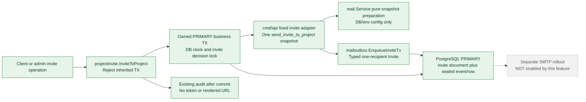
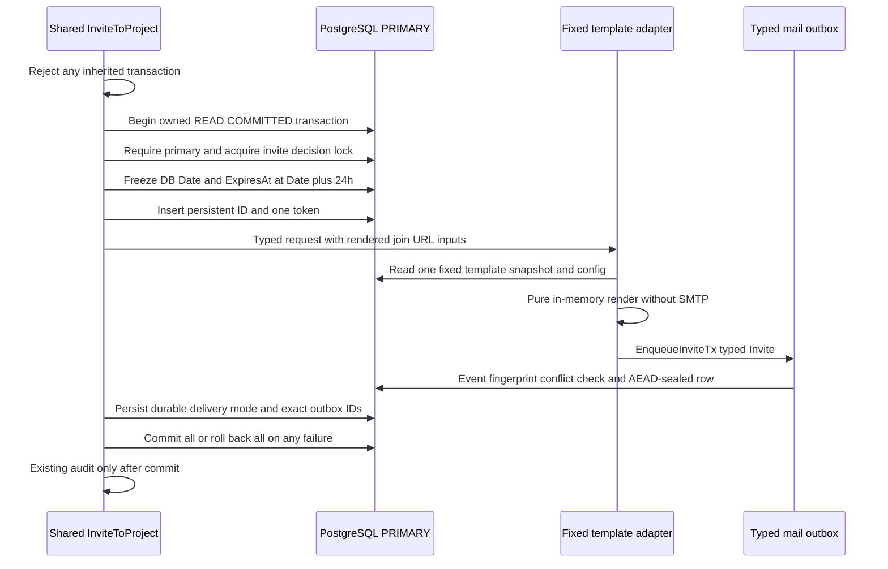

# PROJECT_INVITE transactional outbox (enqueue-only)

## Why and status

**Implemented, default OFF:** a project invitation and its immutable mail decision
commit together on PostgreSQL PRIMARY instead of committing a token and attempting
best-effort mail afterward. The existing shared client/admin service leg is the
single producer entry; this is not a generic templated job framework. The only
additional family is `project-invite/v1`, payload version 1, one recipient.

**Not implemented/authorized here:** a production SMTP dispatcher, real-recipient
activation, delivery rollout, replay/release/resend endpoints, attachments, other
mail families or a replica-backed decision path. Queue-only opt-in intentionally
cannot deliver email yet. SMTP relay acceptance is not inbox delivery and stable
Message-ID is not exactly-once delivery.

## Context, containers and components



All correctness reads, config snapshots, mutations, claims, payload reads and
cancellation use the same writable primary. The optional read-replica setting
continues to be only lag-tolerant history/metrics infrastructure; it is not passed
to this family. Schema setup and optional table setup occur before serving ON.

## Frozen decision and credential boundary



- Identity is hash of fixed kind plus persistent invite document UUID/hex ID,
  **not token or email**. Deliberate manual invitations create independent events.
- Exact immutable Date, expiry, raw From, recipient key/address, subject and
  rendered bodies are sealed and keyed-fingerprinted. Any change for the same
  ID conflicts, including blocked/suppressed inputs. No arbitrary event JSON,
  template key, attachment or transport can be selected by the caller.
- **Explicit new credential-bearing extension:** the rendered join URL contains an
  invitation token. The new outbox stores it only in its authenticated encrypted
  canonical body, never unsealed row metadata/event keys/status/errors/audit/logs
  or persisted raw template variables. String, GoString and structured-log DTO
  representations are redacted. No parser or renderer logs body content.
- The existing invite business document's token remains plaintext as before for
  lookup; this slice neither expands that schema's credential storage nor claims
  to encrypt the old invitation repository. Existing authenticated invite views
  retain their prior behavior, not a new outbox token/status API.

## Atomic cancellation and availability

Accept and decline cleanup remove **all** matching email/project invitations.
Opportunistic expiry uses the database clock. Both paths enumerate and lock exact
rows using stable 128-row keyset pages, then call keyless `CancelPendingTx` with
at most 20 **persisted IDs** per call in the same delete transaction. Cancellation
failure returns an error and rolls back every delete/cancel update. Nothing infers
IDs from email, template, token or state. All creates/deletes participate in the
same decision lock; READ COMMITTED is selected before the first snapshot so a
queued default-REPEATABLE-READ connection observes the prior writer's commit.

Lock order is decision -> invitation rows -> outbox rows. Workers lock outbox
only and never call into the invite repository; rendering/config resolution
inside the producer is DB/env-only. Large all-match cleanup therefore preserves
correctness at the cost of serializing invite decisions and potentially holding
locks longer. This is not a high-throughput parallel bulk-invitation API.

```text
pending / claimed / blocked / suppressed / no_recipient
    -- cancel persisted IDs in delete TX --> expired, cancelled, epoch fenced

DISPATCHING -- lease expires --> UNKNOWN (never automatically replayed)
    -- exact late same-attempt receipt --> accepted or known-unsent outcome
accepted / UNKNOWN / dead -- business cleanup --> unchanged outbox evidence
```

A claimed worker cannot create intent after a committed pre-intent cancellation.
An already-DISPATCHING socket cannot be unsent; mail may arrive after acceptance,
decline or token expiry. Do not promise otherwise. Expiry is not permission to
clear UNKNOWN or replay. Existing separate membership additions during acceptance
are unchanged: only cancellation plus invitation deletion is atomic here.

OFF affects **new legacy invitations** only. Persisted durable invitations are
never resent/fallen back/backfilled through the notifier. Their cancellation is
always wired even with the producer OFF or payload keys unavailable. Suppressed,
blocked and no-recipient rows are explicit non-delivery; no release endpoint is
added. ON requires high-entropy >=32-byte existing BlobKeys material, while OFF
retains short-key legacy startup compatibility without changing keys.

## Schema and binary compatibility

Startup `Ensure` owns a primary READ COMMITTED transaction and schema advisory
lock. It replaces the original named single-savings CHECK on an **existing**
table with exactly two kinds and version 1, checking the upgraded constraint's
actual validated CHECK definition on subsequent calls. All DDL rolls back on
unexpected schema drift; immutable triggers and old ciphertext remain intact.

Savings canonical plaintext, DTO, event keys, sealing and AAD bytes remain
unchanged: `id + NUL + savings-reminder/v1 + NUL + 1`. Invitation AAD uses the
distinct `project-invite/v1` domain. Dispatch reads/validates row kind/version
**before** decryption and checks the sealed invitation against event/recipient/
expiry metadata. Unknown pairs, cross-kind/cross-row swaps, missing keys or
corruption never fall back to plaintext or acquire intent.

Upgrade **all** API readers/writers before enabling the producer. Older readers
cannot interpret invitation AAD, and older business writers cannot cancel exact
persisted rows. Mixed-version opt-in and rollback to an old binary with durable
invitation history are unsupported. Production defaults/dispatch stay OFF.

## Finite local evidence

New typed DTO/unit/race checks and actual owned loopback PostgreSQL 17 checks cover
original-schema savings ciphertext/AAD/wire preservation, repeated/concurrent
migration, strict constraint-drift rejection, immutable conflict/dedup/key rotation,
kind/version/key/cipher/metadata tamper rejection before intent, rollback/invisibility,
wrong DB, explicit non-delivery, both claim/intent cancellation orders, late receipt,
131-row accept and decline cleanup, expiry, OFF/keyless cleanup and a deterministic
default-RR queued-writer barrier. The existing savings/outbox/durable-SMTP PostgreSQL
regression bodies run unchanged using only a local TestMain fixture overlay.
No lab, cloud, real SMTP/recipient, flag/key activation or full all-project gate is
part of those tests. See [the safety/limits contract](../../mail-outbox-safety-limits.md).
