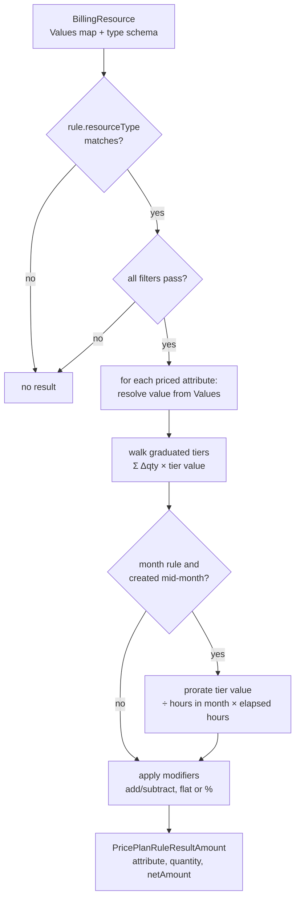
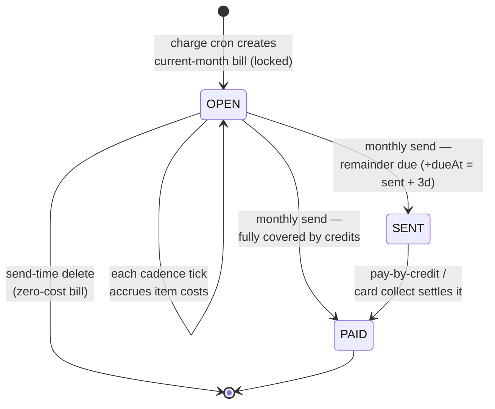
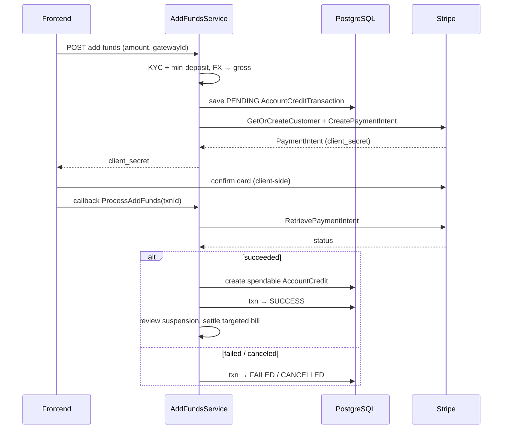
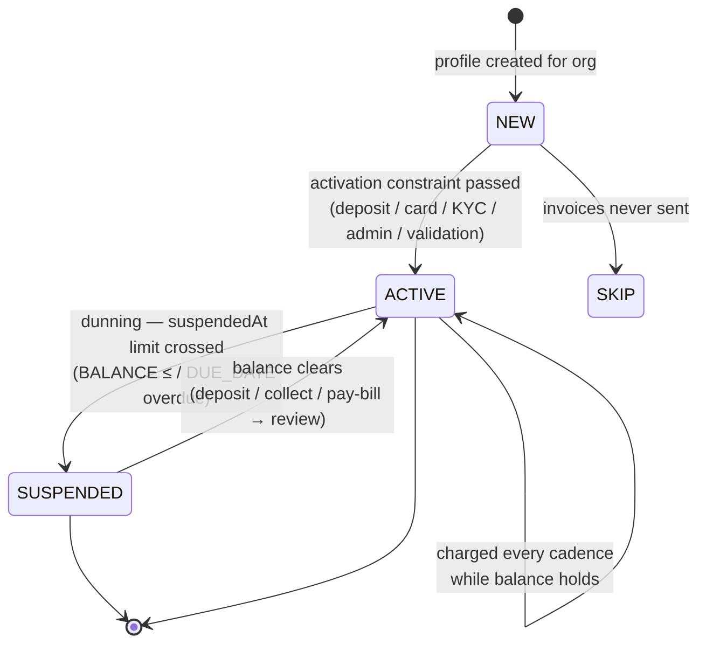
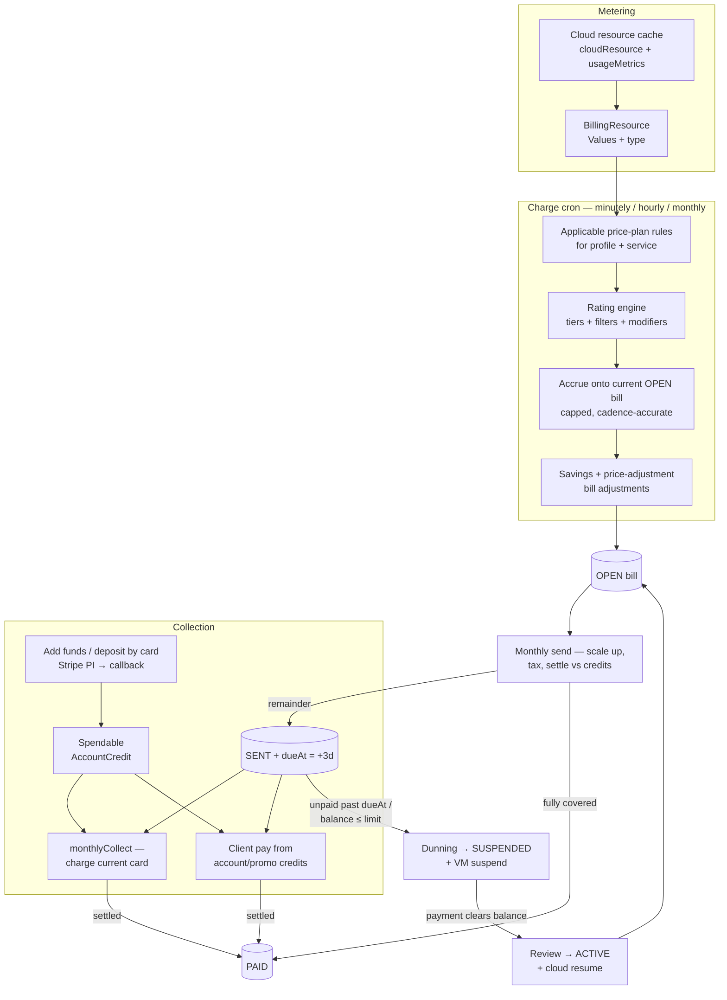

# Billing subsystem

A deep guide to ProxCloud billing — the metering, rating, invoicing, payment, and
dunning engine that turns Proxmox VE and object-storage usage into money owed and money
collected. Audience: contributors working anywhere in the billing code.

Everything here is grounded in the Go source. Money is **never** a float; all
arithmetic is exact decimal.

---

## 1. Package map

| Package | Path | Responsibility |
|---|---|---|
| `pricing` | `internal/platform/pricing` | The rating core: price-plan/rule domain + the pure rating math, bill assembly, tax, FX, credits, settlement, and the suspension **decision** predicates. Golden-tested, mostly pure. |
| `billing` | `internal/platform/billing` | The billing-profile aggregate, the PostgreSQL repos, and the stateful services: balance/due, bill send, pay-by-credit, savings contracts + reminders, suspension **orchestration**, gateways, cards, activation. |
| `billingjob` | `internal/platform/billingjob` | The charge cron driver — loads active profiles + resources and drives `pricing` to accrue costs onto the current bill. |
| `chargefanout` | `internal/platform/chargefanout` | Optional RabbitMQ fan-out of the charge job (one message per profile) as a multi-pod alternative to the in-process loop. |
| `payment` | `internal/platform/payment` | Money-in flows: add funds, deposit/collect by card, register card, the Stripe and Airwallex gateways, and the stuck-transaction scanner. |
| `promotion` | `internal/platform/promotion` | Client promo-code redemption → promotional credit. |
| `catalog` | `internal/platform/catalog` | Cloud-catalog config reads (flavor categories / image groups). |
| `billingresource` | `internal/cloud/billingresource` | The cloud → billing bridge: turns a cloud resource (server, volume, bucket, …) into the priced `BillingResource`(s) the rating loop consumes. |
| `admin/*` | `internal/platform/admin` | Admin CRUD for pricing config, savings, tax, and manual transactions/credits. |
| `pkg/money` | `pkg/money` | The `Money` decimal type (JSON string ↔ shopspring/decimal). |

---

## 2. Concepts & entities

### Billing profile — the billed entity

`billing.BillingProfile` (table **`billingProfile`**) is the account that
gets charged. It is attached to an **organization** (`organizationId`) and owns
the projects whose usage it pays for. Key fields:

- **`status`** — `NEW` → `ACTIVE` → `SUSPENDED` → back to `ACTIVE`, plus `SKIP`
  (a profile whose invoices are never sent). Only `ACTIVE` profiles are charged.
- **`currency`** — the profile's invoice currency (defaults to the platform base
  currency at create time).
- **`company` / `taxPayer` / `country` / `vatCode`** — drive tax-rate selection.
- **`pricePlanConfig`** (`PricePlanConfiguration`: `pricePlanIds` + `includePublicPricePlans`)
  — which price plans apply to this profile.
- **`overwriteSuspension` / `suspensionConfiguration`** — per-profile dunning
  override of the global policy.
- **`defaultCardId`**, **`reseller`** (resellers are never auto-suspended),
  **`activationConstraints`**, **`activatedAt`**.

A profile is created for an org with `Repo.CreateForOrganization` — status `NEW`,
base currency, a default `pricePlanConfig` (`includePublicPricePlans: true`), and a
single contact.

### Price plans and price-plan rules

A **price plan** (`pricing.PricePlan`, table **`pricePlan`**) is a named,
enabled bundle of pricing. Its `accessMode` is one of:

- **`PUBLIC`** — applies to every profile that opts into public plans.
- **`SCOPED`** — applies only to profiles that reference it by id in
  `pricePlanConfig.pricePlanIds`.

A plan may be narrowed to specific external services via `serviceProviders`
(match by `serviceId`); an empty list means "all services"
(`PricePlan.IsServiceProviderScoped`).

A **price-plan rule** (`pricing.PricePlanRule`, table **`pricePlanRule`**,
FK `pricePlanId`) is where the money lives. Each rule targets a **resource type**
and a **time unit**, and carries:

- **`prices[]`** — a priced **attribute** (`attributeName`) with graduated
  **tiers** (`from` / `to` / `value`). Tiers are additive and graduated: the
  charge for a value walks every tier and sums each tier's `Δquantity × value`
  (`Engine.applyTier`). `from == nil` is a flat per-unit tier; an open-ended top
  tier has `to == nil`; a non-zero `from` is treated inclusively (`from-1`).
- **`filters[]`** — match gates on resource attributes (`eq`/`neq`/`gt`/`gte`/
  `lt`/`lte`/`contains`/`startsWith`/`in`). ALL filters must pass for the rule to
  apply. Number comparisons are resource-vs-rule.
- **`modifiers[]`** — conditional post-adjustments to a rated amount (`add`/
  `subtract`, flat or `asPercentage`). Chained; each modifier's output feeds the
  next.
- **`applyMethod`** — `ADD_TO_TOTAL` (default) or `OVERWRITE_TOTAL`. Effect is
  applied during the monthly bill rollup, not inside the per-rule engine.

**Time units and their divisors.** Rules are cadenced. The cadence controls both
how often a rule is charged and the per-cycle **cap** (`BillingContext.timeUnitLimit`,
from `billingConfiguration.settings.timeUnitLimits`, else defaults):

| Time unit | Default limit (per month) | Meaning |
|---|---|---|
| `minute` | 43200 | 30 days × 24 × 60 |
| `hour` | 720 | 30 days × 24 |
| `month` | 1 | one charge per cycle |

A `month`-cadenced rule on a non-display resource created mid-month is **prorated
by the hour**: `pricePerHour = tier.value ÷ (daysInMonth × 24)` (a DECIMAL128
division), then `× hoursElapsedSinceCreation` (`Engine.getTierValue`).

### Price adjustment rules

`pricing.PriceAdjustmentRule` (table **`priceAdjustmentRule`**, FK
`pricePlanId`) is a bill-level, enabled, tiered add/subtract applied **after**
rating. Its `targets[]` (resourceType + filters) select which bill items feed the
"usage" amount; tiers are sorted **descending** by `startAmount`, and the first
tier whose `startAmount ≤ usage` supplies a modifier (flat or `asPercentage`,
`add`/`subtract`). No targets → the rule applies to the whole bill's item sum.

### Resource types & billable attributes

`internal/cloud/billingresource` declares what is metered. `Catalog()` returns the
billable resource types; each provider maps a cloud resource into a
`pricing.BillingResource` with a `Values` map (attribute name → value) and a typed
attribute schema (`BillingResourceType`):

| Resource type | Provider | Metered attributes (selected) | Not billed when |
|---|---|---|---|
| `instance` | `ServerProvider` (`server.go`) | `instance_type`, `ram_mb`, `ram_gb`, `vcpus`, `root_disk_gb`, `gpu_count`, `gpu_model`, `is_bareMetal`, `availability_zone`, `image`, `status` | server status `DELETED`/`ERROR`/`UNKNOWN`/`BUILD` (the Proxmox status is mapped by `pve.MapVMStatus`; a clone/create lock maps to `BUILD`) |
| `instance_traffic` | `ServerProvider` | `incoming/outgoing × private/public × _traffic_mb`, `total_*_traffic_mb` (usage attrs, month to date, from `config.metrics.source`: `pve`, the Proxmox default, reads public-NIC counters every minute; `prometheus` reads a compatible source hourly; `none` meters nothing; see `docs/jobs-scheduling.md`). A rule pricing them must be `OVERWRITE_TOTAL` on an hour or minute cadence (the admin API refuses anything else) | server ineligible |
| `volume` | `VolumeProvider` (`volume.go`) | `size`, `bootable`, `type`, `status`, `availability_zone` | status `error`/`deleting`/`creating`/`error_deleting` (a legacy set: Proxmox volumes report only `in-use`/`available`) |
| `floating_ip` | `FloatingIPProvider` (`floatingip.go`) | `existence` (typically a flat per-IP charge), `status`, `floating_network_id`. Rows derive from the public-IP allocations (`pvePublicIp`), one per allocation, billed from the moment of allocation | — |
| `image` | `ImageProvider` (`image.go`) | `size_gb` (a project template's disk, rounded up to whole GiB), `status`. Catalog templates are the operator's and never bill | — |
| `server_snapshot` | `ServerProvider` | `size_gb` (the server's provisioned disks, not the blocks the snapshot pins: Proxmox reports no per-snapshot usage). One line per snapshot, billed from the moment it was taken, read at each full sync and after a portal action on the server; replication and backup snapshots do not count | — |

Every resource additionally gets `region` and `service_id` stamped in (so plan
filters on those resolve) and `createdAt` (drives mid-month proration) — see
`stampResourceValues`. A special attribute name **`existence`** always rates to
`1` (a flat "resource exists" charge). Usage attributes (`IsUsage`) are skipped on
"display price" resources.

### Tax rates and currencies

`pricing.TaxRate` (table **`taxRate`**) has whole-percent `rateLevels[]`, a
`country`, a `level` audience (`BUSINESS_ONLY` / `CONSUMERS_ONLY` / `ALL`), an
`accessMode`, and an optional active window (`startDate`/`endDate` +
`*Enabled` flags). `SelectTaxRates` picks the country-matching, in-window,
audience-matching, non-`SCOPED` rates for a profile — falling back to
country-less (global) rates when none match.

The **base (product) currency** is `billingConfiguration.baseCurrency`
(`Repo.BaseCurrency`). A profile's own `currency` is its invoice currency. Bills
are accrued in base currency and converted to the profile currency for display
and collection (`pricing.Exchanger`). Live FX is an optional integration; when no
rate client is wired, same-currency conversions short-circuit to rate `1` and a
cross-currency conversion errors cleanly.

---

## 3. Money handling

**`pkg/money.Money`** wraps `shopspring/decimal.Decimal` and (de)serializes as a
JSON string — never an IEEE float. Domain money fields use
`decimal.Decimal` directly (round-tripping as a decimal string) or
`json.Number` on the wire where a bare number is required.

Rounding is deliberate and centralized in `pricing/mathctx.go`:

| Helper | Semantics | Used for |
|---|---|---|
| `divDecimal128` | 34 significant digits, HALF_EVEN (banker's) | month-proration per-hour division; percentage modifier `÷100` |
| `percentFraction` / `divMathCtx2` | 2 significant digits, HALF_UP | tax percentage `÷100`; savings-discount fractions |
| `scaleHalfUp` | scale 2, HALF_UP | final amounts, applied-credit sub-docs, unpaid total |
| `scaleTotal` | scale 4, HALF_UP | balance / due totals |
| `round16` | scale 16, HALF_UP | the running bill-item accrual |

The rating engine itself does **no rounding** except those two DECIMAL128
division sites; the running accrual keeps scale 16 and is only re-rounded to
scale 2 at bill-send time (`ScaleUpItems`).

---

## 4. Usage → cost accrual

### The charge job

`billingjob.Service.Charge(ctx, timeUnit, now)` is the cron entry point, run once
per cadence (minutely / hourly / monthly). Flow:

1. Gate on billing being enabled (a `billingConfiguration` doc exists).
2. Load all **`ACTIVE`** profiles + every external service + the billing context.
3. For each profile, `chargeBillingResource`:
   - Gather the profile's **enabled** projects (direct + via its orgs) that have
     services, scoped to each external service.
   - Turn each project's cloud resources into `BillingResource`s via the
     type → `Provider` registry (`billingresource.GetBillingResources`).
   - Select applicable price plans for the service, flat-map to their rules for
     this time unit (`SelectPricePlansForService` → `ApplicableRules`).
   - Rate + accrue onto the locked current bill (`pricing.ChargeBillingResources`).

Per-profile errors are logged-and-skipped so one bad profile can't stall the run.
The charge job reads the PostgreSQL **cache** (`cloudResource` + `usageMetrics`, the traffic usage table, +
`pricePlan`), never live cloud — populating that cache is the separate sync +
metrics jobs.

### Which engine charges (native vs external)

Everything in this document describes the **native** provider: the billing engine
in this repository, which is the default and needs no external service.

`PROXCLOUD_BILLING_PROVIDER=external` changes exactly one step — the rating and
accrual — by POSTing the resolved resources to a separate billing service instead
of pricing them here. Resolution stays local because it reads the resource
cache. Under `external` the billing-only crons in section 14 are not
scheduled here; the billing service owns them. See `docs/configuration.md`.

### In-process loop vs RabbitMQ fan-out

By default the cron runs the charge loop **in-process** under a distributed lock.
When `PROXCLOUD_JOBS_RABBIT_FANOUT=true` (config `proxcloud.jobs.rabbit-fanout`) and a
broker is up, the cron instead **publishes one message per active profile**
(`chargefanout.Publish`, queue `proxcloud.charge`), and any pod's consumer charges
one profile per message (`chargefanout.StartConsumer` →
`billingjob.ChargeProfileByID`). The per-profile unit of work — and the money math —
is identical; the fan-out just spreads it across pods and isolates failures.

### Rating math (per resource)

`SumNetAmount` reduces all results to a per-resource net.

### Accrual onto the bill (`SaveChargingToBill` / `updateBillItems`)

Each cadence tick **accumulates** onto a per-resource `BillItem`:

- Find-or-create the item (keyed by `resourceId` + `resourceType`).
- Skip if the resource is `NotEligibleForBilling` (its watermark stays, so a `BUILD`
  VM is back-billed when it comes up; `SkipInterval` advances it instead, see below), or if the item is already at
  its cap (net ≥ `getTotalCap` = Σ `timeUnitLimit × ruleSum`) — the cap freezes a
  runaway line.
- Advance the cadence counter by `getTimeUnitsDiff`: `month` is always `+1`;
  `minute`/`hour` add the units **started** since the last rate time (or `+1` on the
  first charge), clamped to `[0, remaining headroom to the cap]`. A started hour is a
  billed hour: a resource pays for every clock unit it existed in, so created 10:20 and
  deleted 12:50 is 3 hours (10, 11, 12).
- Rows archived during the cycle are fed back in with their `deletedAt` (the charge job,
  `GetArchivedBillingResources`), which is what bills the last partial interval. Re-rating
  one is a no-op: its `deletedAt` is behind the watermark and the floor at 0 keeps that
  from being a refund. `month` rules skip them, being paid up front when first rated.
- Update per-rule/per-attribute applied amounts: `round16(perUnit) × diff` (a new
  amount), accumulated for `ADD_TO_TOTAL`. `OVERWRITE_TOTAL` stores the amount as is, on
  the first charge too: it is a month-to-date total, not a per-unit price.
- Re-derive `item.NetAmount = round16(min(Σ applied, cap))`.

The result is a bill whose items track a running, capped, cadence-accurate cost.

### Metering staleness

The state sampler stamps `meterState.lastOkAt` per Proxmox provider. While the cluster does
not answer the cache keeps its last-known state and billing goes on from it. Past 30 minutes
(`cloud.MeterStaleAfter`) every resource of that provider is rated `NotEligibleForBilling` +
`SkipInterval`: nothing accrues and the watermark moves, so the blind interval is written off
instead of being back-billed on recovery. The same moment raises the alert: an `ERROR` log
line with `alert=pve_metering_stale` and a `METERING_STALE` audit event, once per outage,
closed by `METERING_RECOVERED`.

### Charge-time bill adjustments

After rating every resource, `billingjob.billAdjuster` applies (in place):

- **Savings-contract discounts** (`Engine.ApplySavingsContractDiscounts`) — for
  each `ACTIVE` contract whose target item usage ≥ its `monthlyCommittedAmount`, a
  negative `SAVINGS_CONTRACT` adjustment (a contract paid upfront → `-min(committed, usage)`,
  at any usage; else a discount-rate fraction, MATH_CONTEXT `÷100`).
- **Price-adjustment rules** (`Engine.ApplyPriceAdjustmentRules`) — the enabled
  rules of the service's plans add a tiered `PRICE_ADJUSTMENT_RULE` adjustment.

Adjustments are stored on `bill.Adjustments` and move the taxed gross too.

---

## 5. Bills & invoices

### The bill aggregate

`pricing.Bill` (table **`bill`**) has a `status` (`OPEN` → `SENT` → `PAID`), a
`billingCycle` ([first-of-month, first-of-next-month)), `items[]`, the settlement
collections (`adjustments`, `appliedAccountCredits`, `appliedPromotionalCredits`,
`collectedAmounts`), and `dueAt` / `sentAt` / `lockedAt`.

Each `BillItem` carries the running `netAmount` (scale 16 during accrual), the
`appliedPricePlanRules` breakdown (per rule, per attribute), and `timeUnits`
watermarks.

### The bill lifecycle

**Current bill lock.** `GetCurrentBill` ensures an `OPEN` bill exists for the
cycle, then atomically claims it via a `lockedAt` lease (push `lockedAt` to
now + 1m; only claimable when `lockedAt ≤ now`). This is a wall-clock lease so
concurrent chargers on different pods serialize on one bill. Bounded retry (5
attempts) replaces spinning forever.

### Finalizing bills (send)

`billing.BillSendService.SendAllBills` (the daily `monthlyBill` cron,
`0 0 0 * * *`) finalizes each profile's **previous-month** `OPEN` bill
(`sendBill.go`):

1. **Delete-if-zero** — a bill with zero total and no positive item is deleted.
2. Skip `SKIP` profiles.
3. `ScaleUpItems` — re-round every item net from scale 16 to scale 2.
4. Settle the gross against the profile's credit balance
   (`pricing.SettleBillAmount`, promos first then account credits).
5. Flip **`OPEN → PAID`** if nothing is left unpaid, else **`OPEN → SENT`** with
   `dueAt = sentAt + 3 days` and a "bill generated" email.

This is the linchpin: without send, `OPEN` bills never become `SENT`, so nothing
downstream (collect, dunning) has anything to act on.

### Built-in PDF invoicing

`billing/billpdf.go` renders self-contained PDFs with `go-pdf/fpdf`:

- **`BillStatementPDF`** — a consumption statement (header, statement dates,
  statement-for block, an items table with subtotal + adjustments + total, and a
  payments table of applied credits). Filename `Bill-<dd.MM.yyyy>.pdf`.
- **`CollectReceiptPDF`** — a payment receipt for a collect transaction (the
  bill-history "Download" button), used when there is no external invoice gateway
  to proxy. Filename `Receipt-<txnId>.pdf`.

Invoice-gateway resolution (`billing/gateway.go` `ListInvoiceGateways`) is
configurable; under the default seed the receipt is generated locally.

---

## 6. Transactions & balance

### Credit & transaction entities

| Entity | Table | What it is |
|---|---|---|
| `pricing.AccountCredit` | `accountCredit` | A **spendable** credit balance in base currency (`amount` = live balance, `initialAmount` = original, with `invoiceCurrency`/`invoiceExchangeRate` for the FX view). |
| `billing.AccountCreditTransaction` | `accountCreditTransaction` | The deposit/refund **log** — `status` (`PENDING`/`SUCCESS`/`FAILED`/`CANCELLED`/`REFUNDED`), `amount`/`grossAmount`/`exchangeRate`, `externalId` (gateway PI), link to the minted `accountCredit`. |
| `pricing.PromotionalCredit` | `promotionalCredit` | A promo balance (`remainingAmount`, `expirationDate`); consumed before account credits. |
| `pricing.CollectTransaction` | `collectTransaction` | A card **charge** — `status` (`PENDING`/`SUCCESS`/`FAILED`/`CANCELLED`), `billId`/`orderId`, `amount`/`grossAmount`/`exchangeRate`, `creditCardId`. |
| `billing.CreditCard` | `creditCard` | A stored card (`tokenId` = gateway PM, `panMasked`, `tokenExpirationDate`). Validity is by expiry, not a status. |
| `billing.CreditCardTransaction` | `creditCardTransaction` | The register-card transaction (SetupIntent). |
| bank transfer doc | `bankTransfer` | A manual transfer deposit (`status`, `referenceNumber`, `accountCreditTransactionId`). |

Applied credits are embedded on the bill as `AppliedAccountCredit` /
`AppliedPromotionalCredit` / `AppliedCollectedCredit` sub-docs.

### Balance and due

`billing.BalanceService`:

- **`CurrentBalance`** = `scaleTotal( accountCreditTotal + availablePromotionalTotal
  − Σ scaleTotal(unpaid) )` over the profile's `SENT`/`OPEN` bills. Positive =
  credit on hand; negative = owed.
- **`CurrentDue`** = `Σ scaleTotal(unpaid)` over the same `SENT`/`OPEN` bills — so
  `balance = credits − due` reconciles exactly.
- **`DueBills`** = the `dueAt` instants of `SENT` bills whose `dueAt` has passed
  (the dunning trigger inputs).

Per bill, the **unpaid amount** (`GetUnpaidAmountBillProductCurrency`) is
`scaleHalfUp( (Σ item nets + Σ adjustments) − Σ applied account/promo/collected
amounts )`.

### Settling a bill from credits

`pricing.SettleBillAmount` applies **promotional credits first**, then account
credits for the remainder:

- `TakePromotionalCredits` — walks candidates, decrementing `remainingAmount`,
  appending `AppliedPromotionalCredit` sub-docs (all base-currency math).
- `SettleAccountCredits` — 1:1, converting each leg through the credit's invoice
  currency; builds `AppliedAccountCredit` sub-docs (`invoiceAmount =
  scaleHalfUp(invoiceExchangeRate × settled)`, `grossAmount = tax(invoiceAmount)`).

A completed **card** payment is applied via `ApplyPaidCollectOnBill`, which appends
an `AppliedCollectedCredit` using the transaction's **own frozen** exchange rate
and flips the bill `PAID` when nothing is left unpaid.

Client pay-by-credit is `billing.PayService.PayBillWithCredits`: the bill must be
`SENT`, the credit balance must cover the **full** unpaid amount (no partial), then
it settles, persists the consumed credits, flips `PAID`, and re-reviews suspension.

---

## 7. Payments

The `payment` package orchestrates money-in. The gateway is an interface
(`payment.Gateway`) built per integration, so flows are unit-testable with a fake
and live-testable against a sandbox. `payment.NewGateway` picks the card gateway
for an integration: **Stripe** (`StripeGateway`, `stripe-go` v82, keyed by
`secret.privateKey`) or **Airwallex** (`AirwallexGateway`, REST, keyed by
`config.clientId` + `secret.apiKey`; `config.sandbox` selects the demo host). Card
data never reaches the platform for either: the console confirms the intent in the
browser (Stripe Elements, Airwallex Elements) and the confirm callback re-reads the
intent from the gateway. A callback claims the PENDING transaction atomically before
crediting, so a replayed or concurrent callback credits once. There is no webhook
endpoint. A **bank transfer** manual gateway is also supported: the customer reports
the transfer (date, bank reference, optional proof up to 2 MiB), finance is mailed,
and an operator approves or rejects it; an operator can also record an offline
payment against a SENT bill (`POST /admin/bill/{id}/record-payment`, MCP tool
`record_bill_payment`). Issued bills carry a sequential invoice number
(`INV-<year>-<seq>`); refunds produce a credit note.

Payment gateways are `thirdPartyIntegration` docs (`billing/gateway.go`);
`ListGateways` maps each enabled one to a `PaymentGatewayDTO`
(`addCard`/`addFunds`/`metadata.publicKey`/`minDeposit`).

### Add funds → payment intent → callback → credit

`payment.AddFundsService.AddFunds` (deposit):

1. KYC gate (all verifications must pass) + amount/gateway/min-deposit validation.
2. FX the requested amount to the profile currency, then tax to a **gross**
   amount.
3. Persist a **`PENDING`** `AccountCreditTransaction`.
4. For **Stripe**: get-or-create the customer, create a `PaymentIntent`
   (`amount = gross × 100` cents, `setup_future_usage = off_session`), and return
   its **client secret** for the frontend to confirm.
5. For **BankTransfer**: mint a `PENDING` transfer with a reference number — no
   external call.

`ProcessAddFunds` (the redirect callback) maps the gateway status
(`succeeded`→SUCCESS, `failed`→FAILED, `canceled`→CANCELLED, else PENDING). On
**SUCCESS**, `settleSuccess` branches:

- `orderId` present → mark the order `PAID`;
- `savingsContractId` present (stashed in metadata) → **activate** the savings
  contract;
- otherwise → create a **spendable `AccountCredit`** from the transaction amount
  (converted to base currency), linked on the transaction so a refund can void it.

It then marks the txn `SUCCESS` (idempotent — only a `PENDING` txn may be
processed, guarding against a duplicate credit, and the credit's id is the
transaction's, so a settle retried after a failure cannot mint a second one. The
scanner re-drives a deposit left `PROCESSING` for 20 minutes), sends a thank-you email, and best-
effort re-reviews suspension + settles the targeted bill.

`RefundFunds` (admin) full-refunds the `PaymentIntent`, voids the spendable credit and
marks the txn `REFUNDED`. The gateway refunds a charge in full, so a deposit whose credit is
partly spent is refused with the amount spent, and so is the deposit of a savings contract
that still runs: cancel the contract first.

**Credit concurrency.** Every read-check-write of a profile's credit (pay a bill from
credit, bill issue, refund) runs in one transaction under `Repo.WithProfileLock`, a
per-profile advisory lock.

**Bank transfers** leave `PENDING` once: approve, reject and the customer's cancel race on
a conditional update, and the loser gets a 409 naming the state.

### Deposit / collect by card

`payment.CollectService` charges a **saved card** synchronously (Stripe
`confirm=true`, no redirect):

- **`CollectByCard`** — client deposit-by-card → a spendable `AccountCredit`
  (no `billId`).
- **`CollectAll` / `CollectBillingProfile`** — the `monthlyCollect` cron
  (`0 0 7 1,5,9,13,16 * *`): for each non-suspended profile with `SENT` bills and a
  current card, charge the unpaid amount and `ApplyPaidCollectOnBill` (→ bill
  `PAID`). No card → a "customer has no card" email.

`runCollect` persists a `PENDING` `CollectTransaction`, charges the card, then
`processCollect` retrieves the PI and settles on SUCCESS. Cents are computed
HALF_DOWN (`centsHalfDown`).

### Register card

`payment.RegisterCardService` stores a card via a Stripe **SetupIntent** (no
charge). `RegisterCard` creates a `PENDING` `CreditCardTransaction` + SetupIntent
and returns `metadata.client_secret`; `ProcessRegisterCard` (the confirm callback)
stores the resulting card PaymentMethod as a `CreditCard` on success (empty
`metadata` map preserved) and marks the txn `SUCCESS`.

### Bank transfers

`AddFundsService.ProcessBankTransfer` resolves a manual transfer: `APPROVED` →
`settleSuccess` (credit the account), `REJECTED` → txn `FAILED` with the transfer's
comments, else no-op. The admin approve/reject endpoints
(`admin/banktransfer.go`) flip the transfer doc and call through to this settle.

### The stuck-transaction scanner

`payment.TransactionScanner.Scan` (the `paymentGatewayTransactionScanning` cron,
every 20 min) re-drives `PENDING` transactions in the window `(now−24h, now−20min)`
through the same idempotent `Process` paths the callbacks use — so a deposit whose
callback never landed, or a collect a pod died mid-processing, eventually resolves.
A stuck charge on an already-`PAID` bill never settles it again: if the gateway says it
succeeded it becomes spendable credit, otherwise it is `CANCELLED`.

A failed re-check says nothing about the payment. Only the gateway answering 404 (no such
intent) closes the transaction as `FAILED`. Any other error (network, 5xx, rate limit,
rejected credentials, a removed integration) leaves it `PENDING` with the reason in
`gatewayMessage` or `errorMessage`, and the next pass asks again. The 24 hour window is the bound.
Past it the scanner stops asking and logs an error on the way out, and the row stays `PENDING`,
because the money may have moved. A late gateway callback or the operator's
`GET /admin/account-credit-transactions/{id}/sync` can still settle a deposit. A charge past the
window has no such route yet and needs an operator to look at it at the gateway.

### Bill writers and the credit lock

Everything that reads a bill's unpaid amount and writes the bill holds
`billing.Repo.WithProfileLock`: pay with credits, issuing a bill, a recorded manual payment, a
card charge settling. Gateway calls stay outside it. A charge succeeding on a bill that was
paid some other way meanwhile becomes spendable credit, and one the bill already holds changes
nothing.

---

## 8. Savings plans

A **savings plan** (`billing.SavingsPlan`, table **`savingsPlan`**) is an
admin-authored commitment offer: `savingSchedule[]` keyed by `durationMonths`,
each with **upfront** and **no-upfront** discount **tiers** (`startAmount` →
`discount`). `available` + `accessMode`/`billingProfiles` gate eligibility.

A **savings contract** (`billing.SavingsContract`, table **`savingsContract`**)
is a profile's accepted commitment. `CreateSavingsContract`:

1. Resolve the available plan; reject a duplicate contract for the same plan,
   **`ACTIVE`** or **`PENDING_PAYMENT`**. The commitment must be positive.
2. Match the schedule by `durationMonths`.
3. Pick the discount from the upfront-or-no-upfront tiers: the **max** discount
   among tiers whose `startAmount ≤ monthlyCommittedAmount`.
4. `startDate` = first of current or next month (`startDate` request =
   `CURRENT_MONTH` / `NEXT_MONTH`); `endDate = startDate + durationMonths`.
5. Persist the contract (`monthlyCommittedAmount`, `discountRate`, `paidUpfront`,
   `targets`): **`ACTIVE`** without upfront payment, **`PENDING_PAYMENT`** with it, plus
   `upfrontAmount` = commitment x months, less the discount.

Statuses: `PENDING_PAYMENT` → `ACTIVE` → `EXPIRED` (or `CANCELLED`). During charging,
only an `ACTIVE` contract covering the whole cycle discounts the bill: once target usage
reaches the committed amount, or from the first unit for one paid upfront, whose usage up to
the commitment is prepaid (see §4). Cancelling keeps what a bill already holds and stops
further discounts.

An upfront contract is paid with `POST /payment/deposit/{bp}` carrying
`savingsContractId`. `AddFunds` requires it to be the caller's own contract and
`PENDING_PAYMENT`, and takes its `upfrontAmount` as the amount, whatever the client sent.
When that deposit settles (card callback, or an operator approving the bank transfer)
`activateSavingsContract` activates the contract instead of minting credit. A term whose start
has passed restarts at the current month. If the contract no longer wants the money (cancelled
meanwhile, another amount) the deposit becomes spendable credit. A paid upfront contract cannot be
cancelled or extended by the customer; one awaiting payment can be cancelled. An operator
creating a contract in the admin console sets it `ACTIVE` directly and answers for the payment
(`paymentRecordedBy`, optional `paymentReference`), and
`POST /admin/savings-contracts/{id}/record-payment {reference}` does the same for a
`PENDING_PAYMENT` contract paid outside the portal.

An upfront contract with neither a paying deposit nor an operator on record never discounts,
whatever its status (`SavingsContract.UpfrontUnpaid`). Contracts from before payments were
enforced are in that state as `ACTIVE`: `HoldUnpaidUpfrontContracts` moves them to
`PENDING_PAYMENT`, priced, at every API start and logs their ids. It is idempotent, and leaves
alone what they already discounted and contracts past their `endDate`. An admin edit cannot set
one back to `ACTIVE`.

**Expiry** — `SavingsService.ExpireContracts` (daily `0 0 0 * * *`) flips every
`ACTIVE` contract past its `endDate` to `EXPIRED`, cancels its reminders, and sends
a contract-expired email.

**Expiry reminders** — a two-phase pipeline over `reminderNotification` docs
(`billing/reminder.go`):

- **Schedule** (daily) — `SendExpiryReminders` reads
  `savingsContractNotificationConfig.reminderDaysBeforeExpiry`, and for every active
  contract ending within `max(days)+1` days, creates one `IN_PROGRESS` reminder doc
  (idempotent).
- **Dispatch** (hourly) — `ProcessReminderNotifications` walks `IN_PROGRESS` docs,
  re-evaluates days-until-expiry, sends the single tightest due reminder (marking
  earlier missed windows as sent without emailing), and flips the doc `DONE` when
  all windows are sent.

---

## 9. Promotions & credits

### Promo codes and redemption

A **promotion code** (table **`promotionCode`**, admin-created) has a `code`,
`amount`, an optional validity window (`validFrom`/`validUntil`), a
`creditValidityDuration`, `targetOrganizationIds[]`, and a `status`.

`promotion.Handler.redeem` (`POST /promotion/{billingProfileId}/code?code=`)
redeems a code into a **promotional credit**:

1. Resolve the profile's org **with a membership check** on the caller.
2. Guard `promotionCodesEnabled` on `billingConfiguration`.
3. `validateRedeemable` — case-insensitive code lookup; reject blank/missing
   (`Invalid code. `), `DISABLED`, before-`validFrom`, after-`validUntil`, or an
   org not in `targetOrganizationIds`.
4. Reject if already redeemed by this org
   (`promotionCodeRedemption`, dedup key `promotionCodeId + organizationId`).
5. Mint a `PromotionalCredit` (`initialAmount` = `remainingAmount` = the code
   amount; expiry from `creditValidityDuration`, ISO-8601 duration parsed, else a
   far-future sentinel), and record the redemption.

### Sign-up & provisioning promotional credits

On activation (`billing/activationservice.go`):

- **Sign-up bonus** (`signUpBonus`) — an affiliate-referred profile
  (`affiliateId` set) gets a one-time 10-credit, 60-day promotional credit,
  stamped in `customInfo` so it never re-applies.
- **Provisioning credits** (`provisionPromotionalCredits`) — each entry of
  `billingConfiguration.provisioningSettings.promotionals[{amount, daysValidity}]`
  mints a promotional credit for the newly-activated profile.

---

## 10. Suspension lifecycle (dunning)

Automated suspension is decided by pure predicates in `pricing/suspension.go` and
orchestrated by `billing.SuspensionJob` (the `autoSuspensionJob` cron, every 30
min).

**Policy** — `BillingAutomaticSuspensionConfig` (global on
`billingConfiguration.suspensionConfiguration`, or the profile's own when
`overwriteSuspension`): `enabled`, a `type`, a `suspendedAt` limit, and
`notifications[]` (dunning warning limits). Two trigger types:

- **`BALANCE`** — eligible when `balance ≤ limit.balance`.
- **`DUE_DATE`** — eligible when any due bill is at least `limit.days` past its
  `dueAt`.

`StartAtSuspensionLimit` picks the notification "entry" limit (BALANCE → max
balance threshold; DUE_DATE → min days), falling back to `suspendedAt`.

**Per profile** (`executeBillingProfile`), for an `ACTIVE`, non-reseller profile
that has crossed its start limit:

1. Create (or reuse) an `IN_PROGRESS` `SuspensionProcess` (table
   **`suspension`**) with a notification slot per configured limit.
2. Mark + send each not-yet-sent notification whose limit is crossed
   (`MarkNotificationsToSend`) — a "before suspension" dunning email + audit.
3. If the **`suspendedAt`** limit is also crossed, **suspend**: best-effort live
   cloud suspend (PVE `suspend` on each project VM + disable the project) first, then
   process → `SUSPENDED`, profile → `SUSPENDED`, a suspend email + audit.

**Resume** — `ReviewBillingProfile` (called on every balance-clearing event: a
paid bill, a successful deposit/collect) re-evaluates a profile with an
open/suspended process; when it is no longer eligible it flips the profile back to
`ACTIVE` (best-effort cloud resume) and marks the process `RESOLVED`.

A suspend, resume or activation applies to the projects the profile pays for: attached to it directly, or in an organization
that references it with no profile of their own. The project's status moves first, on a fresh read, with a retry when another
status change wins meanwhile. A loss that survives the retries is logged as an error.

**What `DISABLED` means** — metering, the sync and rating cover only `ENABLED` projects, so a `DISABLED` project refuses what
would add usage with a 409: every create, an object upload, new or rotated S3 keys, and every cloud action outside
`allowedWhileDisabled` (`internal/platform/project/cloud_writes.go`). That list is reads, stop, delete, detach, and removing
snapshots, backups and objects. S3 keys already issued keep working against the object store itself until the project is
deleted.

**What lifts `DISABLED`** — an operator's enable, a resume of the profile that paid for it, its activation, or opening the
project when nothing holds it any more: billing is unconfigured or the paying profile is `ACTIVE`. A project an operator disabled
(`disabledByOperator`) comes back only through an operator, whatever billing does. Disabling a project billing already holds
sets that flag, so the operator can keep it down past a resume.

Moving a project to a `NEW` profile, by changing its profile or its organization, disables it. The move is refused with a 409
while a VM is not stopped or the project has a Kubernetes cluster or managed database, since those would run unbilled.

### Billing-profile status lifecycle

`SuspensionProcess.status` runs `IN_PROGRESS → SUSPENDED → RESOLVED`.

---

## 11. End-to-end money path

---

## 12. Tables reference

| Table | Owned by | Contents |
|---|---|---|
| `billingProfile` | `billing` | The billed account. |
| `billingConfiguration` | `billing` | Base currency, promo toggle, suspension config, provisioning settings, time-unit limits. |
| `pricePlan` / `pricePlanRule` | `pricing` | Priced bundles + their rules. |
| `priceAdjustmentRule` | `pricing`/admin | Bill-level tiered adjustments. |
| `taxRate` | `pricing` | Tax rates (whole-percent levels, audience, window). |
| `bill` | `pricing`/`billing` | The accruing/sent/paid bill aggregate. |
| `accountCredit` | `billing` | Spendable credit balances. |
| `accountCreditTransaction` | `billing` | Deposit/refund transaction log. |
| `collectTransaction` | `pricing`/`billing` | Card-charge transactions. |
| `creditCard` / `creditCardTransaction` | `billing` | Stored cards + register-card transactions. |
| `bankTransfer` | `billing` | Manual bank-transfer deposits. |
| `promotionalCredit` | `pricing`/`billing` | Promo/sign-up/provisioning credits. |
| `promotionCode` / `promotionCodeRedemption` | admin/`billing` | Promo codes + per-org redemption records. |
| `savingsPlan` / `savingsContract` | `billing` | Commitment offers + accepted contracts. |
| `suspension` | `billing` | Dunning process records. |
| `reminderNotification` | `billing` | Savings-contract expiry reminders. |
| `thirdPartyIntegration` | `billing` | Payment/invoice gateway integrations. |

---

## 13. Admin surface

Admin handlers (`internal/platform/admin`) manage the config the client flows
consume. Permissions are noted per area.

- **Price plan** (`priceplan.go`, perms `admin:price_plan:*`) — CRUD + clone for
  plans and rules; `GET .../resource-types` serves the billing-resource catalog;
  rule validation rejects tiers where `to < from`; delete guards against a plan in
  use by external services or projects (cascade-deletes its rules).
- **Price adjustment rule** (`priceadjustmentrule.go`) — CRUD; `pricePlanId` is
  immutable on update; `.../usage` sums `OPEN`-bill adjustment amounts for the
  rule.
- **Savings plan / contract** (`savingsplan.go`, `savingscontract.go`, perms
  `admin:savings_plan:*`) — CRUD; contract create mirrors the client validation
  (available plan, no duplicate ACTIVE, schedule/discount-tier resolution).
- **Tax** (`tax.go`, perm `admin:tax:manage`) — create/update/delete; delete
  guards a `SCOPED` rate referenced by any profile's `taxConfiguration.taxRuleId`.
- **Transaction** (`transaction.go`, perm `admin:transaction:read`, read-only) —
  merged collect + account-credit transaction lists per profile and platform-wide;
  `.../download/{id}` streams a receipt PDF.
- **Bank transfer** (`banktransfer.go`, perm `admin:transaction:manage`) —
  approve/reject → settle via `ProcessBankTransfer`.
- **Account credit** (`accountcredit.go`, perms `admin:account_credit:*`) — manual
  create/list/update/delete of spendable credits (cross-currency create is a
  configurable integration).
- **Promotional credit** (`promotionalcredit.go`) and **promotion code**
  (`promotioncode.go`, perm `admin:promotional_credit:manage`) — manual
  create/update/delete; code push to organizations.

---

## 14. Cron schedule

| Job | Spec (`sec min hr dom mon dow`) | Effect |
|---|---|---|
| `minutelyCharge` | `30 * * * * *` | accrue `minute`-cadence rules |
| `hourlyCharge` | `0 0 * * * *` | accrue `hour`-cadence rules |
| `monthlyCharge` | `0 0 * * * *` | accrue `month`-cadence rules |
| `monthlyBill` | `0 0 0 * * *` | finalize last-month OPEN bills → SENT/PAID |
| `monthlyCollect` | `0 0 7 1,5,9,13,16 * *` | collect SENT bills via card |
| `autoSuspensionJob` | `0 */30 * * * *` | dunning + auto-suspend |
| `paymentGatewayTransactionScanning` | `0 */20 * * * *` | re-drive stuck PENDING transactions |
| `savingsContractExpiration` | `0 0 0 * * *` | expire ended contracts |
| `savingsContractExpiryReminders` | `0 0 0 * * *` | schedule expiry reminders |
| `reminderNotifications` | `0 0 * * * *` | dispatch due reminders |

Jobs run under a distributed lock (`atMostFor` / `atLeastFor`) so only one pod
runs each tick.

## 15. Config flags

- **`PROXCLOUD_BILLING_PROVIDER`** (`proxcloud.billing.provider`, default `native`) —
  which engine charges bills. `native` is everything documented in this file,
  running in-process against PostgreSQL. `external` delegates only the rating step
  to a separate billing service (`PROXCLOUD_BILLING_URL` + `PROXCLOUD_BILLING_TOKEN`
  become required); proxcloud still resolves what to bill. See
  `internal/platform/billingprovider` and `docs/configuration.md`.
- **`PROXCLOUD_JOBS_RABBIT_FANOUT`** (`proxcloud.jobs.rabbit-fanout`, default off) —
  fan the native charge cron out across pods via RabbitMQ (one message per active
  profile) instead of charging every profile in one pod. Ignored by the external
  provider.
- **`billingConfiguration.baseCurrency`** — the product/base currency all bills
  accrue in.
- **`billingConfiguration.settings.timeUnitLimits`** — per-time-unit charge caps
  (else the 30-day-month defaults).
- **`billingConfiguration.suspensionConfiguration`** — the global dunning policy.
- **`billingConfiguration.provisioningSettings.promotionals`** — provisioning
  promotional credits minted on activation.
- Payment gateway integrations (`thirdPartyIntegration`) — the Stripe secret /
  public key + `minDeposit` live here.
