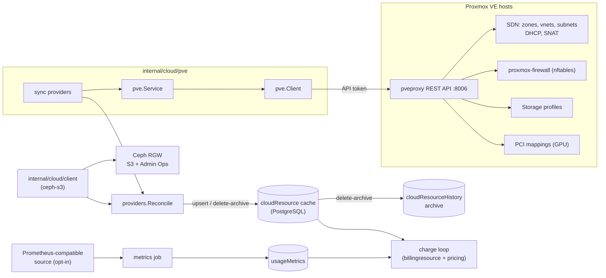
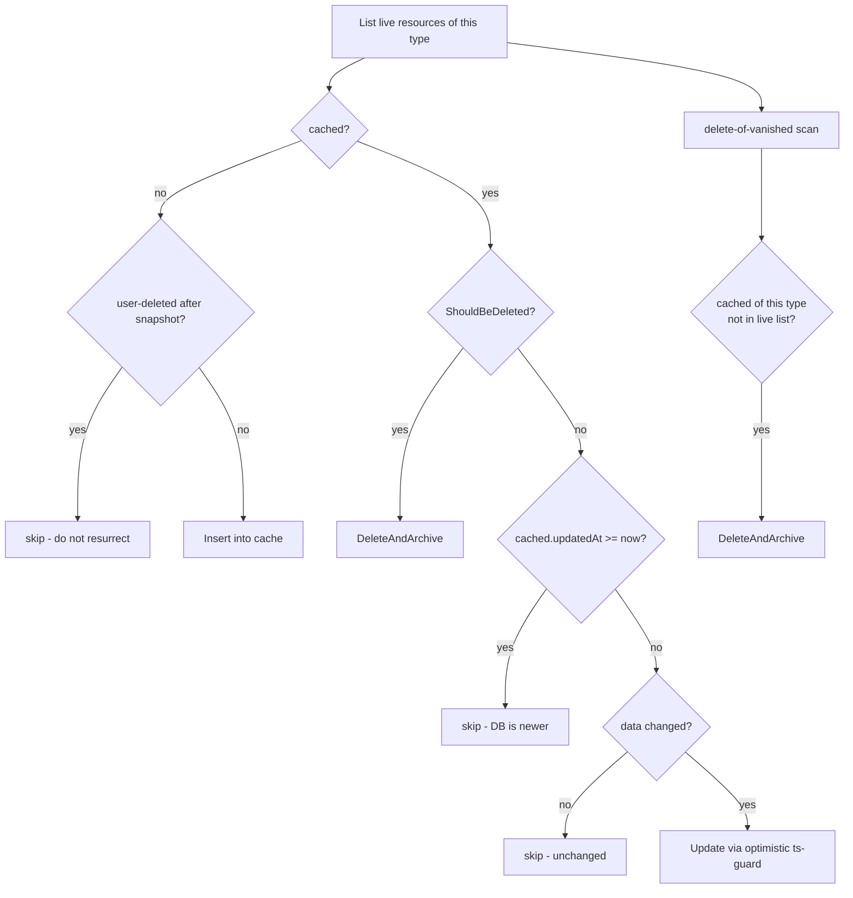

# Cloud Integration

How ProxCloud connects to Proxmox VE clusters and Ceph RGW object stores, keeps a
truthful cache of every customer's cloud resources, and feeds that cache into
billing.

This document is for contributors working in `internal/cloud/*` and
`internal/platform/externalservice/*`. It describes the model as the code
implements it today. The component view with Implemented/Planned status is in
[C3 components](architecture/c4/c3-components.md) (C3b, C3c, C3e); the
code-level flows (network isolation, firewall, quota, rating, create/teardown
sequences) are in [C4 code](architecture/c4/c4-code.md).

---

## The big picture

ProxCloud never bills straight off a live cluster. It maintains a PostgreSQL
**cache** of cloud resources (the `cloudResource` table) and rates against that
cache. Three paths keep the cache honest:

- **Write paths** (`internal/platform/project/cloud_writes*.go`) — every create,
  action and delete done through ProxCloud writes the cluster **and** the cache
  row synchronously.
- **Sync** (`internal/cloud/syncjob`, the PVE sync providers,
  `internal/cloud/providers`) — a 15-minute reconcile that lists each project's
  pool on the cluster and makes the cache match it. A change made directly in
  Proxmox appears after the next sync.
- **Live refresh** — a server GET does a best-effort refresh of that one row
  (`pveRefreshServerRow` in `cloud_writes.go`).

A fourth path, **metrics** (`internal/cloud/metrics`, `internal/cloud/metricsjob`),
reads traffic counters from a Prometheus-compatible source into per-server monthly
documents that the rating engine charges from. It is opt-in and off by default on
Proxmox.



---

## External services (provider registration)

A cluster or store is registered as an **external service**: a document in the
`externalService` table, modeled by
`internal/platform/externalservice/externalservice.go`.

```go
type ExternalService struct {
    ID               string
    Name             string
    DefaultPricePlan string
    Type             string          // CLOUD | CPANEL | PAYMENT
    Status           string          // PUBLIC | PRIVATE | DISABLED
    Config           map[string]any  // free-form, shape depends on config.provider
    Secret           any             // encrypted at rest, decrypted in memory on read
}
```

Only `Type == "CLOUD"` matters to the cloud layer. `config.provider` selects the
provider kind:

| `config.provider` | What it is | Accessors |
|---|---|---|
| `proxmox` | One Proxmox VE cluster (one cluster = one region) | `internal/platform/externalservice/proxmox.go` |
| `ceph-s3` | A Ceph RGW reached over S3 and Admin Ops | `externalservice.go` (`IsCephS3`, `ObjectClient`, …) |
| `rustfs` | A RustFS reached over S3 and its admin API | `externalservice.go` (`IsRustFS`, `ObjectClient`) |
| `truenas` | A TrueNAS reached over its WebSocket API | `externalservice.go` (`IsTrueNAS`, `TrueNASService`) |
| `powerdns` | A PowerDNS authoritative server for tenant zones | `externalservice.go` (`IsPowerDNS`, `PowerDNSService`) |
| `sandbox` | The platform's sandbox cluster (gVisor) | `sandbox.go` (`IsSandbox`, `SandboxConfig`) |
| `kamaji` | A management cluster for managed Kubernetes | `kamaji.go` |
| `dbaas` | A management cluster for managed databases | `dbaas.go` |

Operators register providers in the admin console (System → Cloud providers →
Add provider) or with the same admin `POST /service` call the form uses.

### The Proxmox provider document

The shape is documented in the header of `proxmox.go`:

```jsonc
{
  "name": "Proxmox Lab", "type": "CLOUD", "status": "PUBLIC",
  "config": {
    "provider": "proxmox",
    "region":   "pve",                                   // 1 cluster = 1 region
    "regions":  {"pve": {"displayName": "Homelab"}},
    "services": {"compute": {"pve": true}, "network": {"pve": true},
                 "volumev3": {"pve": true}, "image": {"pve": true}},
    "apiUrl":      "https://pve1.lab:8006",
    "tokenId":     "proxcloud@pve!platform",             // API token identity; secret below
    "fingerprint": "AA:BB:…",                            // SHA-256 cert pin; empty = system CA
    "insecureTls": false,
    "poolPrefix":  "pc-",                                // pool = poolPrefix + projectId
    "network": {
      "defaultZone": "overlay",
      "zones": { "overlay": {"kind": "evpn", "controller": "proxcloud", "mtu": 1450, …} },
      "publicNetworks": [{"id": "vmbr1", "name": "Internet", "cidr": "203.0.113.0/24",
                          "gateway": "203.0.113.1", "ranges": ["…"], "exclude": ["…"]}],
      "cidrPool": "10.100.0.0/16",                       // required; tenant CIDRs never overlap
      "blockedCidrs": ["192.0.2.0/24"],                  // tenants cannot reach these; node management networks are always added
      "platformBlockedCidrs": [],                        // written by ProxCloud, not by you: the entries of blockedCidrs a save of the managed-services installation added (managed-services.md)
      "sandboxCidrs": ["198.51.100.0/24"],               // sandbox cluster workers: fenced off tenants and the blocked networks, both ways
      "isolation": "shared",                             // or "evpn-per-project"
      "evpnController": "proxcloud"
    },
    "sandbox": {                                         // the sandbox workers' VM firewall, applied by the sync; secret.sandboxKubeconfig
      "pool": "proxcloud-sandbox", "nodes": ["198.51.100.10-198.51.100.29"],
      "loadBalancers": ["198.51.100.200-198.51.100.209"], "dns": ["1.1.1.1"],
      "kubeletSources": ["192.0.2.201-192.0.2.209"], "snat": "203.0.113.50", "unsecuredMinAgeMinutes": 20,
      "registry": {"address": "192.0.2.226", "port": 443},  // the sandbox registry, the one image source (SB6a)
      "buildStorage": {"address": "192.0.2.41", "port": 9000}, // the template build bucket, build pods fetch contexts (SB6b)
      "proxy": {"address": "198.51.100.201", "port": 443,  // sandbox-proxy (stage 56): only the entry appliance reaches it
                "entry": {"vmid": 9110, "pool": "proxcloud-sandbox-entry", "address": "198.51.100.5"}}
    },
    "storageProfiles": {"std": {"label": "Local NVMe (ZFS)", "storages": {"*": "local-zfs"},
                                "shared": false, "snapshots": true, "thin": true,
                                "liveMigrate": false, "replication": false},
                        "capacity": {"label": "Capacity HDD (NFS)", "storages": {"*": "nas-capacity"},
                                     "shared": true, "liveMigrate": true}},
    "defaultStorageProfile": "std",
    "capabilities": {"detectedAt": "…", "storages": {"local-zfs": {…}}}, // written by detection only
    "storageClasses": {"nas-capacity": {"class": "capacity",            // admin override (wins)
                                        "suggestedClass": "standard"}}, // installer fio result, display only
    "storageHeadroomPct": 10,                            // % of a storage kept free when placing disks
    "backupStorage": "nas-backup",                       // shared store of server backups; absent = none
    "importStorage": "nas-templates",                    // store with import content for customer images; absent = none
    "isoStorage": "local",                               // Kubernetes workers' bootstrap ISOs: node-local only (managed-k8s.md)
    "templates": {},                                     // optional pins or overlays on the discovered OS templates
    "gpus": {},                                          // {mappingId: {"alias": "nvidia-4090"}}
    "overcommit": {"cpu": 4},
    "metrics": {"source": "none"},
    "metadata": {                                        // server seeds, all optional (see "Server seeds")
      "url": "https://api.example.com",                  // the API as tenant vnets reach it; default its own base URL
      "isoStorage": "nas-templates",                     // default: first active iso storage on the node, shared first
      "forceIso": false,                                 // never use a URL: tenants cannot reach the API
      "vendorData": "#cloud-config\n…"                   // operator's vendor-data for every seeded server
    },
    "provisioning": {"quota": {"servers": 10, "vcpus": 20, "ramMb": 51200, "diskGb": 500,
                               "networks": 5, "floatingIps": 2, "gpu": {"*": 0}}}
  },
  "secret": {"tokenSecret": "<uuid>"}                    // encrypted at rest
}
```

A save whose body carries `config.network` (`POST /service`, `PUT /service/{id}`,
`PUT /service/{id}/update`) is checked first (`externalservice.ValidatePVENetwork`)
and refused with a `400` naming the field when a tenant network could not work
with it: `cidrPool` is not an IPv4 range of `/24` or larger, `defaultZone` names
no zone of `zones` (one zone needs no `defaultZone`, several do), a zone's `kind`
is not `evpn` (or the older `overlay`, or left out), `vlan` or `simple`, a zone id
is longer than the 8 characters of a Proxmox SDN zone id, a `vlan` zone has no
`bridge`, a `vlan` zone's `vlanMin` or `vlanMax` (the tags its networks get) is
missing or not a whole number from 1 to 4094, or `vlanMin` is above `vlanMax`,
or `isolation` is `evpn-per-project` and the default zone is not EVPN
(every project's zone is copied from it). A block that is only incomplete is
stored: no `cidrPool` or no zone yet is what the Add provider form sends, and the
connection test's setup checks report it. A save without `network` leaves the
stored block alone, and a save with one is refused only for a problem the stored
block does not have already: the console sends the stored block back with every
Connection tab save, and a block saved before this check may work (a zone that
exists in Proxmox is used as it is), so it must not lock the provider. A new
problem, or a wrong value changed to another wrong value, is still refused.

Typed accessors used by the rest of the code:

| Accessor | Config key | Meaning |
|---|---|---|
| `IsProxmox()` | `config.provider == "proxmox"` | provider kind |
| `PVERegion()` | `config.region` | the cluster's region, else the first `regions` key |
| `PVEConfig()` | `apiUrl`, `tokenId`, `fingerprint`, `insecureTls`, `secret.tokenSecret` | the `pve.Config` for `pve.NewService` |
| `PVEPoolPrefix()` / `PoolFor(projectID)` | `poolPrefix` (default `pc-`) | the project's pool id |
| `PVENetworkConfig()` | `network.*` | zones, public networks, `cidrPool`, isolation mode |
| `PVEMetadataSettings()` | `metadata.*` | where server seeds come from and live |
| `PVEStorageProfiles()` / `PVEDefaultStorageProfile()` | `storageProfiles`, `defaultStorageProfile` | storage per node, label, capability flags (validated against detection), derived `tier` / `class`, `bootDisk` / `dbaas` caps |
| `PVECapabilities()` | `capabilities` | the last storage capability detection (below) |
| `PVEStorageClasses()` / `PVEEffectiveStorageClass(id)` | `storageClasses` | per-storage class override and installer suggestion; effective class = valid override, else detected |
| `PVEStorageHeadroomPct()` | `storageHeadroomPct` (default 10, valid 0–99) | free space kept on a storage when placing a disk |
| `PVEBackupStorage()` | `backupStorage` | shared store of server backups (NFS, CephFS, PBS); absent = no backups offered |
| `PVEImportStorage()` | `importStorage` | store with `import` content customer images are streamed to; absent = no image import offered |
| `PVEImportUnknownSizeMaxGiB()` | `importUnknownSizeMaxGiB` | how large an image whose server states no size may get, spooled on the portal; absent = such a URL is refused |
| `PVEVolumeProfileFunc()` | `storageProfiles`, `capabilities`, `storageClasses` | resolves each synced disk's own profile and storage class |
| `PVETemplates()`, `PVEImageCatalog()` | `templates` | OS templates servers are cloned from: discovered from cluster tags ([images/README.md](../images/README.md)); an entry with `vmid` + `node` pins one, any other entry overlays `name`, `osDistro`, `minDiskGb` |
| `PVEGPUAliases()` / `PVEGPUMappingsFor(alias)` | `gpus` | PCI mapping ids per GPU alias |
| `PVEOvercommitCPU()` | `overcommit.cpu` (default 4) | scheduler CPU overcommit |
| `PVEDefaultQuota()` | `provisioning.quota` | quota of every project without its own (applied live) |
| `MetricsSource()` | `metrics.source` | `pve` (the Proxmox default), `prometheus` or `none` |
| `ServiceEnabledInRegion(slug, region)` | `services[slug][region]` | per-service toggle (below) |

### Credentials

Secrets are stored encrypted at rest and decrypted in place when the service is
loaded (`Service.decrypt` in `externalservice/service.go`). Never serialize
`Secret`: its JSON tag is `-`, and admin reads strip it.

A Proxmox provider authenticates with one privilege-separated **API token**:
`config.tokenId` (`user@realm!token`) plus the encrypted `secret.tokenSecret`.
Give it the least-privilege `ProxCloudPlatform` role described in
[proxmox-permissions.md](proxmox-permissions.md). Test connection in the admin
console (`internal/platform/admin/pveadmin.go`) warns when privileges are missing
or the token belongs to `root@pam`, refuses a cluster whose datacenter firewall
is off or whose nodes still run the legacy iptables firewall, and refuses a
public network on the management bridge. `?checks=all` returns every check as a
row instead of stopping at the first failure ([api.md](api.md)).

TLS to the cluster (`pve.TLSConfigFor`, `internal/cloud/pve/client.go`): a
`fingerprint` pins the server certificate by its SHA-256 fingerprint (the format
`pvenode cert info` prints); with no fingerprint the system CA pool is used;
`insecureTls` skips verification and is a last resort.

### Per-service toggles and the customer portal

`config.services` is a nested map of `slug → { region → bool }`. It drives what
the customer sees (`uiMenuItems` in `internal/platform/project/clientcloud.go`
builds the portal menu from it) and what the sync job reconciles
(`ServiceEnabledInRegion`; a provider with no `services` map at all counts as
everything enabled):

| Provider kind | Slug | Customer surface |
|---|---|---|
| `proxmox` | `compute` | Servers, Key pairs; also gates the whole Proxmox sync leg |
| `proxmox` | `image` | Images (admin templates and project templates) |
| `proxmox` | `volumev3` | Volumes, Snapshots pages |
| `proxmox` | `network` | Networks, Security groups |
| `ceph-s3`, `rustfs` | `object-store` | Object storage, S3 access keys |
| `truenas` | `shares` | NFS and SMB file shares |
| `powerdns` | `dns` | DNS zones and records |
| `sandbox` | `sandbox` | Sandboxes and their E2B API keys |
| `kamaji` | `kubernetes` | Kubernetes |
| `dbaas` | `database` | Databases |

Public IPs have no page of their own: they are a server action
(`ATTACH_PUBLIC_NETWORK`), see [api.md](api.md).

A service with `Status == "DISABLED"` contributes no menu items and is skipped
by sync and the charge loop.

---

## The Proxmox client layer

`internal/cloud/pve` holds everything that talks to Proxmox VE:

- **`pve.Client`** (`client.go`, `cluster.go`, `qemu.go`, `storage.go`, `sdn.go`,
  `firewall.go`, `pool.go`, `access.go`, `task.go`, `mapping.go`) — a typed REST
  client for `/api2/json` with `PVEAPIToken` auth: cluster resources, QEMU VMs,
  storage, SDN, cluster/vnet/VM firewall, pools, privilege checks, task polling
  (`WaitTask`) and PCI mappings.
- **`pve.Service`** (`service.go`, `write.go`, `volume.go`, `gpu.go`,
  `console.go`) — project-scoped IaaS: ensure the project pool, create, delete,
  resize, power and rename servers, project templates, volumes (add, extend,
  detach, attach, retype, delete detached), GPU slot picking, VNC/serial console.
- **Networks** (`network.go`, `sdn.go`) — tenant vnets and subnets carved from
  `cidrPool`, the ownership alias, cluster firewall isolation rules, per-project
  EVPN zones, staged SDN changes plus apply (serialized platform-wide by the SDN apply
  lock).
- **Firewall** (`firewallsvc.go`) — security groups as cluster firewall groups,
  the project default group, VM firewall options and per-NIC ipfilter sets
  (`SecureVM`).
- **Scheduler** (`scheduler.go`, `PickNode`) — capacity-ranked node choice with
  CPU overcommit, storage-profile node restriction, free space on the profile's
  storage (minus headroom) and free GPU slots. Memory taken on a node is the
  larger of the configured memory of the running VMs the token may audit and the
  node's own used memory, plus the VMs that do not run (`CommittedMem`), so VMs
  hidden from the token still take room; their vCPUs are not counted.
- **Storage capabilities** (`capability.go`, `volume.go`) — `DetectStorage`,
  `StorageHasRoom`, `TemplateShared`; see
  [Storage capabilities and placement](#storage-capabilities-and-placement).

The handler side (`internal/platform/project`) holds a factory,
`projectH.SetProxmox(func(es) → pve.NewService(es.PVEConfig(), …))`, wired in
`cmd/api/main.go`. A client is built per provider when needed; a write returns
`503 "proxmox client not ready"` if it cannot be built.

### Storage capabilities and placement

Storage profiles are no longer trusted as typed. `pve.DetectStorage` reads
`GET /storage` and `GET /cluster/resources?type=storage` and returns, per storage
id: type, shared, content, snapshots, thin, live migrate, replication (`zfspool`
only), tier (`full` for `rbd` / `cephfs`, else `standard`), a default class
(`performance` / `standard` / `capacity`) from a static type table, and per-node
active / total / avail. A node outside the storage's `nodes` list is ignored and a
`disable=1` storage is active nowhere.

- **When it runs.** Every services-sync cycle (`syncjob.detectProxmoxCapabilities`,
  so nodes joining or leaving are picked up), on `POST
  /api/v1/admin/service/{id}/storage/detect` (the Storage tab's Re-detect), and on
  every `storageProfiles` save. The result is written as a partial update of
  `config.capabilities`.
- **Proposed profiles.** The detect answer carries `proposedProfiles` next to
  `detectedAt` and `storages`: storage profiles in the `config.storageProfiles`
  shape for the operator to confirm, nothing of it stored. It is the
  installer's `classify_storages` (`installer/filter_plugins/proxcloud.py`,
  `pve.ProposeProfiles`): `rbd` → `ceph`, `zfspool` → `std`, `lvmthin` →
  `local-lvm`, `nfs` / `cifs` → `capacity`, one storage per profile (the first
  by name), only storages with `images` content, and an NFS or CIFS store that
  also takes `iso` or `import` is the template store, not a profile. Unlike the
  installer it skips a storage active on no node, claims a flag only when the
  storage has it (a zfspool without `sparse` is not thin), and claims no
  snapshots for a storage whose effective class is `capacity` (an override set
  with `storage-classes` below wins over the detected class), so the proposal
  passes the profile save as it is.
- **Class.** `PUT /api/v1/admin/service/{id}/storage-classes` takes
  `{"<storage>": "performance|standard|capacity|"}`; `""` clears the override. The
  installer's fio result (`suggestedClass`) is only a suggestion and is never
  applied. A profile's class is the lowest effective class of its storages; its
  tier is `full` only when every storage is Ceph.
- **Profile saves** (`ValidatePVEStorageProfiles`) are checked against a live
  detection and answer 400 when a storage is missing, lacks `images` content, is
  inactive on its node (or on every node for `*`), when the profile claims a flag
  (shared, snapshots, thin, liveMigrate, replication) the storage lacks, or when a
  capacity-class profile claims `snapshots`, `bootDisk` or `dbaas`. Downgrading a
  flag is always allowed. An unreachable cluster rejects the save.
- **Server create** (`pveCreateServer`, `pvePlacement`) runs a live detection and
  reads the template's config first. A profile that refuses boot disks is 409. The
  profile's storage state per node (`PVEStorageProfile.Placement`) restricts the
  scheduler to nodes where it is active and feeds `pve.StorageHasRoom`: free space
  after the disk must stay at least `storageHeadroomPct` % of the storage's total
  (thin storage is checked at full size). PVE clones to another node only from
  shared to shared storage, so a template whose volumes all sit on shared storage
  (`pve.TemplateShared`) is full-cloned to a picked node whose profile storage is
  shared too (or with no profile, onto the template's own storages); a local
  template or a local profile pins the clone to the nodes holding a copy of the template
  (a discovered template clones the target node's own copy), and a profile
  not active on that node is 409.
- **Volumes.** Add-volume checks free space on the server's node (409, nothing
  written). A detached disk attaches only to a server on its VM's node: PVE's disk
  reassign requires both VMs on one node, even on shared storage (else 409);
  `LIST_ATTACH_TARGETS` returns the eligible servers. An attach to another server gives the disk a new
  volid; its VOLUME row follows it and keeps its id, the name the tenant gave it, its creation date and its
  bill item (before v0.8.1 the row was archived and a new one made: the volume lost its name and its charge
  was split). An attach that answers an error after the disk moved (a task wait that ran out) is followed
  too and is a success. An attach during a retype's copy is 409. A cross-node attach that fails halfway can
  leave the disk on its carrier under a new name; that row is a new one. `RETYPE` moves the disk with `move_disk ... delete=1`
  to another profile's storage on the same node (409 if same storage, inactive, no
  `images`, no room, or a boot disk onto a profile that refuses boot disks).
  `DELETE` destroys a detached disk and is 409 for an attached one. A server
  snapshot (image) is 409 while an attached disk sits on capacity storage. Typed
  refusals are `pve.ConflictError`, mapped to 409 by `pveVolumeErr`.
- **DBaaS.** A database create whose storage class is named after a profile closed
  to databases on any Proxmox provider is 409.
- **Billing.** The volume sync stamps each disk's own `profile` and `storage_class`
  (and `volume_type` follows the disk's profile, not the server's). The volume
  billing resource exposes both as string attributes for price-rule filters.

### Server seeds

A server with user-data, instance metadata or a provider `vendorData` gets a NoCloud seed from the
platform (`pve/seed.go`, `project/nocloud_pve.go`). Any other server stays on PVE's own cloud-init
drive. PVE's drive cannot carry them: its only input is cicustom snippets, and the API cannot upload a
snippet.

| Vnet | Seed | Why |
|---|---|---|
| With DHCP (simple zone), and an API URL | `smbios1` serial `ds=nocloud;s=<api>/api/v1/nocloud/<token>/` | cloud-init fetches it in its network stage, with DHCP on the first NIC |
| Without DHCP (EVPN, VLAN), or `forceIso`, or no URL | a `cidata` ISO in the VM's cloud-init slot, uploaded to `isoStorage` | a URL seed means no network until it is fetched: the local stage gives up on any CD, so a static address has nowhere to come from |

**Choosing.** Only the operator knows whether tenant servers reach the URL and trust its certificate,
and a server that misses its URL seed boots with the template's hostname, no password and no guest agent,
with nothing reporting it. So the setup status (`GET /api/v1/admin/setup/status`, network item `seeds`)
asks for a choice: it is `attention`, never blocking, until `metadata.forceIso` is `true`, or is `false`
with a seed URL, or `metadata.url` is set, and its message names the URL seeds are fetched from
(`metadata.url`, else `PROXCLOUD_SELF_API_BASE_URL`; the answer's `seedUrl`). With neither set every seed
goes on an ISO whatever `forceIso` says, so the item stays `attention` and says so. Platform setup, step 3
Network, offers the two answers under **Server seeds** and saves `metadata.forceIso`, keeping the other
`metadata` keys:

- **By URL** (`forceIso: false`): tenant servers reach that URL with a certificate they trust, for example
  a public ACME certificate on an address the tenant vnets route to. Disabled when there is no seed URL.
- **On an ISO** (`forceIso: true`): a LAN install, or a self-signed certificate such as Compose TLS mode
  `internal`. The seed needs no network; it lives on `isoStorage` (see Secrets below).

Both carry the same files. `meta-data` holds the instance id, hostname and tenant metadata under `meta`
(`cloud-init query ds.meta_data.meta`), so a tenant key can never set `instance-id`, `dsmode` or
`seedfrom`. `user-data` is the tenant's, passed through. `vendor-data` is the platform's cloud-config
(a bcrypt hash of the create password, SSH keys) joined with the operator's: a tenant's user-data wins on
the same key. `network-config` is rendered from `ipconfigN` and is absent for plain DHCP.

- **Token.** Per VM, 256 bits, only its hash is stored (`pveServerSeed`). It is the only credential of
  `GET /api/v1/nocloud/{token}/{meta-data,user-data,vendor-data,network-config}`. Deleting the server or
  tearing down the project revokes it and removes the CD.
- **Secrets.** User-data is encrypted at rest in the database. On an ISO seed it is a plain file on the
  ISO storage and in the guest's CD drive for the server's lifetime, as any cloud-init seed is. A create
  password is only ever there as a bcrypt hash, also for a login user (`adminUser`). The portal offers no
  tenant a path to the file, so what protects it is who can read the store: **export a NAS store to the node
  addresses, not to a subnet.** With a subnet, any VM whose traffic reaches the NAS from inside it can mount
  the store and read every seed on it, along with every disk. Private vnets cannot get there
  (`blockedCidrs` plus the node networks); a public NIC is bridged to the uplink and only the site's routing
  stops it. CephFS asks for a key, so reaching a monitor is not enough. A vnet leaves through its exit node's
  NAT under the node's address, which a node-only export admits, so the isolation rules are what keeps it
  out: **Test connection warns about every network store (NFS, CIFS, GlusterFS, iSCSI portal, monitors of an
  external Ceph) whose server is outside `blockedCidrs` and the
  nodes' management networks.** Seeds stay on a shared store by default because PVE refuses to migrate a VM
  with a CD on a node-local one (`local cdrom image`, `QemuMigrate.pm`). Bootstrap ISOs of Kubernetes
  workers are different, live only until the node joins, and must be node-local (docs/managed-k8s.md).
- **Removal.** Every new CD has a committed `pveSeedArtifact` journal entry before upload, with a persistent
  installation identity and an exact 128-bit random filename. Failed/superseded uploads stay accounted for independently
  of the encrypted active `pveServerSeed` source. All delete/empty paths require journal ownership, unchanged cluster and
  storage identity, complete current/pending/snapshot references across **all** VMs/templates, and two no-reference
  observations separated by 24 hours (plus a final fresh scan). Legacy `pcseed-<vmid>-<suffix>` files are never adopted.
  No inventory reader or incomplete visibility means retained plaintext CD + durable warning, not an empty fallback.
  A positively deleted server's source is retired (never delivered to a reused VMID), but its ciphertext remains while
  cleanup is pending. A stale cache candidate alone cannot retire an active source. A denied DELETE may use an empty
  CD overwrite only after the same checks; an unknown async task outcome requires operator reconciliation instead.
  See [server-seed-safety.md](server-seed-safety.md) for setup, status, failure handling and remaining confidentiality limits.
- **Password login.** A create password always goes through a seed: PVE's own drive sets the password but
  cannot turn on `ssh_pwauth`, and a cloud image then refuses it over ssh.
- **Later changes.** Attaching or detaching a public NIC re-delivers the seed with the same instance id
  and the seed asks cloud-init to re-read the network at each boot (`updates.network.when: [boot]`), so
  user-data does not run again. Rebuild delivers it with a new instance id: the new disk runs it once.
- **Reachability.** A URL seed needs a route from tenant vnets to `metadata.url` that `blockedCidrs` does
  not cover.

### Server actions beyond power

- **Set password** (`SET_PASSWORD {password, username?}`): the guest agent's `set-user-password`, for
  `username` or the image's default user. The server must be running. 409 when the agent answers with an
  error (no agent yet, no such user) or the token lacks the privilege.
- **Rebuild** (`REBUILD {imageId}`): swaps the boot disk for a fresh copy of the image and keeps the vmid,
  NICs, addresses, firewall and data disks. The copy goes on the old disk's storage, because PVE only moves
  a disk between VMs on one node and storage; the old disk is parked as `unusedN` until the new one is in,
  and put back on any failure. The disk donor VM is named like an image build for the seconds it exists:
  sync and billing skip it. 409 with snapshots on the server, or when the image needs a bigger disk.
  The new boot disk is a new volume with a row of its own, and the row of the destroyed one is archived in
  the same request, also when the rebuild fails after the swap. The same reconcile of the project's VOLUME
  rows ends a snapshot rollback and a restore, so the rows equal the disks without waiting for the
  scheduled sync (before v0.8.1 a rebuild left the old row, and on a site that runs no scheduler the quota
  counted the disk twice for good). A resize refreshes the rows (it adds and updates, nothing is gone).
  The reconcile needs every VM of the project readable. While one of them is locked (a backup, a snapshot,
  a migration), offline or unreadable, it does not run: no row is archived, added or updated in that
  request. A rebuild then still archives the row of the boot disk it destroyed, since it removed that disk
  itself, but the new boot disk has no row until the next sync; after a rollback or a restore the rows stay
  as they were. On a site without the scheduler they stay so until the next such action in the project or
  one provider sync. Not verified on a lab: the tests run against a fake Proxmox API and a real database,
  and whether the reconcile's proof passes on a real cluster in the seconds after a rebuild changed the
  server's tags is the first thing to check there (rebuild, then count the volume rows).
- **Snapshots** (`LIST_/CREATE_/ROLLBACK_/DELETE_SNAPSHOT {name}`): PVE VM snapshots, disk only. 409 when an
  attached disk is on storage without snapshots (capacity class by design). ZFS rolls back to the newest
  snapshot only, so an older one is 409 rather than a failed task. A running server restarts after a rollback.
  A rollback brings the snapshot's config back: a data volume attached after the snapshot is no longer in
  the server's config, and from v0.8.1 its VOLUME row is archived in the same request (before, by the next
  scheduled sync). The disk stays on the store, unseen and unbilled. To get it back the operator runs
  `qm disk rescan --vmid <id>` on the node, which lists it as an unused disk of the server; the next sync
  then makes a new row for it, without the name the tenant gave it. Not tried on a lab.
  Replication's `__*` snapshots are hidden and refused.
  `DELETE_SNAPSHOT` asks Proxmox up to three times when the delete task ends on `can't lock file ... got timeout`
  (v0.8.2). On the production acceptance of v0.8.0 a delete sent 4 s after a rollback had answered failed that way:
  Proxmox waits 10 s for the VM's config lock and something still held it. The rollback request already waits for the
  rollback task and for the start task, so what held the lock was not found in the code; it has to be read off a
  node (`qm` tasks and `/var/lock/qemu-server/lock-<vmid>.conf` right after a rollback). With Proxmox's own wait the
  delete now waits up to about 30 s and then answers 409 busy as before. Tested against a fake Proxmox API only.
- **Console state** (`GET_CONSOLE_STATE` on a SERVER, v0.8.2): `{status, uptime, serialDisplay}` from the VM's
  status and config. `serialDisplay` is true when `vga` is a serial port in the values in effect (`current=1`, so a
  `vga: std` an operator set by hand on a running VM does not count before its next stop and start; the portal
  itself writes `vga` only on a stopped VM), as every VM made from a template of before v0.10.0 has it until its
  next start from the portal ([template-updates.md](template-updates.md#console-display)): the console page then opens on its
  Serial tab. The page also asks every 10 s while a serial session is open
  and ends the session when the VM is stopped or has been up for less time than the session: on the same
  acceptance the socket of a session stayed open after the server restarted. Why the socket did not close was not
  found (the proxy closes the browser's side when Proxmox closes its side); not tried on a lab.
- **Backup id**: `CREATE_BACKUP` answers `{id}`, the new archive's volid, from v0.8.2. vzdump reports none, so it is
  the newest archive of this server and project on the store after the task; before, the id was empty.
- **Backups** (`LIST_/CREATE_/RESTORE_/DELETE_BACKUP {id}`, offered when `config.backupStorage` names a shared store
  with `backup` content: NFS, CephFS or PBS): vzdump in snapshot mode, zstd, with the store's retention left out so it
  cannot remove a tenant's archive. `notes-template` stamps each archive with the project, and every action lists the
  store and goes on only with an archive carrying this project's stamp, so a volid from elsewhere is 409. At most 7
  per server; 409 when the store lacks room for the server's provisioned disks plus `storageHeadroomPct`. Restore runs
  in place: PVE destroys the VM's disks and rebuilds them and the config from the archive, and a running server comes
  back running. 409 up front, with nothing stopped, on a protected server, when the token lacks the privilege, when a
  volume (a detached one too) is not in the archive, when what the restore would produce breaks the project's quota
  (vCPUs, RAM, disk, GPUs), or when the NICs changed since the backup. A volume counts as in the archive when the archive
  names its volid and its VOLUME row is older than the backup: PVE reuses disk names, so a disk added after another left
  can carry that one's name. The boot disk always counts, so a restore can roll back a rebuild. A disk with no row before
  a restore dates from that backup (`dataSince` on the row), so the same archive can restore it again. A retype keeps the
  row but dates its name from the move (`externalIdSince`), since the move can land on the name of a disk that left: a backup
  older than that does not hold it. A disk that left and came back, or was retyped and back, is refused too, though the
  archive has an older copy: move it away or take a new backup. The checks run again once the server has stopped. VOLUME rows
  wait out a restore (PVE cuts the config to `{memory: 128}` while its task runs), so the bill and the row's age carry on. A
  failed restore task after that point leaves the VM with that cut-down config and its disks destroyed: their rows are
  archived and the bill for them stops, the task's answer says so (409), and another restore brings the server back (it
  stays stopped). What a killed task had already written is freed right after, and by that retry or the server's delete if
  that fails. Such a retry skips the volume and NIC checks, and its quota check counts the server by its rows. Backups go with their
  server, on delete and on project teardown, and a failure stops either: PVE lets the token delete an archive only through
  `VM.Backup` on its VM, so on a server delete they go after protection is off, the volumes have moved and a hard stop has
  worked, just before the destroy. A running restore refuses the delete, and so does a store that cannot list them, before anything changes. Keeping a server's state past its life is what an image is for. An archive of a VM destroyed outside the portal
  disappears from the token's listing (PVE filters by the same check), so it stays on the store until an operator
  removes it; its notes name the project. Backups are not billed yet.
- **Image import** (`POST /project/{id}/cloud` `IMAGE {name, url, format?, checksum?, checksumAlgorithm?, profile?}`, offered
  when `config.importStorage` names a store with `import` content): the portal fetches the URL and streams it to PVE's
  upload API, a VM takes it with `import-from` on the profile's boot storage, and it becomes the project's template. **A
  node never sees the URL.** PVE's `download-url` follows redirects with no way to turn that off, so a server answering the
  portal with an image and the node with a 302 would reach the node's network, and no check in the portal could see it.
  The fetch (`pkg/safeurl`) allows http and https without credentials, and refuses, at connect time, any address that is
  not globally routable or is in `network.blockedCidrs`, so list public management ranges there; the portal needs
  internet access for it, and carries the bytes. `format` is `qcow2` or `vmdk`, not raw: PVE checks those two as untrusted
  and refuses a backing file on upload, and no check can tell a raw disk from any other bytes. Limits: one import at a
  time per project; a disk over 200 GiB is 409; the disk counts against `diskGb` (project images count there now, from a
  snapshot too), checked on the file's size before the upload and on the disk's virtual size after it; room on the
  import store and, for the disk, on the profile's storage, both with `storageHeadroomPct`. pveproxy spools an upload to
  `/var/tmp` on the API node, on any node's behalf, so an image also needs room on that node's root disk or it is 409, and
  only one upload runs at a time per provider (409 for the others), since each passing the room check on its own could fill
  that disk together. Because that holds up other projects, a source that sends nothing for a minute, or averages under
  2 MiB/s past a two-minute grace, ends the import with a 409 and lets go at once. A
  URL whose server states no size is refused unless `config.importUnknownSizeMaxGiB` allows it: then it is spooled to the
  portal's temporary directory up to that limit, first. The client waits; if it gives up the import finishes and the
  sampler adds the image, and whatever ends an import, the portal waits for the upload's task on the node before it lets go of
  the project's lock and removes the file. Nothing is left on a failure except, with no `Datastore.Allocate` on the store, the uploaded
  file (Test connection warns, see `docs/proxmox-permissions.md`). A template on local storage clones on its own node
  only, like any project image. Billed as `image`.
- **Spread groups** (`spreadGroup`, `spreadStrict` on create): a `grp-<name>` tag on the VM. The scheduler
  prefers the node with the fewest members of the group in the project; strict refuses a node that has one.
  At create time only: nothing moves a member later. PVE 9's own affinity rules are HA-only, and strict.
- **Subnets** (`ADD_SUBNET {cidr?, snat?}`, `REMOVE_SUBNET {cidr}`, `SET_SNAT {cidr, snat}` on a NETWORK): a vnet
  holds several subnets, from the same `cidrPool` with the same overlap check, and the project's isolation
  ACCEPT covers them all. A server picks one with `networkInterfaces[0].subnet`. A subnet with an allocated
  address cannot be removed, and a network keeps one. There is no router resource: the zone's VRF routes
  between all of a project's vnets, and the isolation rules are what keeps other projects out. A network's row
  holds `subnetDetails` (cidr, gateway, snat per subnet) from its create on (v0.8.2; before, only the sync wrote it,
  and on a site without the scheduler the console's Subnets tab of a new network stayed empty). A network made
  before v0.8.2 gets `subnetDetails` at the next sync or subnet action; until then the console's Subnets tab shows
  the row's own `cidr`, `gateway` and `snat`, the one subnet it was created with.
- **Servers on a network** (`GET_SERVERS` on a NETWORK, v0.8.2): the project's SERVER rows whose VM has a NIC on the
  vnet. It reads the config of every VM in the project's pool, as the network delete guard does, because a SERVER
  row holds addresses and not the network of each NIC; 409 while a host of the project's servers is down. Tested
  against a fake Proxmox API and a real database, not on a lab.

### Tenancy: the pool is the boundary, the platform DB decides the rest

There is one admin token per provider, and ProxCloud is the policy decision
point (`proxmox.go` header):

- Every project VM and project template lives in the project's **pool**
  (`<poolPrefix><projectId>`). Every list filters by pool, so a VM outside the
  pool never enters the cache, and every mutation re-verifies ownership against
  the platform's cached row.
- Vnets, firewall groups and PCI mappings have **no pool scoping** in Proxmox.
  For them the platform database is the only tenancy boundary: vnets carry an
  ownership alias, and ownership is checked before any change.
- Tenant-to-tenant isolation on the SDN is enforced by cluster firewall rules,
  in `shared` mode and with one EVPN zone per project (`evpn-per-project`) alike.
  They also keep tenants off the nodes' management networks and `blockedCidrs`, and fence the
  sandbox cluster's workers (`sandboxCidrs`) off tenants and those networks in both directions. Details:
  [C4.1 tenant network isolation](architecture/c4/c4-code.md#c41-tenant-network-isolation).
- With `config.sandbox`, the sync puts every VM of that pool behind its own VM firewall (both policies DROP, address
  pinned, only its control plane, DNS, the other workers and the internet allowed) and takes the
  `proxcloud.io/unsecured` taint off a worker once that is in place:
  [managed-sandbox.md §2](managed-sandbox.md#2-layer-1-the-vm-firewall-on-the-workers-sb2b).
- PVE offers DHCP on simple zones only, and a simple zone stays on one node. On EVPN and
  VLAN zones, and on a simple zone without a DHCP server, the platform allocates each server's
  `net0` address and sets it through cloud-init, so an image without cloud-init gets no address
  there. What decides is the zone as Proxmox has it (its `dhcp` field), not its kind in the
  provider's config: the network create reads it, writes a DHCP range only where the zone runs a
  DHCP server, answers `dhcp: false` elsewhere and refuses `enableDhcp: true` there with a `400`;
  the sync answers the same from the subnet and the zone ([api.md](api.md)). ProxCloud creates a
  missing simple zone with DHCP, or without when its config says `"dhcp": false`; a zone that
  exists is never changed. Tenant Kubernetes clusters and load balancers need a network without
  DHCP.
- A network in a `vlan` zone is a bare VLAN: Proxmox holds no gateway address there and does
  no DHCP and no SNAT. The subnet is written without a DHCP range and without SNAT, the network
  answers `dhcp: false` and `snat: false` (also one made before this rule, whatever its subnet
  still says), and a create with `enableDhcp: true` or `snat: true`, or an `ADD_SUBNET` or
  `SET_SNAT` with `snat: true`, is refused with a `400`. The `gateway` it shows (the
  subnet's first address) is the address the site's router must hold on that VLAN: servers get
  it as their default route, and outbound access is that router's decision.

Getting tenancy wrong over-bills a customer for resources that are not theirs,
or worse, exposes them.

### Project provisioning

`BootstrapProxmoxOnto` (`internal/platform/project/bootstrap.go`) attaches a
project to a Proxmox provider:

1. ensure the project pool;
2. ensure the project's default security group;
3. append the binding `{serviceId, provider: "proxmox", region, pool}` to
   `project.services`. The pool id is persisted so teardown never re-derives it.

No quota is copied onto the project. A project without its own Proxmox quota
(set on its admin Quota tab) is held to the provider's default quota
(`config.provisioning.quota`) as it is at each check, so changing the default
applies to every such project at once.

It is idempotent. There is no per-project identity on the cluster: customers
never get Proxmox credentials, and access is enforced by platform RBAC.

Projects provision onto every non-disabled provider whose attach policy is on
the first time they are entered (`enableAndBootstrap`). Projects that predate a
provider are attached from the admin project page (Cloud services → Attach
provider, which calls `POST /admin/project/{id}/external-service/{esid}`; a
`GET` answers 405), or many at once with the bulk attach below. The attach is
idempotent: a service the project already carries is not provisioned again and
gets no second binding. It refuses a project scheduled for deletion, being torn
down or deleted (`400`); a DISABLED project (billing hold or operator) is
attached and keeps its status. One attach runs for at most 2 minutes, past the
request (it may create things on the provider).

Bindings are written one way only: `Repo.AppendBinding` appends the binding in
one statement, and only when no binding of that service is there yet. A save
of the rest of the project (rename, member change, activation) does not write
`services` or `provisionFailures`, so it cannot drop a binding added meanwhile.
The operator attaches and the provisioning part of `enableAndBootstrap` run
under a per-project PostgreSQL advisory lock (`project-attach:<id>`), on a
fresh read. The binding append and the removal of the attach marks run on the
lock's own session, with the "lock still held" check inside the same statement.
There is no gap between the check and the write, and a session that lost the
lock or is gone writes nothing (`ErrAttachLost`). An open of an already
bootstrapped project takes the lock only when a recorded provisioning failure
is due for its retry.

#### Attach policy for new projects

`config.attachToNewProjects` (boolean, default `true` when absent) decides
whether a project's first bootstrap provisions onto the provider. Every provider
stored before the setting existed keeps attaching new projects. With it `false`
a new project is not attached to that provider; an operator attaches it per
project or in bulk. The setting changes nothing for projects already attached
and nothing about request routing: a request naming a service the project is
not attached to is still refused, and a request naming none still uses the
default (#215).

Set it on the provider's **Projects** tab, or with
`PUT /api/v1/admin/service/{id}/attach-policy` `{"attachToNewProjects": false}`
(`admin:service:manage`). That PUT is a single-key write in the database
(`jsonb_set` of `config.attachToNewProjects`), not a read-modify-replace of the
provider. A connection save landing at the same time is not reverted, and the
connection and go-live checks (object store, sandbox) do not apply to it. The
connection save (`PUT /admin/service/{id}`) and the create also accept the key
and refuse anything but `true`/`false`.

#### Attaching a provider to existing projects

The provider's **Projects** tab → *Attach to existing projects* attaches the
provider to all projects, to the projects of picked organizations, or to picked
projects (searchable picker). The page previews how many projects are in scope,
already attached, being deleted and left to attach. It then shows progress with
counts, the failed projects with their reason, *Cancel* and
*Retry failed projects*.

| Method | Path (`/api/v1/admin/service/{id}/…`) | Permission |
|---|---|---|
| GET | `bulk-attach` (runs, newest first, and the active one) | `admin:service:read` |
| GET | `bulk-attach/candidates?kind=projects\|organizations&search=` | `admin:service:read` + `admin:project:read` |
| POST | `bulk-attach/preview` `{scope}` | `admin:service:read` + `admin:project:read` |
| POST | `bulk-attach` `{scope, concurrency}` | `admin:service:manage` + `admin:project:update` |
| GET | `bulk-attach/{runId}`, `bulk-attach/{runId}/items?state=failed` | `admin:service:read` |
| POST | `bulk-attach/{runId}/cancel` | `admin:service:manage` |
| POST | `bulk-attach/{runId}/retry` `[{concurrency}]` | `admin:service:manage` + `admin:project:update` |

`scope` is `{"mode":"all"}`, `{"mode":"organizations","organizationIds":[…]}`
or `{"mode":"projects","projectIds":[…]}` (at most 2000 ids; unknown ids are a
`400`). `concurrency` is 1–4, default 2. A DISABLED provider is refused (`409`).
So is a provider this API cannot attach projects to: an unknown kind, or one
whose client is not wired (`400`). One run attaches at most 5000 projects,
counted at the start without those already attached. A larger scope is refused
(`400`); split it by organizations or picked projects.

How it runs (`internal/providerattach`):

- The request only records a run (`providerAttachRun`) and enqueues one durable
  job of kind `providerattach.run/v1` in the same transaction. Hundreds or
  thousands of projects never run inside the HTTP request.
- **One run per provider.** The start holds an advisory lock on the provider
  and refuses (`409`) while an earlier run's job is pending or running. The job
  key is `<provider>#<sequence>`. Runs for different providers are independent.
- A runner in every API replica claims the job (the `durable_job` lease,
  renewed while it works). It plans the scoped projects in batches of 500, in
  id order. Each batch is one fenced transaction that advances a cursor on the
  run, so planning of any size resumes where it stopped. Projects already
  attached get no item, only a count on the run (`planSkipped`, shown as
  skipped/already attached). Projects on their way out or gone get an item
  `skipped/deleting` or `skipped/not_found`. The rest are pending items
  (`providerAttachItem`).
- It attaches the pending items with the run's concurrency, each through
  `project.Handler.AttachByOperator`, the same path as the per-project POST.
  That path runs under the per-project lock, on a fresh read, with no provider
  call when the project is already attached. The provider is re-read for every
  project, so a credential rotation applies to the next project. A provider
  deleted, disabled or no longer attachable mid-run ends the run (`failed`):
  every project not done yet fails `provider_missing`, `provider_disabled` or
  `provider_unsupported`, and *Retry failed projects* picks them up once the
  provider is back.
- **Fenced and resumable.** Taking an item (`running`, attempt+1) and
  recording its result are each committed with `durablejobs.Store.Checkpoint`.
  An acquisition that lost its lease writes nothing more. The next acquisition
  resumes from the items: an item left `running` is attached again, which is a
  no-op where the first attempt had landed. An item interrupted three times
  fails `attempts_exhausted`. A job interrupted five times dies; its run shows
  `failed` and *Retry failed projects* picks up what it did not finish. A dead
  bulk attach job is not replayed from the durable-jobs replay endpoint (`409`).
- **Fixed codes only.** An item ends `attached`, `skipped` (`already_attached`,
  `deleting`, `not_found`), `failed` (`provider_error`, `timeout`,
  `provider_missing`, `provider_disabled`, `provider_unsupported`,
  `attempts_exhausted`) or `cancelled`. The provider's error text is never stored or returned: it is
  logged with the project id only, and the project's own provision failure is
  not touched.
- **Cancel** stops taking new items. Items in flight finish, the rest become
  `cancelled`, and nothing is detached. A cancel that arrives once every
  project is done changes nothing: the run stays completed. **Retry failed
  projects** starts a new run over the failed items of a finished run.
- **Retention.** The per-project items of a run finished more than 30 days ago
  are removed by the runner's idle pass. The run keeps its counts and is marked
  `itemsPruned`; it can no longer be retried (start a new run instead).
- **Before the first bootstrap.** A project that was never opened (for example
  one waiting on billing) is attached too, by the bulk attach or the
  per-project POST. Its binding is marked `attachedBy: "operator"` in the same
  statement that appends it, so no failure can leave an unmarked binding. A
  marked binding does not count as the first bootstrap. When the project is
  first opened it still gets every provider whose policy is on, and the marks
  are dropped, also when there is no such provider.
- **Audit.** Start, cancel and retry each write an admin audit event
  `BULK_ATTACH` on the provider (`EXTERNAL_SERVICE`). It carries the actor, the
  run and job ids, the scope (mode, ids, up to 50 listed, and their count), the
  concurrency and the counts (preview counts for a start, the run's counts for
  a cancel or retry). The generic admin mutation event is written as well.

Teardown (`project/teardown.go`) destroys the pool's VMs and the pool, the
project's vnets and EVPN zone, its security groups, releases public IPs and
archives the cache rows.

---

## Resource sync (reconcile)

The cache is the `cloudResource` document (`internal/cloud/resource.go`). `type`
is the discriminator for the free-form `data` sub-document. The types produced
today are `SERVER`, `VOLUME`, `IMAGE`, `KEYPAIR`, `NETWORK`, `SECURITY_GROUP`,
`FLOATING_IP`, `LOAD_BALANCER`, `BUCKET`, `SHARE`, `DNS_ZONE`, `KUBERNETES_CLUSTER`,
`DATABASE_CLUSTER`, `SANDBOX` and `SANDBOX_SNAPSHOT` (a paused sandbox's or an E2B
snapshot's stored filesystem). `resource.go` still
declares the wider type list of the previous backend; nothing produces the
other types.

External ids per type:

| Type | `externalId` | Status values |
|---|---|---|
| `SERVER` | VMID | `pve.MapVMStatus`: `ACTIVE`, `SHUTOFF`, `BUILD` (clone/create lock), `MIGRATING`, else the uppercased PVE status |
| `IMAGE` (project template) | VMID | — |
| `VOLUME` | `volid` (e.g. `local-zfs:vm-123-disk-0`) | `in-use` or `available` |
| `NETWORK` | vnet name | — |
| `SECURITY_GROUP` | firewall group name | — |
| `KEYPAIR` | platform-only row (no cluster object; injected through cloud-init) | — |
| `BUCKET` | bucket name | — |

### Providers

A **Provider** (`internal/cloud/providers/providers.go`) is the read interface
for one resource type: `List(ctx)` returns live objects already mapped to
`CloudResource` (externalId/type/region/data set). Optional capabilities:

- `ProjectScoped` — the ProxCloud project id, used to scope the
  delete-of-vanished scan to `(serviceId, projectId, type)`.
- `Deletable` — `ShouldBeDeleted(cr)` marks a cached resource terminal even when
  the source still lists it.
- `KeyedComparer` — a per-key comparison (number-width and list-order tolerant,
  `compare.go`) for deciding whether an update is needed.

The Proxmox sync providers are `ServerSyncProvider`, `VolumeSyncProvider`,
`ImageSyncProvider` (`pve/syncprovider.go`), `NetworkSyncProvider`
(`pve/network.go`) and `SecurityGroupSyncProvider` (`pve/firewallsvc.go`).
Servers and templates come from the pool's `qemu` rows in `/cluster/resources`;
volumes are derived from each pool VM's disk entries; networks and groups are
the vnets and groups the project owns.

### Reconcile algorithm

`providers.Reconcile(ctx, provider, repo, serviceID, now)` is the core. For each
live resource:



Key behaviors, all in `providers/providers.go` + `cloud/repo.go`:

- **Leak-guard / delete-of-vanished** — after upserting, the reconcile scans the
  cached resources of this `(serviceId, projectId, type)` and archives any not
  present in the live list. Scoping to `projectId` (via `ProjectScoped`) means
  one project's sync can never delete another project's cached resources that
  share a `serviceId`. A VM that leaves the pool is archived the same way.
- **Recreate guard** (`WasUserDeletedAfter`) — if the newest archive record for
  `(serviceId, externalId)` was deleted **after** this sync's snapshot time, the
  resource is *not* re-inserted from a stale read.
- **Optimistic concurrency** — `Update` runs a row-locked read-modify-write
  inside a transaction (`WithTx` + `GetForUpdate`), gated on
  `updatedAt <= incoming.updatedAt`; a newer DB doc wins and the write is
  skipped (`Update` returns `(nil, nil)`).
- **Immutable `createdAt`** — `createdAt` is written only on the insert leg, so
  re-caching never drifts it. The UI "Created" column and mid-month billing
  proration both read it. `StampCreatedAtIfNull` heals docs whose `createdAt` was
  nulled by older writers.
- **`data` map stability** — cached `data` maps must be JSON-round-trip-stable:
  strings, numbers, maps and lists only. Timestamps are RFC3339 **strings**,
  never `time.Time`; otherwise the keyed compare reports a spurious diff every
  pass. `pve.ServerData` builds the server payload with this in mind.

### History archive

`DeleteAndArchive` hard-deletes from `cloudResource` and writes a one-time copy
into `cloudResourceHistory` (`internal/cloud/history.go`). The archive is
idempotent per `cloudResourceId` and copies only
`cloudResourceId/region/serviceId/type/data/createdAt/externalId/projectId +
deletedAt`. History backs the recreate guard above.

### The sync job

`internal/cloud/syncjob/job.go`:

- `Run(ctx)` — every **ENABLED** project → each attached CLOUD service → the
  provider-kind leg: `syncProxmoxService` (servers, volumes, templates, networks,
  security groups; gated on the `compute` toggle), `syncCephService` (buckets;
  `object-store`), `syncKamajiService` (`kubernetes`), `syncDbaasService`
  (`database`). Per-project and per-service failures are logged and skipped.
  Each cycle also re-detects the storage capabilities of every non-disabled
  Proxmox provider (`detectProxmoxCapabilities`).
  The scheduler runs it every 15 minutes (`scheduler.ServicesSyncSpec`).
- `SyncOne(ctx, projectID, serviceID)` — the admin single-project leg. A blank
  `serviceID` syncs every attached service (gated on the project being
  ENABLED); a specific `serviceID` syncs just that one.

There is no event-driven ingestion: Proxmox has no notification webhook in this
design. Freshness between syncs comes from the write paths and the live refresh
on a server GET.

---

## Metrics (traffic usage)

`internal/cloud/metrics` reads traffic counters; `internal/cloud/metricsjob`
drives the ingestion. The scope is **network traffic** per server, for the
`instance_traffic` billing unit.

- A Proxmox provider defaults to `pve` (`metrics/pve.go`): public-NIC byte counters off
  `status/current` every minute, folded into month-to-date totals with reset-aware deltas
  (`cur >= prev ? cur - prev : cur`), SDN traffic excluded. The other live source is a
  **Prometheus-compatible** endpoint (`metrics/prometheus.go`; vanilla Prometheus, Mimir,
  VictoriaMetrics, Thanos). `liveFetcher` (`metricsjob/job.go`) picks by
  `config.metrics.source`; with `none` the job skips the provider's servers silently.
  Prometheus month usage is `max − min` of the
  raw cumulative-counter samples inside the month window (not PromQL
  `increase()`), using the same decimal arithmetic as the rating engine.
- The only query schema implemented today, `libvirt-exporter`, is a layout
  from the previous backend. There is no Proxmox-exporter schema yet, so traffic metering on
  Proxmox stays off in practice. Native Proxmox samplers (VM state, task log,
  NIC counters) are planned (C3c).
- `metrics/service.go` aggregates per server into **public vs private** traffic.
  `metricsjob.livePublicNetworks` supplies the provider's `publicNetworks` ids
  for the classification.
- `metricsjob/job.go` (`Run`) walks every **ENABLED** project, reads its cached
  servers, resolves each server's external service, and calls
  `FetchAndSaveUsageMetrics`. The result is one document per
  `(server, billing cycle)` in the `usageMetrics` table.

Operators edit the source with `PUT /api/v1/admin/service/{id}/metrics-config`
and probe it with `POST /api/v1/admin/service/{id}/metrics-test` (the provider's
Metrics tab in the admin console). There are no per-VM utilization charts in the
client console.

---

## How the cache feeds billing

`internal/cloud/billingresource` is the cloud → billing bridge.
`GetBillingResources(projectID, serviceID)` lists the service's cached resources
and flat-maps each through its type's **Provider** (`GetBillingInformation`) into
priced `BillingResource`s. Types with no registered provider are skipped. The
providers are instance (plus `instance_traffic`), volume, bucket,
kubernetes_cluster, database_cluster and floating_ip. A load balancer has no
provider of its own: its VM, disk and address bill as those types. Networks and
security groups are not billed. Public-IP and template billing are planned (C3c).

`stampResourceValues` injects `region` and `service_id` into each billing
resource's values (so a price-plan rule filtered by region/service can match)
and stamps `createdAt` (which drives mid-month proration).

The charge loop itself (`internal/platform/billingjob`) reads **only** the
PostgreSQL cache (`cloudResource` + `usageMetrics` + price plans), never the
live cluster. That is why the whole rating driver is testcontainer-verifiable,
and why sync and metrics exist: to keep the cache truthful. See
[billing.md](billing.md) and [jobs-scheduling.md](jobs-scheduling.md).

---

## Sequence: a customer creates a server

```mermaid
sequenceDiagram
    participant SPA as Customer SPA
    participant H as project handlers
    participant PS as pve.Service
    participant PVE as Proxmox VE API
    participant CACHE as cloudResource cache

    SPA->>H: POST /project/{id}/cloud<br/>{type: SERVER, data}
    H->>H: authz, flavor, template, project network
    H->>H: GPU quota, checkPVEQuota
    H->>PVE: storage detection, template config
    H->>H: pvePlacement (boot-disk cap, active nodes,<br/>template locality; 409 on refusal)
    H->>PVE: nodes and cluster resources
    H->>H: pve.PickNode (capacity, GPUs,<br/>storage free >= disk + headroom)
    H->>PS: CreateServer
    PS->>PVE: full clone (target node, profile storage)<br/>into the project pool
    PS->>PVE: cores, memory, net0 on the vnet, disk resize
    PS->>PVE: SecureVM (firewall before first boot)
    PS->>PVE: start VM
    PS-->>H: cache row
    H->>CACHE: insert (createdAt on insert only)
    H-->>SPA: 200 {result: resource}

    Note over CACHE: every 15 min, servicesSync reconciles<br/>the cache against the pool (repairs drift)
```

The create writes Proxmox **and** the cache synchronously, so the SPA sees the
resource immediately. If the firewall step fails the VM is destroyed and the
create fails. The full step list, including security groups and the failure
branch, is in
[C4 sequence (a)](architecture/c4/c4-code.md#sequence-a-create-server).

---

## Several API endpoints

`config.apiUrl` is the first endpoint; `config.apiUrls` lists other nodes or a VIP. The client tries them in order and
remembers the last one that answered, so one dead node costs one 5 s dial, not one per request. It moves on when a
connection never opened, for a read that lost its connection, and when a node answers without quorum. A mutation
whose connection broke after sending is not retried, because it may have run.

Nodes have different certificates, so several endpoints need `config.caCert`: the cluster CA (`/etc/pve/pve-root-ca.pem`).
It accepts any certificate that CA signed, whatever the host name, because nodes are addressed by IP. It takes
precedence over `fingerprint`, which only ever matches one node.

## Protected servers (replication + HA)

An opt-in per server. On local ZFS: replication every 15 minutes to a second node, plus an HA resource with a strict
node-affinity rule over the two. On shared storage: the HA resource alone. Code: `internal/cloud/pve/protect.go`, `internal/platform/project/cloud_protect_pve.go`.
Actions on a server: `GET_PROTECTION`, `ENABLE_PROTECTION`, `DISABLE_PROTECTION`.

- **Availability.** The cluster needs quorum and three nodes, or two with a QDevice. Every disk must be on `zfspool`
  storage, or every disk on shared storage (RBD, NFS, shared LVM), not a mix. The VM must have no passthrough device, and
  another node must have room for its memory, and for its disks on ZFS.
- **Shared storage.** No job, no replica, `mode: shared` on the state, so it takes `Sys.Console` and not `VM.Replicate`. HA is
  added at enable and the state is `active` from there. Measured on RBD: back up on another node about 2.5 minutes after a
  hard power-off. A failover loses what the guest had not flushed, as a power cut does. Not billed: `server_protection` rates a
  replica's space and there is none. No memory is held back for these VMs and there is no node-affinity rule, so a nearly full
  cluster, or shared storage restricted to some nodes, can fail a restart.
- **Lifecycle.** Enable creates the job and syncs at once. HA is added only after the first sync has landed, on read or at
  the next sync (`ReconcileProtection`), because HA recovery before that has nothing to start from. State:
  `syncing` → `active`, or `degraded` when the last sync failed or is older than twice the schedule. Remove protection flags
  the job, drops the tag, then removes the rule and HA, so a read in between cannot add HA back.
- **Rollback and restore.** PVE puts a VM's tags back with its config, and the job and HA carry on regardless. The portal
  keeps the protection tags as they were before the rollback or restore, so an older snapshot neither loses protection nor
  brings back an earlier one. A rollback run outside the portal is healed on ZFS at the next sync, where a live job brings the
  tag back. On shared storage it is not, but Remove protection and a delete still find the HA resource.
- **Failover on ZFS.** The dead node's watchdog fences it and the VM starts on the replica with its data as of the last sync.
  RPO = schedule + sync time. What was written after the last sync is lost.
- **Node returns.** The VM stays where it is: equal priority in the rule, so no second interruption.
- **Capacity.** The scheduler keeps each node's replicated VMs' memory free for them (`SchedReq.ReserveMem`).
- **Billing.** `server_protection` with `size_gb` (replicated disks), from the first successful sync until disabled. The
  start is when a read first saw that sync done (tag `pc-p-<unix>`), not PVE's `last_sync`, which is when that sync began.
  A row with no stamp has no line. Any live replication job on a tenant VM counts, including one an operator made by hand.
- **Operator migrate.** `POST /admin/service/{id}/server/{vmid}/migrate {target}`. Sends only the delta when a replica
  exists; PVE turns it into an HA request for a managed VM, and the route waits until the VM is on the target.
- **After a failover**, the node the VM left keeps its cloud-init volume, because PVE regenerates that volume on start
  and does not replicate it. A later migrate back would abort on "volume already exists", so the route refuses with the
  `pvesm free` to run. Removing it from the API takes `Datastore.Allocate` on the storage, more than the platform token
  should hold.
- **Power actions** on a managed VM return once the VM has reached the state, not when the HA request was accepted.

Limits: a volume on another storage cannot be attached to a protected server without breaking its job; rollback of a
VM snapshot older than the last sync can force a full resync (unverified). There is no alert on `degraded` yet; the state
shows in the console and on the row.

## A node goes down

What Proxmox VE reports for a dead node, measured on PVE 9.2: for about five minutes its VMs read as last seen, `running`
included; after that as `unknown`, with no name, sizes or template flag. Its storages keep reading as `available`.
`Client.ClusterResources` therefore marks VM rows of a node that is not online (`NodeDown`, status `unknown`), and the sync
treats a listed vmid it cannot read as still there.

- **Rows.** Servers, volumes and images on that node keep their ids and everything the row knew. Only the server's status
  changes, to `UNKNOWN`. A row is archived only when PVE no longer lists the vmid. The same goes for a VM whose config
  read fails on a node PVE still calls online: that is the first minute of the same outage.
- **Billing.** An `UNKNOWN` server is not billed for its flavor. Its volumes, addresses and snapshots still are: the data is
  there and the address stays reserved.
- **Actions.** Power actions and anything else that needs the node answer 409 with a message the customer can read. A delete
  fails the same way and the row stays. Deleting a network or a security group is refused while any server of the project
  cannot be read, since it may be using it.
- **The rest of the project** keeps working: sync, volumes and new servers on the other nodes. The scheduler skips the node,
  and a template copy on it is not offered.
- **Node returns.** The rows refresh at the next sample. VMs that were running come back stopped, unless HA manages them
  (see Protected servers): the customer starts them, and their data on shared storage is intact.

On Ceph with pools of size 3 and `min_size` 2, one lost node leaves the cluster degraded and writable: RBD, CephFS and RGW all
kept taking writes on the lab and recovered by themselves when the node returned. A pool of size 2 and `min_size` 1 stays
writable too, on one copy.

## Standalone volumes (holder VM)

A Proxmox disk must belong to a VM. A volume with no server sits as `unusedN` on a **holder VM**: one per (project,
node), never started, tagged `pc-holder`, in the project pool, created on demand and removed with its last disk. Code:
`internal/cloud/pve/holder.go`.

- `POST /project/{id}/cloud` with type `VOLUME` and no `serverId` creates one, placed on the node with most free space
  on the profile's storage (or `availabilityZone`).
- Deleting a server moves its data volumes to the holder, attached and detached alike; `?deleteVolumes=true` destroys
  them with the server. If a move fails the server is not deleted.
- Holders have no SERVER row, so no compute bill, no quota and no attach target. Their disks are normal `VOLUME` rows,
  billed and counted against `diskGb`. The scheduler ignores holders.
- PVE reassigns a disk only within a node. A local disk therefore only attaches to a server on its node. A disk on
  shared storage (`Shared` in the detected capabilities: RBD, NFS) attaches anywhere: `carryToNode` moves it onto a new
  holder, migrates that holder offline (nothing to copy) and reassigns on the target's node. If a step fails the disk
  stays on that holder as an ordinary detached volume. A node where the storage is disabled, restricted away or down is
  no target: it is left out of `LIST_ATTACH_TARGETS` and an attach answers 409.
- That holder is a carrier, tagged `pc-carrier` as well as `pc-holder`. No other operation may put a disk on it. It goes
  once its disk has left, and it stays behind empty when a move may still be running: its delete would take a disk that
  arrives after the check. An empty carrier costs a vmid and no money. Project teardown removes it.
- Create detached, keep on server delete, attach and delete volume run under a per-project lock (PostgreSQL, so it holds
  across API replicas). A caller that waits a minute gets 409.

## Shared block on a TrueNAS LUN

A LUN with shared LVM on it gives a boot-capable profile on any node without Ceph: live migration and cross-node attach
work, there are no snapshots and no thin provisioning. No ProxCloud code is specific to it: detection classifies shared
`lvm` as tier standard, class standard. Checked on TrueNAS 25.10 and PVE 9.2 with one portal and no multipath:

```sh
# On TrueNAS: a sparse zvol, an iSCSI portal, initiator group, target, extent and target-extent, then start iSCSI.
# On one node:
pvesm add iscsi nas-iscsi --portal <nas> --target <iqn> --content none
pvcreate /dev/disk/by-id/<wwn>; vgcreate shared-vg /dev/disk/by-id/<wwn>
pvesm add lvm shared-block --vgname shared-vg --base nas-iscsi:0.0.0.<wwn> --shared 1 --content images
# On every other node, or the storage stays inactive there:
iscsiadm -m session --rescan; pvscan --cache
```

Then add a profile: `"block": {"storages": {"*": "shared-block"}, "shared": true, "liveMigrate": true}`. Claiming
`snapshots` is refused. Restrict the target's initiators to the nodes on a real site. A NAS on HDD RAIDZ is capacity
class in practice: use this on SSD or mirrors, and set the storage's class by hand if it is not. A portal the nodes
cannot reach (TrueNAS also advertises its Docker bridges) makes `iscsiadm` log an error on every scan; it is harmless.

## PowerDNS zones

`config.provider == "powerdns"` serves tenant zones (`DNS_ZONE` resources, service slug `dns`). Code:
`internal/cloud/powerdns/`, `internal/platform/project/cloud_zones.go`.

```json
{"provider": "powerdns", "apiUrl": "https://dns.example:8081", "serverId": "localhost",
 "nameservers": ["ns1.example.net", "ns2.example.net"], "region": "pve",
 "regions": {"pve": {"displayName": "Lab"}}, "services": {"dns": {"pve": true}}}
```

The API key goes in `secret.apiKey`. The server needs `api=yes`, a backend that stores zones, and its API reachable
from ProxCloud only. Zones are `Native`, so the operator replicates them (database replication or a second backend).

A zone belongs to the project in its `account` field (`proxcloud:<projectId>`). Every read and write checks it first,
and another project's zone looks absent. Names are global on the server: a taken name answers `409`. So does a name above
or below a zone the project does not own, including zones the operator made by hand (empty `account`) and the name server
hosts, because the server answers from the longest matching zone with no delegation step. New names use strict IDNA
A-label canonicalization (lowercase, one final dot); public suffixes, private suffixes (`github.io`), unknown/internal
suffixes, wildcards and malformed labels are refused. Tenants may not write the SOA or apex NS. Zones are not billed and
have no zone-count quota yet; ownership challenges have their own bounded quota below.

### Ownership proof before creating a zone

Every **new** zone requires a fresh TXT proof before any authoritative zone is created. The console guides the flow;
MCP has `create_dns_ownership_challenge`, `get_dns_ownership`, `verify_dns_ownership`, `cancel_dns_ownership` and
`create_dns_zone`. Native HTTP and MCP share the same backend gate; `verified:true`, a raw token or a zone in the cache
cannot bypass it. All lifecycle routes require project membership plus `project:cloud_resource:manage` and an exact
attached, enabled PowerDNS provider. Paths below have the `/api/v1` prefix:

| Method / path | Contract |
|---|---|
| `POST /project/{id}/dns-ownership` | `{serviceId,name}` → `{id,name,serviceId,state:"PENDING",recordName,recordType:"TXT",recordValue,expiresAt}`. Publish the **exact** value at `_proxcloud-ownership.<canonical-zone>.` on your current DNS host. Token is returned only here, with `Cache-Control: no-store`. |
| `GET /project/{id}/dns-ownership/{ownershipId}?serviceId=…` | State, record name and deadlines; never the token or hash. Lost token: cancel and start again. |
| `POST /project/{id}/dns-ownership/{ownershipId}/verify` | `{serviceId}` only. Trusted TXT lookup, not tenant-supplied token/server. Correct exact-owner TXT → `VERIFIED` and `verifiedUntil`. Wrong/not visible →409; resolver failure →502; backoff/busy →429. |
| `DELETE /project/{id}/dns-ownership/{ownershipId}?serviceId=…` | Cancel a challenge (idempotent); does not delete an existing zone. |
| `POST /project/{id}/cloud?serviceId=…` | `{type:"DNS_ZONE",data:{name,ownershipId}}`; matching `VERIFIED` proof required. Consume then create, once only. |

The random value has **256 bits** of entropy. Only a SHA-256 hash bound to project/provider/canonical-zone is stored.
Pending lifetime is30minutes; a successful proof authorizes one create for10minutes. Verification cannot extend an already
verified proof. Maximum10live challenges and20new challenges/hour **per project across all providers**; cancellation and
consumption do not reset the hourly budget. Attempts are at least10seconds apart; simultaneous project requests get429
rather than holding shared lock-pool connections. Pending and even verified challenges are **nonexclusive**: they never
reserve a name or block another project's challenge. Expired rows cannot grant access; challenge history older than24h
is opportunistically pruned for that project on its next challenge, retaining no permanent reservation.

A PostgreSQL session advisory lock serializes actual creates across every provider/alias in this database; busy returns409
without consuming the proof. The complete create request has a10second deadline. A durable60second create-attempt
cooldown spans **all proofs/providers of one project**, even when live preflight fails; invalid/foreign/config-invalidated
proofs and global-busy responses spend no attempt. This bounds one valid owner's slow-backend occupancy of the shared
namespace lock; it is a low-volume global safety bottleneck, not a high-throughput multi-writer DNS engine.
No DNS proof lookup holds that global lock. Short row-lock transactions protect backoff,
verify/cancel and consumption. Consumption commits **before** PowerDNS POST, and is not rolled back by a failed/uncertain
HTTP response. On failure, refresh the zone list (sync also finds owned zones); if absent, start a new challenge. The
live PowerDNS overlap guard runs before verify, after lookup and under the create lock. Only actual existing zones
exclude overlap, never pending claims. Operator writes outside ProxCloud are not covered by its DB lock, so the existing
post-create overlap check remains too. Fresh project/provider/permission checks run at finalize/create. Changing API URL,
server ID, name servers or verification resolvers invalidates earlier proofs.

### Resolver trust, caches and controlled lab overrides

Default verification queries **TCP** `1.1.1.1:53` and `8.8.8.8:53`, not the API host's system resolver, a tenant server or
the PowerDNS HTTP API. Permit API egress to those endpoints. At most two TCP queries,2seconds each, total4seconds; any
configured trusted resolver's exact answer can prove control. Other resolver failure/disagreement can delay visibility,
but does not add a new trust source. Only the queried owner's TXT records count (chunks within one RR concatenate;
separate RRs never concatenate). CNAME/DNAME indirection, truncated/mismatched/malformed responses and failed resolvers
fail closed. DNS negative and positive cache TTLs still apply: wait and retry, do not create a zone to make proof visible.

This is conventional DNS TXT control proof, **not DNSSEC validation** or legal domain ownership. It trusts the configured
resolver operators and the network path; use trusted, independently operated recursors with a public DNS view in
production. Do not point verification at the tenant-managed authoritative backend, a recursor forwarding undelegated
zones to it, or a resolver tenants can reconfigure. Otherwise a split/private view can vouch for data not publicly owned.
The record need not remain after creation; this is a short-lived creation authorization, not continuous domain monitoring.

An operator with `admin:service:manage` may set `config.ownershipResolvers` to **one or two literal unicast `IP:port`**
endpoints, e.g. `["10.88.0.10:5301"]`, using the provider's Advanced config or admin provider PUT. Hostnames, URLs,
zero ports, unspecified/multicast addresses and tenant resolver input are rejected. Omit/null restores public defaults;
an empty list is invalid. This is a trust override, never a per-tenant choice. Private authoritative endpoints are useful
only for a **controlled drill**, with an isolated proof publisher separate from the actual zone-creation backend and no
production domain/delegation. Such a drill proves the gate and packet flow, not public domain ownership. The operator
connection page shows the effective policy. Do not ship a lab override into production.

A same-project, already-managed parent can legitimately publish the TXT for its child; control of that parent delegates
child control. A foreign-project/operator parent on the same PowerDNS server is still refused by the live overlap rule,
even with an external proof. No automatic legacy-parent ownership grant or domain-wide permanent ownership is inferred.

### Upgrade and existing zones

Upgrade **all API replicas** before reopening DNS creates: an old replica still runs the former ungated create path.
Startup ensures the `dns_ownership` table/index and wires mandatory proof storage; an unwired handler refuses new creates.
No new tenant or cloud permission, secret, workflow, DNS grant or destructive migration is required. Existing zones,
including unproved/overlapping legacy zones, remain readable, editable and deletable: no retroactive cleanup or outage.
Operator reconciliation of legacy ownership is a separate explicit process. New recreate-after-delete needs a fresh proof.
Audits record challenge/verify/cancel identity/outcome but no token/hash; proof-looking TXT values are redacted in record
mutation audit. Avoid logging challenge response bodies at reverse proxies or in automation transcripts.

A project's deletion removes its zones by `account`, with or without rows. If the server is down the project stays
`DELETE_IN_PROGRESS` and the deletion job retries every sweep. The same holds for shares, Proxmox, ceph-s3 credentials and
managed-service remnants. Tenants see a generic message when the server fails; the cause is in the API log.

The PVE SDN DNS plugin, which would register VM names from SDN IPAM, is not wired and stays Planned: it needs DNS
options on the shared EVPN zone, and ProxCloud does not create IPAM records for it to use.

## TrueNAS file shares

`config.provider == "truenas"` serves NFS and SMB shares (`SHARE` resources, service slug `shares`). Code:
`internal/cloud/truenas/`, `internal/platform/project/cloud_shares.go`,
`internal/cloud/billingresource/share.go`.

The client speaks JSON-RPC 2.0 over one WebSocket (`wss://<nas>/api/current`, `auth.login_ex` with
`API_KEY_PLAIN`), and refuses a plain-HTTP URL because TrueNAS revokes a key sent over it. Minimum TrueNAS 25.10.

```json
{"provider": "truenas", "apiUrl": "https://nas.example", "username": "proxcloud", "fingerprint": "AA:BB:...",
 "parentDataset": "tank/shares", "mountHost": "192.0.2.10", "region": "pve", "defaultQuotaGiB": 500,
 "regions": {"pve": {"displayName": "Lab"}}, "services": {"shares": {"pve": true}}}
```

The API key goes in `secret.apiKey`. Its account needs the built-in `truenas_sharing_administrators` group
(`SHARING_ADMIN` also covers `pool.dataset.create`, checked on 25.10.8). Deleting a share needs `DATASET_DELETE`, and SMB shares create a user per share, which
takes `ACCOUNT_WRITE`: a privilege with both roles on the account's group.

Each share is a dataset `<parent>/<projectId>-<name>` with a `refquota`, the `proxcloud:project` property proving
ownership, plus one NFS or SMB share. SMB gets a generated user and password: the password appears once, in the
create or reset response, and is never stored.

**Access.** An export lists the project's public NIC addresses, the addresses of its clusters on a shared worker pool,
and its subnets, computed at create, by the `REFRESH_ACCESS` action and by every sync. A cluster on a project network is
covered by the subnet and is not listed on its own (TrueNAS also refuses a /32 inside a listed subnet). An address leaving
the project (detach, server delete, public IP delete, subnet or network delete, cluster release, teardown) comes off the
project's exports first, and if the NAS refuses, the release fails and the address stays held, so it can never reach
another tenant while an export lists it. Network delete is refused while a live cluster holds addresses on the network,
and drops the addresses a deleted cluster left there. NFS squashes root: a client's root is `nobody` on the
NAS, and a new dataset is mode `777` so that unprivileged clients can write. An export from before this rule is brought
in line by the next sync or `REFRESH_ACCESS`: `maproot` goes and its top directory opens to `777`, not recursively. Files
a client's root wrote before that stay owned by root with their modes, so clients can read them as those modes allow but
no longer change them. An operator who wants them writable changes their owner on the NAS. The NAS tells tenants apart by source address, so a client needs a path to the NAS that keeps
its address. A public NIC has one when the NAS is routable from the public network. A private subnet that leaves
through SNAT arrives with a node's address, and the tenant isolation rules drop traffic from the pool to the nodes'
management network: on a NAS placed there, private subnets cannot mount. From v0.8.2 the customer console says so
before a share is made: the bulk action `LIST_SHARE_WARNINGS` on the share provider answers a list of sentences,
one when the file server's address (`config.mountHost`, or the host of `apiUrl`) is inside a management network of
the nodes or inside `network.blockedCidrs` of a Proxmox provider of the project, and the Create share dialog shows
it. A provider that cannot be read warns of nothing. The share can still be created. Tested against a fake Proxmox
API, not on a lab.

**A NAT between tenants and the NAS.** When a NAT rewrites tenant traffic on its way to the NAS, the NAS sees the NAT's
address, which no export lists, so the mount fails. `config.snatSources` (default: none, off) lists those addresses,
single hosts only:

```json
{"provider": "truenas", "snatSources": ["192.0.2.1"]}
```

Each address is added to every export of the provider, Kubernetes RWX datasets included, at create, by
`REFRESH_ACCESS` and by every sync, and no release of a tenant's address takes it off. Removing it (an empty list)
takes it off at the next sync; clients that rely on it then get `Stale file handle` or a refused mount.

**This gives up tenant isolation on that NAS.** A NAT address is shared by every tenant behind it, and the address is
all an NFS export checks. Every tenant behind the NAT can mount every NFS share of every project on this provider, read
and write its files (a new dataset is mode `777`), and the export path is no secret. On SMB only the share's password
is left. Use it only for tenants who trust each other, or give the NAS a path that keeps each tenant's address and leave
the setting off. The customer console tells a share's owner when the setting applies to it.

**Actions:** `EXTEND {sizeGb}` (either direction, not below usage), `REFRESH_ACCESS`, `RESET_PASSWORD`. Delete removes
the export, the SMB user and the dataset with its data. Project teardown does the same.

**Quota and billing.** `defaultQuotaGiB` caps the sum of a project's allocated sizes, and one share is at most 1 PiB. The `share` billing resource has
`size_gb` (used), `quota_gb` (allocated) and `protocol`; the seed bills `size_gb`.

## RustFS S3 object storage

Standard-tier sites serve buckets from **RustFS** (`config.provider == "rustfs"`, same config keys
as `ceph-s3`). `adminApiUrl` is the private base URL the API reaches `/rustfs/admin/v3` on (the public
endpoint blocks it); the secret holds the RustFS root keys. Buckets carry
`data.storageBackend = "RUSTFS"`. Code: `internal/cloud/client/objectstore_rustfs.go`.

`rustfsBackend` embeds the Ceph backend's plain-S3 data plane and replaces what RGW does through Admin
Ops or bucket ownership. `client.ObjectCaps` (returned by `GET_SETTINGS` as `caps`) tells the UI what is
off; the API enforces it too.

| Concern | Ceph RGW | RustFS |
|---|---|---|
| Project identity | RGW user with generated keys | IAM user `uidPrefix + projectId`; ProxCloud generates the secret; access key = the user name |
| Bucket ownership | RGW owner | ARN in the project's canned policy, named like the user. Created and deleted with the root key; the project policy denies `s3:CreateBucket` and `s3:DeleteBucket` |
| Project quota | RGW user quota | Sum of bucket quotas, enforced by the API. With `defaultQuotaGiB` set, a new bucket gets what is left as its HARD quota, and quotas must keep fitting (`409` otherwise) |
| Bucket quota | bytes and objects | bytes only (`caps.quotaObjects = false`); HARD but fail-open, so never a billing guarantee |
| Usage | Admin Ops counters | Scanner (`datausageinfo`): delayed. Unknown usage keeps the last value, never 0 (`client.KeepLastUsage`) |
| Extra keys | child RGW user | IAM user with no identity policy, reaching only what a bucket policy grants |
| Key rotation | new access + secret | new secret, access key unchanged |
| Website | yes | gated off (`caps.website = false`) until per-bucket DNS serving is verified |

**Lab check RUSTFS-POLICY-1 (RustFS 1.0.4):** a bucket-policy principal matches the **bare user name**,
`{"AWS":["<user>"]}`. The ARN forms RGW uses (`arn:aws:iam:::user/<user>`) are accepted and silently match
nothing. So grants are bucket-policy statements, as on RGW, with the principal in RustFS's form
(`cephBackend.bareUserGrants`).

Known limit: a bucket with a quota refuses writes with `503` for a few seconds after creation, until the
scanner has seen it (measured 5 s on an idle 1.0.4). The root key owns every bucket, so `CreateBucket` on an
existing name answers 200: the API checks with `HeadBucket` first.

Quirks handled: `GET /quota/<bucket>` answers `503 "authoritative bucket usage is not available yet"` until
the scanner has seen a new bucket (waited out for decisions, flagged unknown in sync, `503` to the user if it
lasts); `list-canned-policies` needs `bucket=` next to `format=json`. Any bucket's ARN is removed from other
project policies when that name is created, so an owner who deleted a bucket directly through a key granted
by a custom policy cannot reach the next owner's bucket.

Bucket billing rules choose their basis through the priced attribute: `size_gb` (used, the default in the
seed) or `quota_gb` (allocated; the used size for a bucket without a quota). Both backends fill it.

## Ceph RGW S3 object storage

Full-tier sites serve buckets from **Ceph RGW over the S3 API**
(`config.provider == "ceph-s3"`). Every bucket
carries `data.storageBackend = "CEPH_S3"`. Code:
`internal/cloud/client/objectstore_ceph*.go`, `internal/cloud/cephcred/`,
`internal/platform/project/cloud_bucket_settings.go`.

### The RGW user is the per-project anchor

The per-project anchor is a dedicated **RGW user**,
`rgwUid = config.uidPrefix + <projectId>` (`uidPrefix` defaults to `proxcloud-`),
created in RGW's **default tenant**. We deliberately do **not** use RGW
multi-tenancy: a tenanted bucket cannot be reached from the s3website endpoint
(a DNS hostname cannot encode a tenant), which would make static website hosting
impossible. The trade-offs:

- **Isolation** = bucket **ownership** + S3 default-deny, plus the admin-ops `uid`
  filter that scopes the sync/billing list. A project's data-plane keys can only
  touch buckets it owns.
- **Global bucket namespace** (exactly like AWS S3). A name taken by any project
  fails with `409` (`client.ErrBucketNameTaken`). If collisions bite, add a
  per-provider `bucketPrefix` (not built).

### Provider config

A `ceph-s3` external service is created from **Cloud providers → Add provider →
Ceph S3** in the admin UI, or through the same admin `POST /service` path it
posts to. Shape:

```jsonc
{
  "type": "CLOUD", "status": "PUBLIC", "name": "ceph-s3",
  "config": {
    "provider": "ceph-s3",
    "s3Endpoint":        "https://s3.example",            // S3 data endpoint
    "adminApiUrl":       "https://s3.example/admin",       // RGW Admin Ops
    "s3WebsiteEndpoint": "https://s3-website.example",     // optional (static websites)
    "region":            "us-east-1",                       // RGW zonegroup, for SigV4
    "uidPrefix":         "dev_",                            // optional prefix on the RGW uid
    "defaultQuotaGiB":   100,                               // per-project user quota
    "services": { "object-store": { "us-east-1": true } }
  },
  "secret": { "adminAccessKey": "…", "adminSecretKey": "…" }  // an RGW admin user, caps users=*;buckets=*;usage=*
}
```

Static websites are offered only when `s3WebsiteEndpoint` is set, and the gateway must run with
`rgw_enable_static_website = true` and `rgw_dns_s3website_name` = the endpoint's host. Without the option RGW answers
`405` to the website calls; ProxCloud reports that as "does not offer static website hosting". Sites live at
`<bucket>.<endpoint host>`, so that name needs a wildcard DNS record.

The public-read statement a website installs serves on the S3 endpoint whatever the gateway answers to website calls.
Turning the option off or clearing `s3WebsiteEndpoint` therefore does not close a live website. The tenant still sees
the Website tab with **Disable website** on such a bucket, and making the bucket private also removes the website.

`POST /api/v1/admin/service/object-store/test` with `{provider, s3Endpoint, adminApiUrl, region, adminAccessKey, adminSecretKey}`
tests a connection without storing it: an S3 call, then an admin read (on `ceph-s3` the key's own Admin Ops user and caps,
on `rustfs` the canned policy list). A blank `provider` means `ceph-s3`. The answer is `200`, or `400` with the reason. The
installer calls it before registering the provider, and the Add dialog's **Test connection** button calls it.
`POST /api/v1/admin/service/{id}/object-store/test` runs it on a stored row with its stored key: **Test connection** on
the provider's Connection tab.

The same check runs on `POST /admin/service` for an object-store row of any status, and on an update that changes a row's
endpoints, region or keys or turns it to anything but `DISABLED`. A write that changes none of those still works while the
store is down, turning a service off included.

A row can still go bad after it is stored, so bootstrap does not depend on the check. Each provider gets its own attempt,
bounded to 45 seconds. A failed one leaves the others provisioned, and it is recorded twice: in `provisionFailures` on the
project, retried when the project is next opened and no more than once in 5 minutes, and in `provisionError` on the
provider's row, which the provider's page shows. A project on no provider at all gets an error on every open until one attaches, also inside
the 5 minutes when nothing is tried. An operator can also attach the provider by hand.

Accessors: `IsCephS3`, `S3Endpoint`, `AdminAPIURL`, `S3WebsiteEndpoint`,
`CephRegion`, `UIDPrefix`, `RGWUIDFor(projectID)`, `DefaultQuotaGiB`, and
`CephConfig(...)` which assembles a `client.CephConfig` for `client.NewCephS3`.

**Cluster prerequisite.** The client talks path-style (`UsePathStyle: true`), so
`s3Endpoint`'s hostname MUST be one RGW recognizes as its own — `rgw_dns_name`,
the zonegroup `hostnames` list, or Rook's
`CephObjectStore.spec.hosting.dnsNames`. RGW treats that list as
all-or-nothing: naming any host switches it to Host-header matching, and a Host
that is missing is parsed as the **bucket name** (`404 NoSuchBucket:
<your-hostname>`, path ignored). List every external name the gateway answers on.

**Attaching an existing project.** As with Proxmox, a project that predates the
provider is attached from the admin project page (Cloud services → Attach
provider), which runs `BootstrapCephOnto`. Idempotent.

### Two credential planes

`client.NewCephS3` is the only constructor of `*client.Client`. The client
carries up to two S3/admin clients:

- **Admin keys** (Admin Ops, SigV4-signed REST): provision the RGW user + quota,
  list buckets with stats for the sync/billing meter, read one bucket's
  owner/stats. An *admin-only* client (no project keys) can do these but no data
  I/O.
- **Project keys** (aws-sdk-go-v2 S3): bucket + object CRUD, ACL, website,
  policy — run **as the project's own RGW user**. Stored encrypted per project in
  the `cephRgwCredential` collection (`internal/cloud/cephcred`), kept **off** the
  project document (which is serialized to the client, so the secret would leak).

Admin Ops quirks that only a live cluster surfaced: every request needs an
explicit `X-Amz-Content-Sha256` header; the query must be sorted (SigV4
canonicalization); `PUT /admin/user?key` returns a **bare array**;
`max-buckets=-1` **forbids** a user from creating buckets (the opposite of the
usual convention).

### Ownership guard — every admin-by-name op verifies the live owner

The admin key can address **any** bucket by name, and the namespace is global.
So a stale cache row whose name was recreated by another project must never be
read, requota'd, or purged as if it were ours. `adminBucketInfo` / `bucketOwner`
fetch the live `owner` and refuse a bucket the project does not own
(`ErrBucketNotOwned`); `getBucket`, `SetBucketQuota`, and `ForceDeleteCephBucket`
all funnel through it. Cached `ProjectID` is **not** proof of live ownership.

### Lifecycle

- **Bootstrap** (`project/bootstrap.go: BootstrapCephOnto`) — ensure the RGW user
  (idempotent), set quota, store the keys in `cephRgwCredential`, append the
  binding `{serviceId, provider:"ceph-s3", region, rgwUid}`.
- **Client build** — the handler seams (`tryTenantClient`, `tenantWriteService`)
  build a project-keyed ceph client from `cephRgwCredential`. Bucket actions
  resolve the provider from the **resource's** `serviceId`, never the request
  header.
- **Sync** (`syncjob.go: syncCephService`) — admin-keyed client, `uid`-scoped
  bucket list with stats → the `BUCKET` cache carries
  `{objectCount, sizeInBytes, sizeInGb}`, which the `"bucket"` pricing rules
  rate. The `uid` filter IS the leak-guard.
- **Teardown** (`project/teardown.go`) — force-delete this project's buckets via
  Admin Ops `purge-objects` (owner-checked), purge each child-key user then the
  parent user, and drop the stored credentials. **Fail closed:** a local
  key/credential record is deleted only after its RGW user is actually purged,
  so a transient purge failure never orphans a live key with no inventory left
  to revoke.

### Customer surface

Beyond bucket + object CRUD, buckets expose an S3 feature surface:

- **S3 access keys** (`/project/{id}/s3-credentials`, `/s3-keys`) — the project's
  own credentials plus extra keys for aws-cli / any S3 client, with **rotation**
  and delete. Each extra key is its own RGW user (`<projectUid>-<name>`,
  `max-buckets=-1` so it cannot create unmetered buckets); it gets access only
  through explicit **bucket grants** (READ / READ_WRITE / FULL, via bucket
  policy). These endpoints require `project:cloud_resource:api_access`, not
  `manage` — they hand out live credentials.
- **Bucket settings** (cloud actions on the BUCKET resource) — versioning, object
  lock (create-time, **GOVERNANCE only** so teardown can still purge), per-bucket
  quota, lifecycle, CORS, tagging, raw bucket-policy passthrough, read-only
  index-type/placement.
- **Static website** — `PutBucketWebsite` + an anonymous-read bucket **policy**
  (not just an ACL; an ACL grants bucket *listing*, not object reads). Enabling
  exposes every object publicly, and the response says so (`publicObjects: true`).

ProxCloud **owns** the bucket policy document and merges by `Sid`
(`ProxCloudPublicWebsiteRead`, `ProxCloudPublicRead`, `ProxCloudGrant-<uid>`),
preserving foreign statements byte-for-byte — so the website toggle and per-key
grants never clobber each other or a customer's own statements.

**Not built** (blocked by infra, not code): server-side encryption (needs a
KMS/Vault backend — `PutBucketEncryption` returns 200 but then bricks writes
without one), cross-zone replication (single-zone cluster), MFA delete.

---

## Load balancers (HAProxy appliance)

A `LOAD_BALANCER` row (`internal/platform/project/cloud_lb_pve.go`) is what a tenant configured: listeners, pools, members. A new balancer runs on two appliances by default ([High availability](#high-availability-a-pair-of-appliances)); this section first describes a single appliance, the path of every balancer made before v0.11.0. Everything that runs and bills is an ordinary object in the project's pool: a VM tagged `pc-lb-<id>` with a SERVER row, its disk with a VOLUME row, its public address with a FLOATING_IP row. So the charge job, quota, sync, project suspension and teardown need nothing new. A tenant's direct action on those rows answers 409 (`pveApplianceGuard`), and **Servers** hides the VM. So do requests that name the VM as a target: a new volume on it, moving a disk onto it (`refuseAppliance` in `pve/lb.go`), and an image of it. It is not offered as an attach target, or as a member of another balancer.

- **Create.** `POST /project/{id}/cloud`, `type: LOAD_BALANCER`, data `name`, `networkId`, `publicNetworkId`, `flavorId`. The row goes in first, so a crash during the build leaves something to find the VM by. The build is a server create with no security group and no seed: before first boot `net1` is plugged on the public network, pinned by ipfilter, with the default route on it, and `net0` gives up its gateway, so no reboot is needed. A network with DHCP is refused, because a DHCP `net0` keeps its gateway and replies would leave through the overlay. A build that fails destroys the VM and gives the addresses back only once PVE says the VM is gone, which holds for an ordinary server too (`pve.VMLeftError`). If it cannot say, the addresses stay held and the row stays in `ERROR`, so the tenant can delete it.
- **Image.** `config.lbImage` (`PUT /admin/service/{id}/update`), default `debian-13`: a Debian-family image with the guest agent and cloud-init. A stock image gets `haproxy`, `socat` and `iproute2` through apt over the public NIC; a site with no egress bakes them into the image. The appliance is ready for a config when dpkg reports every package `install ok installed` and the units exist (`lbReadyScript`). That the binaries exist is not enough: they do while dpkg still configures the package and starts its service. "Installed" is asked before "a package manager runs": an appliance whose packages are installed takes a config while the image's own `apt` runs, and waits only while dpkg is at work on a package the appliance itself runs ("A change while the package manager runs", under High availability). `sshd` is masked by the install and by every apply (`lbNoSSH`): nobody logs in to an appliance.
- **Config.** `pveLBApply` renders the row with `pve.RenderHAProxy` and compares the hash with the last one applied. On a difference it opens the listener ports on the VM's firewall, writes the file through the guest agent, and runs `haproxy -c` before moving it in, so a refused config leaves the old one running. The apply then makes HAProxy run that file and proves it before the hash is recorded: HAProxy is started when it does not run, **and reloaded in every case** through its master socket (a start that was already under way, as the package's own at install, has read the file that was there before, and `systemctl start` only joins it); the master must answer `Success=1`; and every TCP `bind` line of the file must be a socket HAProxy listens on (`ss`, tried for 5 seconds). `systemctl reload` reports a reload HAProxy gave up on as done, which is why the master socket is asked; it needs HAProxy 2.7 or newer in the image. If any step fails, as on a port something else holds, the old file goes back and is loaded again, the row says `ERROR` with the reason, **no hash is recorded** and the next pass pushes again. The guest agent creates files with mode 0666, so the apply sets `haproxy.cfg` to root, 0644, and checks it. A change the VM cannot take now (its guest agent does not answer, or dpkg is at work on HAProxy's own package) leaves the last config served: the row keeps its status, `statusMessage` says "A change waits for the load balancer's VM" with the reason, and the platform tries again by itself, 20 s later and for two minutes (`lbRetry`), then at every sync. The log has one INFO line for a push taken and one WARN for a push held or refused, with the class of the reason (`package-manager`, `installing`, `guest-agent`, `refused`). **A recorded hash is checked on every pass**: a balancer in line is asked once whether HAProxy runs and listens on every bind of its config (`HAProxyServing`), whether the file is the one applied and, with a TLS listener, whether the certificate files the config names are in place ("The files are proven on every pass", below); one that does not is `DOWN` with the reason and is pushed again in that pass, which starts a stopped HAProxy. A balancer that is in line is not pushed. A config over `pve.LBMaxConfig` (45 KiB) answers 400, since the guest agent could not write it. HAProxy binds as root and drops to user `haproxy` in a chroot. It runs after each change, every 10 seconds until a new balancer is active, and on every sync, which also starts a stopped appliance. All of it holds the lock `lb-<externalId>`.
- **Tenant input.** Names never reach the config: it uses generated ids, numbers, parsed addresses and values from fixed lists, and the renderer enforces that again on stored rows.
- **Members.** `UPDATE_CONFIG` takes servers, never addresses. `lbMemberAddress` wants a VM in this project's pool, not a template, with a platform allocation on the balancer's network and inside its subnet, and answers the same 400 for a vmid of another project and one that does not exist. The identity stamp is kept, so a reused vmid stays out: the member is marked `missing` and leaves the config at the next sync.
- **Health.** `GET_HEALTH` reads `show stat` through the guest agent, on demand. A member the stored config holds and the running HAProxy does not has status `NOT LOADED`, and the answer then carries `notLoaded` (the listeners HAProxy does not run, as `port` or `address:port`) and a `message`: the appliance does not run the stored config. A member whose server left keeps the empty status.
- **Delete.** Destroys only a VM carrying this balancer's tag, never a template, then its rows and address. It answers 409 while the create is still running (no server saved yet), for at most `lbBuildTimeout` if that create died. Project teardown takes it with the pool.

Privileges: `VM.GuestAgent.Unrestricted` (exec and file-write), which is root in that guest. The token already holds it for Set password, and the platform runs nothing on a VM without this tag.

Suspension: the VM is paused with the project's other VMs and the sync leaves it alone. Create and `UPDATE_CONFIG` answer 409; `GET_HEALTH`, delete and a stop of the VM stay open, as for any server. A resume unpauses it, and the sync starts it if it was stopped. Traffic on its public NIC is metered and bills as `instance_traffic`, like a server's. Not there: TLS termination, security updates of a running single appliance (see the guide to replace one). If the node of a single appliance dies the address is down until the node returns, as for any server on local storage.

**Listener protocols and layer 4 options** (v0.11.1, both kinds; `LBSpec` in `pve/lb.go`). The protocol clients are spoken to in sits on the listener: `tcp`, `udp`, `tls` (TLS ends on the balancer, TCP inside), `http`, `https` (TLS ends on the balancer, HTTP inside). The pool keeps the protocol its members are spoken to in (`tcp`, `http`, `udp`), and `lbPoolProtocolOf` is the matrix between them: `tcp` and `tls` need a `tcp` pool, `http` and `https` an `http` pool, `udp` a `udp` pool. It holds one pool protocol per listener protocol, so a pool serves listeners of one family (the table it was cut from is named in the C4 change log, 2026-11-22). A listener's key is (family, port), family being `tcp` or `udp` (`lbFamily`): in the validation ("Port N has two listeners") and in the firewall, where `LBListenerRules` writes one set of rules per family with the family as the rule's protocol.

- **What is served today: `tcp`, `http`, and `udp` on a pair** (next paragraph but one, "UDP listeners"). `tls` and `https` are in the model, the matrix, the listener key and the firewall, and are refused by `LBSpec.Validate` with the text of one map, `lbNotServed` (a `400` from `UPDATE_CONFIG`). That map is the whole refusal (HAProxy balances no generic UDP, so `lbFrontendMode` gives a `udp` listener no frontend and `RenderLVS` serves it); the change that ends TLS deletes `tls` and `https` and renders their binds where `lbFrontendMode` answers "no frontend" today. `TestNotServedIsTheOnlyRefusal` runs the model with the map empty. A listener's `certificates` (a list on the listener, the first one the default) are reserved for those two protocols.
- **Rows from before.** A stored listener without `protocol` reads its pool's (`lbFrontendMode`), `healthCheck` absent stays the TCP check, `proxyProtocol: true` without a version stays v2, and a field at its default writes no line: the three goldens of before (`lb-legacy.cfg`, `lb-pair.cfg`, `lb-cluster.cfg`) are unchanged, so this change pushes no existing balancer again. `Validate` writes each listener's protocol out when the tenant next saves; the config's bytes stay the same (`TestOldRowsKeepTheirConfig`).
- **What each option renders** (HAProxy 3.0 `doc/configuration.txt` at `v3.0.0`, line of each keyword in brackets). In the listener's frontend: `connectionLimit` is `maxconn <n>` [8453], at most 20000, the appliance's global `maxconn`, which a frontend's "should not exceed"; `timeoutClientData` is `timeout client <n>ms` [13551]. In the pool's backend: `timeoutMemberConnect` and `timeoutMemberData` are `timeout connect` [13640] and `timeout server` [13792]; `sessionPersistence {type: source_ip, timeout}` is `stick-table type ip size 100k expire <timeout>s` [12229] with `stick on src` [12099], 10800 s when no time is named (Kubernetes' default for `sessionAffinity: ClientIP`, `k8s.io/api` `core/v1/types.go`); `proxyProtocol` with `proxyVersion: 1` is `send-proxy` [17790] on each member, else `send-proxy-v2` [17810], never `check-send-proxy`. What a member receives on its checks follows from HAProxy's rule for that keyword ("the PROXY protocol is enabled for health checks if it is already enabled for normal traffic and if no `port` nor `addr` directive is present"): with `proxyProtocol` on, a check on the member's own port carries the PROXY header (version 2: a `LOCAL` header; version 1: a line with the appliance's own addresses), so a member that accepts connections only with the header is checked correctly, and a check with `healthCheck.port` (`check port <n>`) carries none, also when `<n>` is the member's own port, so what answers there must take a plain connection. Seen on HAProxy 3.0.11 in a container (the first bytes of an HTTP check: the PROXY signature or `PROXY TCP4` without `port`, the request line with `port`) and, for the checks without a port, on 3.2.25 by drill Q3 of v0.11.1-rc.1. Health: `http` and `https` write `option httpchk GET <path>` [9559], `https` adds `check-ssl verify none` [17011, 18078] to each member (the check alone speaks TLS; no certificate is verified), `tls-hello` writes `option ssl-hello-chk` [10464], `none` leaves `check` off the members and writes `load-server-state-from-file none` in the backend (a member that was down when its check was taken away is read back as down from the saved state, and with no check nothing raises it again, at that reload or any later one: seen on HAProxy 3.0.11 and 3.2.25, so a pool without a check starts every member up); `timeout` is `timeout check <n>s` [13514], the time the answer may take once the check is connected: with the line present a check's connection must come within `min(timeout connect, inter)`, without it connection and answer share `inter` (measured against an address that drops packets, `inter 10s`: 10 s without the line, 2 s with `timeout check 5s`, 7 s with `timeout connect 7000ms` beside it), so on a `tcp` check the figure only shortens the wait; `interval`, `fall` and `rise` are one `default-server inter <n>s fall <n> rise <n>` line in the backend [6412, 17216, 17132, 17702], all three written whenever one is set, the others at the balancer's own 3 s, 2 and 2.
- **Limits of what was built, said plainly.** The stick table is each HAProxy process's own: it starts empty after a reload (every change of the balancer, and for a cluster every change of its nodes or Services) and on the other appliance after a switch; a `peers` section would carry it and is not written. A TLS hello check takes any TLS answer for healthy, a handshake record or an alert (`src/tcpcheck.c`:4195 at `v3.0.0` expects a first byte of `0x15` or `0x16`): it tells a TLS server from a plain one, not a good certificate from a bad one. `none` means HAProxy never takes a member out; the connect retry on another member (`option redispatch 1`) still applies. A cluster's balancer takes the options from its Services only when the gateway maps them (not in this change): its listeners still carry no protocol and read their pool's.
- **Layer 7 later.** Nothing here has to move for host and path rules: the protocol is on the listener and `pool` is its default pool; one frontend per listener, named by its port and never by its pool, ends in `default_backend`, so a rule is a line above it; certificates are a list on the listener; persistence and the health check are typed, so a cookie or an expected status code is a new value, not a new shape; no field takes HAProxy text.

**UDP listeners** (v0.11.1, a pair only; `pve/lblvs.go`). HAProxy balances no generic UDP, so a `udp` listener is served by the kernel's IPVS in NAT mode, filled by a **second keepalived** that runs only its health checks (`keepalived --check`, unit `proxcloud-lvs.service`, config `/etc/keepalived/lvs.conf`, `instance lvs` for its own pid files). The VRRP keepalived and its config are not touched: a member that comes or goes reloads the LVS process alone. A single appliance has no keepalived, and `UPDATE_CONFIG` refuses a UDP listener there by name (`lbUDPNeedsPair`). A cluster's Services over UDP stay refused by the gateway (`UDPNotSupported`) until it maps them.

- **The packet path.** The client's datagram reaches the VIP on the public NIC and is local there. IPVS picks a member and sends it out of the tenant NIC, where the nftables rule masquerades it: the member sees the appliance's tenant address and answers it on its own subnet, so nothing changes on a member, whose default route is the tenant gateway and not the appliance (LVS DR and TUN need the VIP or a tunnel on every member; plain NAT would have the member answer through its gateway). Connection tracking undoes the masquerade, the answer is forwarded, IPVS puts the VIP back as its source, and with `net.ipv4.vs.snat_reroute=1` the route is looked up again with that source, so the pair's rule `from <vip> table 100` sends it out of the public NIC. Both `vs.conntrack=1` and `vs.snat_reroute=1` are needed (lab: without the first no answer, without the second the answer left by the tenant NIC). A datagram for an address the appliance holds that IPVS does not take (no virtual server for its port) is dropped in the table's input chain before its connection entry is confirmed; see "What the drill of v0.11.1-rc.3 found about UDP" below. The upstream balancer this method is taken from, and its files, are named in the C4 change log (2026-11-22, "UDP listeners on an appliance pair").
- **The files** (`lvsFiles`; written only for a pair with a UDP listener). `/etc/proxcloud-lb/lvs.nft`, table `ip proxcloud-lb`: `lb-masquerade` (postrouting, UDP out of the tenant NIC), `lb-forward` (forward, **policy drop**, `ct state established,related accept`: forwarding makes a two-NIC appliance a router between the public and the tenant network, and only answers of flows IPVS opened pass), `lb-input` (input, priority 150, after IPVS at 98 and 99: `iifname != "lo" meta pkttype host meta l4proto udp ct state new counter drop`, v0.11.1), `lb-prerouting` and `lb-output` at priority -300 with `meta l4proto tcp notrack` (HAProxy's connections would otherwise fill the connection table: 2046 entries per 1000 requests against 46 on the lab). Chain names are the product's own (nft 1.1.6 reads `fwd` as a keyword), one statement a line, and the tenant NIC's name is the one read from the guest (`eth0`, `ens18`: `LBIfaces`), never `net0`. `/etc/proxcloud-lb/lvs.sysctl`: `vs.conntrack`, `vs.snat_reroute`, `vs.expire_nodest_conn`, `vs.expire_quiescent_template`, and `send_redirects=0` on `all` and the tenant NIC (the answer comes in and, before IPVS reroutes it, would leave by the same NIC: the kernel would send the member an ICMP redirect). It is no `sysctl.d` file: the `vs.*` keys exist only once `ip_vs` is loaded. `/usr/local/sbin/proxcloud-lvs-net up|down`: modules, sysctls, the table, a check that the forward chain is loaded with policy drop, the connection table emptied when `up` found no table before (v0.11.1, "What CI on the release pull request of v0.11.1 found about UDP" below), `nf_conntrack_max` raised to 262144 when lower, and **`ip_forward=1` last**; `down`, and any failure of `up`, switches forwarding off and deletes the table. `ip_forward` sits in no file a boot applies, so the appliance never forwards without the chain. The unit runs `up` before keepalived (`ExecStartPre`), again at every reload, and `down` after it stops (`ExecStopPost`); `lvs_flush_on_stop` empties the IPVS table. `/etc/systemd/system/proxcloud-lvs.service.d/nftables.conf` (v0.11.1-rc.3): `PartOf=`, `After=` and `ReloadPropagatedFrom=nftables.service`. nftables.service empties the whole ruleset when it stops and when it loads its own file; the unit now stops before it (forwarding off first), starts after it (table first), and reloads behind its reload.
- **The config** (`RenderLVS`, goldens `testdata/lvs-*.conf`, read by `keepalived -t` of both images in `TestLBPairConfigsPassTheirChecks`): per UDP listener and address one `virtual_server <vip> <port>` with `protocol UDP`, `lvs_method NAT`, `lvs_sched` `wrr` / `lc` / `sh` for `roundrobin` / `leastconn` / `source`, `persistence_timeout` for `sessionPersistence`, and per member `real_server` with its `weight` and, with a `connectionLimit`, `uthreshold` (IPVS counts per member, so the limit is per member, as in the upstream reference). **`alpha` on every server with a check**: a member enters the table after its first good check (lab: a new member with a closed port lost 0 of 277 datagrams with it, 78 of 286 without); the price is an empty table for one check round after a start of the process (boot, first UDP listener), not after a reload. **`warmup 0` beside it** (v0.11.1-rc.3): keepalived starts a checker's first run after a random wait of up to `delay_loop`, so a new member entered 4 to 6 s after the reload that named it; with 0 the first check is made at once and the member is in after about 1 s (both images). The check still decides: a member whose port is closed does not enter. A listener whose pool has no member to send to gets no virtual server (keepalived takes none without a real server), and with none left the file is "" and the service is taken off.
- **Health checks.** `udp-connect` is `UDP_CHECK` **plus `PING_CHECK`**: the UDP check alone fails only on an ICMP error, which a dead host never sends (39 s in the lab spike, the neighbour entry's lifetime) and a host under traffic rate-limits (a closed port was never seen under traffic); the ping takes a dead member out in 10 to 12 s. `UDP_CHECK` without `payload` sends random bytes (keepalived.conf(5)), which the member's service receives every interval. `payload` + `requireReply` (`require_reply`) is the check that sees a closed port (12 s) and a silent firewall; with it no ping is written. `tcp` is `TCP_CHECK`, `http` is `HTTP_GET` expecting 200, `none` writes no checker and no `alpha`. `interval` is `delay_loop` (5 s when absent), `fall` N is `retry N-1` (3 when absent; 2 at least, keepalived takes no `retry 0`, which the container test found), `timeout` is `connect_timeout` (5 s; 2 s with a required reply); `rise` is refused, since keepalived raises a member at its first good check.
- **Apply** (`PushLVS`, called by `lbApplyPair` beside HAProxy's push on each appliance, the standby first, after the firewall has the listener's `udp` rule; until v0.11.1-rc.2 after HAProxy's). A second ready and install line is used only here, so a pair without UDP never runs apt because of this release. The install names `nftables` alone, with `--no-upgrade`: the appliance serves when it runs, and `apt-get install` upgrades every installed package it is given, which would restart HAProxy and keepalived on both appliances in one pass. The appliance says what each file hashes to (`lvsHave`) and the files that differ are written, no other (a member change is `lvs.conf` alone); modes are set (the guest agent creates files 0666), `keepalived -t -f` reads a new config, the unit is reloaded (started when stopped, restarted when its unit file changed), `lvsset()` edits what the kernel's table holds differently from the file, and then `lvsserving()` must hold within 10 s: the unit active, `vs.conntrack` and `vs.snat_reroute` 1, the forward chain loaded with policy drop, `ip_forward` 1, **every `virtual_server` of the file present in `/proc/net/ip_vs`**, and no difference between the table and the file in a scheduler, a persistence timeout, a weight or a connection limit (`lvsdrift()`). Only then does the row record the appliance's `lvsHash` (`LVSHash`: the config and every support file). Otherwise the previous config goes back and is loaded again; a refused config stops at the standby. `RemoveLVS` (no UDP listener left) stops and disables the unit, switches forwarding off, deletes the table and the files, and proves all three gone. It also runs for an appliance whose state read shows an LVS config the row records nothing of (a push whose answer was lost, and the listener gone before the next pass): nothing of the service stays on an appliance without a record of it.
- **Nothing on a pair without UDP.** `RenderLVS` answers "" and `lbApplyPair` then writes no file, installs nothing and records no hash: `haproxyHash` and `keepalivedHash` do not move (`TestLBPairUDPListeners`, step 1; the container test asserts that no file of the service exists and `ip_forward` is 0).
- **The row's hash and the applied-state check.** `appliedHash` is the HAProxy config's hash for a balancer without UDP, as ever, and the hash of both files with one (`lbAppliedHash`). `ReadVRRPState` now also answers what the three files on the appliance hash to (HAProxy's config, keepalived's, the LVS files as `lvssum` sums them) and whether the UDP service serves (and, as `LVSDiffers`, whether the kernel's IPVS table holds a figure the config has differently or the loaded nftables table lacks the input chain's drop; the table's masquerade and its TCP `notrack` rules are not read back, so one of those taken out by hand stays until the unit is loaded again); a pass compares them with what the row records and pushes an appliance whose file differs (lab finding of v0.11.1: a config edited by hand stayed, since only "listeners are served" was asked). A single appliance does the same for `haproxy.cfg` (`HAProxyServing` with the applied hash). An appliance that answers the old four fields is not compared.
- **Health and firewall.** `GET_HEALTH` merges HAProxy's members with `LVSHealth` (`ParseLVSTable` on `/proc/net/ip_vs` of the appliance holding the address): a member in every virtual server of its pool is `UP`, one missing from one is `DOWN`, a pool whose servers are not in the table is `NOT LOADED`. `LBListenerRules` writes the listener's transport as the rule's protocol: one `udp` in-rule per (VIP, source list), ports in lists of 15; one inbound rule is enough, both NICs carry symmetric flows. Members' side: the tenant's security group must admit the appliances' private addresses on the port for UDP (the default group does), and for the default check also ICMP echo: `udp-connect` without `requireReply` pings the member, and with `alpha` a member whose group drops the ping never enters the table.
- **Failover.** No connection sync between the appliances (keepalived's sync daemon is multicast, VRRP here is unicast; the upstream reference syncs neither): the new master schedules every client afresh. Lab spike: planned switch 0.7 to 0.8 s, dead master 3.3 s, as for TCP.
- **What the drill of v0.11.1-rc.2 found about UDP, and rc.3.**
  - *A changed connection limit never reached the kernel (R3-F2).* keepalived 2.3.x rewrites a real server at a reload only when its weight changed (both images: a limit added, raised or removed stays in `lvs.conf` and the kernel keeps the figure of before; a scheduler, a persistence timeout and a weight it does write). The state read asked for virtual servers only, so the row read ACTIVE; a removed limit of 5 kept refusing new flows. `lvsdrift()` now lists what the table holds differently from the file, for the virtual and real servers both hold, as `ipvsadm` edit arguments (`-E` for a scheduler or persistence, `-e ... -m -w <weight> -x <limit> -y 0` for a member); the apply runs them after the reload (`lvsset()`), and the state read says of a table that holds every listener with a difference that it differs (`lvsserving()` answers 2, `VRRPState.LVSDiffers`; 1 stays "a listener is not served"), which a pass answers with a push. Such an appliance answers UDP with the figure of before, so the push is a change and not a repair: the standby takes it first, it waits behind a standby that holds a push, the appliance reads `up` with `a change is not loaded on it yet` and the row `ACTIVE` with "A change waits", and the platform tries again by itself (`lbRetry`). A pair that comes from v0.11.1-rc.2 with a limit its kernel never got is such a pair at its first pass. An edit keeps every connection entry (the real-guest test holds four flows across every change). `ipvsadm` comes with keepalived on both images as a recommended package; without it nothing is compared or set, as before.
  - *A change took 20 to 44 s (R2a-1).* Four waits were taken out: the four support files are no longer written at every push; a new member's first check is made at once (`warmup 0`); on an appliance HAProxy's push and the UDP push are made at once, since they are two services with files, a check and a proof of their own (the standby still answers both before the holder is given anything; an appliance at its first install takes them one after the other, where two pushes would start two package managers), and the two appliances' state reads are made at once; and a converge that finds the cluster's lock held leaves a mark (`lbChanged`), by which the holder starts the next converge when it lets go, so a state stored during a converge's last pass no longer waits for the controller's next send. Counted without a lab: a member change is one file write on each appliance where it was five (`TestPushLVSWritesOnlyWhatDiffers`, `TestLBPairUDPChangeCost`). What the lab must show is the time: a guest command takes 0.5 to 1 s there and HAProxy's reload 4 to 5 s, which this change does not touch.
  - *A replace switched the address to an appliance without UDP members (R3-F3).* "Up" says the table holds the virtual servers. `lbPlannedSwitch` now waits, before it stops keepalived on the appliance that goes, until the peer's table holds every member the other one's holds (`LVSHealth` of both), 30 s at most (`lbUDPMembersWait`), and then switches all the same with a WARN line.
  - *A restart of nftables.service left forwarding on without the table (R3-o5).* The drop-in above. A restart and a stop are closed (forwarding goes off before the ruleset does); a reload leaves the moment between nftables.service's own load and the unit's reload behind it; a start of a stopped nftables.service by hand is still seen only by the next pass ("the forwarding filter is not loaded", pushed again).
- **What the drill of v0.11.1-rc.3 found about UDP (T2-F1): a client that sends before its listener exists.**
  - *The finding.* A UDP client that was sending from one source port when the virtual server of its port appeared on the appliance holding the address was never answered while it kept sending (0 of 2584 datagrams in 8 minutes; answered again after more than 30 s of silence). The row read `ACTIVE`, the members `UP`, and a new socket was answered. Three ways in: a listener added to a balancer in use, the UDP unit restarted (with `nftables.service`), an address that is on the appliance seconds before its virtual server (a Service made again on a kept address).
  - *The cause.* Connection tracking is on for UDP (the masquerade needs it). A datagram to the address with no virtual server is delivered locally, nothing listens, and its connection entry is confirmed at the end of the input hook, without a source rewrite: NAT is decided once per tracked flow. Every later datagram refreshes the entry (30 s), so when IPVS takes the flow it leaves the tenant NIC with the client's address as its source, and the member's answer goes to the client by the tenant gateway.
  - *The fix: `lb-input`.* IPVS takes its datagrams in the input hook at priority 98 and 99 and steals them, so a chain at 150 sees only what IPVS left. It drops a first datagram (`ct state new`) from outside to this host there, before the entry is confirmed: the entry is never made, and the first datagram after the virtual server exists is tracked afresh and masqueraded. Nothing has to follow the listeners: the kernel's own table decides. A virtual server whose members are all down is IPVS's own answer (ICMP port unreachable) as before, since IPVS drops that datagram itself at 99.
  - *What was weighed* (real guests of both images, a one-socket sender every 0.2 s): today's table, 0 answers in 62 s in each of the three ways. A set of the listeners' address and port with `notrack` (or a drop before tracking) for what is not in it: 0 answers when the port enters the set before its virtual server exists, which is the order of a push and of a start of the unit, so the set would have to follow the kernel's table and not the config; with the set filled after the virtual server it works and costs a starting unit's flows one or two datagrams. Removing the entries when a virtual server is added works with `conntrack -D` and needs `conntrack`, which neither image has (a package on every existing appliance at the upgrade). The input chain: answered by the first datagram in all three ways, no entry left, a flow on another listener lost nothing.
  - *What it costs.* A UDP datagram to the appliance for a port without a virtual server is dropped: the client gets no "port unreachable" any more (a drop, not a reject, so that the table needs no kernel module it did not load before), and the appliance itself hears no UDP that was not asked for (nothing on it listens for any; its DNS and NTP are answers to its own questions, VRRP is no UDP, loopback is left out). The chain makes no entry go away: a client that is caught when the table is loaded (an appliance upgraded from a release without the chain) stays caught until it was silent for 30 s. With no table at all (the unit stopped) nothing tracks, unless a ruleset of the operator's own does; but tracking outlives a deleted table by some milliseconds, which is the finding after this one.
  - *The state read.* `lvsserving()` reads the chain back and answers 2 (`LVSDiffers`: serves, with something to load) for a table without its drop: the table of a release before, or one changed by hand. The pass pushes it again, which loads the file.
  - *Test.* `test/integration/lb_udp_before_listener_test.go`, both images, the product's own pushes: a one-socket client before a listener is added, through a restart and a reload of `nftables.service`, and on an address that comes 7 s before its virtual server, each answered within 5 s (measured 0.0 to 0.8 s); a client of a listener that was there first loses nothing when the listener is added, at a reload of the unit, at a member's weight change and when the second address comes. The control deletes the chain from the loaded table: the state read says the table differs, the client is not answered (62 s when the constant was that), a new socket is.
  - *On a lab, under v0.11.1-rc.4* (2026-11-24 UTC; Ubuntu 26.04 appliances, a tenant's own pair and a cluster's). Under rc.3 on that lab 962 of 962 datagrams of the old sender went unanswered. Under rc.4 it was answered within 0.2 s of the listener being served in six cases: a listener added at 5 and at 20 datagrams a second, a listener removed and added again beside the pair's other UDP listeners (440 datagrams unanswered while it was gone, none forwarded, no ICMP), a Service made again on its kept address (the address 7 s before its listener; two senders), and a UDP port added to a Service. At the upgrade from rc.3 each of four appliances got `lvs.nft` alone and one reload of the UDP unit, the standby first by 7 to 8 s, and four running one-socket flows lost 0 of 4464 datagrams each. A restart of `nftables.service` on the holder was tried once there (three flows lost 7 datagrams each, 1.6 s, then all were answered): one try, which did not show the next finding. Not run there: Debian 13, a first datagram from outside for a port that never had a listener (the node's firewall dropped it first), and the connection entry itself (the image has no conntrack tool).
- **What CI on the release pull request of v0.11.1 found about UDP: a client that sends while the UDP service stops and starts.**
  - *The finding.* The real-guest test of `lb-input` failed its step "nftables.service restarted" about one run in twenty: a one-socket client that sent through the restart got no answer afterwards, for as long as it kept sending, while the row read `ACTIVE`, the members `UP` and a new socket was answered. The same picture as T2-F1 (a connection entry `[UNREPLIED]` without the source rewrite, the member's answer at the tenant gateway), with `lb-input` loaded and its counter at 0.
  - *The cause.* The unit's stop runs keepalived's `lvs_flush_on_stop`, and IPVS deletes each flow's connection entry with its connection; then `ExecStopPost` deletes the nftables table, `lb-input` and the NAT chain with it. Connection tracking stays registered for about 12 ms after that commit (4 to 30 ms under a flood of 5,000 datagrams a second). A datagram in that moment finds no virtual server and no drop, is delivered and confirmed, and lives 30 s; once the unit is back, every datagram of its client refreshes it. A second, far shorter moment sits inside `nft -f lvs.nft` at a start from no table: the hooks are on before the rules act.
  - *What causes it.* Every stop of the unit followed by a start within 30 s. By the product alone: a balancer's last UDP listener removed and a UDP listener added again (`RemoveLVS`, then the first push; a UDP Service made again), and the unit's keepalived dying (`Restart=on-failure`: the main process alone; killing the whole unit also kills its stop script, and then nothing of the stop happens). By hand: `systemctl restart nftables` or `systemctl restart proxcloud-lvs` on the appliance that holds the address, and `systemctl reload nftables`, which empties the ruleset while IPVS serves and catches a client whose first datagrams arrive then (179 and 178 of 27,000 new sockets over 100 reloads; none with the fix, whose reload behind it finds no table and flushes). Rarely the start alone: the first UDP listener on an address a client already sends to. Not a push that keeps a UDP listener: the unit's reload loads the table in one transaction, and tracking never goes off.
  - *Measured before the fix* (real guests of both images, 200 stops and starts per event, four one-socket clients at 5 datagrams a second and four at 50; clients left unanswered of 800 at each rate, Debian then Ubuntu): listener removed and added again 37 and 465, 51 and 500; keepalived killed 43 and 462, 46 and 481; `nftables.service` restarted 49 and 442, 41 and 447; the unit started with an emptied connection table 0 and 0, 0 and 0 (the moment inside the load: under 1,000 sockets at 5,000 datagrams a second with no listener, 80 and 79 of 200 starts left an entry).
  - *The fix: empty the connection table at a start that found no table.* `proxcloud-lvs-net up` asks `nft list table ip proxcloud-lb` before it loads the file. When the table was not there, it sends the kernel one netlink message after the load and the chain's read-back, before forwarding goes on: `IPCTNL_MSG_CT_DELETE` with no tuple, which is what `conntrack -F` sends. From then on no entry without the rewrite can be made: with no virtual server `lb-input` drops the datagram before its entry is confirmed, and with one the masquerade rule is in place. So the order "load, then flush" leaves none, whenever the entry was made: at the stop, or inside the load. The flood again: 0 of 200 starts left an entry on either image, and of the 2,500 entries that 50 stops left none was there 0.2 s after the start. A reload of the unit finds the table and flushes nothing.
  - *What sends the message.* perl-base, which is on both cloud images (`Essential: yes`; `perl-base` is in the manifest of `debian-13-genericcloud-amd64` and of `ubuntu-26.04-server-cloudimg-amd64`); `conntrack` is on neither, and adding it would be a package on every existing appliance at the upgrade. The script reads the kernel's acknowledgement (`NLMSG_ERROR` with error 0) with a 5 s alarm, and writes one line: "the nftables table was not loaded before: the connection table was emptied" to stdout, or "... could not be emptied: a UDP client that sent meanwhile may stay unanswered ..." to stderr; both are the unit's journal. A failed flush does not fail `up`: the unit starts and serves with the defect of before. Run without the right to (uid nobody) the kernel answers `EPERM`, and the script says "could not" (both images). The message needs the module `nf_conntrack_netlink`: `up` loads it by name beside the IPVS modules; it is in `linux-image-6.12.118+deb13-cloud-amd64` and in `linux-modules-7.0.0-38-generic` (the kernels of the two images' manifests; read with `dpkg -c`), with the alias `nfnetlink-subsys-1`, by which the kernel asks for it at the first message (not shown here: the host had it loaded). A flush takes 3 to 13 ms, perl's start included.
  - *What else has entries then, and what the flush costs it.* Read from the table at the moment of the flush, over 50 restarts under two balancer clients and four clients of the appliance's own: the caught entries (45 and 66, `udp`, to the balancer's address, not answered), the appliance's own UDP exchanges (health checks, the test's resolver-like clients), its pings of the members, VRRP's adverts (protocol 112, one entry) and a few TCP entries made in the moment after the table went. TCP is not tracked while the table is loaded and no rule of the table reads a TCP state: 0 of 800 new connections and of 4,000 exchanges on one connection from the appliance failed over the 50 restarts, with the flush as without. keepalived's VRRP made no transition and kept the address. An answer on its way to a UDP question of the appliance's own at the flush is dropped by `lb-input` (its entry is gone, so it reads as new): a client that asks 50 times a second on one socket, with an answer 5 ms away, lost 14 of 2,996 and 10 of 3,069 answers over 50 restarts (0 and 1 without the flush), one that opens a socket per question 10 of 1,458 and 10 of 1,452 (8 and 6 without). The next question is answered; a resolver asks again.
  - *What was weighed.* (1) Flush only the entries that were never answered and carry no source rewrite (the same message with two attributes more, `CTA_STATUS` 0 under the mask of "seen a reply" and "source rewritten"): as cheap, and it freed every client as well (100 restarts of `nftables.service` per image: 0 of 400 clients at each rate, 0 of 38,000 new sockets; 100 reloads of it: 0 of 27,000). What it spares, measured: the appliance's own one-socket client above loses 1 and 0 answers of 3,100 where the whole flush costs it 14 and 10, and at a reload of `nftables.service` by hand, where IPVS still holds its flows, a flow at 50 datagrams a second loses 2.5 and 2.4 datagrams a reload where the whole flush costs it 2.7 and 2.5 (2.4 and 2.2 before the fix: the table is away for a moment either way). Not taken: it rests on what a caught entry looks like, and where that is wrong a client is unanswered for as long as it sends, while the whole flush rests on nothing and its price is one answer at a start; and the filter was run on the workstation's kernel (7.0) only, where the plain flush is the oldest call the connection table's netlink has. It is one `pack` in the script if a lab shows the whole flush to cost more than this. (2) Flush only entries for the balancer's addresses: the script does not know the addresses (they are in `lvs.conf`), whether the kernel's flush takes an address filter depends on its version (7.0 accepted one here; Debian 13's 6.12 was not run), and a dump with a delete per entry is a netlink parser in a support file. (3) Hold tracking off through the stop (a stand-in table with `notrack`, then wait until the hooks are gone, then delete): it closed the restart too, but is about 20 lines, adds 0.2 to 2 s to every stop, and leaves a reload of `nftables.service` open.
  - *What it does not do.* It frees no client when the release arrives: the upgrade's reload finds the table. It does not shorten the stop and start itself (about 1.2 s without an answer at a restart). A client that is caught by a table loaded by hand, or by an operator's own ruleset that tracks, is freed at the next start of the unit and not before.
  - *Tests.* `test/integration/lb_udp_stop_start_test.go`, both images, the product's own pushes: each of the four events looped 30 times with four clients at 5 a second and four at 50 (32 more at 50 for the start alone), one client without an answer within 5 s fails; the control puts a perl that fails into the unit's path: the unit starts, its journal says the table was not emptied, a restart leaves a client unanswered for 5 s while a new socket is answered, and the next restart with the flush back answers it. `TestLVSNetEmptiesTheConnectionTable` runs the script as text against stubs (order, and what it says); `TestPushLVSFromTheCandidateBefore` shows the one file and the one reload of the upgrade.
  - *On a lab, under v0.11.1-rc.5* (2026-11-25 UTC; one tenant's pair with one UDP listener, Ubuntu 26.04 appliances of one vCPU, kernel 7.0.0-43; twelve one-socket clients, four each at 5, 50 and 500 datagrams a second). Looped on the appliance that holds the address with the clients sending throughout: the last UDP listener removed and added again 40 times, the unit's keepalived killed 60 times, `systemctl restart nftables` 40 times, `systemctl restart proxcloud-lvs` 20 times, and a first listener added 30 times: no client was left unanswered (0 of 1,920 and 0 of 360), and every client was answered within 0.2 s of the first. The same pair under rc.4 the same day: 4 of 20, 10 of 52 and 8 of 40 of the first three events left a client unanswered. The journal had the line "the connection table was emptied" at each of 261 starts that found no table and never "could not be emptied"; the module `nf_conntrack_netlink` was loaded by the upgrade's reload (it was not loaded under rc.4) and again on the newer kernel (7.0.0-44) an appliance booted after a failover. At the upgrade from rc.4 each appliance got the script alone and one reload, the standby first by 15 s, with the unit's process kept. After such a start, tried once: 13 name lookups answered, `apt-get update` ended with 0, the clock in sync.
  - *What that lab does not show.* On appliances of one vCPU the moment is about 0.13 ms, not the 12 ms of the real-guest runs, so rc.4 itself loses a client there almost only at 500 datagrams a second (27 of 448 clients; 1 of 688 at 5 a second, 2 of 688 at 50). The lab tells the fix from rc.4 at 500 a second and not at 5 or 50, and it has no rc.4 figure for a start alone; the lower rates rest on the real-guest runs above. Appliances with more than one vCPU, where rc.4 loses far more often, were not run on a lab.
  - *Not shown.* Debian 13 appliances on a lab (kernel 6.12 ran the flush in no test: the real-guest tests run each image's userland on one workstation's kernel, 7.0, and CI's runner). A flush that fails on a lab, a clean exit of the unit's keepalived, `systemctl reload nftables` on a lab, systemd's start limit. A client caught before the upgrade: that it stays caught through the reload and is freed by the next stop and start. The connection table's entry count before and after a start (the image has no tool). Why tracking outlives the table is read from the effect (hooks listed, entries counted), not from a kernel trace.
- **Limits, said plainly.** The member never sees the client's address (no PROXY for UDP). A closed port on a running member is not seen under traffic without `requireReply` or a TCP/HTTP check. The connection limit is per member. Fragmented answers (4 KiB) passed the Proxmox firewall in the lab spike. The spike ran the method by hand (a second keepalived for LVS, the sysctls and the nftables rules) on Ubuntu 26.04 appliances; the product's own unit and push then ran on lab pairs of Ubuntu 26.04 appliances under v0.11.1-rc.2, v0.11.1-rc.3, v0.11.1-rc.4 and v0.11.1-rc.5 (a tenant's own pair and a cluster's); Debian 13 is covered by the container test only (the image's keepalived, nftables and systemd on the CI runner's kernel): no lab pair ran it.

**TLS and HTTPS listeners** (v0.11.1, both kinds; `pve/lbtls.go`, `project/cloud_lb_certs.go`). A `tls` listener ends TLS and speaks TCP to its pool, an `https` listener ends TLS and speaks HTTP to it; TLS to the members is not offered.

- **The config.** `bind <address>:<port> ssl crt /etc/haproxy/certs/<file>.pem [crt ...] [alpn h2,http/1.1]`, one `crt` per certificate of the listener in its order: HAProxy presents the one whose names hold the client's server name and the first one otherwise (no `strict-sni`). `alpn` on `https` only, with `option forwardfor` and `http-request set-header X-Forwarded-Proto https`. `option forwardfor` (on every `http` and `https` listener) **appends**: a client that sends its own `X-Forwarded-For` reaches the member with that value first and the address HAProxy saw last (drill Q3-o1 of v0.11.1-rc.1; `TestLBApplianceTLS` step 4), as HAProxy and other balancers do, so the guides tell a server to read the last value and name the PROXY protocol for an address a client cannot forge. `X-Forwarded-Proto` is replaced. Three lines go into `global`, and only when a listener ends TLS, so every other config keeps its bytes: `ssl-default-bind-options ssl-min-ver TLSv1.2`, `ssl-default-bind-ciphersuites` (the three TLS 1.3 suites) and `ssl-default-bind-ciphers` (six ECDHE suites with AES-GCM or ChaCha20-Poly1305, for RSA and ECDSA certificates). No DHE suite: HAProxy has no DH parameters here. Goldens `testdata/haproxy-tls*.cfg`.
- **A certificate** is a row of `lb_certificates`: what it says (subject, names, dates, fingerprint, key kind) and one blob, the chain and the key as PEM, sealed with `textcrypt.BlobKeys` (AES-256-GCM, key derived from `PROXCLOUD_ENCRYPTION_DEFAULT_KEY`), with the project id and the certificate id as additional data: a blob copied to another row does not open. Without a key of 32 characters or more the upload answers 503, nothing is stored, and a balancer with a TLS listener is not pushed (its row says why). The upload's checks are `CheckLBCertificate`; the key is written out again as PKCS #8, so the same upload gives the same file.
- **The file on an appliance** is named by the SHA-256 of the chain, never by the certificate's id. A change of certificate is therefore a new file and a new config line: it rides the config's check, swap and roll back; the file of before is still there when HAProxy refuses the new config; and the config's hash covers which certificates are served, so `appliedHash` needs no term of its own. The hash says nothing of a file's bytes: for those the applied-state check has a term since v0.11.1-rc.2 ("The files are proven on every pass", below). Overwriting a file in place would leave a balancer that cannot reload or boot after a refused file.
- **A refused config and a damaged file are two things.** A *new* config HAProxy refuses (its `haproxy -c`, or a reload it gives up on) leaves the config and the certificate files of before in place, and the row says why. That takes a config that names a file HAProxy cannot load: one that is not on the appliance, or a file that is no certificate under a name the config has (`TestLBApplianceTLS`, step 6). A file of the config *in use* that is damaged or removed on the appliance by hand does **not** give a refused config, though the review list of this feature expected one: a push brings every file its config names in place before the config is checked (until v0.11.1-rc.1 by writing each one again, since then by writing the ones that are not in order), so the next change of the balancer is applied and the file is whole again. Drill Q3 of v0.11.1-rc.1 showed it twice (a truncated file, then a harmless change: `200`, `ACTIVE`, one reload). What a damaged file did do, unnoticed, is the next point's subject. The refused-config path with a TLS listener has run in the container tests and never on a lab.
- **Delivery** (`pushCertificates`, inside `PushHAProxy` and `PushPairHAProxy`, so before the config on each appliance and the standby first). The guest agent gives mode 0666 to a file it creates, whatever the umask, leaves the mode of a file that exists, and creates no directory. So: one command makes `/etc/haproxy/certs` (refused if it is a link), gives it to root with mode 0700 and **proves it** (`stat`) before anything is written, and answers what the directory holds (`certstate`, as the state read); for each file the appliance does not hold as the portal would write it (missing, other bytes, another mode or owner: `lbCertFaults`) one command makes `<file>.pem.new` inside the directory, **empty, root's and with mode 0600, and proves it** (`lbCertPrepareScript`, under `umask 077`), and only then the agent writes into it; one command sets owner and mode again, proves them and moves each in place (neither command is sent when no file is written); then the config is written and applied. So a file that holds a key never has a mode wider than 0600. Until v0.11.1-rc.2 the agent created the file and the chmod came a command later: 0666 for that moment, inside the 0700 directory (drill R3-o4). A watcher on the mode runs through every push of `TestLBApplianceTLS` in a real guest of both images, with a file the agent creates by itself as its control. Until v0.11.1-rc.1 a push wrote every file again, about 0.6 s each through the guest agent on the lab, inside the tenant's request: 8.8 s for a change with two certificates, 13.5 s with eleven (drill Q3-o2). A push whose files are all in place now sends one command for them, and a change of certificate writes the new file alone (`TestPushWritesOnlyTheCertificateFilesThatDiffer`; the files written through the agent are counted in the real guest too, `TestLBApplianceTLS` step 8). After a config was seen to be served, the apply removes every file in the directory the config does not name. A key is never in cloud-init, a seed ISO or a VM's config: an appliance is built before any certificate is known to it.
- **The files are proven on every pass** (v0.11.1-rc.2; drill Q3-1 of v0.11.1-rc.1). HAProxy reads a certificate file at a start and at a reload and serves from memory after that. On the lab, with one file of a listener truncated, the row read `ACTIVE`, the same request sent again and a services sync changed nothing, and `haproxy -c` on the config in use answered 1: HAProxy refuses the **whole** config at its next start, so a reboot or a restart would have taken the plain listeners down with the TLS ones, until the next sync found no listener and pushed again. The config's hash names the files and says nothing of their bytes. So the applied-state read (`HAProxyServing` for one VM, `ReadVRRPState` for an appliance of a pair) asks in the command it already sends what the certificate directory and each file in it is (`certstate`: `stat` of the directory, `stat` of the files, `sha256sum` of the files, three commands whatever the number of files), and `lbCertFaults` holds that against the files the config names: each must be there, be the bytes the portal would write, and be root's with mode 0600 in a directory of root with mode 0700. Anything else counts as a config that is not served and takes the branch that pushes again, the standby first on a pair. An appliance of a pair is asked for the files only when its row records the config that names them (`a.HAProxyHash` is the hash of the config rendered now): one that has a change still to take does not hold a new certificate's file yet, which is no fault, and counted as one it would push the appliance that holds the address after the standby had refused the config. The push writes the files while HAProxy still serves from memory, so nothing is down at any time; it costs the one reload of a push. A mode or an owner that is wrong is put right by that push (the directory by its first command, the file by being written again), and the pass's WARN line says which file and what was wrong with it.
  - **Why a digest and not `haproxy -c`.** A file's name is the SHA-256 of its chain's certificates, not of the file, which holds the key too: the name proves nothing of the bytes. The portal holds the file it would write, so the appliance answers each file's SHA-256 and the portal compares. `haproxy -c -f` on the config in use would start a second HAProxy that parses every key on every pass, answers in HAProxy's own words about a file, does not see a valid file exchanged for another one or a file anybody may read, and cannot say which file to write again.
  - **What leaves the appliance of a file** is that digest, in the command's output: never in a command line (the guest agent writes every command line to the appliance's syslog), a log line, an error, a row or a status text. Those name a file by the first 12 characters of its name, which the config shows anyway.
  - **A balancer without a TLS listener is asked nothing more**: its state read is the command of before, to the byte, and a balancer with one sends no further command either (`TestStateReadProvesTheCertificateFiles`; the call counts of `TestLBSingleRecordsOnlyWhatIsServed`, `TestLBPairRecordsOnlyWhatIsServed` and `TestLBCertificatesReachThePair`).
  - **Tests.** In a real guest of both images (`TestLBApplianceTLS`, step 8): a file truncated, a file deleted, a file opened to all and the directory opened to all, each found by the read while the question of v0.11.1-rc.1 still answered "serving", each put right by one push with one reload, no handshake failed meanwhile, and a restart of HAProxy afterwards took its config. Against PostgreSQL and the wire fake (`TestLBCertificatesReachThePair`): the same on a pair, where only the appliance with the damage is pushed and the standby goes first when both have it, and on one VM. **Not run on a lab.**
- **A change of certificate drops nothing.** The apply ends in the master socket's `reload`: a new worker loads the new files, the old one keeps its connections until they end (the config sets no `hard-stop-after`). Container test on both images: over 300 new handshakes made while HAProxy was reloaded three times with a changed certificate, none failed, and a connection open since before the first reload still echoed after the last.
- **Where a private key is, plainly.** (1) In the portal's database, sealed. (2) **In the portal's backups**: `proxcloud-up.sh backup`, which every upgrade runs, writes the database dump and a copy of `.env` with `ENCRYPTION_KEY` side by side in `backups/`; whoever holds that directory opens every tenant's key, as every provider credential. (3) In transit: in the body of a POST to the Proxmox API over its TLS (`agent/file-write`, which runs inline and starts no task, so no task log holds the content), then over the guest agent's channel. (4) **On the appliance's disk in clear**, in a file only root reads: a Proxmox backup, snapshot, clone or replica of an appliance VM holds it, and so does whoever is root on the node or reads the storage. A node-level backup job that includes the pool's VMs includes these files. A tenant cannot snapshot, back up, image or attach a disk of an appliance (`pveApplianceGuard`, `refuseAppliance`).
- **On a lab.** The change itself ran in the container tests (`TestLBApplianceTLS`, HAProxy 3.0.11 on Debian 13 and 3.2.25 on Ubuntu 26.04) and against the wire fake; the lab spike of 2026-11-22 ran SNI, the version floor and a reload under load by hand on Ubuntu 26.04 only. Drill Q3 of v0.11.1-rc.1 then ran a balancer on one VM (Ubuntu 26.04, HAProxy 3.2.25): the upload's checks, SNI, the policy, HTTP/2, the two headers, PROXY protocol versions 1 and 2, a change of certificate under load, a 16 KiB bundle, a reboot of the appliance, and a search for the keys in the database dump, the portal's logs, the audit trail, the three nodes' journals and Proxmox access logs and every file of the appliance, which found them in the sealed rows and in the root-only files alone. A pair with TLS listeners ran on the lab under v0.11.1-rc.2: SNI, a rotation under 50 requests a second (2052 requests, 0 failed, the standby first), and a damaged certificate file healed in one pass, only where it was damaged. **Not run on a lab:** Debian 13 with a TLS listener, the refused-config path with a TLS listener, and a damaged file at a start of HAProxy.

Per pool and listener, for both kinds: `healthCheck {type, port, path, interval, timeout, rise, fall}` (an HTTP check is `option httpchk GET <path>`, `check port <port>`; no check means today's TCP check on the member's port), `proxyProtocol` (`send-proxy-v2` on the members, `send-proxy` with `proxyVersion: 1`; never `check-send-proxy`, so a check on the member's port carries the PROXY header and a check with a port of its own carries none), and `sourceRanges` on a listener: IPv4 networks, at most 512 characters together, written as the `source` of the listener's firewall rule, so HAProxy never sees a refused client. The firewall writer (`SetLBRules`) makes one rule per (address, transport, source list) with at most 15 ports in its `dport` list, Proxmox's limits (pve-firewall `Firewall.pm`:1241-1245, :1716-1729), adds before it deletes, and touches only rules with the comment `load balancer listener` or `load balancer vrrp`. A single appliance keeps one rule per port with no destination, as before, and its rules already carry the first comment, so its firewall writes are those of the old writer (`TestSetLBRulesSingleApplianceAsBefore`); its config rendered byte for byte as before until v0.11.0 (`testdata/lb-legacy.cfg`), so an existing balancer was not pushed again until its tenant changed it; v0.11.1 changes every balancer's config once (next paragraph), and each is pushed at the first services sync after that upgrade.

**Members, reloads and a member that goes away** (v0.11.1, both kinds). Every change of a balancer is one HAProxy reload, and a new HAProxy process takes every member for up until its checks say otherwise (`default-server inter 3s fall 2 rise 2`). Three lines of the config and one of the apply keep that from costing requests. `server-state-file /var/lib/haproxy/server-state` with `load-server-state-from-file global`: the apply writes `show servers state` to that file just before it reloads, so a member that was down stays down in the new process. HAProxy matches a line to a server by the names of its backend and of the server (`src/server_state.c`), so a backend is named by its pool (`p-<pool name>`, `lbBackends`; a name off the rule becomes a digest, never text in the config) and not by its place, which moved whenever a pool before it came or went; a cluster's pool is named by its Service and node port. A HAProxy that does not answer has no state, and the file is removed. `option redispatch 1` with `retries 3` and `timeout connect 2s`: a connection a member does not take is tried on another member, so a member whose VM just stopped costs a client 2 s, not its answer; only the connect is repeated, never a request that was sent. A member new to the config still starts up (`init-state down` needs HAProxy 3.1; Debian 13 ships 3.0). `test/integration/lb_appliance_test.go` shows all of it on the HAProxy of both images: a member that never answers costs no request, is found out, is down right after a reload that removes the pool before it, and is up again after a reload with no saved state (the control). Not run on a lab.

### High availability: a pair of appliances

`data.ha` on create, **true by default** (`false` builds the single appliance above). Existing balancers have no `ha` and keep the single path: their install line, readiness check and config are unchanged, and there is no conversion; a tenant who wants the pair creates a new balancer (a new address). Code: `internal/platform/project/cloud_lb_pair_pve.go`, `internal/cloud/pve/lbpair.go`.

- **What HA means.** Active-standby: one VM carries the traffic, the other waits. Measured on the lab (spike and two drills, 2026-11-21 and 2026-11-22, both VMs on one node): a dead master (stopped hard) loses 2.8 to 3.5 s, a stopped master or a stopped keepalived 0.7 to 0.9 s, HAProxy stopped and left down 1.9 to 2.7 s; a killed HAProxy is restarted by systemd and nothing switches. A switch cuts open connections (no state sync). **Where both VMs run on one node** (a one-node site, or a tenant network in a `simple` zone) the pair survives an appliance failure, not the loss of the node; the page says so.
- **Create.** The public network must not be an SDN vnet (400): the platform writes a vnet NIC's ip filter set from the vnet's subnets, and an EVPN zone suppresses ARP for an address that moves. A public network is a bridge name and nothing more (`config.network.publicNetworks[].id`): the appliance's NIC is plugged on it untagged, there is no VLAN tag field, and the bridge must exist under that name on every node an appliance can land on. A site whose public range is a VLAN on a VLAN-aware trunk makes a bridge for that VLAN on every node first (a Linux bridge over the VLAN interface, e.g. `vmbr1v200` on `bond0.200`) and names that bridge; a VLAN made as an SDN vnet is refused here. Quota is checked for two servers of the flavor, their disks and one address before anything is built (`lbPairDemand`), then each build checks its own server as usual. The VIP is a `pvePublicIp` row of owner `lb:<id>` on `net1` (`LBAddressOwner`), one public address per VIP. Two server builds follow, from `config.lbImage`, in the soft spread group `lb-<id>`; the second goes to the first one's node when the tenant network is a `simple` zone, whose traffic never leaves its node (`pveAppliance.node`). Placement also depends on where the image is: `PickNode` only takes nodes the template can be cloned to, so **copy `config.lbImage` to every node**, or both land on the one that has it; the page shows the real nodes. Before first boot each VM gets `net1` on the public bridge with no `ipconfig1` (so cloud-init writes nothing for it) and the VIP in its `ipfilter-net1`; `net0` keeps the tenant network's gateway, which apt at first boot uses. A failed build takes back both VMs and the VIP; when that fails too the row stays in `ERROR` for the tenant to delete.
- **In the guest.** `haproxy socat keepalived iproute2` from apt (the pair's own install line, ready as for a single appliance, with keepalived's package and unit; a site without egress bakes them into `config.lbImage`). keepalived 2.3.x (Debian 13: 2.3.3, Ubuntu 26.04: 2.3.4): `vrrp_version 3`, unicast from the own `net0` address to the peer's with `check_unicast_src`, both `BACKUP` at priority 100 with `nopreempt`, `garp_master_refresh 5`, `track_interface` on `net1`'s interface and a track script (interval 1 s, fall 2) that asks HAProxy's master socket for a worker and, from v0.11.1, `ss` for the first address the config binds: a stopped HAProxy, or one that runs without the balancer's listeners, puts the appliance in `FAULT` and the peer takes over. The listener is not asked for during the ten seconds after an apply put a config in place, while HAProxy loads it, and never when the config binds no address. The first VIP is in `virtual_ipaddress` (with no VIP, a placeholder `192.0.2.1/32 dev lo`: keepalived refuses an instance without one) and the others in `virtual_ipaddress_excluded`; `virtual_rules` (with a preference) and `virtual_routes` send replies from a VIP out of `net1` by table 100, whose default route is the public gateway. Drop-ins: `ip_nonlocal_bind=1` and loose `rp_filter` (the standby's HAProxy binds VIPs it does not hold), a `keepalived.service` drop-in that brings `net1`'s link up, and a notify script that writes the state the portal reads. The interface names come from the guest agent, matched by MAC. **An appliance with no peer** (the first of a pair until the second is built, or the one a replace left) gets the same config with `127.0.0.1` in `unicast_peer`: it hears no advert, becomes `MASTER` and holds the VIPs. Its own adverts are addressed to `127.0.0.1`, which no host takes from a NIC and no router forwards, so they reach no keepalived. What is on the tenant network meanwhile follows the appliance's routes: with its default route through `net0`, which an appliance has, one advert a second goes to the tenant gateway's Ethernet address alone and the gateway drops it (a gateway that logs such packets logs one a second while the pair has one appliance); on a network without a gateway the kernel asks for `127.0.0.1` by ARP once a second instead, and nothing answers. No other host of the network is sent an advert, and an appliance of another pair would not take one: its firewall lets `vrrp` in from its own peer only, and `check_unicast_src` does the same in keepalived. Leaving `unicast_peer` out is not possible: keepalived 2.3 then falls back to multicast (and `keepalived -t` refuses the file), and multicast adverts meet every VRRP instance of the network with the same router id, a tenant's own among them. When the peer comes the file names it and keepalived reloads, which keeps its state and the addresses. `test/integration/lb_keepalived_test.go` runs `keepalived -t` on Debian 13 and Ubuntu 26.04 with 0, 1 and 50 VIPs, and `haproxy -c` on the pair's config. `test/integration/lb_lone_test.go` runs an appliance alone and then with its peer in a guest of each image (see "One appliance of a pair" below). `test/integration/lb_appliance_test.go` runs the product's own pushes and reads against a guest of each image with the distribution's systemd, dpkg, HAProxy (3.0 and 3.2) and keepalived: the first push through the install line, a push while the package's own start is under way (where the apply of v0.11.0-rc.1 answered success with nothing listening), a stopped HAProxy and a stopped keepalived, an apply whose proof fails, and the files' modes.
- **Apply** (`lbApplyPair`, under the lock `lb-<externalId>`, a one-minute lease its holder extends). A config an appliance's HAProxy or keepalived refused is sent to no other appliance in that pass: the standby comes first, so it does not reach the one that holds the address. A refused push is logged at WARN with the balancer, the appliance and which push it was; the reason, which is the guest's own words and may quote a line of a config, goes into the row's `statusMessage` only. For each running appliance: the listener rules with `dest` = each VIP, one in-rule `proto vrrp` from the peer's `net0` address (none for an appliance with no peer) (the product's security groups refuse protocol 112, so this rule is the balancer's own; Proxmox takes `vrrp` by name), and the VIPs added to `ipfilter-net1` **entry by entry** (`AddIPFilterEntries`; the spike: a VIP answers only once it is in both VMs' sets, and a dropped and rebuilt set would cut every address of the balancer). First each appliance with a recorded hash is asked what it runs (`ReadVRRPState`: keepalived's state, HAProxy's master, the address, and whether HAProxy listens on every bind of its config). Then per appliance, the standby first and the one holding the address last, and an appliance keepalived never ran on after one it runs on: keepalived's config and files when their hash differs **or keepalived is stopped** (`keepalived -t` before the move, the files set to root 0644 and the scripts 0755, then reload, or start when it does not run; the hash is recorded only when keepalived runs afterwards), HAProxy's config when its hash differs **or HAProxy does not serve its config** (the same apply and proof as a single appliance). So a stopped keepalived or HAProxy on a running appliance is started in the pass that sees it, and an appliance whose HAProxy runs another config than its file holds (as after the package's own first start) is loaded again. The pass compares HAProxy with the file on the appliance, which only the platform writes; a file changed by hand and loaded is named by `GET_HEALTH` (`notLoaded`), not by the pass. An appliance that cannot take a push now holds it, and the appliances after it in the order wait with it for one retry window ("A change while the package manager runs", below). The log has one INFO line per push an appliance took (`push taken`: balancer, VM, `haproxy`, `keepalived`, `udp` or `certificates`, keepalived's role, whether it holds the address, its place in the order) and one WARN per push held or refused, with the class of the reason; never a config, a key or a digest. An appliance that was pushed is read again. A VIP leaves keepalived before it leaves the sets (`RemoveIPFilterEntries`, once the appliance's keepalived config is current). Rules and sets are compared on every pass, so a rule or entry removed by hand is put back at the next sync. The row keeps, per appliance, the two hashes, keepalived's state, whether it holds the address, and why it is not up.
- **One appliance of a pair** (v0.11.1-rc.2; drill Q0b-1). A pair has one appliance for a while whenever the other is not built yet: a cluster's pair is built one appliance per attempt and an attempt that fails (no room on a node, a failed clone) is tried again after five minutes; a replace whose new clone fails leaves a tenant's pair with one. Until v0.11.1-rc.1 such an appliance got no keepalived, and with it no `ip_nonlocal_bind` and no address: HAProxy refused its config ("cannot bind socket"), the row read `ERROR` for a pass, and an address that was shown answered nobody until the second appliance had joined (9 min 14 s on the lab). Now every running appliance gets keepalived, with its peer or with none, **before** HAProxy, and HAProxy is not pushed to an appliance keepalived is not on. The appliance that is alone is its own master and serves: TCP, TLS (the certificates go with the HAProxy config, as on a pair) and UDP (the IPVS table is filled as on a pair, and the address is on this appliance). It follows the row like any other: an address added or removed reaches its keepalived, and an address given up goes back to the pool. The row reads `DEGRADED` "One appliance carries the traffic, with no standby", and for a cluster's pair says that the platform builds the second one itself. When the second appliance is in the row, the one that served is told of its peer first (`lbPushOrder`): it reloads, stays `MASTER` and keeps sending adverts, now to the peer, so the new appliance's keepalived starts as a standby that hears a master. The other way round the new one would hear nothing for 3.6 s, take the addresses too, and the election between two masters of equal priority goes to the higher tenant address, which could move them. When the one that served refuses that push (an error of an appliance that answers; not a push it holds), the new appliance gets no keepalived in that pass: it reads `building`, "it waits for appliance N, which did not take the change that tells it of this one", the row reads `ERROR` with the first one's words, and the next pass tries both again in the same order. Up to v0.11.1 the new one was pushed all the same and held the addresses beside the first for a pass. A first appliance that is down, gone or whose keepalived is stopped is not waited for, and one that holds its push is waited for one retry window, as every appliance behind a held one (`TestLBJoinWaitsForAPeerThatRefused`). A pair that has both appliances renders the config it always did, byte for byte, so no appliance of an existing pair is pushed because of this. At the create of a tenant's pair nothing changed: a second clone that fails still takes the pair back, and the create answers the error. `test/integration/lb_lone_test.go`, in a guest of each image: HAProxy without keepalived refuses the pair's config (the control); alone, a client on the public network is answered over TCP, over TLS with the pushed certificate and over UDP, and its adverts all go to the tenant gateway's Ethernet address for `127.0.0.1` while a second host of the tenant network is sent none (the guest has an appliance's default route through its tenant NIC); a peer started before the first appliance knows of it becomes a second master (the control of the order); in the product's order the address never leaves the first appliance's NIC, keepalived changes no state, and a client asking ten times a second is answered every time; the peer taken away again, as a replace does, and a new one put in, with no change of state or address on the first; then keepalived stops on the first and the peer takes the address. The peer there is a second keepalived in a network namespace of the same guest, on the config the product renders for it. Not verified on a lab.
- **Status.** `ACTIVE`: both appliances answer (running, HAProxy up **and listening on every bind of its config**, keepalived `MASTER` or `BACKUP`) and one holds the address. An appliance that serves the config its row records and has a change still to take is `up`, with the reason (`a change is not loaded on it yet: ...`); the row then stays `ACTIVE` and its `statusMessage` reads "A change waits (appliance ...: ...)", and `appliedHash` moves only when an appliance serves the new config. `DEGRADED`: one answers (the message names what is wrong with the other and what puts it right: the platform's next pass for a stopped service, a stopped VM or a config not served; "still being prepared" during the first build; "being replaced" during a replace; **Replace appliances** only when an appliance is missing), or both hold the address (they cannot hear each other's adverts; traffic may reach either; nothing is done about it, and it heals when they hear each other again, the one with the lower address yielding, RFC 5798), with the reason in `statusMessage`. `DOWN`: neither answers. An appliance missing from Proxmox's VM list counts as gone only when its VMID is free in the whole cluster (`lbVMUnseen`, the proof a SERVER row's retirement uses): one the platform's token cannot see is `down`, "the platform cannot see its VM", and no message says to replace or delete for it. Deleting the `vrrp` rule of a running pair does not split it (conntrack keeps passing the adverts, spike S2): a split needs both appliances silent long enough for the conntrack entry to expire. The sync starts a stopped appliance; with `nopreempt` the address does not move back.
- **Replace appliances** (`REPLACE_APPLIANCES`, a tenant action; there is no operator route for it in this release). One appliance at a time, the standby first: a planned switch away from it when it holds the address (`systemctl stop keepalived`: priority 0, the peer takes over in about 0.6 s), its VM destroyed, a new one built from the current image and waited for until it runs the current configs, then the same for the other. The row's status is stated again each time an appliance leaves or joins the row: `DEGRADED`, "One appliance carries the traffic while the other is being replaced", never `ACTIVE` with one appliance listed. A missing appliance is built first. It is the way to new packages and a new image, and to rebuild an appliance that is gone. While it runs (`replacing`, at most 60 minutes), a second replace and a delete answer 409. It stops at the first step that fails, with the reason in `statusMessage`; what was replaced stays replaced.
- **Health and delete.** `GET_HEALTH` answers `result` (the members as the appliance that holds the address **at the call** sees them; while none does, in the seconds of a failover, as an appliance that answers sees them), `appliances` (both, as just read: the role and the address are the read's, one whose HAProxy does not serve its config reads `down` with the reason, and one that cannot be read is `down`, "it cannot be reached", with no role and no address, whatever the row says) and, when HAProxy does not run the stored config, `notLoaded` and `message` as for a single appliance. When the read differs from the row in who holds the address or in an appliance that cannot be reached, the row is corrected by it (`lbCorrectRoles`: roles, the unreachable appliance and the status they add up to, nothing of what an appliance runs; skipped while the balancer's lock is held). "It cannot be reached" is the health read's own mark in the row: a later read that reaches the appliance and finds it serving takes it back, without waiting for a pass. The pass's two marks for an appliance it could not read, "its VM is stopped; starting it" and "it does not answer", are taken back the same way (`lbUnreachable`; lab observation T2-o1 of v0.11.1-rc.3: after a failover the appliance the pass started read down, and the balancer `DEGRADED`, until the next pass after it was back). Serving is: HAProxy serves its configuration, keepalived is master or backup, and with a UDP listener the UDP service serves. A pass's mark is not taken back from an appliance whose row does not record the files of the balancer's configuration as it is now: it was down while a pass loaded a change on its peer, and the pass that loads the change on it says it is up. A reason the pass found stays the pass's. A read that reaches no appliance writes nothing: it knows nothing of the pair, and the row is the pass's. Delete destroys every VM tagged `pc-lb-<id>` in the pool, gives back the VIP rows of owner `lb:<id>` and drops their `FLOATING_IP` rows; it answers 409 until the create has both appliances.
- **Billing.** Two `SERVER` rows and their `VOLUME` rows (hidden from Servers, listed on the balancer's page) and one `FLOATING_IP` row per VIP: no new billing type and no new quota key. The row is written when the address is allocated and archived when it is released (`lbOwnAddressRows`, `lbGiveBack`), billed from the allocation's time; it is the row the provider sync makes of the allocation, so a sync changes nothing, and a balancer made before that gets its row at its next pass. The orphan sweep of the VM inventory skips owner-keyed rows, as it skips cluster reservations: no VM lists a VIP, and before v0.11.0 such a row would have stopped the project's address reconcile (`orphanIPs`, `ReleaseIfUnchanged`). Traffic is the tap of each appliance's `net1`, which carries every VIP of the balancer: one counter per (appliance, balancer), `<row id>/lb:<id>`, never one per VIP (`trafficTaps`), so the two appliances' counters add up to the balancer's traffic and bill as their `instance_traffic`.
- **In the SERVER rows.** An appliance's row lists the address the platform configured on `net0` and nothing its guest reports: the guest agent of the appliance that holds the address reports the VIP too, and the VIP is the balancer's, not that VM's. Until v0.11.0-rc.1 the sync read it into the master's row. When that VM was then stopped or paused there was no agent to ask, the cached address counted as lost, the project's inventory as unproved ([vm-inventory-safety.md](vm-inventory-safety.md#a-vm-that-cannot-be-asked)), and the services sync left out its load balancer pass, the one that starts a stopped appliance, for as long as the VM stayed down. A row that still holds a VIP is put right by the next services sync.
- **Measured on one lab** (two drills, v0.11.0-rc.1 on 2026-11-21 and v0.11.0-rc.2 on 2026-11-22: a nested three-node Proxmox cluster, both appliances on one node, `config.lbImage` an Ubuntu 26.04 image, packages from apt through the lab's router; one lab's sample, not a promise).
  - **Build.** Create to `ACTIVE` 7 min 33 s to 8 min 16 s (the create answers after 2 to 4 min with both VMs built; the rest is first boot and apt); a single appliance (`ha: false`) `ACTIVE` in 4 min 3 s to 7 min 8 s. The image's own first-boot upgrade runs first and the ready check waits for it, so the time moves with what the image has to upgrade. On rc.2 a new pair and a new single appliance answered on their address before the row first read `ACTIVE` (15 s and 2 s before).
  - **Failover.** On rc.1 15 failovers between 0.7 and 3.5 s (a stopped keepalived or VM at the low end, a dead master at the high end). On rc.2 a master stopped hard three times cost 2.9 to 3.4 s, keepalived stopped on the master 0.8 s, HAProxy stopped on the master 1.9 s, a paused master 3.0 s.
  - **Replace appliances** under 10 requests a second, three times on rc.2: one no-answer window of 0.7 to 0.8 s each (the planned switch), 12.5 to 13.5 min from the request to `ACTIVE`, the row `DEGRADED` whenever one appliance was listed, a second replace answered 409. On rc.1 the same action left the address refusing every connection for 458 s: its first config push met the HAProxy package's own first start, which the apply above now proves against.
  - **Repair by the services sync** on rc.2: a stopped keepalived or HAProxy was started by the next sync; a master stopped hard was started by the next sync three times of three and the row was `ACTIVE` one sync later, with the sync's other passes running; HAProxy put on another config by hand was reported by `GET_HEALTH` (`notLoaded`) and loaded again by the next sync; a config change made while `apt-get` ran on the master reached the standby at once and the master after it, with 0 requests lost. A single appliance whose HAProxy was stopped refused connections for 33 s, until the sync. The lab runs no scheduler: every sync was started by hand.
  - **The upgrade** from rc.1 to rc.2 pushed no balancer that served its config (file, reload count and hashes unchanged after the upgrade and two syncs), and the first sync loaded the config on an appliance rc.1 had left not serving. Files written by rc.2 were mode 644, the scripts 755; files rc.1 wrote stay 666 until the next config change or replace.
  - For a cluster's balancer see [managed-k8s.md](managed-k8s.md).
- **What the drills found, and v0.11.1.** A paused appliance is not resumed by the platform. In v0.11.0 Proxmox's status `paused` was not a known state to the VM inventory: the project's SERVER sync was held back for as long as the pause lasted, and the row of a pair whose former master was paused read "Both appliances hold the address" instead of the cause; keepalived's track script asked whether HAProxy's master has a worker, not whether it listens, so a HAProxy that ran without the balancer's listeners kept the address until the next pass (25 s on the lab; only a hand edit makes that state); while the second appliance of a replace was built the row showed the first with its last known role for up to 90 s; and the balancer's lock was held for three minutes after an API stop. v0.11.1 changes each of them (`paused` is a known state and the row names the pause; the track script asks for the first listener; the remaining appliance is read before the build; the lock is a one-minute lease its holder extends). Tests only, the track script and the state kept over a reload on a real guest of each image: not run on a lab.
- **What the drill of v0.11.1-rc.1 found, and rc.2.** *The holder of a pair with a UDP listener (Q1-2).* The state read (`ReadVRRPState`) is one script: it sets `v` to 1 when the appliance carries the first address, then calls the checks of HAProxy's listeners (`serving`) and of the UDP service (`lvsserving`), then prints its answers. A shell function's variables are its caller's, and `lvsserving` loops over the config's virtual servers with a variable named `v`: with any UDP listener the read printed a virtual server where "holds the address" belongs, which parses as "no". Both appliances then read as holding nothing, so the row was `DEGRADED` "Neither appliance holds the address yet" while it served, a cluster's Services made or changed afterwards stayed `building` (a Service is ready by the row's applied hash, which a pass sets only for a status it trusts), a pass's pushes went in the row's order, and `GET_HEALTH` asked no appliance. Now `serving`, `lvsserving` and `worker` are defined with a subshell as their body (`name() ( ... )`), so nothing they set reaches a caller, and the read calls the first two in a subshell as well. `lbApplyPair` takes role and holder from the read it makes before its pushes, so the standby comes first by what the appliances say now. A row that rc.1 left `DEGRADED` needs no repair: the script travels with every read, and the first pass after the upgrade reads the holder and writes `ACTIVE`. The scripts were read for the same mistake and its relatives: the two `swap` functions and `sum`/`lvssum` set no variable a caller reads; no expansion is unquoted on a value that is not the product's own constant or a validated address; under `set -e` the one command that could end `lvsApply` before the old config was loaded again (`systemctl reset-failed`) can no longer. Tests: `internal/cloud/pve/lbscript_test.go` runs the read's script as text, in dash and in bash, on a guest made of files and stub commands (`lbguesttest`), without a UDP listener, with one and with three, for the holder and the standby, and shows each helper's "no" and that a caller's variables survive; the wire fake of the apply tests no longer writes the read's answer but runs the script on what the fake guest is (`pairWire.stateRead`), so `TestLBPairUDPListeners`, `TestLBPairWithUDPKnowsItsHolder` (holder, `GET_HEALTH` for both pools, the standby first, and the healing pass on a row as rc.1 left it) and `TestLBClusterStateConverges` (a Service made while a UDP listener is served is ready with its address) fail on the script of rc.1; `test/integration/lb_udp_test.go` reads the holder on a real guest of both images while the listener is served, asks the push order with that read (`project.LBPushOrder`) and the health of both pools. The stub commands are the fake part: systemd, keepalived, HAProxy and the kernel are real only in the container test, and a second appliance exists in no test but the fake. Not run on a lab. *The WARN "keepalived config is not the one its row records" (Q1-4).* It was logged at every planned change of the address list, because the file's sum was compared with the config the pass was about to push. The row now keeps `keepalivedConfHash`, the hash of `keepalived.conf` alone (`keepalivedHash` covers the config and its support files, which no read sums), and the comparison is with that: the line means a file changed or lost behind the product. A row of before the field whose keepalived is current gets it from the config rendered at its next pass, which is the one it records. `TestLBKeepalivedWarnMeansAHandEdit` shows both, on a row with the field and on one without. *A reload and the track script (Q1-o1).* keepalived runs the track script every second and gives the addresses up after two failed runs in a row (`fall 2`). The script asked HAProxy's master socket for a worker once; at a reload the master execs itself and the socket refuses connections meanwhile (measured in the real guests on an idle config: about 10 ms with HAProxy 3.2, about 70 ms with 3.0), so a push that met that moment was one failed run on the appliance that holds the address. The script now asks up to four times, 0.2 s apart, so a reload that is over within 0.6 s is no failed run. The price is on the other side: an HAProxy that is really gone fails each run up to 0.6 s later, and since keepalived starts a run every interval whatever the last one took, the addresses move at most 0.6 s later than before, less than one interval. The tries must end within the interval (keepalived counts a run that is not done by then as failed), which is why there are four and no more. The ten seconds without the listener check after an apply are as before, and they still come after the worker check: a grace before it would have hidden an HAProxy that dies right after an apply for ten seconds. `TestTrackScriptAsksAgainDuringAReload` runs the script's text with a master that refuses one to three connections and one that never answers; `test/integration/lb_appliance_test.go` step 3a makes 20 reloads in a row on a real guest that holds the address while the script file is also run without a pause (it meets every reload; the script of rc.1 fails there dozens of times), and asks for no failed run, no line "now returning 1" and no state change in keepalived's journal, then stops HAProxy and asks that the address is given up within four seconds. Not shown: a reload that takes longer than 0.6 s to bring the socket back (a very large config on a slow appliance), which is one failed run as before, and two appliances. *Files written onto their place (Q1-o2).* The guest agent's file-write opens the file, which empties it, fills it, and creates a new file with mode 0666. keepalived's support files and the UDP service's nftables file, sysctl file and network script were written onto their place and given their mode by the apply afterwards: keepalived ran a track script that was empty for a moment at every push, and the file was writable by anyone until then. `PushKeepalived` and `PushLVS` now write every file as `<path>.new`; `lbKeepalivedApply` and `lvsApply` give it root and its final mode under that name and move it in with `mv`, which is a rename within one directory, so a reader finds the file of before or the new one, whole. Nothing reads a `.new` name (systemd and sysctl take `*.conf`). The notify script writes `/run/proxcloud-lb.state` through `<file>.<pid>` and a rename, so the state read never meets an empty state. Order in keepalived's apply: the support files go in, then `sysctl -p`, `daemon-reload` and `keepalived -t` on the new config, which names the track script and must find it in place, then the config; a config keepalived refuses leaves the one in use, with the new support files, as before. `TestPushesMoveEveryFileIn` runs both pushes against a guest whose apply scripts run as text and asks that no write names a file's place, that each file ends in place with its mode and that nothing stays beside it; the pair fake and the real-guest agent (`guestAgent`) refuse a write onto a file's place in every test; the real-guest tests read the files, their modes and that no `.new` is left. Not shown by a test: a reader that meets the moment of a write, which the container's file copy does not reproduce (it replaces a file in one step); the rule that no write names a place stands in for it. *What an upgrade to rc.2 pushes.* Two of keepalived's support files changed, the track script and the notify script, and with them the hash a pair's row records for keepalived's files (`LBPairFilesDigest`): every appliance of a pair gets the five files and one keepalived reload at its first pass, the standby first. `haproxy.cfg` and the UDP service's files are the same to the byte and are not pushed (`TestLBUpgradePushesKeepalivedAlone`, `TestLBPairWithUDPKnowsItsHolder`, the goldens of `internal/cloud/pve/testdata`); `testdata/lb-pair-files.txt` holds the support files, so the next change to one shows as a diff that means a push to every pair.
- **A change while the package manager runs** (v0.11.1-rc.3; drill of v0.11.1-rc.2, R3-F1, R2b-1, R2b-o2, R1-o1, R4-o1, R3-o4). Until rc.2 the ready check answered "busy" whenever a process named `apt-get`, `apt` or `dpkg` ran, also on an appliance installed long ago, and Ubuntu's own timers (`apt-daily`, `apt-daily-upgrade`) run on every appliance: on the lab 4 to 7 minutes after first boot, for 2 to 6.5 minutes, and then every day. A tenant's change answered 200 was not served for 3 min 28 s; a pair that served read `DOWN` "No appliance answers" for 29 s; the holder was pushed before the standby; nothing tried again before the next services sync and nothing was logged.
  - **What waits now.** A config check, a swap and a reload need nothing of apt or dpkg, so an appliance whose packages are installed takes a change while they run. One case waits: dpkg is at work on a package the appliance itself runs (`haproxy`, `socat`, `keepalived`, and `nftables` on a pair with UDP), as in an upgrade by unattended-upgrades. Between the unpack and the end of the package's postinst the new binary is on disk under the old process, and the postinst restarts the service: a reload in between would run the new binary under the old master, and a swap that meets the restart cannot prove what is served. dpkg says so itself: the package's status is not `install ok installed` for exactly that time. The ready check then answers 75 (`ErrLBPackageBusy`); each apply asks again as its first step, so the question and the change are not seconds apart; and a swap that failed while dpkg was at HAProxy's package puts the old file back and answers "held", not "refused". An upgrade of any other package holds nothing: it touches no file of the product's, and a service it restarts reads a config that was checked. The first install waits for the package manager as before.
  - **Status.** An appliance that serves the config its row records and could not take a new one is `up` with the reason; the row is never `DOWN` while an appliance serves. A cluster's Service that the holder serves as it is stays `ready` while the holder waits for a change of something else (a worker that left, another Service): the row keeps a digest per Service of what the holder last served (`lbClusterSvc.served`). A Service that is new or changed is `building` until the holder has it, as before.
  - **Order.** The standby takes every change first. When it cannot take one now, the holder waits with it for one retry window (100 s from the first held pass, `heldSince` in the row); after that the holder goes ahead, as it does beside a standby that is down. What an appliance does not serve as its row records is loaded again in any case: that is no change.
  - **Retry.** The platform tries again by itself (`lbRetry`): 20 s after the pass that was held and every 20 s for two minutes, for a tenant's pair, a balancer on one VM and a cluster's pair, one loop per balancer. The services sync, and a cluster controller's next send, stay the backstop. The loop lives in the API process: a restart ends it, and the sync takes over. A retry's pass has no deadline of the loop's, as the sync's passes have none: a cluster's pass may build an appliance, and a build that is cut off cannot remove its VM. The pass of a tenant's own balancer builds nothing and bounds itself to three minutes.
  - **Also in rc.3.** `sshd` is masked (`ssh.service` and `ssh.socket`), by the install of a new appliance and by every apply on an existing one: with both units only disabled, cloud-init started `ssh.service` at boot on the Ubuntu image and sshd listened until the next HAProxy reload (R4-o1; the VM firewall dropped the port all along). The health read and the certificate files' mode are described above.
  - **Tests.** The ready check and the three applies run as their own text in dash and bash (`TestReadyCheckAsksInstalledBeforeBusy`, with the check of rc.2 as its control; `TestChangeIsTakenWhileThePackageManagerRuns`). The wire fake of the pair's pass runs the ready check's text too (`pairWire.readyCheck`), so the pass is tested on what the script decides (`TestLBPairTakesAChangeWhileAptRuns`, `TestLBSingleTakesAChangeWhileAptRuns`, `TestLBRetryIsBoundedAndSingle`, `TestLBPairHealthAfterAFailover`; with Postgres: the retry and the row's correction in `TestLBPairApplyOrderAndStatus`, a cluster's Services and its retry in `TestLBClusterStateConverges`). In a real guest of both images (`TestLBApplianceServesWhatIsRecorded`, steps 8 and 9): a push taken while a process named `apt-get` runs, where the check of rc.2 answers 3; a push held while the distribution's `dpkg-query` reports `haproxy` unpacked, with nothing written, and taken after `dpkg --configure`; sshd masked by the install, started again by a mere disable (the control), masked by the next push, and still off after the container is stopped and started.
  - **Not run on a lab.** All of it is from container tests and the wire fake: the timers of a real Ubuntu image, an upgrade of `haproxy` by unattended-upgrades, cloud-init's start of `ssh.service` at a VM's boot and the QEMU guest agent's own file-write have not been met by this code.
- **Not verified on a lab:** VRRP between two nodes, placement on two nodes, the loss of a node, open connections across a switch, the default Debian 13 image (its HAProxy 3.0 and keepalived 2.3.3 ran in the container test only), apt on a site's tenant network, a balancer made before v0.11.0 across the upgrade (tests only), the consoles (every step went through the API), a scheduler-driven sync, a real unattended-upgrades run of minutes, an appliance stopped from inside its guest, an appliance the platform's token cannot see, the sandbox entry appliance, a project's delete with a balancer, a production site.

## Managed Kubernetes and databases (Kamaji and DBaaS providers)

`config.provider == "kamaji"` registers a management cluster for managed
Kubernetes (`KUBERNETES_CLUSTER`, slug `kubernetes`); `config.provider ==
"dbaas"` does the same for managed databases (`DATABASE_CLUSTER`, slug
`database`). Each follows the provider pattern above: typed accessors
(`externalservice/kamaji.go`, `dbaas.go`), a dedicated client, its own bootstrap
and sync legs. Each customer cluster or database is one ArgoCD `Application`
written to the management cluster's API (`internal/cloud/kamaji`,
`internal/cloud/dbaas`, client `internal/cloud/kamajik8s`); health is read back
from the Application and the objects it owns. Billing:
`billingresource/kubernetescluster.go` (control-plane fee) and
`databasecluster.go`.

Read, sync and delete work today, and so does **creating a database**: its
endpoint is a MetalLB address from `config.database.lbAddressPool`, no tenant
network is involved. **Creating a cluster** resolves the workers' pool, vnet,
addresses and per-cluster PVE tokens in `project/cloud_kamaji_create.go`. See
[C3e](architecture/c4/c3-components.md#c3e-managed-services-and-object-storage).

Operator guides: [managed-k8s.md](managed-k8s.md),
[managed-dbaas.md](managed-dbaas.md). Management-cluster manifests (RBAC,
AppProject guardrail, ArgoCD health checks): `deploy/mgmt-cluster/`.

---

## Source files

**Cloud domain and cache:**

- `internal/cloud/resource.go` — the `CloudResource` document + the type list
- `internal/cloud/repo.go` — persistence, optimistic upsert/update, archive, recreate guard, counts
- `internal/cloud/history.go` — `cloudResourceHistory` archive record
- `internal/cloud/download.go` — object-store download tokens

**Proxmox VE:**

- `internal/cloud/pve/{client,cluster,qemu,storage,sdn,firewall,pool,access,task,mapping,form}.go` — REST client
- `internal/cloud/pve/{service,write,volume,gpu,console}.go` — project-scoped service
- `internal/cloud/pve/{network,firewallsvc,scheduler}.go` — networks and isolation, security groups, node placement
- `internal/cloud/pve/capability.go` — storage capability detection, free-space and template-locality checks
- `internal/cloud/pve/syncprovider.go` — server, volume and template sync providers
- `internal/platform/externalservice/proxmox.go` — provider document and accessors

**Providers and sync:**

- `internal/cloud/providers/{providers,compare,niche_sync,write}.go` — Provider interface, `Reconcile`, keyed compare, bucket write/sync
- `internal/cloud/syncjob/job.go` — the sync driver

**Metrics:**

- `internal/cloud/metrics/{prometheus,service,repo,shared,domain}.go`
- `internal/cloud/metricsjob/job.go`

**Billing bridge:**

- `internal/cloud/billingresource/{billingresource,catalog,server,volume,bucket,image,floatingip,kubernetescluster,databasecluster}.go`

**Object storage:**

- `internal/cloud/client/{client,objectstore}.go` — the ceph-s3 client
- `internal/cloud/client/objectstore_ceph{,_policy,_settings}.go` — S3 + Admin Ops, policy document, bucket settings
- `internal/cloud/cephcred/` — per-project RGW credentials + extra S3 keys (encrypted)

**Managed services:**

- `internal/cloud/kamaji/`, `internal/cloud/dbaas/`, `internal/cloud/kamajik8s/`

**Portal-facing:**

- `internal/platform/project/clientcloud.go` — UI menu + attached services
- `internal/platform/project/cloud_writes.go`, `cloud_writes_pve.go` — client cloud create/action/delete
- `internal/platform/project/cloud_network_pve.go` — networks, public NIC attach/detach
- `internal/platform/project/cloud_quota_pve.go`, `publicip_pve.go` — quota gate, public IP pool
- `internal/platform/project/cloud_bucket_settings.go` — bucket settings + S3-key routes
- `internal/platform/project/{bootstrap,teardown}.go` — provision + deprovision
- `cmd/api/main.go` — wiring (external services, provider factories, cephcred, jobs)
