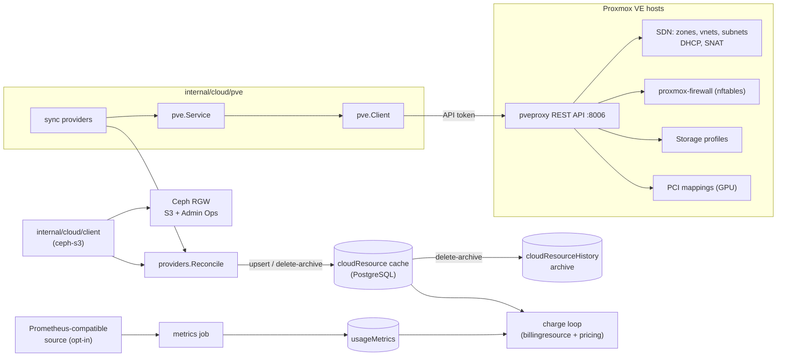
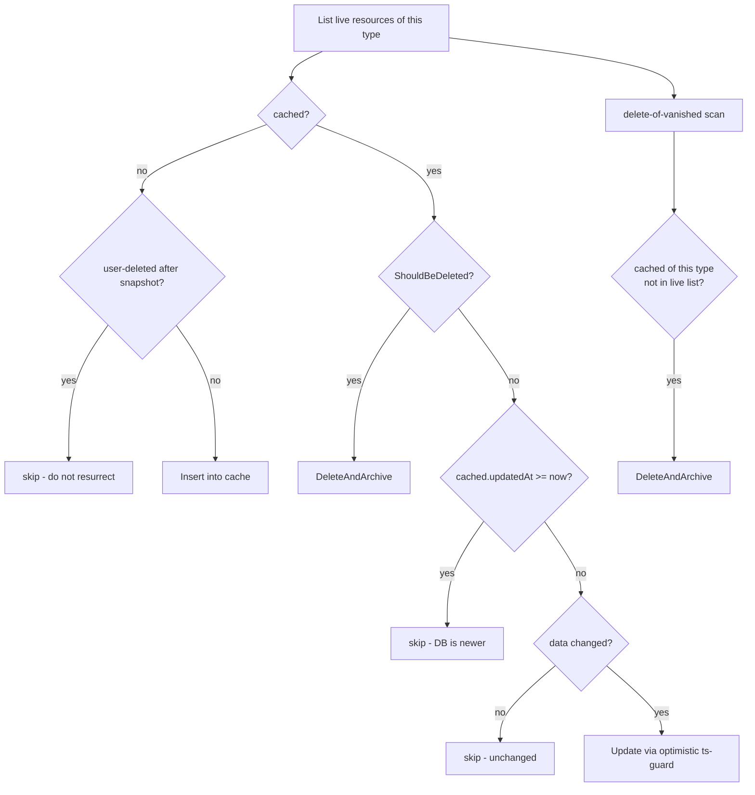

# Cloud Integration

How ProxCloud connects to Proxmox VE clusters and Ceph RGW object stores, keeps a
truthful cache of every customer's cloud resources, and feeds that cache into
billing.

This document is for contributors working in `internal/cloud/*` and
`internal/platform/externalservice/*`. It describes the model as the code
implements it today. The component view with Implemented/Planned status is in
[C3 components](architecture/c4/c3-components.md) (C3b, C3c, C3e); the
code-level flows (network isolation, firewall, quota, rating, create/teardown
sequences) are in [C4 code](architecture/c4/c4-code.md).

---

## The big picture

ProxCloud never bills straight off a live cluster. It maintains a PostgreSQL
**cache** of cloud resources (the `cloudResource` table) and rates against that
cache. Three paths keep the cache honest:

- **Write paths** (`internal/platform/project/cloud_writes*.go`) — every create,
  action and delete done through ProxCloud writes the cluster **and** the cache
  row synchronously.
- **Sync** (`internal/cloud/syncjob`, the PVE sync providers,
  `internal/cloud/providers`) — a 15-minute reconcile that lists each project's
  pool on the cluster and makes the cache match it. A change made directly in
  Proxmox appears after the next sync.
- **Live refresh** — a server GET does a best-effort refresh of that one row
  (`pveRefreshServerRow` in `cloud_writes.go`).

A fourth path, **metrics** (`internal/cloud/metrics`, `internal/cloud/metricsjob`),
reads traffic counters from a Prometheus-compatible source into per-server monthly
documents that the rating engine charges from. It is opt-in and off by default on
Proxmox.



---

## External services (provider registration)

A cluster or store is registered as an **external service**: a document in the
`externalService` table, modeled by
`internal/platform/externalservice/externalservice.go`.

```go
type ExternalService struct {
    ID               string
    Name             string
    DefaultPricePlan string
    Type             string          // CLOUD | CPANEL | PAYMENT
    Status           string          // PUBLIC | PRIVATE | DISABLED
    Config           map[string]any  // free-form, shape depends on config.provider
    Secret           any             // encrypted at rest, decrypted in memory on read
}
```

Only `Type == "CLOUD"` matters to the cloud layer. `config.provider` selects the
provider kind:

| `config.provider` | What it is | Accessors |
|---|---|---|
| `proxmox` | One Proxmox VE cluster (one cluster = one region) | `internal/platform/externalservice/proxmox.go` |
| `ceph-s3` | A Ceph RGW reached over S3 and Admin Ops | `externalservice.go` (`IsCephS3`, `ObjectClient`, …) |
| `rustfs` | A RustFS reached over S3 and its admin API | `externalservice.go` (`IsRustFS`, `ObjectClient`) |
| `kamaji` | A management cluster for managed Kubernetes | `kamaji.go` |
| `dbaas` | A management cluster for managed databases | `dbaas.go` |

Operators register providers in the admin console (System → Cloud providers →
Add provider) or with the same admin `POST /service` call the form uses.

### The Proxmox provider document

The shape is documented in the header of `proxmox.go`:

```jsonc
{
  "name": "Proxmox Lab", "type": "CLOUD", "status": "PUBLIC",
  "config": {
    "provider": "proxmox",
    "region":   "pve",                                   // 1 cluster = 1 region
    "regions":  {"pve": {"displayName": "Homelab"}},
    "services": {"compute": {"pve": true}, "network": {"pve": true},
                 "volumev3": {"pve": true}, "image": {"pve": true}},
    "apiUrl":      "https://pve1.lab:8006",
    "tokenId":     "proxcloud@pve!platform",             // API token identity; secret below
    "fingerprint": "AA:BB:…",                            // SHA-256 cert pin; empty = system CA
    "insecureTls": false,
    "poolPrefix":  "pc-",                                // pool = poolPrefix + projectId
    "network": {
      "defaultZone": "overlay",
      "zones": { "overlay": {"kind": "evpn", "controller": "proxcloud", "mtu": 1450, …} },
      "publicNetworks": [{"id": "vmbr1", "name": "Internet", "cidr": "203.0.113.0/24",
                          "gateway": "203.0.113.1", "ranges": ["…"], "exclude": ["…"]}],
      "cidrPool": "10.100.0.0/16",                       // required; tenant CIDRs never overlap
      "blockedCidrs": ["192.0.2.0/24"],                  // tenants cannot reach these; node management networks are always added
      "isolation": "shared",                             // or "evpn-per-project"
      "evpnController": "proxcloud"
    },
    "storageProfiles": {"std": {"label": "Local NVMe (ZFS)", "storages": {"*": "local-zfs"},
                                "shared": false, "snapshots": true, "thin": true,
                                "liveMigrate": false, "replication": false},
                        "capacity": {"label": "Capacity HDD (NFS)", "storages": {"*": "nas-capacity"},
                                     "shared": true, "liveMigrate": true}},
    "defaultStorageProfile": "std",
    "capabilities": {"detectedAt": "…", "storages": {"local-zfs": {…}}}, // written by detection only
    "storageClasses": {"nas-capacity": {"class": "capacity",            // admin override (wins)
                                        "suggestedClass": "standard"}}, // installer fio result, display only
    "storageHeadroomPct": 10,                            // % of a storage kept free when placing disks
    "templates": {},                                     // optional pins or overlays on the discovered OS templates
    "gpus": {},                                          // {mappingId: {"alias": "nvidia-4090"}}
    "overcommit": {"cpu": 4},
    "metrics": {"source": "none"},
    "provisioning": {"quota": {"servers": 10, "vcpus": 20, "ramMb": 51200, "diskGb": 500,
                               "networks": 5, "floatingIps": 2, "gpu": {"*": 0}}}
  },
  "secret": {"tokenSecret": "<uuid>"}                    // encrypted at rest
}
```

Typed accessors used by the rest of the code:

| Accessor | Config key | Meaning |
|---|---|---|
| `IsProxmox()` | `config.provider == "proxmox"` | provider kind |
| `PVERegion()` | `config.region` | the cluster's region, else the first `regions` key |
| `PVEConfig()` | `apiUrl`, `tokenId`, `fingerprint`, `insecureTls`, `secret.tokenSecret` | the `pve.Config` for `pve.NewService` |
| `PVEPoolPrefix()` / `PoolFor(projectID)` | `poolPrefix` (default `pc-`) | the project's pool id |
| `PVENetworkConfig()` | `network.*` | zones, public networks, `cidrPool`, isolation mode |
| `PVEStorageProfiles()` / `PVEDefaultStorageProfile()` | `storageProfiles`, `defaultStorageProfile` | storage per node, label, capability flags (validated against detection), derived `tier` / `class`, `bootDisk` / `dbaas` caps |
| `PVECapabilities()` | `capabilities` | the last storage capability detection (below) |
| `PVEStorageClasses()` / `PVEEffectiveStorageClass(id)` | `storageClasses` | per-storage class override and installer suggestion; effective class = valid override, else detected |
| `PVEStorageHeadroomPct()` | `storageHeadroomPct` (default 10, valid 0–99) | free space kept on a storage when placing a disk |
| `PVEVolumeProfileFunc()` | `storageProfiles`, `capabilities`, `storageClasses` | resolves each synced disk's own profile and storage class |
| `PVETemplates()`, `PVEImageCatalog()` | `templates` | OS templates servers are cloned from: discovered from cluster tags ([images/README.md](../images/README.md)); an entry with `vmid` + `node` pins one, any other entry overlays `name`, `osDistro`, `minDiskGb` |
| `PVEGPUAliases()` / `PVEGPUMappingsFor(alias)` | `gpus` | PCI mapping ids per GPU alias |
| `PVEOvercommitCPU()` | `overcommit.cpu` (default 4) | scheduler CPU overcommit |
| `PVEDefaultQuota()` | `provisioning.quota` | quota seeded onto a new project |
| `MetricsSource()` | `metrics.source` | `pve` (the Proxmox default), `prometheus` or `none` |
| `ServiceEnabledInRegion(slug, region)` | `services[slug][region]` | per-service toggle (below) |

### Credentials

Secrets are stored encrypted at rest and decrypted in place when the service is
loaded (`Service.decrypt` in `externalservice/service.go`). Never serialize
`Secret`: its JSON tag is `-`, and admin reads strip it.

A Proxmox provider authenticates with one privilege-separated **API token**:
`config.tokenId` (`user@realm!token`) plus the encrypted `secret.tokenSecret`.
Give it the least-privilege `ProxCloudPlatform` role described in
[proxmox-permissions.md](proxmox-permissions.md). Test connection in the admin
console (`internal/platform/admin/pveadmin.go`) warns when privileges are missing
or the token belongs to `root@pam`, refuses a cluster whose datacenter firewall
is off or whose nodes still run the legacy iptables firewall, and refuses a
public network on the management bridge.

TLS to the cluster (`pve.TLSConfigFor`, `internal/cloud/pve/client.go`): a
`fingerprint` pins the server certificate by its SHA-256 fingerprint (the format
`pvenode cert info` prints); with no fingerprint the system CA pool is used;
`insecureTls` skips verification and is a last resort.

### Per-service toggles and the customer portal

`config.services` is a nested map of `slug → { region → bool }`. It drives what
the customer sees (`uiMenuItems` in `internal/platform/project/clientcloud.go`
builds the portal menu from it) and what the sync job reconciles
(`ServiceEnabledInRegion`; a provider with no `services` map at all counts as
everything enabled):

| Provider kind | Slug | Customer surface |
|---|---|---|
| `proxmox` | `compute` | Servers, Key pairs; also gates the whole Proxmox sync leg |
| `proxmox` | `image` | Images (admin templates and project templates) |
| `proxmox` | `volumev3` | Volumes, Snapshots pages |
| `proxmox` | `network` | Networks, Security groups |
| `ceph-s3`, `rustfs` | `object-store` | Object storage, S3 access keys |
| `kamaji` | `kubernetes` | Kubernetes |
| `dbaas` | `database` | Databases |

Public IPs have no page of their own: they are a server action
(`ATTACH_PUBLIC_NETWORK`), see [api.md](api.md).

A service with `Status == "DISABLED"` contributes no menu items and is skipped
by sync and the charge loop.

---

## The Proxmox client layer

`internal/cloud/pve` holds everything that talks to Proxmox VE:

- **`pve.Client`** (`client.go`, `cluster.go`, `qemu.go`, `storage.go`, `sdn.go`,
  `firewall.go`, `pool.go`, `access.go`, `task.go`, `mapping.go`) — a typed REST
  client for `/api2/json` with `PVEAPIToken` auth: cluster resources, QEMU VMs,
  storage, SDN, cluster/vnet/VM firewall, pools, privilege checks, task polling
  (`WaitTask`) and PCI mappings.
- **`pve.Service`** (`service.go`, `write.go`, `volume.go`, `gpu.go`,
  `console.go`) — project-scoped IaaS: ensure the project pool, create, delete,
  resize, power and rename servers, project templates, volumes (add, extend,
  detach, attach, retype, delete detached), GPU slot picking, VNC/serial console.
- **Networks** (`network.go`, `sdn.go`) — tenant vnets and subnets carved from
  `cidrPool`, the ownership alias, cluster firewall isolation rules, per-project
  EVPN zones, staged SDN changes plus apply (serialized platform-wide by the SDN apply
  lock).
- **Firewall** (`firewallsvc.go`) — security groups as cluster firewall groups,
  the project default group, VM firewall options and per-NIC ipfilter sets
  (`SecureVM`).
- **Scheduler** (`scheduler.go`, `PickNode`) — capacity-ranked node choice with
  CPU overcommit, storage-profile node restriction, free space on the profile's
  storage (minus headroom) and free GPU slots.
- **Storage capabilities** (`capability.go`, `volume.go`) — `DetectStorage`,
  `StorageHasRoom`, `TemplateShared`; see
  [Storage capabilities and placement](#storage-capabilities-and-placement).

The handler side (`internal/platform/project`) holds a factory,
`projectH.SetProxmox(func(es) → pve.NewService(es.PVEConfig(), …))`, wired in
`cmd/api/main.go`. A client is built per provider when needed; a write returns
`503 "proxmox client not ready"` if it cannot be built.

### Storage capabilities and placement

Storage profiles are no longer trusted as typed. `pve.DetectStorage` reads
`GET /storage` and `GET /cluster/resources?type=storage` and returns, per storage
id: type, shared, content, snapshots, thin, live migrate, replication (`zfspool`
only), tier (`full` for `rbd` / `cephfs`, else `standard`), a default class
(`performance` / `standard` / `capacity`) from a static type table, and per-node
active / total / avail. A node outside the storage's `nodes` list is ignored and a
`disable=1` storage is active nowhere.

- **When it runs.** Every services-sync cycle (`syncjob.detectProxmoxCapabilities`,
  so nodes joining or leaving are picked up), on `POST
  /api/v1/admin/service/{id}/storage/detect` (the Storage tab's Re-detect), and on
  every `storageProfiles` save. The result is written as a partial update of
  `config.capabilities`.
- **Class.** `PUT /api/v1/admin/service/{id}/storage-classes` takes
  `{"<storage>": "performance|standard|capacity|"}`; `""` clears the override. The
  installer's fio result (`suggestedClass`) is only a suggestion and is never
  applied. A profile's class is the lowest effective class of its storages; its
  tier is `full` only when every storage is Ceph.
- **Profile saves** (`ValidatePVEStorageProfiles`) are checked against a live
  detection and answer 400 when a storage is missing, lacks `images` content, is
  inactive on its node (or on every node for `*`), when the profile claims a flag
  (shared, snapshots, thin, liveMigrate, replication) the storage lacks, or when a
  capacity-class profile claims `snapshots`, `bootDisk` or `dbaas`. Downgrading a
  flag is always allowed. An unreachable cluster rejects the save.
- **Server create** (`pveCreateServer`, `pvePlacement`) runs a live detection and
  reads the template's config first. A profile that refuses boot disks is 409. The
  profile's storage state per node (`PVEStorageProfile.Placement`) restricts the
  scheduler to nodes where it is active and feeds `pve.StorageHasRoom`: free space
  after the disk must stay at least `storageHeadroomPct` % of the storage's total
  (thin storage is checked at full size). PVE clones to another node only from
  shared to shared storage, so a template whose volumes all sit on shared storage
  (`pve.TemplateShared`) is full-cloned to a picked node whose profile storage is
  shared too (or with no profile, onto the template's own storages); a local
  template or a local profile pins the clone to the nodes holding a copy of the template
  (a discovered template clones the target node's own copy), and a profile
  not active on that node is 409.
- **Volumes.** Add-volume checks free space on the server's node (409, nothing
  written). A detached disk attaches only to a server on its VM's node: PVE's disk
  reassign requires both VMs on one node, even on shared storage (else 409);
  `LIST_ATTACH_TARGETS` returns the eligible servers. `RETYPE` moves the disk with `move_disk ... delete=1`
  to another profile's storage on the same node (409 if same storage, inactive, no
  `images`, no room, or a boot disk onto a profile that refuses boot disks).
  `DELETE` destroys a detached disk and is 409 for an attached one. A server
  snapshot (image) is 409 while an attached disk sits on capacity storage. Typed
  refusals are `pve.ConflictError`, mapped to 409 by `pveVolumeErr`.
- **DBaaS.** A database create whose storage class is named after a profile closed
  to databases on any Proxmox provider is 409.
- **Billing.** The volume sync stamps each disk's own `profile` and `storage_class`
  (and `volume_type` follows the disk's profile, not the server's). The volume
  billing resource exposes both as string attributes for price-rule filters.

### Tenancy: the pool is the boundary, the platform DB decides the rest

There is one admin token per provider, and ProxCloud is the policy decision
point (`proxmox.go` header):

- Every project VM and project template lives in the project's **pool**
  (`<poolPrefix><projectId>`). Every list filters by pool, so a VM outside the
  pool never enters the cache, and every mutation re-verifies ownership against
  the platform's cached row.
- Vnets, firewall groups and PCI mappings have **no pool scoping** in Proxmox.
  For them the platform database is the only tenancy boundary: vnets carry an
  ownership alias, and ownership is checked before any change.
- Tenant-to-tenant isolation on the SDN is enforced by cluster firewall rules,
  in `shared` mode and with one EVPN zone per project (`evpn-per-project`) alike.
  They also keep tenants off the nodes' management networks and `blockedCidrs`. Details:
  [C4.1 tenant network isolation](architecture/c4/c4-code.md#c41-tenant-network-isolation).
- PVE offers DHCP on simple zones only, and a simple zone stays on one node. On EVPN and
  VLAN zones the platform allocates each server's `net0` address and sets it through
  cloud-init, so an image without cloud-init gets no address there.

Getting tenancy wrong over-bills a customer for resources that are not theirs,
or worse, exposes them.

### Project provisioning

`BootstrapProxmoxOnto` (`internal/platform/project/bootstrap.go`) attaches a
project to a Proxmox provider:

1. ensure the project pool;
2. ensure the project's default security group;
3. seed the provider's default quota onto a project that has none;
4. append the binding `{serviceId, provider: "proxmox", region, pool}` to
   `project.services`. The pool id is persisted so teardown never re-derives it.

It is idempotent. There is no per-project identity on the cluster: customers
never get Proxmox credentials, and access is enforced by platform RBAC.

Projects provision onto every non-disabled provider the first time they are
entered (`enableAndBootstrap`). Projects that predate a provider are attached
from the admin project page (Cloud services → Attach provider, which calls
`GET /admin/project/{id}/external-service/{esid}`).

Teardown (`project/teardown.go`) destroys the pool's VMs and the pool, the
project's vnets and EVPN zone, its security groups, releases public IPs and
archives the cache rows.

---

## Resource sync (reconcile)

The cache is the `cloudResource` document (`internal/cloud/resource.go`). `type`
is the discriminator for the free-form `data` sub-document. The types produced
today are `SERVER`, `VOLUME`, `IMAGE`, `KEYPAIR`, `NETWORK`, `SECURITY_GROUP`,
`BUCKET`, `KUBERNETES_CLUSTER` and `DATABASE_CLUSTER`. `resource.go` still
declares the wider type list of the previous backend; nothing produces the
other types.

External ids per type:

| Type | `externalId` | Status values |
|---|---|---|
| `SERVER` | VMID | `pve.MapVMStatus`: `ACTIVE`, `SHUTOFF`, `BUILD` (clone/create lock), `MIGRATING`, else the uppercased PVE status |
| `IMAGE` (project template) | VMID | — |
| `VOLUME` | `volid` (e.g. `local-zfs:vm-123-disk-0`) | `in-use` or `available` |
| `NETWORK` | vnet name | — |
| `SECURITY_GROUP` | firewall group name | — |
| `KEYPAIR` | platform-only row (no cluster object; injected through cloud-init) | — |
| `BUCKET` | bucket name | — |

### Providers

A **Provider** (`internal/cloud/providers/providers.go`) is the read interface
for one resource type: `List(ctx)` returns live objects already mapped to
`CloudResource` (externalId/type/region/data set). Optional capabilities:

- `ProjectScoped` — the ProxCloud project id, used to scope the
  delete-of-vanished scan to `(serviceId, projectId, type)`.
- `Deletable` — `ShouldBeDeleted(cr)` marks a cached resource terminal even when
  the source still lists it.
- `KeyedComparer` — a per-key comparison (number-width and list-order tolerant,
  `compare.go`) for deciding whether an update is needed.

The Proxmox sync providers are `ServerSyncProvider`, `VolumeSyncProvider`,
`ImageSyncProvider` (`pve/syncprovider.go`), `NetworkSyncProvider`
(`pve/network.go`) and `SecurityGroupSyncProvider` (`pve/firewallsvc.go`).
Servers and templates come from the pool's `qemu` rows in `/cluster/resources`;
volumes are derived from each pool VM's disk entries; networks and groups are
the vnets and groups the project owns.

### Reconcile algorithm

`providers.Reconcile(ctx, provider, repo, serviceID, now)` is the core. For each
live resource:



Key behaviors, all in `providers/providers.go` + `cloud/repo.go`:

- **Leak-guard / delete-of-vanished** — after upserting, the reconcile scans the
  cached resources of this `(serviceId, projectId, type)` and archives any not
  present in the live list. Scoping to `projectId` (via `ProjectScoped`) means
  one project's sync can never delete another project's cached resources that
  share a `serviceId`. A VM that leaves the pool is archived the same way.
- **Recreate guard** (`WasUserDeletedAfter`) — if the newest archive record for
  `(serviceId, externalId)` was deleted **after** this sync's snapshot time, the
  resource is *not* re-inserted from a stale read.
- **Optimistic concurrency** — `Update` runs a row-locked read-modify-write
  inside a transaction (`WithTx` + `GetForUpdate`), gated on
  `updatedAt <= incoming.updatedAt`; a newer DB doc wins and the write is
  skipped (`Update` returns `(nil, nil)`).
- **Immutable `createdAt`** — `createdAt` is written only on the insert leg, so
  re-caching never drifts it. The UI "Created" column and mid-month billing
  proration both read it. `StampCreatedAtIfNull` heals docs whose `createdAt` was
  nulled by older writers.
- **`data` map stability** — cached `data` maps must be JSON-round-trip-stable:
  strings, numbers, maps and lists only. Timestamps are RFC3339 **strings**,
  never `time.Time`; otherwise the keyed compare reports a spurious diff every
  pass. `pve.ServerData` builds the server payload with this in mind.

### History archive

`DeleteAndArchive` hard-deletes from `cloudResource` and writes a one-time copy
into `cloudResourceHistory` (`internal/cloud/history.go`). The archive is
idempotent per `cloudResourceId` and copies only
`cloudResourceId/region/serviceId/type/data/createdAt/externalId/projectId +
deletedAt`. History backs the recreate guard above.

### The sync job

`internal/cloud/syncjob/job.go`:

- `Run(ctx)` — every **ENABLED** project → each attached CLOUD service → the
  provider-kind leg: `syncProxmoxService` (servers, volumes, templates, networks,
  security groups; gated on the `compute` toggle), `syncCephService` (buckets;
  `object-store`), `syncKamajiService` (`kubernetes`), `syncDbaasService`
  (`database`). Per-project and per-service failures are logged and skipped.
  Each cycle also re-detects the storage capabilities of every non-disabled
  Proxmox provider (`detectProxmoxCapabilities`).
  The scheduler runs it every 15 minutes (`scheduler.ServicesSyncSpec`).
- `SyncOne(ctx, projectID, serviceID)` — the admin single-project leg. A blank
  `serviceID` syncs every attached service (gated on the project being
  ENABLED); a specific `serviceID` syncs just that one.

There is no event-driven ingestion: Proxmox has no notification webhook in this
design. Freshness between syncs comes from the write paths and the live refresh
on a server GET.

---

## Metrics (traffic usage)

`internal/cloud/metrics` reads traffic counters; `internal/cloud/metricsjob`
drives the ingestion. The scope is **network traffic** per server, for the
`instance_traffic` billing unit.

- A Proxmox provider defaults to `pve` (`metrics/pve.go`): public-NIC byte counters off
  `status/current` every minute, folded into month-to-date totals with reset-aware deltas
  (`cur >= prev ? cur - prev : cur`), SDN traffic excluded. The other live source is a
  **Prometheus-compatible** endpoint (`metrics/prometheus.go`; vanilla Prometheus, Mimir,
  VictoriaMetrics, Thanos). `liveFetcher` (`metricsjob/job.go`) picks by
  `config.metrics.source`; with `none` the job skips the provider's servers silently.
  Prometheus month usage is `max − min` of the
  raw cumulative-counter samples inside the month window (not PromQL
  `increase()`), using the same decimal arithmetic as the rating engine.
- The only query schema implemented today, `libvirt-exporter`, is a layout
  from the previous backend. There is no Proxmox-exporter schema yet, so traffic metering on
  Proxmox stays off in practice. Native Proxmox samplers (VM state, task log,
  NIC counters) are planned (C3c).
- `metrics/service.go` aggregates per server into **public vs private** traffic.
  `metricsjob.livePublicNetworks` supplies the provider's `publicNetworks` ids
  for the classification.
- `metricsjob/job.go` (`Run`) walks every **ENABLED** project, reads its cached
  servers, resolves each server's external service, and calls
  `FetchAndSaveUsageMetrics`. The result is one document per
  `(server, billing cycle)` in the `usageMetrics` table.

Operators edit the source with `PUT /api/v1/admin/service/{id}/metrics-config`
and probe it with `POST /api/v1/admin/service/{id}/metrics-test` (the provider's
Metrics tab in the admin console). There are no per-VM utilization charts in the
client console.

---

## How the cache feeds billing

`internal/cloud/billingresource` is the cloud → billing bridge.
`GetBillingResources(projectID, serviceID)` lists the service's cached resources
and flat-maps each through its type's **Provider** (`GetBillingInformation`) into
priced `BillingResource`s. Types with no registered provider are skipped. The
providers are instance (plus `instance_traffic`), volume, bucket,
kubernetes_cluster, database_cluster, and the floating_ip / load_balancer
providers that no Proxmox resource feeds yet. Networks and security groups are
not billed. Public-IP and template billing are planned (C3c).

`stampResourceValues` injects `region` and `service_id` into each billing
resource's values (so a price-plan rule filtered by region/service can match)
and stamps `createdAt` (which drives mid-month proration).

The charge loop itself (`internal/platform/billingjob`) reads **only** the
PostgreSQL cache (`cloudResource` + `usageMetrics` + price plans), never the
live cluster. That is why the whole rating driver is testcontainer-verifiable,
and why sync and metrics exist: to keep the cache truthful. See
[billing.md](billing.md) and [jobs-scheduling.md](jobs-scheduling.md).

---

## Sequence: a customer creates a server

```mermaid
sequenceDiagram
    participant SPA as Customer SPA
    participant H as project handlers
    participant PS as pve.Service
    participant PVE as Proxmox VE API
    participant CACHE as cloudResource cache

    SPA->>H: POST /project/{id}/cloud<br/>{type: SERVER, data}
    H->>H: authz, flavor, template, project network
    H->>H: GPU quota, checkPVEQuota
    H->>PVE: storage detection, template config
    H->>H: pvePlacement (boot-disk cap, active nodes,<br/>template locality; 409 on refusal)
    H->>PVE: nodes and cluster resources
    H->>H: pve.PickNode (capacity, GPUs,<br/>storage free >= disk + headroom)
    H->>PS: CreateServer
    PS->>PVE: full clone (target node, profile storage)<br/>into the project pool
    PS->>PVE: cores, memory, net0 on the vnet, disk resize
    PS->>PVE: SecureVM (firewall before first boot)
    PS->>PVE: start VM
    PS-->>H: cache row
    H->>CACHE: insert (createdAt on insert only)
    H-->>SPA: 200 {result: resource}

    Note over CACHE: every 15 min, servicesSync reconciles<br/>the cache against the pool (repairs drift)
```

The create writes Proxmox **and** the cache synchronously, so the SPA sees the
resource immediately. If the firewall step fails the VM is destroyed and the
create fails. The full step list, including security groups and the failure
branch, is in
[C4 sequence (a)](architecture/c4/c4-code.md#sequence-a-create-server).

---

## RustFS S3 object storage

Standard-tier sites serve buckets from **RustFS** (`config.provider == "rustfs"`, same config keys
as `ceph-s3`). `adminApiUrl` is the private base URL the API reaches `/rustfs/admin/v3` on (the public
endpoint blocks it); the secret holds the RustFS root keys. Buckets carry
`data.storageBackend = "RUSTFS"`. Code: `internal/cloud/client/objectstore_rustfs.go`.

`rustfsBackend` embeds the Ceph backend's plain-S3 data plane and replaces what RGW does through Admin
Ops or bucket ownership. `client.ObjectCaps` (returned by `GET_SETTINGS` as `caps`) tells the UI what is
off; the API enforces it too.

| Concern | Ceph RGW | RustFS |
|---|---|---|
| Project identity | RGW user with generated keys | IAM user `uidPrefix + projectId`; ProxCloud generates the secret; access key = the user name |
| Bucket ownership | RGW owner | ARN in the project's canned policy, named like the user. Created and deleted with the root key; the project policy denies `s3:CreateBucket` and `s3:DeleteBucket` |
| Project quota | RGW user quota | Sum of bucket quotas, enforced by the API. With `defaultQuotaGiB` set, a new bucket gets what is left as its HARD quota, and quotas must keep fitting (`409` otherwise) |
| Bucket quota | bytes and objects | bytes only (`caps.quotaObjects = false`); HARD but fail-open, so never a billing guarantee |
| Usage | Admin Ops counters | Scanner (`datausageinfo`): delayed. Unknown usage keeps the last value, never 0 (`client.KeepLastUsage`) |
| Extra keys | child RGW user | IAM user with no identity policy, reaching only what a bucket policy grants |
| Key rotation | new access + secret | new secret, access key unchanged |
| Website | yes | gated off (`caps.website = false`) until per-bucket DNS serving is verified |

**Lab check RUSTFS-POLICY-1 (RustFS 1.0.4):** a bucket-policy principal matches the **bare user name**,
`{"AWS":["<user>"]}`. The ARN forms RGW uses (`arn:aws:iam:::user/<user>`) are accepted and silently match
nothing. So grants are bucket-policy statements, as on RGW, with the principal in RustFS's form
(`cephBackend.bareUserGrants`).

Known limit: a bucket with a quota refuses writes with `503` for a few seconds after creation, until the
scanner has seen it (measured 5 s on an idle 1.0.4). The root key owns every bucket, so `CreateBucket` on an
existing name answers 200: the API checks with `HeadBucket` first.

Quirks handled: `GET /quota/<bucket>` answers `503 "authoritative bucket usage is not available yet"` until
the scanner has seen a new bucket (waited out for decisions, flagged unknown in sync, `503` to the user if it
lasts); `list-canned-policies` needs `bucket=` next to `format=json`. Any bucket's ARN is removed from other
project policies when that name is created, so an owner who deleted a bucket directly through a key granted
by a custom policy cannot reach the next owner's bucket.

Bucket billing rules choose their basis through the priced attribute: `size_gb` (used, the default in the
seed) or `quota_gb` (allocated; the used size for a bucket without a quota). Both backends fill it.

## Ceph RGW S3 object storage

Full-tier sites serve buckets from **Ceph RGW over the S3 API**
(`config.provider == "ceph-s3"`). Every bucket
carries `data.storageBackend = "CEPH_S3"`. Code:
`internal/cloud/client/objectstore_ceph*.go`, `internal/cloud/cephcred/`,
`internal/platform/project/cloud_bucket_settings.go`.

### The RGW user is the per-project anchor

The per-project anchor is a dedicated **RGW user**,
`rgwUid = config.uidPrefix + <projectId>` (`uidPrefix` defaults to `proxcloud-`),
created in RGW's **default tenant**. We deliberately do **not** use RGW
multi-tenancy: a tenanted bucket cannot be reached from the s3website endpoint
(a DNS hostname cannot encode a tenant), which would make static website hosting
impossible. The trade-offs:

- **Isolation** = bucket **ownership** + S3 default-deny, plus the admin-ops `uid`
  filter that scopes the sync/billing list. A project's data-plane keys can only
  touch buckets it owns.
- **Global bucket namespace** (exactly like AWS S3). A name taken by any project
  fails with `409` (`client.ErrBucketNameTaken`). If collisions bite, add a
  per-provider `bucketPrefix` (not built).

### Provider config

A `ceph-s3` external service is created from **Cloud providers → Add provider →
Ceph S3** in the admin UI, or through the same admin `POST /service` path it
posts to. Shape:

```jsonc
{
  "type": "CLOUD", "status": "PUBLIC", "name": "ceph-s3",
  "config": {
    "provider": "ceph-s3",
    "s3Endpoint":        "https://s3.example",            // S3 data endpoint
    "adminApiUrl":       "https://s3.example/admin",       // RGW Admin Ops
    "s3WebsiteEndpoint": "https://s3-website.example",     // optional (static websites)
    "region":            "us-east-1",                       // RGW zonegroup, for SigV4
    "uidPrefix":         "dev_",                            // optional prefix on the RGW uid
    "defaultQuotaGiB":   100,                               // per-project user quota
    "services": { "object-store": { "us-east-1": true } }
  },
  "secret": { "adminAccessKey": "…", "adminSecretKey": "…" }  // an RGW admin user, caps users=*;buckets=*;usage=*
}
```

Accessors: `IsCephS3`, `S3Endpoint`, `AdminAPIURL`, `S3WebsiteEndpoint`,
`CephRegion`, `UIDPrefix`, `RGWUIDFor(projectID)`, `DefaultQuotaGiB`, and
`CephConfig(...)` which assembles a `client.CephConfig` for `client.NewCephS3`.

**Cluster prerequisite.** The client talks path-style (`UsePathStyle: true`), so
`s3Endpoint`'s hostname MUST be one RGW recognizes as its own — `rgw_dns_name`,
the zonegroup `hostnames` list, or Rook's
`CephObjectStore.spec.hosting.dnsNames`. RGW treats that list as
all-or-nothing: naming any host switches it to Host-header matching, and a Host
that is missing is parsed as the **bucket name** (`404 NoSuchBucket:
<your-hostname>`, path ignored). List every external name the gateway answers on.

**Attaching an existing project.** As with Proxmox, a project that predates the
provider is attached from the admin project page (Cloud services → Attach
provider), which runs `BootstrapCephOnto`. Idempotent.

### Two credential planes

`client.NewCephS3` is the only constructor of `*client.Client`. The client
carries up to two S3/admin clients:

- **Admin keys** (Admin Ops, SigV4-signed REST): provision the RGW user + quota,
  list buckets with stats for the sync/billing meter, read one bucket's
  owner/stats. An *admin-only* client (no project keys) can do these but no data
  I/O.
- **Project keys** (aws-sdk-go-v2 S3): bucket + object CRUD, ACL, website,
  policy — run **as the project's own RGW user**. Stored encrypted per project in
  the `cephRgwCredential` collection (`internal/cloud/cephcred`), kept **off** the
  project document (which is serialized to the client, so the secret would leak).

Admin Ops quirks that only a live cluster surfaced: every request needs an
explicit `X-Amz-Content-Sha256` header; the query must be sorted (SigV4
canonicalization); `PUT /admin/user?key` returns a **bare array**;
`max-buckets=-1` **forbids** a user from creating buckets (the opposite of the
usual convention).

### Ownership guard — every admin-by-name op verifies the live owner

The admin key can address **any** bucket by name, and the namespace is global.
So a stale cache row whose name was recreated by another project must never be
read, requota'd, or purged as if it were ours. `adminBucketInfo` / `bucketOwner`
fetch the live `owner` and refuse a bucket the project does not own
(`ErrBucketNotOwned`); `getBucket`, `SetBucketQuota`, and `ForceDeleteCephBucket`
all funnel through it. Cached `ProjectID` is **not** proof of live ownership.

### Lifecycle

- **Bootstrap** (`project/bootstrap.go: BootstrapCephOnto`) — ensure the RGW user
  (idempotent), set quota, store the keys in `cephRgwCredential`, append the
  binding `{serviceId, provider:"ceph-s3", region, rgwUid}`.
- **Client build** — the handler seams (`tryTenantClient`, `tenantWriteService`)
  build a project-keyed ceph client from `cephRgwCredential`. Bucket actions
  resolve the provider from the **resource's** `serviceId`, never the request
  header.
- **Sync** (`syncjob.go: syncCephService`) — admin-keyed client, `uid`-scoped
  bucket list with stats → the `BUCKET` cache carries
  `{objectCount, sizeInBytes, sizeInGb}`, which the `"bucket"` pricing rules
  rate. The `uid` filter IS the leak-guard.
- **Teardown** (`project/teardown.go`) — force-delete this project's buckets via
  Admin Ops `purge-objects` (owner-checked), purge each child-key user then the
  parent user, and drop the stored credentials. **Fail closed:** a local
  key/credential record is deleted only after its RGW user is actually purged,
  so a transient purge failure never orphans a live key with no inventory left
  to revoke.

### Customer surface

Beyond bucket + object CRUD, buckets expose an S3 feature surface:

- **S3 access keys** (`/project/{id}/s3-credentials`, `/s3-keys`) — the project's
  own credentials plus extra keys for aws-cli / any S3 client, with **rotation**
  and delete. Each extra key is its own RGW user (`<projectUid>-<name>`,
  `max-buckets=-1` so it cannot create unmetered buckets); it gets access only
  through explicit **bucket grants** (READ / READ_WRITE / FULL, via bucket
  policy). These endpoints require `project:cloud_resource:api_access`, not
  `manage` — they hand out live credentials.
- **Bucket settings** (cloud actions on the BUCKET resource) — versioning, object
  lock (create-time, **GOVERNANCE only** so teardown can still purge), per-bucket
  quota, lifecycle, CORS, tagging, raw bucket-policy passthrough, read-only
  index-type/placement.
- **Static website** — `PutBucketWebsite` + an anonymous-read bucket **policy**
  (not just an ACL; an ACL grants bucket *listing*, not object reads). Enabling
  exposes every object publicly, and the response says so (`publicObjects: true`).

ProxCloud **owns** the bucket policy document and merges by `Sid`
(`ProxCloudPublicWebsiteRead`, `ProxCloudPublicRead`, `ProxCloudGrant-<uid>`),
preserving foreign statements byte-for-byte — so the website toggle and per-key
grants never clobber each other or a customer's own statements.

**Not built** (blocked by infra, not code): server-side encryption (needs a
KMS/Vault backend — `PutBucketEncryption` returns 200 but then bricks writes
without one), cross-zone replication (single-zone cluster), MFA delete.

---

## Managed Kubernetes and databases (Kamaji and DBaaS providers)

`config.provider == "kamaji"` registers a management cluster for managed
Kubernetes (`KUBERNETES_CLUSTER`, slug `kubernetes`); `config.provider ==
"dbaas"` does the same for managed databases (`DATABASE_CLUSTER`, slug
`database`). Each follows the provider pattern above: typed accessors
(`externalservice/kamaji.go`, `dbaas.go`), a dedicated client, its own bootstrap
and sync legs. Each customer cluster or database is one ArgoCD `Application`
written to the management cluster's API (`internal/cloud/kamaji`,
`internal/cloud/dbaas`, client `internal/cloud/kamajik8s`); health is read back
from the Application and the objects it owns. Billing:
`billingresource/kubernetescluster.go` (control-plane fee) and
`databasecluster.go`.

Read, sync and delete work today. **Creating** a cluster or a database on a
Proxmox provider is planned: the create legs
(`project/cloud_kamaji_create.go`, `cloud_dbaas_create.go`) return an
explicit "not available yet" error. See
[C3e](architecture/c4/c3-components.md#c3e-managed-services-and-object-storage).

Operator guides: [managed-k8s.md](managed-k8s.md),
[managed-dbaas.md](managed-dbaas.md). Management-cluster manifests (RBAC,
AppProject guardrail, ArgoCD health checks): `deploy/mgmt-cluster/`.

---

## Source files

**Cloud domain and cache:**

- `internal/cloud/resource.go` — the `CloudResource` document + the type list
- `internal/cloud/repo.go` — persistence, optimistic upsert/update, archive, recreate guard, counts
- `internal/cloud/history.go` — `cloudResourceHistory` archive record
- `internal/cloud/download.go` — object-store download tokens

**Proxmox VE:**

- `internal/cloud/pve/{client,cluster,qemu,storage,sdn,firewall,pool,access,task,mapping,form}.go` — REST client
- `internal/cloud/pve/{service,write,volume,gpu,console}.go` — project-scoped service
- `internal/cloud/pve/{network,firewallsvc,scheduler}.go` — networks and isolation, security groups, node placement
- `internal/cloud/pve/capability.go` — storage capability detection, free-space and template-locality checks
- `internal/cloud/pve/syncprovider.go` — server, volume and template sync providers
- `internal/platform/externalservice/proxmox.go` — provider document and accessors

**Providers and sync:**

- `internal/cloud/providers/{providers,compare,niche_sync,write}.go` — Provider interface, `Reconcile`, keyed compare, bucket write/sync
- `internal/cloud/syncjob/job.go` — the sync driver

**Metrics:**

- `internal/cloud/metrics/{prometheus,service,repo,shared,domain}.go`
- `internal/cloud/metricsjob/job.go`

**Billing bridge:**

- `internal/cloud/billingresource/{billingresource,catalog,server,volume,bucket,image,floatingip,kubernetescluster,databasecluster}.go`

**Object storage:**

- `internal/cloud/client/{client,objectstore}.go` — the ceph-s3 client
- `internal/cloud/client/objectstore_ceph{,_policy,_settings}.go` — S3 + Admin Ops, policy document, bucket settings
- `internal/cloud/cephcred/` — per-project RGW credentials + extra S3 keys (encrypted)

**Managed services:**

- `internal/cloud/kamaji/`, `internal/cloud/dbaas/`, `internal/cloud/kamajik8s/`

**Portal-facing:**

- `internal/platform/project/clientcloud.go` — UI menu + attached services
- `internal/platform/project/cloud_writes.go`, `cloud_writes_pve.go` — client cloud create/action/delete
- `internal/platform/project/cloud_network_pve.go` — networks, public NIC attach/detach
- `internal/platform/project/cloud_quota_pve.go`, `publicip_pve.go` — quota gate, public IP pool
- `internal/platform/project/cloud_bucket_settings.go` — bucket settings + S3-key routes
- `internal/platform/project/{bootstrap,teardown}.go` — provision + deprovision
- `cmd/api/main.go` — wiring (external services, provider factories, cephcred, jobs)
