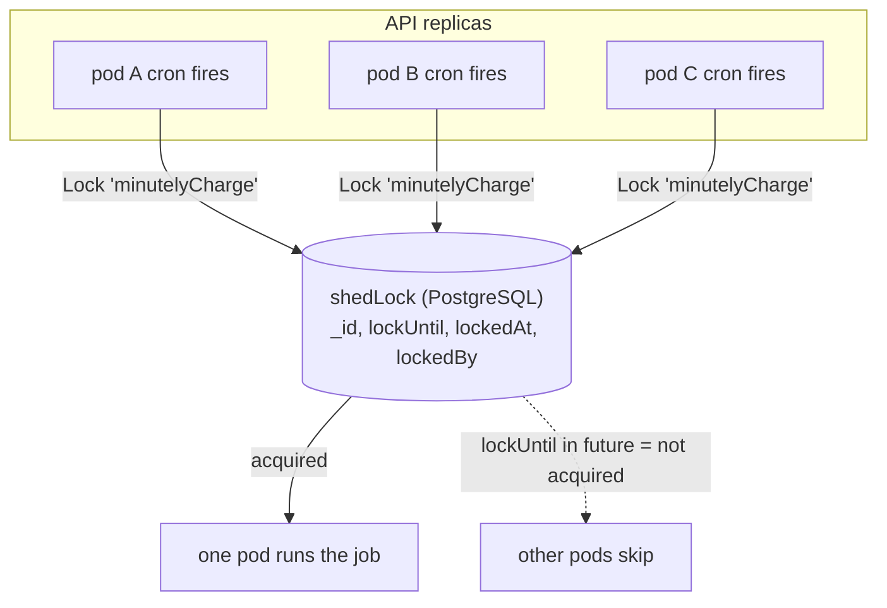

# Jobs & Scheduling

How ProxCloud runs its background work — cron-scheduled jobs, the distributed lock
that limits duplicate cron dispatch, primary PostgreSQL durable native billing,
and the on-demand debug triggers.

This document is for contributors working in `internal/platform/scheduler`,
`internal/platform/lock`, `internal/platform/chargefanout`,
`internal/platform/billingjob`, and the job wiring in `cmd/api/main.go`.

---

## Why this design

The API is meant to run with **N replicas** behind a load balancer. Background
work must not multiply by the replica count — you do not want three pods each
charging every billing profile every minute. Two mechanisms make horizontal
scaling safe:

- **ShedLock** — a PostgreSQL-backed distributed lock. Every scheduled job runs
  under a named lock while that lease holds. It throttles duplicate dispatch, but a timed-out or uncooperative process is not proven stopped.
- **Durable competing workers** — native billing publishes a frozen original-cycle
  job per profile on the primary. Delivery is at least once; UUID owner + epoch +
  unexpired database-clock CAS fences completion/retry. The whole-profile financial
  receipt and queue acknowledgment commit with all service bill mutations.



---

## The scheduler

`internal/platform/scheduler/scheduler.go` wraps `robfig/cron/v3` in
**seconds-enabled** mode, so all cron specs are **6-field, seconds-first**
(`sec min hour dom month dow`).

A job is:

```go
type Job struct {
    Name       string        // the ShedLock name
    Spec       string        // 6-field cron expression
    AtMostFor  time.Duration
    AtLeastFor time.Duration
    Fn         func(ctx context.Context)
}
```

`Register` schedules the job; each fire calls `RunLocked`, which acquires the
job's ShedLock, runs `Fn` only if it acquired, and releases honoring
`AtLeastFor`:

```go
func (s *Scheduler) RunLocked(ctx, name, atMostFor, atLeastFor, now, fn) (bool, error) {
    ok, err := s.lock.Lock(ctx, name, atMostFor, now)
    if err != nil || !ok { return false, err }   // a fleet-mate holds it -> skip
    defer s.lock.Unlock(ctx, name, atLeastFor, now, time.Now().UTC())
    fn(ctx)
    return true, nil
}
```

`RunLocked` is exported with an injected `now` so the lock guard is
deterministically testable without waiting on the cron clock.

---

## ShedLock (the distributed lock)

`internal/platform/lock/shedlock.go`. One row per lock in the `shedLock`
table `(id text primary key, doc jsonb)`:

```text
{ _id: <lockName>, lockUntil: <time>, lockedAt: <time>, lockedBy: <hostname> }
```

**Acquire** — `Lock(name, atMostFor, now)` runs a single statement, and treats
`RowsAffected() > 0` as acquired:

```sql
INSERT INTO "shedLock" (id, doc)
VALUES (name, { lockUntil: now + atMostFor, lockedAt: now, lockedBy: host })
ON CONFLICT (id) DO UPDATE SET doc = EXCLUDED.doc
WHERE ("shedLock".doc->>'lockUntil')::timestamptz <= now;
```

- If no lock row exists, the `INSERT` creates it → **acquired**.
- If a row exists but its `lockUntil` is in the past, the `ON CONFLICT` arm's
  `WHERE` guard passes and the row is taken over → **acquired**.
- If a live lock is held (`lockUntil > now`), the `WHERE` guard fails, zero rows
  are affected → **not acquired** (returns `false`, no error).

`atMostFor` (ShedLock's `lockAtMostFor`) is the **safety ceiling**: if the
holder crashes without unlocking, the lock auto-frees after this long so the job
is not stuck forever.

**Release** — `Unlock(name, atLeastFor, acquiredAt, now)` sets `lockUntil` to
the later of `acquiredAt + atLeastFor` and `now`. `atLeastFor`
(`lockAtLeastFor`) is a **minimum hold**: a job that finished in milliseconds
still can't re-run before its minimum interval, which debounces a fast job whose
cron would otherwise fire it again immediately.

---

## Job catalog

These are the jobs registered in `registerJobs` (`cmd/api/main.go`), with the
cron specs from `scheduler.go`. All specs are 6-field seconds-first, UTC.

| Job (lock name) | Cron spec | Cadence | atMostFor / atLeastFor | What it does |
|---|---|---|---|---|
| `minutelyCharge` | `30 * * * * *` | every minute at :30 | 5m / 30s | Charge each ACTIVE billing profile for the `minute` time unit |
| `hourlyCharge` | `0 0 * * * *` | top of every hour | 5m / 30s | Charge each ACTIVE profile for the `hour` time unit |
| `monthlyCharge` | `0 0 * * * *` | top of every hour | 5m / 30s | Charge each ACTIVE profile for the `month` time unit (shares the hourly spec; the charge filters rules by exact time unit) |
| `usageMetricsFetch` | `0 0 * * * *` | top of every hour | 10m / 30s | Ingest per-VM network-traffic usage into `usageMetrics` from `config.metrics.source` (`pve`, `prometheus` or `none`; see `pveTrafficSample` for the per-minute Proxmox pass) |
| `savingsContractExpiration` | `0 0 0 * * *` | daily 00:00 | 10m / 30s | Expire savings contracts past their end date |
| `savingsContractExpiryReminders` | `0 0 0 * * *` | daily 00:00 | 10m / 30s | Schedule reminder docs for ACTIVE contracts nearing expiry |
| `reminderNotifications` | `0 0 * * * *` | top of every hour | 10m / 30s | Dispatch the due scheduled reminders (re-evaluates days-until-expiry each run) |
| `paymentGatewayTransactionScanning` | `0 */20 * * * *` | every 20 minutes | 10m / 30s | Reconcile stuck PENDING payment transactions (deposits/collects) |
| `autoSuspensionJob` | `0 */30 * * * *` | every 30 minutes | 20m / 5m | Walk every `SUSPENDED` profile again (finishes a failed or partial suspension), retry the resume of every VM a suspension paused in a project no longer held, then run dunning → auto-suspend delinquent billing profiles |
| `monthlyBill` | `0 30 0 * * *` | daily 00:30 | 1h / 30s | Finalize each profile's previous-month OPEN bill (OPEN → SENT/PAID) so it becomes collectable + dunnable; after the passes that bill the month's last hour and minute onto it |
| `monthlyCollect` | `0 0 7 1,5,9,13,16 * *` | 07:00 on the 1st/5th/9th/13th/16th | 1h / 30s | Collect SENT bills via the stored card |
| `servicesSync` | `0 */15 * * * *` | every 15 minutes | 10m / 30s | Sync every ENABLED project's cloud resources into the cache |
| `pveStateSync` | `15 * * * * *` | every minute at :15 | 2m / 30s | Proxmox: SERVER, IMAGE and FLOATING_IP rows of every project off one `/cluster/resources` page per provider; heartbeat and staleness alert |
| `sandboxStateSync` | `10 * * * * *` | every minute at :10 | 2m / 30s | Sandboxes: every enabled project's SANDBOX rows off the sandbox cluster before the minutely charge (pins each start, ends each vanished row) |
| `sandboxTemplateAdopt` | `0 */5 * * * *` | every 5 minutes | 10m / 1m | Sandboxes: a built-in template moves to the digest the prepull DaemonSet runs once every Ready node has pulled it; only for providers with `imageAdoption` `on` (`dry-run` logs) (docs/managed-sandbox.md §6) |
| `sandboxBuildSync` | `40 * * * * *` | every minute at :40 | 10m / 20s | Sandboxes: record the result of custom template builds nobody polls, before the build pod is cleaned up |
| `sandboxAutoPause` | `5 * * * * *` | every minute at :05 | 30m / 20s | Registered, but skips managed saved-lifecycle work while the fixed capability is false; no AutoPause enable flag |
| `sandboxRegistryPrune` | `0 17 * * * *` | every hour at :17 | 30m / 5m | `dry-run` previews old unreferenced candidates; configured `on` returns physical-delete HOLD, including project teardown |
| `pveTaskPoll` | `*/20 * * * * *` | every 20 seconds | 1m / 10s | Proxmox: finished VM tasks past each node's cursor; records them (`LIST_EVENTS`), audits the ones the platform did not run, re-syncs their project |
| `pveTrafficSample` | `45 * * * * *` | every minute at :45 | 2m / 30s | Proxmox: public-NIC counters of the VMs holding a public IP into `usageMetrics` |
| `executeProjectDeletion` | `30 * * * * *` | every minute at :30 | 30m / 30s | Delete projects past their deletion grace window (cascade live cloud delete → remove the doc) |

Notes:

- `monthlyCharge` deliberately reuses the hourly spec. The charge step filters
  price-plan rules by the **exact** time unit, so a `month`-unit rule only
  accrues on the monthly charge even though it fires hourly.
- The `autoSuspensionJob` uses a longer `atLeastFor` (5m) because dunning + cloud
  suspend is heavier and should not re-fire back-to-back.
- Every job body logs-and-continues on error; the scheduler never crashes on a
  job failure.

### The charge job specifically

`internal/platform/billingjob/billingjob.go` is the rating driver. `Charge(ctx,
timeUnit, now)`:

1. gates on `billingEnabled` (a `billingConfiguration` document exists);
2. loads all **ACTIVE** billing profiles + every external service;
3. for each profile, gathers the project-scoped cached resources per service,
   selects applicable price-plan rules for the time unit, and applies them to
   the profile's current bill (plus savings-contract discounts and
   price-adjustment rules).

Errors per profile are logged and skipped so one bad profile can't stall the
rest. Crucially, the charge reads **only** the PostgreSQL cache
(`cloudResource` + `usageMetrics` + price plans), never live cloud — the sync
and metrics jobs are what keep that cache truthful (see
`cloud-integration.md`).

---

## Primary durable native charge dispatch

Native billing always publishes through `chargefanout.Publish` to `durable_job`.
The message is a validated versioned `{version, profileId, timeUnit, cycleAt}`;
`cycleAt` is the canonical ORIGINAL producer cutoff, not processing time. One
unique key includes profile, cadence and that UTC cutoff. Re-publishing cannot
replace a frozen payload. Partial publishing can be retried for the same cycle.

Every API replica starts a bounded worker pool. `SELECT FOR UPDATE SKIP LOCKED`
selects due/expired work on the primary. Every acquisition gets a fresh UUID owner
and increasing epoch; renew/retry/complete require that acquisition and an unexpired
DB-clock lease, checked again after row-lock waits. A DB-only worker transaction
commits all provider charges, a profile-cycle receipt, optional transactional
outbox writes, and queue ACK together. A crash before commit rolls everything back;
a business commit without ACK is safe on retry because the independent financial
receipt survives completed queue-payload pruning. This is not exactly-once SMTP,
HTTP or gateway execution.

Original cutoff also pins monthly proration's per-call engine clock. Deleted
resources cannot rate after that cutoff or the original month's end; older cycles
cannot rewind newer watermarks. Resolution still reads CURRENT primary cache and
pricing configuration, not historical snapshots. Unknown/missing history cannot be
reconstructed by this queue. Issued SENT/PAID months never reopen: a late/missing
closing cycle requires explicit reconciliation and does not record success.
Invoice issuance defers while known pending/running/dead jobs cover its original
cycle; a publish arriving after issuance fails the issued-month guard instead.

External billing keeps its existing explicit HTTP provider: no native fallback and
no new automatic HTTP retries. Its worker only claims selftests; native backlog
stays untouched until the operator restores/drains the native mode. Do not mix
native/external producers or change providers with unreconciled work.

See [durable job operations](durable-jobs.md) for transactions, status/replay,
retention, migration, primary/read-pool boundaries, and exact regression commands.

---

## Manual triggers

Two ways to run a job on demand instead of waiting for its cron — useful for a
controlled first live run, or for driving a job deterministically in a drill.

### mgmt debug triggers

Exposed on the **management port** when `PROXCLOUD_JOBS_SCHEDULER_ENABLED=true`
**or** `PROXCLOUD_JOBS_DEBUG_TRIGGERS=true` (`server.MgmtRouter(..., jobsDebug)`),
except `gen-hmac-key`, which only `PROXCLOUD_JOBS_DEBUG_TRIGGERS=true` exposes
(it is unauthenticated).
Each is `POST /debug/<name>` and returns a small JSON result:

| Trigger | Runs |
|---|---|
| `run-sso-reconcile` | one per-organization SSO reconcile (404 when SSO is off) |
| `run-sync` | one cloud resource sync pass |
| `run-pve-state` | one Proxmox state sample |
| `run-sandbox-state` | one sandbox state read |
| `run-sandbox-builds` | record finished custom template builds |
| `run-sandbox-autopause` | invokes the same capability-gated runner; does not bypass the saved-lifecycle hold |
| `run-registry-prune` | preview/HOLD as configured; `?grace=10m` lowers only the candidate age floor, never enables real DELETE |
| `run-pve-tasks` | one Proxmox task poll |
| `run-pve-traffic` | one Proxmox public-NIC sample |
| `run-metrics` | one metrics ingestion pass (prometheus per provider config) |
| `run-charge?timeUnit=minute\|hour\|month` | one charge pass (defaults to `minute`) |
| `run-savings-expire` | expire savings contracts |
| `run-expiry-reminders` | schedule expiry reminder docs |
| `run-reminders` | dispatch due reminders |
| `run-txn-scan` | scan stuck PENDING transactions |
| `run-review` | re-evaluate every profile's suspension (resume path) |
| `run-dunning` | dunning → auto-suspend |
| `run-send-bills` | finalize previous-month OPEN bills |
| `run-collect` | collect SENT bills via card |
| `run-project-deletion` | delete scheduled projects (⚠ live cloud deletes) |
| `jobs-selftest` | isolated durable enqueue/claim/commit round-trip, no billing data |
| `jobs-status` | bounded lag-tolerant queue history and WAL replay metadata |
| `sse-emit` | push a synthetic SSE event to open streams |
| `send-test-mail` | render + send a system message template |
| `gen-hmac-key` | mint an Admin-API SigV4 access key pair (debug triggers only) |

### Operator job API

`internal/platform/job` also exposes `/api/v1/admin/job/*` on the app port,
reusing the **same** in-process job objects (charge, metrics, services-sync,
collect, savings-expire, reminder schedule/dispatch, transaction-scan). This is
the authenticated operator surface for the same runners.

---

## Wiring and startup gates (`cmd/api/main.go`)

Cron producers are **started only when enabled**. Workers always process already
accepted durable jobs, even with the scheduler off; a new empty deployment produces
no timed billing work:

```go
if cfg.Jobs.SchedulerEnabled {   // PROXCLOUD_JOBS_SCHEDULER_ENABLED
    sched.Start()                // crons begin firing
    defer sched.Stop()
} else {
    // wired but dormant
}
```

The runtime settings (`internal/config/config.go`):

| Env var | Default / effect |
|---|---|
| `PROXCLOUD_JOBS_SCHEDULER_ENABLED` | false; starts timed cron producers |
| `PROXCLOUD_JOBS_DEBUG_TRIGGERS` | false; expose management debug triggers |
| `PROXCLOUD_JOBS_WORKER_CONCURRENCY` | 2 per API replica; 1..16 |
| `PROXCLOUD_JOBS_POLL_INTERVAL` | 1s; 100ms..1m, jittered empty/error polling |
| `PROXCLOUD_JOBS_LEASE_DURATION` | 1m; 10s..10m; DB-only transaction deadline is 3/4 of lease |
| `PROXCLOUD_DB_URL` | writable PRIMARY only; every new connection rejects recovery/read-only |
| `PROXCLOUD_DB_READ_URL` | optional read-only HISTORY/metrics; empty uses primary for history |
| `PROXCLOUD_JOBS_RABBIT_FANOUT=true` | startup migration error: drain/reconcile old queue and clear flag |

An explicitly configured unavailable history pool returns a stats error; it does
not redirect claims, auth, business reads or writes there. History is always
marked lag-tolerant and never drives replay or financial decisions. No physical
replication is provisioned by the runtime setting.

## Scaling and boundaries

Cron ShedLock is a dispatch throttle, not a promise that a timed-out process stops.
Durable original-cycle identity and the financial receipt make duplicate native
dispatch safe. Workers are bounded per process and claim one job at a time; cancellation
rolls back SQL and leaves claims to DB-clock expiry recovery. Retrying poison is
bounded with exponential backoff/jitter and visible dead letters.

SSE remains an in-memory pool **per API pod**. Competing queue workers are NOT a
broadcast mechanism and this phase adds no event-stream fan-out. The native billing
queue does not automatically make cloud/gateway calls or every email durable.
Separate bounded mail-outbox and invitation composition/status machinery now exists,
with explicit reminder queue-only opt-in and conservative unknown-SMTP outcomes;
there is no blanket production SMTP dispatcher/recipient rollout or legacy fallback.
Read [mail outbox safety limits](mail-outbox-safety-limits.md) before enabling any
producer. Other legacy mail callers retain their documented best-effort behavior.

---

## Source files

- `internal/platform/scheduler/scheduler.go` — cron specs, `Job`, `Register`, `RunLocked`
- `internal/platform/lock/shedlock.go` — the PostgreSQL distributed lock (acquire/release)
- `internal/platform/chargefanout/chargefanout.go` — frozen original-cycle enqueue + finite billing/selftest handlers
- `internal/platform/billingjob/billingjob.go` — the charge/rating driver (`Charge`, `ChargeProfileByID`, `ActiveProfileIDs`)
- `internal/cloud/syncjob/job.go` — the `servicesSync` job
- `internal/cloud/syncjob/pve_meter.go` — the Proxmox sampler and task poller
- `internal/cloud/metricsjob/job.go` — the `usageMetricsFetch` job
- `internal/platform/job/*` — the `/api/v1/admin/job/*` operator API
- `internal/config/config.go` — the `PROXCLOUD_JOBS_*` env gates
- `cmd/api/main.go` — `registerJobs`, `chargeDispatch`, primary worker pool, the mgmt debug triggers, and the enable/start gating

- `internal/durablejobs/` — primary SQL job/outbox store, fenced transitions, bounded workers, lag-tolerant history
- `internal/platform/pricing/receipt.go` — whole-profile atomic receipt; independent of queue payload retention
