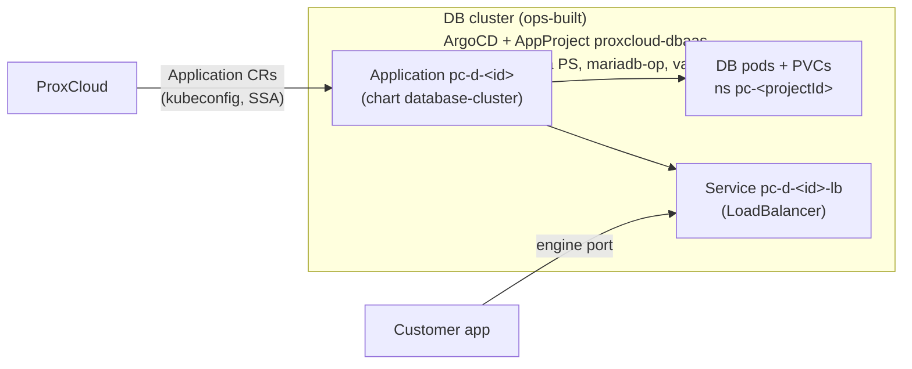
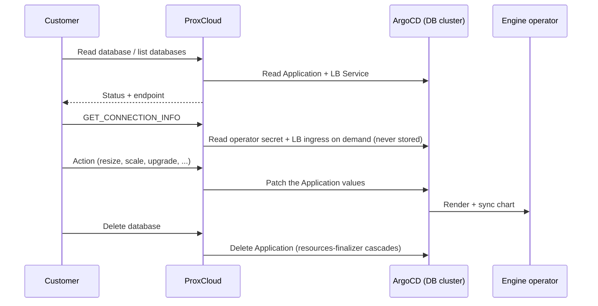

# Managed Databases (DBaaS) — operator guide

ProxCloud runs customer databases as **ArgoCD Applications on a dedicated, ops-built DB
Kubernetes cluster** — the managed-Kubernetes (kamaji) delivery pattern pointed at a different
cluster. One database = one Application rendering the `database-cluster` chart
(`deploy/charts/database-cluster`), which emits the engine operator CR, a LoadBalancer Service
and a NetworkPolicy. ProxCloud stays stateless about desired spec: the Application's
`helm.valuesObject` is the state store, status is read back off Application health + the LB
Service.

## Networking on Proxmox

No tenant network is involved. The chart's `<id>-lb` LoadBalancer Service gets its address from
**MetalLB**, out of the provider's `config.database.lbAddressPool` (annotation
`metallb.universe.tf/address-pool` on every tenant-facing LB Service: `<id>-lb`, the PostgreSQL
`<id>-ro-lb`, the OpenSearch `<id>-dash-lb`, and the Strimzi bootstrap + per-broker Services of
Kafka). The pool is a routable services subnet that tenants reach over their normal egress.
The only network filter in front of a database is the client's `allowedCidrs`, rendered as
`loadBalancerSourceRanges`. Leave the pool empty and MetalLB picks from any auto-assign pool.

**What `allowedCidrs` can and cannot isolate.** The filter sees the source address a connection
arrives with at the load balancer, which is the tenant's own address only when nothing translates
it on the way:

| Tenant network | Address the load balancer sees | What `allowedCidrs` can hold |
|---|---|---|
| SNAT on, `simple` zone | the Proxmox node's own address, the one of the node the VM runs on (measured) | only node addresses. The tenant subnet never matches: with it alone every connection is dropped |
| SNAT on, EVPN zone (the default zone kind) | the address of the zone's exit node, whatever node the VM runs on (not measured; it follows from where EVPN does its SNAT) | only exit node addresses. The tenant subnet never matches |
| SNAT off, or a VLAN zone, and the site routes the tenant subnet to the pool without NAT | the VM's address | the tenant's subnet, or single addresses of it |
| a site router that itself NATs tenants | that router's address | only that address, shared by every tenant behind it |

With SNAT, allowing a node's address is not isolation: **every tenant behind the same NAT address
arrives with it and passes the filter**. In a `simple` zone that is every tenant whose VM runs on
the same node, and a VM that moves to another node is cut off. In an EVPN zone it is every tenant
that leaves through the same exit node, wherever its VM runs, so with one exit node it is every
tenant, and moving a VM changes nothing. No page or API tells a tenant these addresses. What then
separates tenants is the database's password and TLS only. (Measured on a lab, in a `simple` zone
only: the tenant subnet was refused and the node's `/32` let the VM in. That a second tenant
behind the same address passes follows from the SNAT rule and was not measured; nothing was
measured in an EVPN zone.) The same holds for NAS exports
([managed-k8s.md](managed-k8s.md)).

What a site must do, one of:

- **Route, do not NAT.** Give tenant subnets a route to the load balancer pool without source
  NAT (SNAT off on the networks that use databases, or a VLAN zone, and on the services side a
  route back to the tenant ranges), and tell tenants to put their own subnet in `allowedCidrs`.
  With SNAT off in an EVPN or `simple` zone the Proxmox nodes still route the traffic, so the
  provider's isolation rules still keep tenants away from each other and from the rest of the
  services network. In a VLAN zone the site's router does the routing, so it must keep tenants
  apart and away from the rest of the services network itself; ProxCloud's firewall rules do not
  see that traffic (not run on a lab).
- **Accept it.** Keep SNAT, give tenants the node addresses to allow, and treat `allowedCidrs` as
  a filter against the outside only: a database is then reachable, at the network level, by every
  tenant of the installation, and its password and TLS are the boundary.

ProxCloud does not check which of the two a site runs, and accepts any `allowedCidrs` that are
networks in canonical form: an entry with host bits (`192.168.0.5/24`) is refused with the form to
write, because Kubernetes 1.36 refuses it on the Service; an entry a database already has stays. The routed
setup was not run on a lab.

A database's replicas spread across `topology.kubernetes.io/zone` as a **hard** anti-affinity
whenever `instances > 1` (CNPG `podAntiAffinityType: required`, the equivalent required
`podAntiAffinity` on every other engine). With fewer zones than instances the surplus pod
stays Pending. A single-node or single-zone site overrides the key with
`config.database.scheduling.zoneKey` (chart value `scheduling.zoneKey`), for example
`kubernetes.io/hostname`.

Storage classes named `capacity` or `capacity-*` (HDD-backed NFS) are never offered to
databases: the provider's `storageClasses` list drops them and a create naming one is
rejected.



Engines (valkey is beta-gated):

| Engine | Operator | HA semantics | Client port |
|---|---|---|---|
| `postgresql` | CloudNativePG ≥ 1.29.1 (+ `plugin-barman-cloud` for backups) | `instances` 1/2/3, operator failover | 5432 |
| `mysql` | Percona Operator for MySQL (PS) | group replication, size 1 or 3 | 3306 |
| `mariadb` | mariadb-operator 26.x | replication + chart-owned HAProxy | 3306 |
| `valkey` | valkey-operator (pre-GA, **beta**) | primary + replicas | 6379 |
| `ferretdb` | FerretDB v2 over a CNPG backend | CNPG instances + stateless frontends | 27017 |
| `opensearch` | opensearch-k8s-operator 3.0.2 | N same-size nodes (all roles), 1 or 3 | 9200 (HTTPS) |
| `kafka` | Strimzi 1.1.0 (KRaft, Kafka 4.2.0–4.3.0) | dual-role KRaft pool, 3 brokers | 9094 (SASL/SCRAM) |

The compute and storage under a database are **ops-owned**: nothing lands in the customer's
project except the endpoint. Billing therefore carries the full price on the
`database_cluster` resource type (pre-multiplied totals `vcpus_total`/`ram_gb_total`/
`storage_gb_total`). While the endpoint is absent the charge is **deferred, not waived**:
once the endpoint appears the engine back-bills the current cycle's elapsed hours from
creation.

## Cluster prerequisites (ops, out-of-band)

Everything in `deploy/dbaas-cluster/`: apply order, RBAC + kubeconfig recipe, AppProject
`proxcloud-dbaas`, `argocd-cm` Lua health checks for the engine CRDs, and the pinned operator
install list. Assumed pre-existing on the cluster: MetalLB with the address pool named in
`config.database.lbAddressPool`, a CSI driver with a default StorageClass, and ArgoCD (self-syncing) in
`argocd`.

The Lua health checks are load-bearing: the LB Service's built-in health keeps an Application
`Progressing` until the endpoint is programmed, so ProxCloud never reports READY without an
endpoint — and a missing engine-CRD check would leave Applications Healthy while the database
is degraded.

## Provider registration

Admin UI → System → Cloud providers → Add provider → **Database (DBaaS)**, or `POST
/api/v1/admin/service` with the doc shape documented in
`internal/platform/externalservice/dbaas.go` (`config.provider = "dbaas"`). Fields that matter:

- `secret.kubeconfig` — the DB cluster kubeconfig from `deploy/dbaas-cluster/rbac.yaml`'s
  recipe (token or client-cert only; encrypted at rest, stripped from admin reads).
- `config.argocd.*` — namespace/project/chartRepo/`chartVersion` (pinned, never latest).
- `config.database.engines` — the curated catalog (versions / default / replicas / `beta`).
- `config.database.lbAddressPool`, `config.database.scheduling.zoneKey`,
  `config.database.storageClasses` — the MetalLB pool, the replica spread key and the storage
  allowlist (see Networking on Proxmox).
- `config.database.backup` + `secret.backupAccessKey` / `secret.backupSecretKey` — the S3 store
  (see Backups and restore).
- `config.namespacePlacement` (`nodeSelector`, `tolerations`) — optional, API only (a form save keeps
  it). A `pc-db-*` namespace gets the `scheduler.alpha.kubernetes.io/node-selector` and
  `…/defaultTolerations` annotations and the label `proxcloud.io/platform-role: dbaas`, so the API
  server puts every new pod there on that node group, whatever the chart renders. It needs the
  `PodNodeSelector` and `PodTolerationRestriction` admission plugins on the DB cluster's API server;
  without them the annotations do nothing. Absent: nothing is stamped. A selector that is not label
  keys and values, or a toleration the API server would refuse, is refused when the provider is
  built: the API server checks the annotation on every pod create, so it would refuse every pod there.
- `config.database.egressFence: true` — optional, API only (a form save keeps it). A `pc-db-*`
  namespace gets the CiliumNetworkPolicy `proxcloud-default-egress`: its pods reach only their own
  namespace, kube-dns on 53 and the API server on 6443 (what CloudNativePG needs), so a tenant with a
  shell in its database pod cannot reach etcd, the kubelets, the Proxmox API or ArgoCD. It needs
  Cilium and `get`, `create` and `patch` on `ciliumnetworkpolicies` for the provider ServiceAccount,
  which `deploy/dbaas-cluster/rbac.yaml` does not grant: without them attaching a project and every
  database create fail with 403. Setting the key back to false leaves the policies in place; delete
  them by hand. It allows no object store yet, so a provider that sets it together with
  `config.database.backup` is refused when it is built: behind the fence every PostgreSQL pod's WAL
  archiving would fail until `pg_wal` fills its volume.
- Both keys are stamped on a namespace when it is next ensured: a project's first attach to the
  provider, or a new database create. Nothing in the sync ensures a namespace again, so a project
  attached before the key was set keeps its namespace as it is until its next database create, and
  pods already running are not moved.
- `config.services.database.<region> = true` — un-hides the client Databases surface and
  enables the sync.

Seed example: `deploy/seed/external-service-dev.json` (`svc-dbaas-dev`).

## Lifecycle



- **Create** — client `POST /project/{id}/cloud` `{type: DATABASE_CLUSTER, data: {name,
  engine, version, replicas, cpu, memoryGiB, storageGiB, storageClass?, allowedCidrs, beta?,
  readEndpoint?, dashboards?, sso?, restoreFrom?}}`. Nothing is placed on a tenant network, so
  there is no network id to send. `cpu`, `memoryGiB` and `storageGiB` are whole numbers from 1 up
  to the provider's limit, when it sets one; outside that the answer is `400`, for example
  `database: cpu must be a whole number, at least 1` (no limit) or `… from 1 to 16`. `restoreFrom` recovers another database of the project into
  the new one (see Backups and restore).
- **Sync** — `syncjob.syncDbaasService` (every 15 minutes, gated on the `database` toggle)
  reconciles the project's `DATABASE_CLUSTER` rows from Applications labeled with the project
  id, plus the LB Service address.
- **Actions** — `GET_CONNECTION_INFO` (secret + LB read on demand, never stored),
  `RESIZE {cpu,memoryGiB}`, `RESIZE_STORAGE {storageGiB}` (grow-only), `SCALE_REPLICAS`,
  `UPGRADE {version}` (catalog-gated, upward-only vs live values; off for valkey),
  `RESTART`, `RESET_PASSWORD` (returned once), `SET_ALLOWED_CIDRS`, `SET_SSO` (opensearch only:
  Dashboards OIDC against a **public** IdP client — no client secret is ever stored),
  `SET_AUTOSCALE` (below), and the day-2 set: `MANAGE_ACCESS {databases, users, roles?}`
  (declarative logical databases and users for postgresql / mariadb / valkey (users only) /
  opensearch; new passwords are returned once), `RESET_USER_PASSWORD {username}`,
  `GET_LOGS {lines?}` (tail of every pod's engine log), `SET_PARAMETERS {parameters}` (the
  whole desired runtime-settings set, allowlisted per engine in `parameters.go`),
  `SET_READ_ENDPOINT {enabled}` (postgresql: a second LB `<id>-ro-lb` serving replicas;
  mysql/mariadb: port 3307 of the existing proxy), `SET_BACKUP`, `CREATE_BACKUP`,
  `LIST_BACKUPS` (below), `SET_INDEX_POLICIES {policies}` (opensearch retention) and
  `SET_CUSTOM_DOMAIN {domain, certPem, keyPem, caPem?}` (opensearch BYO certificate on
  Dashboards). Engine-gated via `dbaas.Capabilities`.
- **Delete** — Application delete only; the ArgoCD resources-finalizer cascades the chart. The
  periodic sweep (`syncjob.sweepDbaasOrphans`) then reaps the marker, auth, backup-credential and customer-user secrets and
  GCs the emptied namespace. Project teardown also removes the namespace of a project that never had a database, once nothing is pending and no Application of the project is left.

### Where a database's disk is, and VM id 9999

On the managed platform a database's volume is a proxmox-csi disk named `vm-9999-pvc-<uuid>` on the
platform's boot store, attached to the node VM its pod runs on. To Proxmox a disk with that name
belongs to VM 9999, though ProxCloud creates no such VM. If a guest of your own has the id 9999,
**never destroy it with "Destroy unreferenced disks owned by guest" ticked**
(`qm destroy 9999 --destroy-unreferenced-disks 1`): Proxmox removes every disk named `vm-9999-…`,
which are the databases' volumes (and Kamaji's etcd). The managed-services Check (`csi-vmid`) and the
provider's Test connection warn on such a site; see
[managed-services.md](managed-services.md#vm-id-9999-and-the-csi-volumes). Not tried on a lab.

## Backups and restore

Backups are optional per provider: `config.database.backup` names **any S3 endpoint** (RustFS
on the Standard tier, Ceph RGW on the Full tier; plain `http://` works) and the credentials
ride in the provider secret (`secret.backupAccessKey` / `secret.backupSecretKey`). Without an
endpoint and bucket the whole backup surface (capability, UI, CRs) is off. The location is the
operator's choice; customers only pick a schedule and a retention.

At create, every backup-capable engine (postgresql, mysql, mariadb, ferretdb) is wired to the
store with a weekly schedule (`0 2 * * 0`) and 30 days of retention, because a WAL/binlog archive
without a base backup underneath it restores nothing. ProxCloud writes a per-database Secret
`<id>-backup-s3` on the DB cluster (the values never carry credentials). `SET_BACKUP
{enabled?, schedule, retentionDays}` changes the schedule (a 5-field cron, `""` = on demand
only; the store stays wired so continuous archiving and point-in-time recovery keep working),
`CREATE_BACKUP` takes one now and `LIST_BACKUPS` reads the engine's backup objects live.

| Engine | Mechanism |
|---|---|
| postgresql, ferretdb | CloudNativePG through the **barman-cloud plugin**: an `ObjectStore` CR per database, `isWALArchiver` on the Cluster, `ScheduledBackup` (6-field cron, converted by the chart) and `Backup` CRs. Needs CNPG plus `plugin-barman-cloud` (and cert-manager) on the DB cluster |
| mariadb | `PhysicalBackup` (`onDemand` stamp) + `PointInTimeRecovery` binlog archive when `instances > 1` |
| mysql | Percona `backup.storages` (xbcloud) with a weekly full and daily incrementals, plus `PerconaServerMySQLBackup` for on-demand |

**Restore always produces a NEW database** (the physical backups only lay down on a fresh data
directory, the source keeps running):

```json
POST /api/v1/project/{projectId}/cloud
{"type": "DATABASE_CLUSTER", "data": {
  "name": "orders-recovered", "engine": "postgresql", "version": "17",
  "replicas": 1, "cpu": 2, "memoryGiB": 4, "storageGiB": 20,
  "restoreFrom": {"sourceDatabaseId": "pc-d-1a2b3c4d", "targetTime": "2026-11-01T09:30:00Z"}}}
```

`sourceDatabaseId` must be a database of the same project and engine with backups enabled;
`targetTime` (RFC3339) is optional (omitted = replay the archive to its end). mysql needs
`backupName` (the `PerconaServerMySQLBackup` to restore, from `LIST_BACKUPS`) instead of a
search. Use the same major version as the source. mariadb replays binlogs to `targetTime` only
when the source ran replication, otherwise it lands on the nearest physical backup.

## Pricing (DigitalOcean parity)

The seed price plan carries **one `database_cluster` rule per engine** (filter `engine eq …`),
rated on the pre-multiplied totals and derived from DigitalOcean's managed-databases price
list (monthly/730h; derivation table in `deploy/seed/price-plan-seed.json` `_readme`):

| Engine | vCPU/h | GB-RAM/h | GB-disk/h | DO anchor |
|---|---|---|---|---|
| postgresql, mysql, mariadb, ferretdb | $0.002740 | $0.015068 | $0.000295 | $15.15/mo (1c/1GB/10GB), exact at small tiers |
| valkey | $0.002945 | $0.014658 | $0.000295 | $15/mo (1c/1GB/10GB) |
| opensearch | $0.002740 | $0.006164 | $0.000295 | exact on all three DO tiers |
| kafka | — | $0.028767 | $0.000295 | DO prices the 3-broker cluster; RAM-rated |

Example: a PostgreSQL 2 vCPU / 4 GB / 60 GB single node rates to $60.90/mo (DO: $60.90);
Kafka with three 2c/2GB brokers at 40 GB each rates to about $149/mo (DO: $148.80).
Re-derive when DO reprices.

## HA and write-node failover (why the endpoint never moves)

The customer-facing address is the LB Service address. Failover never changes it; the "flip to
the new write node" happens INSIDE the cluster, behind the LB:

| Engine | Write-path routing behind the LB |
|---|---|
| postgresql | LB Service selects `cnpg.io/instanceRole: primary`; CNPG re-labels pods on failover/switchover, so the Service endpoints flip to the new primary |
| mysql | LB targets the Percona operator's HAProxy pods; HAProxy follows the group-replication primary election |
| mariadb | LB targets the chart-owned HAProxy, whose backend is the operator's `<id>-primary` Service — the operator re-points its endpoints on switchover/failover |
| ferretdb | LB targets the stateless frontends, which talk to the CNPG `-pg-rw` Service (operator-managed) |
| valkey | beta — routing unverified until the operator CRD is pinned |
| opensearch | LB targets all nodes (every node coordinates); cluster re-elects internally |
| kafka | Strimzi-created LBs: ONE bootstrap address + one per broker (advertised addresses), so N+1 LoadBalancer Services per cluster; partition leadership moves internally |

Clients see a few seconds of connection resets during a failover, reconnect to the SAME
host:port, and land on the new primary. No DNS TTL.

## Vertical autoscale (opt-in, surcharge-priced)

`SET_AUTOSCALE {enabled, maxCpu, maxMemoryGiB, maxStorageGiB}` — available on every engine.
Design: **the VPA is the brain, ProxCloud is the hand**. The chart renders a
VerticalPodAutoscaler in `updateMode: Off` (recommendation only — a VPA that evicts database
pods on its own schedule is a data-safety hazard); each sync cycle ProxCloud reads the
recommendation, clamps it into the customer's ceilings and applies it through the SAME values
patch RESIZE uses, so the operator performs its own safe rolling change. Disk rides the same
tick: when any of the database's PVCs passes 80% full (kubelet volume-stats via the provider's
Prometheus metrics config), the volume grows 20% (grow-only), up to `maxStorageGiB`.
`maxCpu` and `maxMemoryGiB` are whole numbers from 1, `maxStorageGiB` from 0 (0 turns the disk leg
off), each up to the provider's limit when it sets one; outside that the answer is a `400` such as
`maxStorageGiB must be a whole number, at least 0` (no limit) or `… from 0 to 500`.

Scale-UP only by design — automatic shrink flaps and is where databases lose caches; scaling
down stays a deliberate customer RESIZE. Billing: the scaled-to size bills through the normal
declared-size totals (the tick raises the declared values), plus a flat surcharge
(`autoscale_enabled`, $0.0137/h ≈ $10/mo per database) while enabled. Prerequisites on the DB
cluster: the VPA recommender, and Prometheus metrics config on the provider for the disk leg —
see `deploy/dbaas-cluster/README.md`.

## Chart pin / platform update

Databases keep their chart pin when the provider's `chartVersion` moves. Operator override:
`GET /api/v1/admin/service/{id}/db-clusters` lists pins; `POST .../db-clusters/bump-chart`
(all) or `POST .../db-clusters/{clusterId}/bump-chart` (one) re-pins onto the provider's
current version.

From chart 0.5.2 a PostgreSQL (or FerretDB) database of one instance has no PodDisruptionBudget
(`enablePDB: false` on its CloudNativePG Cluster). With the budget, a drain of the database's node
waited without limit, because the budget of a single instance allows no eviction; that blocks
every replacement of the node. Without it the drain evicts the pod and the database restarts on
another node of the group: it is down for that restart. Databases of more than one instance keep
their budget. The platform BOM pins 0.5.2: a managed-services platform installed from this release
registers its database provider with it, and an upgrade to this BOM writes it on the provider. An
existing database takes the change with `bump-chart`, once the provider pins
0.5.2 or later; until then it keeps its budget. On CloudNativePG 1.30.1 the bump of a database of
one instance from 0.5.1 to 0.5.2 removed its budget without restarting it (one production site,
2026-11-20: the same pod and postmaster start, no failed connection).

An upgrade of a managed-services platform that replaces the platform cluster's machines checks
this before it starts: its plan lists every PodDisruptionBudget on the platform cluster that
allows no disruption (`drain_blocked`, with namespace and name), and the replacement is refused
until none is left. For a database that is the bump above
([managed-services.md](managed-services.md#the-platform-clusters-machines)). The database is then
down while its machine is replaced; take a backup of it first.

## Connection secrets (contract, pinned by TestConnectionSecretContract)

| Engine | Secret | Exposed account |
|---|---|---|
| postgresql | `<id>-superuser` (CNPG-minted; `<id>-app` for databases created without superuser access) | `postgres` role, `username`/`password` keys, database `app` |
| ferretdb | `<id>-pg-app` (CNPG backend `<id>-pg`) | same keys, Mongo wire |
| mysql | `<id>-secrets` (operator-minted) | `root` under key `root` (PS has no declarative app users) |
| mariadb | `<id>-auth` (**ProxCloud-provisioned**) | user `app`, database `app` |
| valkey | `<id>-auth` (**ProxCloud-provisioned**) | ACL user `default` |
| opensearch | `<id>-admin-password` (operator-minted, default securityconfig) | `username`/`password` keys |
| kafka | `<id>-auth` (**ProxCloud-provisioned**, KafkaUser BYO-password) | SASL user `<id>-app`, SCRAM-SHA-512 |

The ProxCloud-provisioned secrets live OUTSIDE the Application on purpose: a chart-generated
password would re-roll on every ArgoCD render, and values must never carry secrets (the
Application CR is readable by anyone with argocd read).

## Troubleshooting

- **Endpoint stuck pending** — `kubectl -n pc-<project> get svc <id>-lb`; empty
  `EXTERNAL-IP` → MetalLB (events on the Service; an exhausted or misnamed
  `config.database.lbAddressPool` parks the Service `<pending>`).
- **Database stays PROGRESSING with "Waiting for room on the database nodes"** — a pod of the
  database cannot be scheduled: no database node has the CPU or memory its size asks for
  (requests equal limits, at least 1 CPU). A create is not refused for it; the database's row
  carries the scheduler's sentence in `database.status_message` (the tenant's database page
  shows it under the status), for example `0/4 nodes are available: 1 Insufficient cpu, ...`.
  The pod starts by itself once room is free: delete or shrink another database, or add a
  machine to the group. The field is absent while every pod has a node and once the database
  is READY. Nothing counts the room before a create.
- **Replica pod Pending** — the zone anti-affinity is a hard rule; fewer zones than
  `instances` leaves the surplus pod unschedulable. Add a zone, lower the replica count or set
  `config.database.scheduling.zoneKey` to a key the nodes do vary on.
- **Database shows PROGRESSING with sync `OutOfSync` and backups on (postgresql)** — the
  `barmancloud.cnpg.io` `ObjectStore` CRD is missing: install `plugin-barman-cloud`.
- **Application Degraded on first create (ferretdb)** — frontend crash-loops until the CNPG
  backend accepts connections; the startup probe absorbs the normal window.
- **`not managed by proxcloud — refusing`** — the object lacks the
  `app.kubernetes.io/managed-by: proxcloud` label; pre-existing/hand-made objects are invisible
  and untouchable by design.
