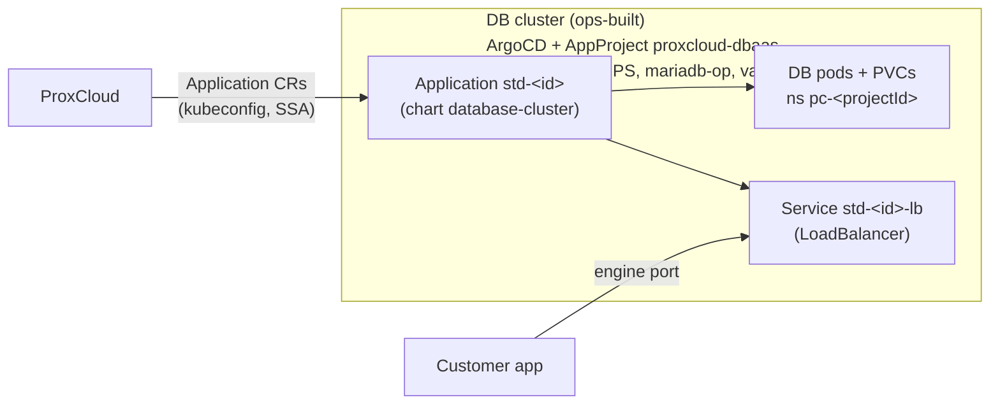
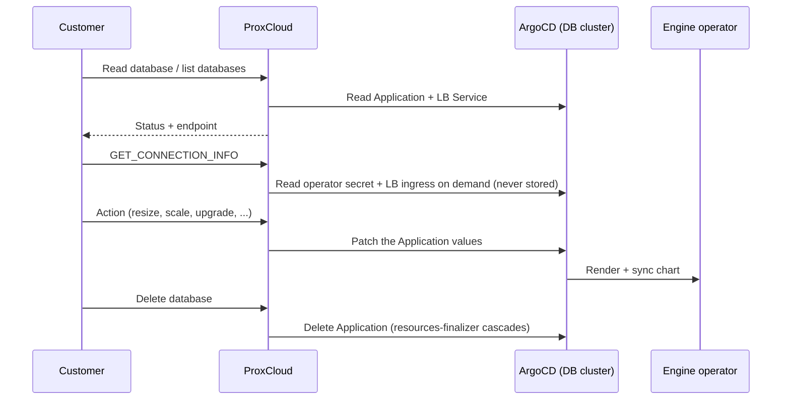

# Managed Databases (DBaaS) — operator guide

ProxCloud runs customer databases as **ArgoCD Applications on a dedicated, ops-built DB
Kubernetes cluster** — the managed-Kubernetes (kamaji) delivery pattern pointed at a different
cluster. One database = one Application rendering the `database-cluster` chart
(`deploy/charts/database-cluster`), which emits the engine operator CR, a LoadBalancer Service
and a NetworkPolicy. ProxCloud stays stateless about desired spec: the Application's
`helm.valuesObject` is the state store, status is read back off Application health + the LB
Service.

> ## Status on Proxmox
>
> **Read, sync, connection info, actions on existing databases and delete work. Creating a
> database on a Proxmox provider is planned.** Today a create returns "Managed Databases on
> Proxmox are not available yet": the network legs in
> `internal/platform/project/cloud_dbaas_create.go` are stubs. The planned design exposes
> databases on a routed services subnet through MetalLB, with isolation by
> `loadBalancerSourceRanges`; see
> [C3e](architecture/c4/c3-components.md#c3e-managed-services-and-object-storage). The chart's
> LB Service template carries no provider-specific annotations; extra ones come from
> `network.extraAnnotations`.

Engines (valkey is beta-gated):

| Engine | Operator | HA semantics | Client port |
|---|---|---|---|
| `postgresql` | CloudNativePG ≥ 1.29.1 | `instances` 1/2/3, operator failover | 5432 |
| `mysql` | Percona Operator for MySQL (PS) | group replication, size 1 or 3 | 3306 |
| `mariadb` | mariadb-operator 26.x | replication + chart-owned HAProxy | 3306 |
| `valkey` | valkey-operator (pre-GA, **beta**) | primary + replicas | 6379 |
| `ferretdb` | FerretDB v2 over a CNPG backend | CNPG instances + stateless frontends | 27017 |
| `opensearch` | opensearch-k8s-operator 3.0.2 | N same-size nodes (all roles), 1 or 3 | 9200 (HTTPS) |
| `kafka` | Strimzi 1.1.0 (KRaft, Kafka 4.2.0–4.3.0) | dual-role KRaft pool, 3 brokers | 9094 (SASL/SCRAM) |

The compute and storage under a database are **ops-owned**: nothing lands in the customer's
project except the endpoint. Billing therefore carries the full price on the
`database_cluster` resource type (pre-multiplied totals `vcpus_total`/`ram_gb_total`/
`storage_gb_total`). While the endpoint is absent the charge is **deferred, not waived**:
once the endpoint appears the engine back-bills the current cycle's elapsed hours from
creation.

## Cluster prerequisites (ops, out-of-band)

Everything in `deploy/dbaas-cluster/`: apply order, RBAC + kubeconfig recipe, AppProject
`proxcloud-dbaas`, `argocd-cm` Lua health checks for the engine CRDs, and the pinned operator
install list. Assumed pre-existing on the cluster: a load-balancer implementation for
`LoadBalancer` Services, a CSI driver with a default StorageClass, and ArgoCD (self-syncing) in
`argocd`.

The Lua health checks are load-bearing: the LB Service's built-in health keeps an Application
`Progressing` until the endpoint is programmed, so ProxCloud never reports READY without an
endpoint — and a missing engine-CRD check would leave Applications Healthy while the database
is degraded.

## Provider registration

Admin UI → System → Cloud providers → Add provider → **Database (DBaaS)**, or `POST
/api/v1/admin/service` with the doc shape documented in
`internal/platform/externalservice/dbaas.go` (`config.provider = "dbaas"`). Fields that matter:

- `secret.kubeconfig` — the DB cluster kubeconfig from `deploy/dbaas-cluster/rbac.yaml`'s
  recipe (token or client-cert only; encrypted at rest, stripped from admin reads).
- `config.argocd.*` — namespace/project/chartRepo/`chartVersion` (pinned, never latest).
- `config.database.engines` — the curated catalog (versions / default / replicas / `beta`).
- `config.services.database.<region> = true` — un-hides the client Databases surface and
  enables the sync.

Seed example: `deploy/seed/external-service-dev.json` (`svc-dbaas-dev`).

## Lifecycle

- **Create** — client `POST /project/{id}/cloud` `{type: DATABASE_CLUSTER, data: {name,
  engine, version, replicas, cpu, memoryGiB, storageGiB, allowedCidrs, beta?}}`. On a Proxmox provider it currently fails before anything is written (see the status
  box).
- **Sync** — `syncjob.syncDbaasService` (every 15 minutes, gated on the `database` toggle)
  reconciles the project's `DATABASE_CLUSTER` rows from Applications labeled with the project
  id, plus the LB Service address.
- **Actions** — `GET_CONNECTION_INFO` (secret + LB read on demand, never stored),
  `RESIZE {cpu,memoryGiB}`, `RESIZE_STORAGE {storageGiB}` (grow-only), `SCALE_REPLICAS`,
  `UPGRADE {version}` (catalog-gated, upward-only vs live values; off for valkey and ferretdb),
  `RESTART`, `RESET_PASSWORD` (returned once), `SET_ALLOWED_CIDRS`, `SET_SSO` (opensearch only:
  Dashboards OIDC against a **public** IdP client — no client secret is ever stored),
  `SET_AUTOSCALE` (below). Engine-gated via `dbaas.Capabilities`.
- **Delete** — Application delete only; the ArgoCD resources-finalizer cascades the chart. The
  periodic sweep (`syncjob.sweepDbaasOrphans`) then reaps the marker/auth secrets and GCs the
  emptied namespace.

## Pricing (DigitalOcean parity)

The seed price plan carries **one `database_cluster` rule per engine** (filter `engine eq …`),
rated on the pre-multiplied totals and derived from DigitalOcean's managed-databases price
list (monthly/730h; derivation table in `deploy/seed/price-plan-seed.json` `_readme`):

| Engine | vCPU/h | GB-RAM/h | GB-disk/h | DO anchor |
|---|---|---|---|---|
| postgresql, mysql, mariadb, ferretdb | $0.002740 | $0.015068 | $0.000295 | $15.15/mo (1c/1GB/10GB), exact at small tiers |
| valkey | $0.002945 | $0.014658 | $0.000295 | $15/mo (1c/1GB/10GB) |
| opensearch | $0.002740 | $0.006164 | $0.000295 | exact on all three DO tiers |
| kafka | — | $0.028767 | $0.000295 | DO prices the 3-broker cluster; RAM-rated |

Example: a PostgreSQL 2 vCPU / 4 GB / 60 GB single node rates to $60.90/mo (DO: $60.90);
Kafka with three 2c/2GB brokers at 40 GB each rates to about $149/mo (DO: $148.80).
Re-derive when DO reprices.

## HA and write-node failover (why the endpoint never moves)

The customer-facing address is the LB Service address. Failover never changes it; the "flip to
the new write node" happens INSIDE the cluster, behind the LB:

| Engine | Write-path routing behind the LB |
|---|---|
| postgresql | LB Service selects `cnpg.io/instanceRole: primary`; CNPG re-labels pods on failover/switchover, so the Service endpoints flip to the new primary |
| mysql | LB targets the Percona operator's HAProxy pods; HAProxy follows the group-replication primary election |
| mariadb | LB targets the chart-owned HAProxy, whose backend is the operator's `<id>-primary` Service — the operator re-points its endpoints on switchover/failover |
| ferretdb | LB targets the stateless frontends, which talk to the CNPG `-pg-rw` Service (operator-managed) |
| valkey | beta — routing unverified until the operator CRD is pinned |
| opensearch | LB targets all nodes (every node coordinates); cluster re-elects internally |
| kafka | Strimzi-created LBs: ONE bootstrap address + one per broker (advertised addresses), so N+1 LoadBalancer Services per cluster; partition leadership moves internally |

Clients see a few seconds of connection resets during a failover, reconnect to the SAME
host:port, and land on the new primary. No DNS TTL.

## Vertical autoscale (opt-in, surcharge-priced)

`SET_AUTOSCALE {enabled, maxCpu, maxMemoryGiB, maxStorageGiB}` — available on every engine.
Design: **the VPA is the brain, ProxCloud is the hand**. The chart renders a
VerticalPodAutoscaler in `updateMode: Off` (recommendation only — a VPA that evicts database
pods on its own schedule is a data-safety hazard); each sync cycle ProxCloud reads the
recommendation, clamps it into the customer's ceilings and applies it through the SAME values
patch RESIZE uses, so the operator performs its own safe rolling change. Disk rides the same
tick: when any of the database's PVCs passes 80% full (kubelet volume-stats via the provider's
Prometheus metrics config), the volume grows 20% (grow-only), up to `maxStorageGiB`.

Scale-UP only by design — automatic shrink flaps and is where databases lose caches; scaling
down stays a deliberate customer RESIZE. Billing: the scaled-to size bills through the normal
declared-size totals (the tick raises the declared values), plus a flat surcharge
(`autoscale_enabled`, $0.0137/h ≈ $10/mo per database) while enabled. Prerequisites on the DB
cluster: the VPA recommender, and Prometheus metrics config on the provider for the disk leg —
see `deploy/dbaas-cluster/README.md`.

## Chart pin / platform update

Databases keep their chart pin when the provider's `chartVersion` moves. Operator override:
`GET /api/v1/admin/service/{id}/db-clusters` lists pins; `POST .../db-clusters/bump-chart`
(all) or `POST .../db-clusters/{clusterId}/bump-chart` (one) re-pins onto the provider's
current version.

## Connection secrets (contract, pinned by TestConnectionSecretContract)

| Engine | Secret | Exposed account |
|---|---|---|
| postgresql | `<id>-app` (CNPG-minted) | `username`/`password`/`dbname` keys |
| ferretdb | `<id>-pg-app` (CNPG backend `<id>-pg`) | same keys, Mongo wire |
| mysql | `<id>-secrets` (operator-minted) | `root` under key `root` (PS has no declarative app users) |
| mariadb | `<id>-auth` (**ProxCloud-provisioned**) | user `app`, database `app` |
| valkey | `<id>-auth` (**ProxCloud-provisioned**) | AUTH only |
| opensearch | `<id>-admin-password` (operator-minted, default securityconfig) | `username`/`password` keys |
| kafka | `<id>-auth` (**ProxCloud-provisioned**, KafkaUser BYO-password) | SASL user `<id>-app`, SCRAM-SHA-512 |

The ProxCloud-provisioned secrets live OUTSIDE the Application on purpose: a chart-generated
password would re-roll on every ArgoCD render, and values must never carry secrets (the
Application CR is readable by anyone with argocd read).

## Troubleshooting

- **Create fails with "not available yet"** — expected on a Proxmox provider (see the status
  box).
- **Endpoint stuck pending** — `kubectl -n pc-<project> get svc <id>-lb`; empty
  `EXTERNAL-IP` → the cluster's load-balancer implementation (events on the Service).
- **Application Degraded on first create (ferretdb)** — frontend crash-loops until the CNPG
  backend accepts connections; the startup probe absorbs the normal window.
- **`not managed by proxcloud — refusing`** — the object lacks the
  `app.kubernetes.io/managed-by: proxcloud` label; pre-existing/hand-made objects are invisible
  and untouchable by design.
