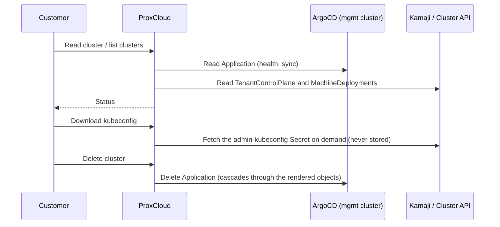

# Managed Kubernetes (kamaji provider) — operator runbook

How to register, operate and debug the `kamaji` managed-Kubernetes provider. A
kamaji provider is a **management cluster** reached over a stored kubeconfig:
each customer cluster is one ArgoCD `Application` that ProxCloud writes to that
cluster's API, and Kamaji runs the cluster's control plane as pods there
(`TenantControlPlane`).

> ## Status on Proxmox
>
> **Read, sync, status, kubeconfig download and delete of existing clusters work.
> Creating a cluster on a Proxmox provider is planned.** Today a create returns
> "Managed Kubernetes on Proxmox is not available yet": the create legs in
> `internal/platform/project/cloud_kamaji_openstack.go` are stubs. The planned
> design runs worker VMs on Proxmox through Cluster API with the CAPMOX provider,
> load-balancer IPs from MetalLB and volumes through proxmox-csi; see
> [C2](architecture/c4/c2-containers.md) and
> [C3e](architecture/c4/c3-components.md#c3e-managed-services-and-object-storage).
> Nothing below describes that design as built.

Code: `internal/cloud/kamaji` (config, values builder, Application builder,
service, sync provider), `internal/cloud/kamajik8s` (minimal management-cluster
API client), `internal/platform/project/cloud_kamaji.go` (the
`KUBERNETES_CLUSTER` surface), `internal/platform/externalservice/kamaji.go`
(provider accessors).

## 1. Management-cluster prerequisites

One-time, per management cluster (apply order:
[`deploy/mgmt-cluster/README.md`](../deploy/mgmt-cluster/README.md)):

1. The Kamaji stack is running (Kamaji operator and its DataStore, plus the
   Cluster API machinery the cluster chart uses).
2. **ArgoCD is installed.** ArgoCD is the delivery plane: ProxCloud only writes
   `Application` objects through the Kubernetes API and never talks to the ArgoCD
   API.
3. `deploy/mgmt-cluster/` is applied: `rbac.yaml` (ProxCloud ServiceAccount,
   least-privilege RBAC, token), `appproject.yaml` (AppProject `proxcloud-k8s`,
   the source/destination guardrail), `argocd-health.yaml` (custom health checks
   for `TenantControlPlane` / `Cluster` / `MachineDeployment`).
4. **Chart pinning.** The cluster chart is published to an OCI registry at
   pinned versions. Never `latest`: the provider config and every existing
   cluster pin an exact version, and the registry must keep every pinned version.
   The values contract lives in `internal/cloud/kamaji/values.go` and is pinned by
   `TestBuildValues`. The chart itself is not shipped in this repository
   (`deploy/charts` holds only `proxcloud` and `database-cluster`); the default
   chart name in `config.argocd.chartName` is still the one from the previous
   backend.

## 2. Provider setup (admin → Cloud providers → Add provider → Kubernetes)

Seed-file twin of the form: `deploy/seed/external-service-dev.json`
(`svc-kamaji-dev`).

| Form field | Config key | Notes |
|---|---|---|
| Management kubeconfig | `secret.kubeconfig` | The ProxCloud ServiceAccount kubeconfig assembled per the recipe in `deploy/mgmt-cluster/rbac.yaml`. Plain token or client certificate only, no exec plugins. Encrypted at rest. |
| Regions | `config.regions` | The region(s) stamped on cached clusters. |
| Services | `config.services` | `{"kubernetes": {"<region>": true}}` — drives the client-portal nav gating and the sync. |
| ArgoCD namespace / project | `config.argocd.namespace` / `.project` | Must match `deploy/mgmt-cluster` (`argocd` / `proxcloud-k8s`). |
| Chart repo / name / version | `config.argocd.chartRepo` / `.chartName` / `.chartVersion` | OCI repo **without** the `oci://` prefix. The version is the pin for NEW clusters; existing clusters keep their own pin until moved (§3). |
| DataStore | `config.cluster.dataStoreName` | Kamaji DataStore name (default `default`). |
| DNS zone | `config.cluster.dnsZone` | Optional. API FQDN = `<clusterId>.<zone>`. Cluster ids (`stc-<8hex>`) never change. |
| Version → image matrix | `config.cluster.versions` | Curated map `k8s version → node image id`: the only versions offered to customers. Textarea grammar: `1.35.4=<image-id>` per line. |
| Image variants | `config.cluster.imageVariants` | Alternative node-image builds of the same version, e.g. a GPU build. Grammar: `1.35.4@nvidia=<image-id>`. |
| Flavors allowlist | `config.cluster.flavors` | Flavor ids offered for node groups. Empty = no restriction. |

The remaining `config.cluster.*` keys the form still shows (`floatingNetworkId`,
`externalNetworkId`, `storageVolumeType`, the browse-provider link) belong to the
previous infrastructure backend and have no Proxmox meaning.

## 3. How a cluster is represented



- Each cluster is one ArgoCD `Application` named `<clusterId>` in the ArgoCD
  namespace: source = the pinned chart, full generated values inline,
  destination = namespace `pc-<projectId>`, project `proxcloud-k8s`, finalizer
  `resources-finalizer.argocd.argoproj.io`.
- **Ownership marker:** ProxCloud only lists, patches and deletes objects labeled
  `app.kubernetes.io/managed-by: proxcloud`. Anything else on the management
  cluster is invisible to it.
- **Sync** (`syncjob.syncKamajiService`, every 15 minutes) reconciles the
  project's `KUBERNETES_CLUSTER` rows from Applications labeled with the project
  id, enriched from the TenantControlPlane and MachineDeployments.
- **Post-create changes** (k8s upgrade, node groups, OIDC, add-ons, kubeconfig
  rotation, platform update) all mutate the stored desired spec and re-apply the
  whole Application. Every cluster pins the chart version it was created with;
  the provider's `chartVersion` only affects new clusters. An existing cluster
  moves through the customer's *Apply platform update* or the admin's per-cluster
  **Bump** / **Bump all** on the provider page. These paths were built against the
  previous infrastructure backend and have not been exercised on Proxmox.

### Deletion and orphan finalization

Delete removes the Application; the resources finalizer makes ArgoCD cascade the
delete through everything the chart rendered. Cleanup of the per-cluster
secrets and, when the project's last cluster is gone, the `pc-*` namespace is
**sync-driven**: `syncjob.sweepKamajiOrphans` runs once per sync cycle as a
service-level sweep, after the cascade completes. It scans the management cluster
itself, so it also reaps leftovers of projects whose ProxCloud record is already
gone. A secret younger than the 30-minute grace window is never touched.

A leftover secret that names a credential from the previous backend is not
revoked automatically: the sweep reports it and leaves it for manual review.

```sh
# namespaces ProxCloud owns, with what's left inside them
kubectl get ns -l app.kubernetes.io/managed-by=proxcloud
kubectl get applications.argoproj.io -n argocd -l app.kubernetes.io/managed-by=proxcloud
kubectl get tenantcontrolplanes,machinedeployments -n pc-<projectId>
```

## 4. Billing

- `kubernetes_cluster` — the flat control-plane fee: a price-plan rule on
  attribute `existence` (e.g. `0.10`/hour), charged once the API endpoint exists
  (`internal/cloud/billingresource/kubernetescluster.go`). Worker VMs bill through
  the ordinary instance rules; never add k8s rules for them.
- Example rules live in `deploy/seed/price-plan-seed.json`.

## 5. Troubleshooting

Start from the ArgoCD Application — it aggregates everything the chart rendered:

```sh
# health + sync state of every ProxCloud cluster
kubectl get applications.argoproj.io -n argocd -l app.kubernetes.io/managed-by=proxcloud
# one cluster's full resource tree with per-resource health (or use the ArgoCD UI)
argocd app get <stc-id> --show-operation
kubectl get application <stc-id> -n argocd -o jsonpath='{.status.health}{"\n"}{.status.sync}'
```

| Symptom | Look at |
|---|---|
| Create fails with "not available yet" | Expected on a Proxmox provider: cluster create is planned (see the status box). |
| Application `OutOfSync` / `SyncFailed` | `argocd app get <stc-id>` sync error. "not permitted in project proxcloud-k8s" → the chart needs a cluster-scoped resource; add exactly that group/kind to `deploy/mgmt-cluster/appproject.yaml`. Chart pull errors → registry or pin problem (§1.4). |
| Application Healthy but cluster unusable | Health checks not loaded or wrong: verify the `argocd-health.yaml` keys exist in `argocd-cm` and the application controller was restarted. |
| Cluster stuck `PROGRESSING`, no endpoint | `kubectl get tcp -n pc-<projectId>` → TenantControlPlane status. Pending CP pods → management-cluster capacity or DataStore. |
| Delete hangs | The Application keeps its finalizer while the cascade runs; inspect what is left in the tree (`argocd app get`). Remove the finalizer by hand only if you accept orphaning the rendered objects, then clean up per §3. |
| Orphaned namespaces/secrets | §3 orphan-finalization check. |
| Cluster missing from the portal | The `kubernetes` service toggle for the region is off, or the Application lacks the ProxCloud labels. |
