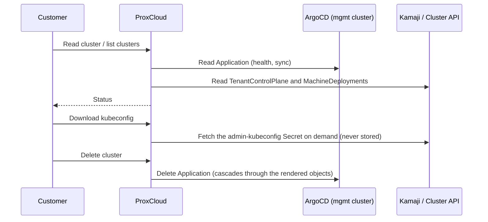

# Managed Kubernetes (kamaji provider) — operator runbook

How to register, operate and debug the `kamaji` managed-Kubernetes provider. A
kamaji provider is a **management cluster** reached over a stored kubeconfig:
each customer cluster is one ArgoCD `Application` that ProxCloud writes to that
cluster's API, and Kamaji runs the cluster's control plane as pods there
(`TenantControlPlane`).

> ## Status on Proxmox
>
> **Evidence boundary:** the operations below describe historical development-lab
> acceptance of the managed-provider flow, not a blanket production certification
> or a clean install from published release artifacts. The new static ISO template
> builder is a separate path: configuration/tests pass, but live ISO boot, installed
> reboot and Goss acceptance have not yet run.
>
> Creating a cluster was verified on that lab: a tenant control plane on Kamaji, worker VMs through CAPMOX, Cilium and MetalLB, with
> workers in the project's pool on the project's network, under tokens minted per cluster and revoked after the delete.
> Verified on PVE 9.2 with CAPI v1.14.4, CAPMOX v0.9.2 and Kamaji CP provider v0.22.0: create, scale-out, RWX volumes on a
> NAS dataset, a tenant LoadBalancer, project suspend and resume, a refused create, delete with everything it held.
> **Block volumes (proxmox-csi) come through the CSI gateway**, which keeps every PVE credential out of the tenant
> cluster: a new cluster gets them when the portal runs the gateway (on in the installer's split mode), the compute
> provider holds its token and the Kubernetes provider pins chart 0.1.7 or later. Without the gateway a cluster gets
> no block volumes: see [section 9](#9-how-a-cluster-lands-on-proxmox). Not available: autoscaling node groups, GPU node groups. Not run: the
> installer's split mode end to end, and a NAS the workers reach without SNAT (the lab has none).

Code: `internal/cloud/kamaji` (config, values builder, Application builder,
service, sync provider), `internal/cloud/kamajik8s` (minimal management-cluster
API client), `internal/platform/project/cloud_kamaji.go` (the
`KUBERNETES_CLUSTER` surface), `internal/platform/externalservice/kamaji.go`
(provider accessors).

## Gateway API for new clusters

Cluster chart `0.1.10` offers **NGINX Gateway Fabric** (`nginxGatewayFabric`) instead
of a new ingress-nginx installation. The addon is opt-in and includes pinned tenant
Gateway API Standard prerequisites, but creates no application Gateway, route, TLS
issuer or DNS entry. Existing legacy ingress releases and their traffic are preserved,
not automatically migrated by an addon edit or platform bump. See the
[Gateway API contract, CRD lifecycle and migration runbook](managed-k8s-gateway-api.md).
Source implementation and offline rendering are not a live Gateway API canary.

## 1. Management-cluster prerequisites

One-time, per management cluster (apply order:
[`deploy/mgmt-cluster/README.md`](../deploy/mgmt-cluster/README.md)):

1. The Kamaji stack is running (Kamaji operator and its DataStore, plus the
   Cluster API machinery the cluster chart uses).
2. **ArgoCD is installed.** ArgoCD is the delivery plane: ProxCloud only writes
   `Application` objects through the Kubernetes API and never talks to the ArgoCD
   API.
3. `deploy/mgmt-cluster/` is applied: `rbac.yaml` (ProxCloud ServiceAccount,
   least-privilege RBAC, token), `appproject.yaml` (AppProject `proxcloud-k8s`,
   the source/destination guardrail), `argocd-health.yaml` (custom health checks
   for `TenantControlPlane` / `Cluster` / `MachineDeployment`).
4. **Chart pinning.** Publish/copy the cluster chart to the registry your ArgoCD
   can reach and verify the exact version exists before registering it. A chart
   directory/version in this checkout is **not** proof of a public OCI artifact;
   no public ProxCloud chart release has been published yet. Installer stage 50
   packages the checkout's charts into its services-cluster registry, a separate
   path from the GitHub tag-based chart workflow. Never `latest`: the provider and
   every existing cluster pin an exact version, and the registry must keep it.
   The values contract lives in `internal/cloud/kamaji/values.go` and is pinned by
   `TestBuildValues`. The chart is `deploy/charts/proxmox-kamaji-cluster`, and
   `config.argocd.chartName` has no default: the provider config must name it.

### Node-template build network

Building a Kubernetes node image does **not** require DHCP as a Kubernetes
prerequisite. The manual `k8s-node-templates` Actions workflow defaults to
`network_mode=static`: existing `BUILD_IP` (host CIDR), `BUILD_GATEWAY`,
`BUILD_NAMESERVER` and optional build VLAN Repository Secrets generate a private
local NoCloud `cidata` ISO. The live installer and installed build OS receive the
same fixed-MAC Netplan configuration; Packer has an explicit SSH address, with no
guest-to-runner HTTP seed route. Direct script use still defaults to legacy DHCP,
so set `PVE_BUILD_NETWORK_MODE=static` explicitly.

The runner needs xorriso/OpenSSL and access to template disks plus an ISO-capable
store (`PVE_ISO_STORAGE`, optionally different from `PVE_TEMPLATE_STORAGE`). Keep
the reserved build address outside all allocators. Static guest provisioning,
reboot and Goss precede final guest sanitization, exact seed detachment/deletion
and build-NIC removal; private logs/seed files must never become public artifacts.
A killed runner is not cleanup proof. Do not adopt an old same-name template as
clean just because its NIC was removed, or start a competing DHCP server as a
workaround. See the [template pipeline](../images/README.md#static-mode-workflow-default-no-dhcp)
and [quickstart command](quickstart.md#d-managed-kubernetes-databases-and-sandboxes-split).
The installer consumes the output node→VMID map; stage 50 does not call this build
or import Actions Secrets. Runtime acceptance of the new static ISO path remains
pending for the chosen Kubernetes version; successful Debian/Ubuntu OS cloud-image
canaries do not prove it.

## 2. Provider setup (admin → Cloud providers → Add provider → Kubernetes)

Seed-file twin of the form: `deploy/seed/external-service-dev.json`
(`svc-kamaji-dev`).

| Form field | Config key | Notes |
|---|---|---|
| Management kubeconfig | `secret.kubeconfig` | The ProxCloud ServiceAccount kubeconfig assembled per the recipe in `deploy/mgmt-cluster/rbac.yaml`. Plain token or client certificate only, no exec plugins. Encrypted at rest. |
| Regions | `config.regions` | The region(s) stamped on cached clusters. |
| Services | `config.services` | `{"kubernetes": {"<region>": true}}` — drives the client-portal nav gating and the sync. |
| ArgoCD namespace / project | `config.argocd.namespace` / `.project` | Must match `deploy/mgmt-cluster` (`argocd` / `proxcloud-k8s`). |
| Chart repo / name / version | `config.argocd.chartRepo` / `.chartName` / `.chartVersion` | All three required. OCI repo **without** the `oci://` prefix. The version is the pin for NEW clusters; existing clusters keep their own pin until moved (§3). |
| DataStore | `config.cluster.dataStoreName` | Kamaji DataStore name (default `default`). |
| DNS zone | `config.cluster.dnsZone` | Optional. API FQDN = `<clusterId>.<zone>`. Cluster ids (`pc-c-<8hex>`) never change, and a cluster made before this format keeps the id it has; nothing reads the prefix. |
| Version → image matrix | `config.cluster.versions` | Curated map `k8s version → node image id`: the only versions offered to customers. Textarea grammar: `1.35.4=<image-id>` per line. |
| Image variants | `config.cluster.imageVariants` | Alternative node-image builds of the same version, e.g. a GPU build. Grammar: `1.35.4@nvidia=<image-id>`. |
| Worker firewall for new clusters | `config.cluster.workerFirewall` | Optional, API only, default `false`. A JSON boolean: the save answers 400 to any other value. `true`: every new cluster's workers go behind the Proxmox VM firewall. **Not verified on a lab**; see [Worker firewall](#worker-firewall). |
| RWX dataset size | `config.cluster.rwxGiB` | Optional, API or installer (`services.kamaji.rwx_gib`). See [section 9](#9-how-a-cluster-lands-on-proxmox). |
| Block volumes for tenants | — | Through the CSI gateway only, with no credential in the tenant ([section 9](#9-how-a-cluster-lands-on-proxmox)). `csiSharedStores` and `pveCsiUrl` were removed: the API answers 400 to a `cluster` block that still has one, and the form drops them on save. |
| Load balancer | `config.cluster.loadBalancer` | Optional: `{"publicNetworkId": "<id>", "flavorId": "<id>"}`, both or neither (the form's **Load balancer public network** and **Load balancer flavor id**). The public network of each cluster's load balancer, on the workers' Proxmox provider, with a gateway and on a plain bridge, not an SDN vnet; the flavor of its two appliances, active. Checked on save. Absent: every cluster keeps MetalLB alone. See "Load balancers of a cluster's Services" in [section 9](#9-how-a-cluster-lands-on-proxmox). **Not verified on a lab.** |
| Flavors allowlist | `config.cluster.flavors` | Flavor ids offered for node groups. Empty = no restriction. |
| Node startup timeout | `config.cluster.nodeStartupTimeoutSeconds` | API only (the form keeps the key). Seconds a worker may run without a Node before Cluster API replaces it; absent = 1800, `0` = never. `0` or a whole number from 900 to 86400: the save answers 400 to anything else ([Values the save refuses](#values-the-save-refuses)). Read by cluster chart 0.1.14 and later. See [A worker that does not join](#a-worker-that-does-not-join). |
| Repair guard | `config.cluster.repairMaxUnhealthy` | API only. Machines of a node group that may be without a Node while one is still replaced; absent = 1. A whole number of 1 or more, never a percentage: the save answers 400 to anything else. |
| Namespace placement | `config.namespacePlacement` | Optional, API only: `{nodeSelector, tolerations}`. A `pc-*` namespace gets the `scheduler.alpha.kubernetes.io/node-selector` and `…/defaultTolerations` annotations and the label `proxcloud.io/platform-role: kamaji`, so the API server puts new tenant control-plane pods there on that node group. They are stamped when the namespace is next ensured: a project's first attach to the provider, or a new cluster create. Nothing in the sync ensures a namespace again, so a project attached before the key was set keeps its namespace as it is until then, and pods already running are not moved. Needs the `PodNodeSelector` and `PodTolerationRestriction` admission plugins on the management cluster's API server; without them the annotations do nothing. Absent: nothing is stamped. A selector that is not label keys and values, or a toleration the API server would refuse, is refused when the provider is built: the API server checks the annotation on every pod create, so it would refuse every pod there. |

### Values the save refuses

A create of a Kubernetes provider (the managed-services install registers its provider through the same check) and
an update that sends the `cluster` block answer `400` with the field and the reason when one of these three keys has
a value that cannot be used. **Not verified on a lab**: the tests run on the handlers.

| Key | Accepted | Why |
|---|---|---|
| `nodeStartupTimeoutSeconds` | `0`, or a whole number from 900 to 86400 (digits in a string are read as the number) | Cluster API deletes a worker with no Node this long after the newest of its creation and its VM being ready. The floor of 900 s is the 15 minutes the status sync gives a running machine to join before it asks for attention, so the repair never deletes a machine the product still calls "joining". On the lab of 2026-11-19 (nested, loaded) the slowest worker was provisioned 5 min 23 s after its create. Nothing was measured on slow real storage: where one clone takes longer than 15 minutes, set more than the floor, or `0`. Above a day use `0`. |
| `repairMaxUnhealthy` | a whole number, 1 or more | A percentage is rounded down by Cluster API: 40 % of one or two machines is 0, and nothing is replaced. |
| `workerFirewall` | `true` or `false` | Any other value (`"yes"`, `1`) reads as off while the operator believes new clusters are protected. |

A lab round saved `30`, `-5`, `"40%"` and `"yes"` with 200 before this check existed. A value like these that is
already stored does not break anything that reads the provider: it is read as the default (1800 s, a guard of 1,
firewall off), and an update that does not send the `cluster` block still passes. The provider's answer
(`GET /admin/service/{id}`, the list, and every save) then carries `configNotes`, a list of sentences that the
provider's page shows above its tabs: one per stored value that is ignored, and one when
`nodeStartupTimeoutSeconds` or `repairMaxUnhealthy` is set while `config.argocd.chartVersion` is older than 0.1.14.
On such a chart the two keys have no effect: they are stored, and a cluster gets its health check once it is on
chart 0.1.14 or later. `workerFirewall` needs no chart. `configNotes` is computed at each read and never stored.

**Changing a setting later.** The installer's `services.kamaji.*` keys take effect only when stage 60 first registers the provider: it skips a provider
whose name already exists, so a re-run neither applies a changed key nor overwrites one set by hand. On an existing site use the
form above, or for the keys it has no field for (`rwxGiB`) the API. An update replaces each top-level key of
`config` whole, so send the complete `cluster` block, or you lose its versions and URLs:

```sh
# AUTH='Authorization: Bearer <operator token>', API=<api url>/api/v1, ID=<provider id>
curl -s -H "$AUTH" "$API/admin/service/$ID" | jq '{config: {cluster: (.data.config.cluster | del(.csiSharedStores, .pveCsiUrl)) + {rwxGiB: 100}}}' \
  | curl -s -X PUT -H "$AUTH" -H 'Content-Type: application/json' -d @- "$API/admin/service/$ID"
```

It applies to clusters created afterwards. Existing clusters keep what they were created with: their dataset, their MTU, their
StorageClasses and any CSI token (see "Taking the token back" in [section 9](#9-how-a-cluster-lands-on-proxmox)).
A numeric key may be a number or a string of digits, since the installer sends strings.

## 3. How a cluster is represented



- Each cluster is one ArgoCD `Application` named `<clusterId>` in the ArgoCD
  namespace: source = the pinned chart, full generated values inline,
  destination = namespace `pc-<projectId>`, project `proxcloud-k8s`, finalizer
  `resources-finalizer.argocd.argoproj.io`.
- **Ownership marker:** ProxCloud only lists, patches and deletes objects labeled
  `app.kubernetes.io/managed-by: proxcloud`. Anything else on the management
  cluster is invisible to it.
- **Sync** (`syncjob.syncKamajiService`, every 15 minutes) reconciles the
  project's `KUBERNETES_CLUSTER` rows from Applications labeled with the project
  id, enriched from the TenantControlPlane and MachineDeployments.
- **Post-create changes** (k8s upgrade, node groups, OIDC, add-ons, kubeconfig
  rotation, platform update) all mutate the stored desired spec and re-apply the
  whole Application. Every cluster pins the chart version it was created with;
  the provider's `chartVersion` only affects new clusters. An existing cluster
  moves through the customer's *Apply platform update* or the admin's per-cluster
  **Bump** / **Bump all** on the provider page. The admin Bump was run on Proxmox
  (0.1.5 to 0.1.6 on the lab: ArgoCD synced the new pin, the workers stayed); the
  customer's *Apply platform update* has not been.
- **A cluster behind the provider's chart** is shown where the move is offered, and nowhere else. The tenant
  console compares the cluster's `chart_version` with the provider's `kubernetesPlatformVersion` (the project's
  services list, `GET /api/v1/project/{id}/service`) and shows "Platform update available" with both versions on the cluster's
  page. The operator's provider page lists `chartVersion` per cluster next to `providerChartVersion`
  (`GET /api/v1/admin/service/{id}/k8s-clusters`) and counts the clusters behind. The cluster's own row in the
  tenant API carries `chart_version` only: a script reads the provider's version from the services list. Neither
  place says what a newer chart adds; for 0.1.13 to 0.1.14 that is the automatic replacement of a worker that
  does not join ("A worker that does not join" below), while Replace and the worker firewall work on any chart
  version. Nothing moves a cluster by itself: a platform upgrade changes the provider's version only.

### Deletion and orphan finalization

Delete removes the Application; the resources finalizer makes ArgoCD cascade the
delete through everything the chart rendered. The delete answers `202` before
that cascade has run. What must outlive the cascade is released after it: the
cluster's Proxmox token `capmox@pve!<clusterId>` (and a `csi@pve!<clusterId>`
an older cluster may hold), its addresses, its RWX dataset, its per-cluster
Secrets and, when the project's last cluster is gone, the `pc-*` namespace. The
delete itself cannot do that: CAPMOX deletes the workers with that token.

Two things do the release, with the same checks and the same steps:

1. **The release job** (`kamaji.release/v1`, `project.KamajiReleaseRunner`). The
   delete, and a project teardown, queue one durable job per cluster
   ([durable-jobs.md](durable-jobs.md)). Its runner is part of the API process
   and runs with or without the job scheduler. Its first look at the cluster
   comes within about 5 seconds of the delete (the runner's poll), the next
   ones 15 seconds apart and then at growing intervals, a quarter of the job's
   age, at most every 5 minutes. It releases the cluster at the first look that
   finds the cascade over. After 24 hours without that it gives up: the job
   is `dead` with `cascade_not_finished` in `GET /api/v1/admin/durable-jobs`, and
   the sweep is what is left. A dead release job is not replayed (`409`).
2. **The sweep** (`syncjob.sweepKamajiOrphans`), the backstop: once per provider
   sync, for every marker Secret of the provider on the management cluster. It
   also reaps leftovers of projects whose ProxCloud record is already gone, and
   of a create that died halfway. It never touches a marker younger than 30
   minutes, counted from the cluster's **creation**: a sweep that finds a marker
   with no Application cannot tell a finished delete from a create that has not
   applied its Application yet. The job has no such wait, because a delete is
   accepted only for a cluster whose Application was applied.

**When the cascade counts as over.** All of: no Application, no
TenantControlPlane, no MachineDeployment and no Machine of the cluster on the
management cluster, and no VM whose name starts with `<clusterId>-` in the
project's pool on Proxmox (CAPMOX names a VM after its Machine). While any of
these is left, or the management cluster or Proxmox does not answer, nothing
of the cluster is released (the look at the pool comes before every release
step, the CSI one included) and the job looks again later. Its last result
is then `cascade_running` (something of the cluster is left; nothing is
logged for it) or `release_failed` (a look or a release step failed; only
this one writes a line to the API log, with the reason:
`kamaji: release of a deleted cluster, will retry`). On a management
cluster whose ClusterRole is older than the Machines grant
([Provisioning status](#provisioning-status-reason-and-needs-attention), "RBAC") the
Machines cannot be listed; the other checks decide there.

A node that is down does not hold a release. A VM on it has no name in
Proxmox's list after about five minutes, so the look at the pool cannot tell a
worker from any other VM of the project, and it does not try: a worker on a
dead node keeps its Machine, and the Machine holds the release. The one case
this leaves open is a management cluster with the older ClusterRole and a
worker on a node that is down for more than those minutes: the token is
revoked while that VM exists, CAPMOX cannot delete it afterwards, and an
operator removes the VM and the stuck Machine by hand. Apply
`deploy/mgmt-cluster/rbac.yaml` to close it.

A create that fails runs the same release at once (`AbandonCluster`), with the
same look at the pool, for the token it had just minted and the addresses it
had reserved.

**How long a deleted cluster's Proxmox token lives.** With the release job: until
the first look after the cascade, so seconds to a few minutes after the last
worker is gone, on every install. A lab delete on 2026-11-17 had its worker VM
gone 45 seconds after the delete; in a job's first minute the looks are about
15 seconds apart. Seen on a lab once (2026-11-18, the build `dev-03bc9f3` of
`main`, no scheduler, no provider sync): after a plain delete of a joined
one-worker cluster the job's looks read `cascade_running` until the Application
was gone, 135 to 150 seconds after the delete, and its next look, 2 minutes 53
seconds after the delete and 23 to 38 seconds after the cascade ended, revoked
the token; its seven ACL rows were gone with it. Not run on a lab: a cascade
that hangs (the job `dead` after 24 hours), `release_failed`, a project
teardown, an API restart while the job is pending, a VM `<clusterId>-…` left
in the pool, and a cluster with a `csi@pve!<clusterId>` token or an RWX
dataset; those are covered by tests with a fake management cluster and a fake
Proxmox on PostgreSQL. Should the job not have run (an API from before v0.8.2, a job
that could not be queued, a job that gave up), the sweep's timing applies: with
the scheduler the first provider sync after the cascade and after the marker's
30 minutes; without the scheduler (the Compose install's default) not until an
operator starts a provider sync
(`POST /api/v1/admin/job/external-service/sync`). That older timing was seen on
a lab (2026-11-17, v0.8.0, no scheduler): a token still listed 3 minutes after
the delete went one second after an operator's sync, and the token of a cluster
deleted 22 minutes after its creation survived two syncs.

Until the release the token is listed in Proxmox with its ACL rows
(`ProxCloudCAPI` on the project pool, the boot store, the vnet and `/nodes`).
Its secret lives only in a Secret of the cluster's namespace on the management
cluster, which the cascade deletes, so what is left is a credential nobody
holds, not one in use. The revoke removes the token's own ACL rows before the
token. A token deleted by a release up to v0.10.1-rc.2 left their lines in
`/etc/pve/user.cfg` until that file was next written; until then every `pveum`,
`qm` and `pvesh` call on a node prints `user config - ignore invalid acl token
'capmox@pve!<clusterId>'`, once per row. It is harmless, and any `pveum` change
drops the lines ([proxmox-permissions.md](proxmox-permissions.md)).

Project teardown also removes the `pc-*` namespace of a project that never had a
cluster, once nothing is pending and no Application of the project is left.

```sh
# namespaces ProxCloud owns, with what's left inside them
kubectl get ns -l app.kubernetes.io/managed-by=proxcloud
kubectl get applications.argoproj.io -n argocd -l app.kubernetes.io/managed-by=proxcloud
kubectl get tenantcontrolplanes,machinedeployments -n pc-<projectId>
```

### Provisioning status: reason and "needs attention"

`cluster.status` stays what ArgoCD reports (PENDING, PROGRESSING, READY, DEGRADED). Next to it the sync says why a
cluster is not there yet. While a node group is unsettled (a MachineDeployment whose `replicas`, `readyReplicas` or
`upToDateReplicas` differ from what it asks for, or a Machine that is not Running with a Ready node), its entry in
`cluster.node_groups` carries `progress = {code, since, machines, attention}`:

- `code`: the reason of the group's worst machine (one whose code is not retried, then one that is past its bound,
  then the least advanced, then the oldest). The table below has the codes.
- `since`: when that machine last made progress (RFC 3339).
- `machines`: how many machines share the code.
- `attention`: that machine made no progress for longer than its bound, or its code is one that is not retried.
  Each machine is measured from its own last progress: a group needs attention as soon as one of its machines
  does, whatever the others do. Up to v0.8.2 the clock was the newest progress of any machine of the group, so a
  new worker that joined cleared the attention of two that had not joined for hours, for 15 minutes (seen on a
  production site on 2026-11-18). The operator's Machines view applied the per-machine rule already; both now agree.

`cluster.attention = {code, since}` is the same for the whole cluster: `control_plane_stalled` or
`provider_access_refused`. It carries control-plane and provider codes only: **a worker that stalls is reported on
its node group's `progress.attention`, never on `cluster.attention`**, so a client that wants "this cluster needs
attention" reads both (seen on a lab: a worker that could not join set `node_groups[0].progress.attention` after
its 15 minutes, and the cluster had no `attention` key). Both fields are absent on a settled cluster. Attention is
not a terminal state: it is computed again at every sync and goes away when the cluster recovers. It is evaluated
only at a provider sync, so with the scheduler's 15-minute sync it can show up to one interval after the bound has
passed, and on an install without the scheduler only when an operator starts a sync. The consoles show an amber **Needs attention**
chip on the list and the cluster page, and read a cluster that needs attention once a minute instead of every 15 s.

The source is what Cluster API and CAPMOX report on the management cluster: `Machine`
(`cluster.x-k8s.io/v1beta2`), `ProxmoxMachine` and `ProxmoxCluster`
(`infrastructure.cluster.x-k8s.io/v1alpha2`). They are read once per project sync, and only when a cluster has
something to explain. Only the code and the time are stored: an upstream message names PVE nodes, VMIDs and storage
paths and never reaches a tenant. The first match in this order wins:

| Code | When | The tenant reads | Attention |
|---|---|---|---|
| `provider_access_refused` | A ProxmoxCluster or ProxmoxMachine condition that is not True carries Proxmox's refusal of the token ("authentication failure", "not authorized", "401 unauthorized"), or the ProxmoxCluster has no `ProxmoxAvailable` condition 10 min after it was made (CAPMOX reports only after it opened the Proxmox API) | The platform cannot reach the virtualization provider. Contact the operator. | at once |
| `no_capacity` | The Machine's failure message or the ProxmoxMachine's condition says CAPMOX could not reserve memory on the node (`cannot reserve ... of memory on node`, reason `VMProvisionFailed` at CAPMOX v0.9.2; a condition counts only with that reason, so a clone that is retried is `vm_create_retrying` whatever its message says) | The host has no free capacity for this machine, and it is not retried. Reduce the count or pick a smaller flavor; to retry, reduce the count by one and raise it again. | at once |
| `vm_create_failed` | Reason `VMProvisionFailed` or `TaskFailed`, phase `Failed`, or a failure message on the Machine: CAPMOX skips the machine from then on | Creating the virtual machine failed and is not retried. Reduce the count by one and raise it again, or delete and recreate the cluster. | at once |
| `vm_create_retrying` | Reason `CloningFailed` or `PoweringOnFailed` | Creating the virtual machine failed; retrying automatically. | by bound |
| `node_not_ready` | Phase Running, `NodeReady` not True | The node joined but is not Ready. Check it with kubectl. | 20 min |
| `waiting_control_plane` | Phase Pending and the control plane is not Ready | Waiting for the control plane. | never |
| `creating_vm` | Reason `Cloning`, `WaitingForDiskReconciliation`, `WaitingForStaticIPAllocation`, `WaitingForBootstrapDataReconciliation`, or no ProxmoxMachine condition yet | Creating the virtual machine. | by bound |
| `starting_vm` | Reason `WaitingForVMPowerUp`, `WaitingForCloudInit`, `WaitingForBootstrapReady`, `WaitingForClusterAPIMachineAddresses` | Starting the virtual machine. | by bound |
| `not_joined` | Phase Provisioned, or `NodeHealthy` with reason `NodeDoesNotExist` | Inside the bound: "The machine runs but has not joined the cluster yet." With attention: "The machine runs but has not joined the cluster: most likely it could not reach the cluster's endpoint. Contact the operator, who can read the join error of the machine and check the path from your network to the endpoint. A machine that failed to join does not try again by itself: once the cause is repaired, use Replace on that machine in the list of instances below, which makes a new machine in its place and keeps the node count." The tenant gets the likely cause, not a finding: the machine's own join error goes to the operator only ([A worker that does not join](#a-worker-that-does-not-join)). The tenant cannot see or repair that path, so the text does not ask them to check it ([Reaching the platform](#9-how-a-cluster-lands-on-proxmox)) | 15 min |
| `provisioning` | Anything else, and a machine that Cluster API has not made yet | Preparing the machine. | by bound |
| `control_plane_stalled` | No endpoint, or the control plane has no status or is `Provisioning`, 15 min after the create | The control plane is taking longer than expected. Wait, delete and recreate, or contact the operator. | n/a |

The bounds, counted for each machine from its own last progress (the newest of its creation, `status.lastUpdated`
and, for a running machine, the last change of `NodeReady`):

| State of the machine | Bound |
|---|---|
| Not made yet (counted from the newest of the MachineDeployment's creation, ArgoCD's last finished sync and the last change of the cluster's values, which the portal stamps on the Application as `proxcloud.io/values-changed-at`: right after a scale-up the last sync is still the one before it) | 15 min |
| Pending | 15 min; never while the control plane is not Ready |
| Provisioning | 30 min, plus 5 min for each further machine of the cluster in Provisioning, at most 90 min. CAPMOX clones all machines at once, so on slow disks each one takes longer ([section 9](#9-how-a-cluster-lands-on-proxmox)) |
| Provisioned, no node | 15 min |
| Running, node not Ready | 20 min (the first node waits for the CNI) |

A machine that is being deleted (a scale-down, the old half of a rollout, a replacement) counts neither as progress
nor as a stall. Not covered: a control plane stuck in a later upgrade and a machine stuck in Deleting have no clock;
ArgoCD sync errors are not read; the status sync does not read the MachineHealthChecks (the operator's Machines view
does); the admin cluster list has no attention badge.

**READY after a change of a node group.** On a production site (2026-11-18) the row read PROGRESSING for 1 min 46 s
to 2 min 21 s after a node group had settled (ready = count, no `progress`), three times out of three. The portal
adds no delay of its own there: `cluster.status` is the health ArgoCD keeps on the Application, read at every list
of the page and passed on as it is (the one exception is the ClusterResourceSet case of
[troubleshooting](#7-troubleshooting), within 30 minutes of the create), and Cluster API sets a MachineDeployment's
phase to Running as soon as it has its replicas (read in Cluster API v1.14.4,
`core/reconcilers/machinedeployment/machinedeployment_status.go`). **The cause is not determined.** Not read:
which part of the Application ArgoCD still called Progressing in that window, and whether ArgoCD's health was only
waiting for its next refresh. To decide it on a lab, read during the window
`kubectl -n argocd get application <clusterId> -o jsonpath='{.status.health}{"\n"}{.status.reconciledAt}'`, then
`kubectl -n argocd annotate application <clusterId> argocd.argoproj.io/refresh=normal` and read again: Healthy
right after the refresh means ArgoCD's health was stale and the portal can ask for that refresh itself; still
Progressing means a part of the Application is, and `argocd app get <clusterId>` names it.

A likely cause, **from memory of ArgoCD 3 and not re-read in its source or measured**: ArgoCD 3 ignores updates of a
tracked resource that change only its status, so the Application's health is recomputed at the periodic reconcile
(120 s plus up to 60 s of jitter by default) and not when the MachineDeployment's status changes. That fits the 1
min 46 s to 2 min 21 s seen. If the read above shows a stale health, there are two fixes, neither made here: the
status sync sets `argocd.argoproj.io/refresh=normal` on the Application when the cluster's own objects are settled
and ArgoCD still says Progressing; or `deploy/mgmt-cluster/argocd-health.yaml` gets a
`resource.customizations.ignoreResourceUpdates` override for `cluster.x-k8s.io/MachineDeployment` that does not
ignore its status.

### A worker that does not join

A worker's first boot runs `kubeadm join` once. When it fails (no route to the cluster's endpoint, a wrong image)
the VM keeps running, CAPMOX reports it provisioned, and Cluster API waits for a Node for ever: the chart skips
CAPMOX's cloud-init check, which needs root in every guest and would only mark the machine failed, not repair it.
On a production site (2026-11-18) two workers stayed like that for hours, and replacing them took two
"raise the count, wait, lower the count" cycles, because a group cannot go to 0. Three things act on such a
machine. **None of them was run on a lab.**

**1. Automatic replacement (cluster chart 0.1.14 and later).** For each node group of two or more machines the
chart renders a `MachineHealthCheck` (`<clusterId>-<group>`). A Machine of the group that has no Node after the
startup timeout is deleted by Cluster API, and its MachineDeployment makes a new one: a new clone on the same
Proxmox node and a new join.

- The timeout is the Kubernetes provider's `config.cluster.nodeStartupTimeoutSeconds`, 1800 when the key is absent;
  `0` turns the replacement off (no MachineHealthCheck is rendered). Cluster API counts from the newest of: the
  Machine's creation, the cluster's infrastructure ready, the control plane initialized, the machine's VM ready.
  Until the VM is ready the clock runs from the creation, so **a value below the slowest clone of the site deletes
  machines that are still being cloned, in a loop**. 1800 s is the bound after which this page already calls a
  single cloning machine stalled; it was not measured on a lab.
- The guard is a number of machines, `config.cluster.repairMaxUnhealthy`, 1 when absent, never a percentage (Cluster
  API rounds a percentage down: 40 % of one or two machines is 0, and nothing would ever be replaced; the chart
  refuses one). Machines are replaced only while at most that many of the group are **not healthy**, and Cluster
  API counts every machine without a Node as not healthy, the ones that are still starting too (read in Cluster API
  v1.14.4, `machinehealthcheck_controller.go`: "the number of not started or unhealthy machines"). So a scale-up by
  several machines holds the replacement back until the others have joined.
- **What it does not repair.** When more machines of a group than the guard are without a Node, nothing is
  replaced. The chart caps the guard at the group's count minus one, so this always holds when every machine of a
  group failed: that is a cause of the site (the image, the path to the endpoint), a new clone fails the same way,
  and the loop of clones stops here instead of running for ever. The production case, two of two, is this one. For
  the same reason **a group of one machine gets no MachineHealthCheck at all**. Use the replace action below once
  the cause is repaired.
- **What it does not stop.** A cause that hits fewer machines than the guard, for as long as it lasts: each such
  machine is replaced again after every timeout. The operator's Machines view shows the count of healthy machines
  per group, and young machines in a group that never settles are that loop.
- It checks no Node condition: a node that joined and went NotReady, and a node whose Proxmox host reboots, are
  never replaced by it (start at boot is the tool for a reboot: a worker has `onboot` from its node template, and
  the provider sync sets it on the node templates this portal imported and on the running workers that lack it,
  see [After a Proxmox node reboots](managed-services.md#after-a-proxmox-node-reboots)). A Machine whose Node
  object was deleted is replaced; that is Cluster API's own rule for every MachineHealthCheck.
- New clusters get the block when the provider's `chartVersion` is 0.1.14 or later. An existing cluster gets it
  when it is moved onto such a chart (**Bump** on the provider's page, or the tenant's platform update); **it acts
  at once on a machine that is already past the timeout**, within the guard. A cluster on an older chart renders
  as before, and what its values hold is not touched.
- **The provider's two keys are the setting of every cluster on chart 0.1.14 or later.** The portal writes them
  into a cluster's values at every change it makes to that cluster (a bump, a platform update, a node group edit,
  an upgrade, an add-on change), replaces a block the cluster already has, and removes it when the provider says
  `0`. A change of the provider's keys does not reach a cluster by itself: on the provider's page, **Apply
  settings** on the row of a cluster that is already on the provider's chart writes it now
  (`POST /api/v1/admin/service/{id}/k8s-clusters/{clusterId}/bump-chart`; **Bump all** skips such clusters). This
  is the way to stop a loop of clones on one cluster: raise the timeout or set `0` on the provider, then Apply
  settings on that cluster. A block edited by hand in the ArgoCD Application is overwritten at the portal's next
  change of the cluster. There is no per-cluster setting.
- The MachineHealthCheck is left out of the Application's health (`argocd.argoproj.io/ignore-healthcheck`): its
  own health in ArgoCD is "as many healthy as expected", which would be false whenever a machine is still starting
  (ArgoCD's health script for the kind is quoted from memory here, not re-read).

**2. Replace one machine.** Tenant console, the cluster's page, **Replace** next to a node group's status for each
machine of the group that needs attention, and on every row of the instance list (action `REPLACE_MACHINE` with
`{machine, confirm}`); admin console, **Machines** on the cluster's row, **Replace**
(`POST /api/v1/admin/service/{id}/k8s-clusters/{clusterId}/machines/{machine}/replace`, body `{"confirm": true}` or
none, permission `admin:service:manage`). The portal deletes that Machine and Cluster API makes a new one.

- The node group's count and placement are not changed, so nothing is checked against the quota and none is needed:
  the new machine takes the place of the old one, on the same Proxmox node (a MachineDeployment is pinned to its
  node). For a moment both VMs exist; CAPMOX checks the node's free memory before it clones, so on a node with no
  room for one more machine of the flavor the new machine can end in `no_capacity`. Replace it again once the old
  VM is gone.
- A machine that has a Node is drained by Cluster API before its VM is deleted. What is on the node's own disk is
  lost; volumes stay.
- A machine that is the last Ready node of its node group is refused with `409` and
  `details.reason = "last_ready_node"`; the consoles then ask once more and send `confirm`. A machine without a
  Node needs no confirmation.
- It works on any chart version. It needs `delete` on `machines.cluster.x-k8s.io` for the portal's service account
  (RBAC below); without it the action answers `502`: a tenant is told to contact the operator, the operator's
  route says what to apply (`deploy/mgmt-cluster/rbac.yaml`, or platform chart 0.1.3).
- The instance list holds the project's synced servers whose name starts with the cluster's id. A machine has no
  row there when its VM was never made (`vm_create_failed`, `no_capacity`), on a provider with shared workers, and
  **when no sync has listed the VM yet**: on the production site, with the job scheduler off, the two workers that
  never joined were never in the list. So the node group's `progress` carries `machineNames`, the names of at most
  five machines of the group that need attention, and the console puts **Replace** next to each in the table of
  node groups. The names are those of the last provider sync, like the rest of `progress`: a name that is gone
  since answers `404`, and the next sync corrects the list. A group with more than five such machines shows five;
  the others appear as these are replaced, and the operator's view lists every Machine.

**3. The join error, for the operator.** For each machine in `not_joined` past its bound (at most five per
request), the operator's Machines view reads two files of the worker through the Proxmox guest agent and shows
them under the machine: the `errors` of `/run/cloud-init/result.json` and an excerpt of
`/var/log/cloud-init-output.log` (at most 6000 bytes).

- The excerpt starts at the last `kubeadm join` (the command, or kubeadm's `[preflight] Running pre-flight checks`)
  and runs to the end of the log, so it holds kubeadm's error and cloud-init's own failure lines. The SSH host key
  output (`Generating public/private … key pair` to the end of the key's art, and the `SSH HOST KEY` blocks) and
  cloud-init's `ci-info:` tables are left out: on the node image of the platform BOM cloud-init writes the host
  keys after the failed join, and on the lab of 2026-11-19 the last 40 lines of the log were key art alone. When
  the excerpt is over 40 lines or 6000 bytes it keeps the first line of the join, the last eight lines and,
  between them, the latest lines that name an error, with `[... N lines left out ...]` for each gap; of a line
  over 1000 bytes it keeps the end. A log with no join in it is answered the same way from its start. **Tested on
  a log built to the shape the lab reported, not on a recorded log, and not verified on a lab.**

- It is read live at each request and never stored. Before it leaves the API the text loses kubeadm's bootstrap
  token (`abcdef.0123456789abcdef`, also after `--token` and `token:`), the CA hash (`sha256:<64 hex>`), any
  other run of 32 or more hex characters (a certificate key), JSON web tokens, Proxmox API tokens, PEM blocks,
  the `*-data` values of a kubeconfig, any run of 64 or more base64 characters, and the credential forms every
  upstream message loses. A tenant never gets any of it: the tenant's page says "contact
  the operator".
- The call is `GET /nodes/{node}/qemu/{vmid}/agent/file-read` with the portal's token of the Proxmox provider that
  hosts the workers (the cluster's Secret records it). Proxmox VE 9 asks `VM.GuestAgent.FileRead` or
  `VM.GuestAgent.Unrestricted` for it; the portal's role holds the second on `/pool` since it sets guest passwords,
  so **no privilege was added** ([proxmox-permissions.md](proxmox-permissions.md)). It reads these two paths of a
  managed worker only, never a tenant's server. The read runs for whoever may open the Machines view, that is
  with `admin:service:read`: an operator who may not change a provider still makes the portal read these two files
  inside a tenant's worker, and sees their masked text.
- When nothing can be read the view says why in general words (the token is refused, the guest agent does not
  answer, Proxmox did not answer in time), not with Proxmox's message.

**Operator detail.** Admin console, the Kubernetes provider's page, **Managed clusters**, **Machines** on a cluster's
row (`GET /api/v1/admin/service/{id}/k8s-clusters/{clusterId}/machines`, permission `admin:service:read`): every
worker Machine read live, with its phase, VMID and PVE node, addresses, the same code and attention, and the
conditions with their upstream reason and message. Credentials are cut out of the messages (among them
`PVEAPIToken=user@realm!id=<secret>`) and each is clipped to 400 characters. The view also carries each node
group's MachineHealthCheck (`healthChecks`: timeout, guard, expected and healthy machines), the join error of a
machine that did not join, and **Replace** per machine ([A worker that does not join](#a-worker-that-does-not-join)).

**RBAC.** The sync needs `get` and `list` on `machines.cluster.x-k8s.io` and on `proxmoxmachines` and
`proxmoxclusters.infrastructure.cluster.x-k8s.io`. `deploy/mgmt-cluster/rbac.yaml` and chart `proxcloud-platform`
0.1.2 and later grant them (the platform BOM pins 0.1.3, so a new managed-services install has them). On an install with the older ClusterRole nothing breaks: the sync leaves `progress` and `attention`
out (a 403 or 404 on the read), and the Machines dialog answers "The ProxCloud service account cannot read Machines:
re-apply deploy/mgmt-cluster/rbac.yaml". That advice holds on an installer-built site; on a managed-services platform
installed from an earlier BOM the `platform` Application reverts a hand-applied ClusterRole (self-heal), and the access
comes with Remove and a new install ([managed-services.md](managed-services.md)). Any other error on the read fails that project's sync, so the cached row
keeps its last state instead of losing the flag.

Replacing a machine needs `delete` on `machines.cluster.x-k8s.io`, and the Machines view reads
`machinehealthchecks.cluster.x-k8s.io` (`get`, `list`). `deploy/mgmt-cluster/rbac.yaml` and chart
`proxcloud-platform` 0.1.3 grant both. Chart 0.1.3 is published and the platform BOM pins it: a managed-services
platform installed from this release has both. **A platform on an earlier BOM (0.8.x) keeps chart 0.1.2** until it is
upgraded to this release's BOM ([managed-services.md](managed-services.md#upgrade-between-boms)): it has neither, the
replace action answers `502` there, and the
Machines view shows no health check (the rest of the view works). An installer-built site gets them by applying
`deploy/mgmt-cluster/rbac.yaml` again. `delete` on Machines is the portal's one write on Cluster API objects.
**The grant is cluster-wide**: the ClusterRole lets the portal's service account delete any Machine in any
namespace of the management cluster, also a control-plane Machine of a kubeadm cluster whose Cluster API objects
are on that cluster (whether the platform cluster's own objects are within its reach was not checked). Only the
portal's code confines it: it deletes a Machine only in the namespace of a project, of a cluster whose Application
carries this provider's label, with that cluster's name label and a node group label, which control-plane Machines
do not have. A deleted worker Machine is made again by its MachineSet, so the action does not lower a node group's
count; it does take a node away until the new one is Ready.

## 4. Billing

- `kubernetes_cluster` — the flat control-plane fee: a price-plan rule on
  attribute `existence` (e.g. `0.10`/hour), charged once the API endpoint exists
  (`internal/cloud/billingresource/kubernetescluster.go`). Worker VMs bill through
  the ordinary instance rules; never add k8s rules for them.
- Example rules live in `deploy/seed/price-plan-seed.json`.

## 5. Troubleshooting

Start from the ArgoCD Application — it aggregates everything the chart rendered:

```sh
# health + sync state of every ProxCloud cluster
kubectl get applications.argoproj.io -n argocd -l app.kubernetes.io/managed-by=proxcloud
# one cluster's full resource tree with per-resource health (or use the ArgoCD UI)
argocd app get <cluster-id> --show-operation
kubectl get application <cluster-id> -n argocd -o jsonpath='{.status.health}{"\n"}{.status.sync}'
```

| Symptom | Look at |
|---|---|
| Create answers `409 Could not mint the cluster's Proxmox tokens: the operator must fix a permission of the portal on Proxmox first. Nothing was created, and trying again does not help until then.` | Proxmox refused the portal token an ACL row for the cluster's token (a 403). The tenant's message names no path on purpose. The path is in Proxmox's own words, `Permission check failed (<path>, <privileges>)`, in two places: the operator's **Audit** page, on the `CLOUD_RESOURCE_CREATE` event with outcome `FAILURE` (`internalReason`), and the API log line `backend request failed` with the same request id as the answer's `X-Request-Id`. The usual cause is an ACL row of the portal's own on that store or zone, which hides the mint role its parent passes down: run the managed-services script again, then the Check ([proxmox-permissions.md](proxmox-permissions.md#a-row-of-the-portals-own-on-a-store-or-a-zone)). Until v0.8.0 this was a `502 The compute backend is unavailable` with no audit event. |
| Create answers `502 The compute backend is unavailable. Try again later.` | Proxmox did not answer, or failed for another reason than a permission. The reason is in the same two places. |
| Machines stuck, CAPMOX logs `not authorized to access endpoint` | PVE refused the cluster's token. The PVE access log (`/var/log/pveproxy/access.log`) names the call. `GET /cluster/status` answering 403 is normal and ignored ([proxmox-permissions.md](proxmox-permissions.md#managed-kubernetes)). A refused clone is checked against the template's NICs too. |
| `error waiting for agent` for a few minutes | Normal while the clone boots. |
| Tenant `LoadBalancer` Service `<pending>` for up to 15 minutes after create | The MetalLB pool arrives by ClusterResourceSet, which retries until the chart's CRDs and MetalLB's webhook answer, with CAPI's growing backoff between tries: on the lab it applied 8 minutes after the cluster was Available. The Application reads `Progressing` until then; the portal shows the cluster READY once the control plane, every node group and the sync are done and the ClusterResourceSet is the one part left, for up to 30 minutes after create. A cluster still `PROGRESSING` past that: `kubectl get clusterresourceset -n pc-<projectId>` and its `ResourcesApplied` condition. |
| Application `OutOfSync` / `SyncFailed` | `argocd app get <cluster-id>` sync error. "not permitted in project proxcloud-k8s" → the chart needs a cluster-scoped resource; add exactly that group/kind to `deploy/mgmt-cluster/appproject.yaml`. Chart pull errors → registry or pin problem (§1.4). |
| Application Healthy but cluster unusable | Health checks not loaded or wrong: verify the `argocd-health.yaml` keys exist in `argocd-cm` and the application controller was restarted. |
| Cluster shows **Needs attention** | The reason is on the cluster page per node group; the table under "Provisioning status" in §3 has every code. The operator's detail is **Machines** on the provider page. `not_joined` on the lab of 2026-11-17 was a cluster network without a router: the VM ran, and its kubelet never reached the API endpoint. |
| Cluster stuck `PROGRESSING`, no endpoint | `kubectl get tcp -n pc-<projectId>` → TenantControlPlane status. Pending CP pods → management-cluster capacity or DataStore. |
| Delete hangs | The Application keeps its finalizer while the cascade runs; inspect what is left in the tree (`argocd app get`). Remove the finalizer by hand only if you accept orphaning the rendered objects, then clean up per §3. |
| Orphaned namespaces/secrets | §3 orphan-finalization check. |
| Cluster missing from the portal | The `kubernetes` service toggle for the region is off, or the Application lacks the ProxCloud labels. |

## 9. How a cluster lands on Proxmox

What the create path resolves (`internal/platform/project/cloud_kamaji_create.go`):

| What | From | Note |
|---|---|---|
| Workers' pool | the project's pool | they sync and bill as servers of their flavor (`fl-`, `sp-` tags) |
| Version | the customer's pick, a key of `config.cluster.versions` | a provider with no version (how managed services registers it, before a node image is published) refuses every create: `400 cluster: this provider offers no Kubernetes version yet…`, before addresses are reserved or tokens minted. An `UPGRADE` to a version that is not a key of `config.cluster.versions` answers `400 version is not offered by this provider`, on a provider with no version too, and changes nothing |
| Network | the customer's pick, one of the project's networks | the zone must have no DHCP server (EVPN, VLAN, or a `simple` zone without one). ProxCloud creates a `simple` zone with DHCP unless its config says `"dhcp": false` ([managed-services.md](managed-services.md#2-prerequisites)), so on a Proxmox provider whose default zone is a zone with DHCP a create answers `400 Worker nodes need a network without DHCP (an EVPN or VLAN zone, or a simple zone without a DHCP server)`; the managed-services Check reads the zone in Proxmox and warns about it (`tenant-network`). With shared workers (`cluster.shared`) no tenant network is used and this row does not apply |
| Quota | the project's limits, like servers | every worker counts against `servers`, `vcpus`, `ramMb` and `diskGb`; a create or node group edit over them answers 409 and takes nothing |
| Addresses | 16 for workers, 8 for tenant LoadBalancers, reserved from the top of the subnet | hence at most 15 workers: a rolling replacement needs a spare |
| Credentials | `capmox@pve!<id>` (management side); no CSI token, block volumes use the CSI gateway's | minted at create, revoked after the delete cascade (with a `csi@pve!<id>` an older cluster may still hold) |
| Bootstrap ISO store | the Proxmox provider's `config.isoStorage`, default `local` | must be node-local, see "Bootstrap ISOs" below |

**Node images.** `config.cluster.versions` maps a version to its template per PVE node, as printed by
`images/k8s-node-template.sh`: `{"1.35.10": "pve1=9210,pve2=9211"}`. PVE clones to local storage only on the
template's node, so a node group has one MachineDeployment per entry. The zone label comes from that pin, so no
cloud controller manager is needed. The image is the provider's: a node group in a request names an `imageVariant`
at most, and an `imageId` in a request is ignored (before v0.8.0 it went into the values as it came, so a caller of the
API could pin a group to nodes and template VMIDs of its choice; the console never sent it).

**Sites without shared storage: where a node group's replicas go.** On a site where every node has its own pool
(six nodes, each with a local ZFS pool), the image must exist on every node that should run workers
(`config.cluster.versions`: `"1.35.10": "pve1=9210,pve2=9211,..."`; [template-updates.md](template-updates.md#publish-on-all-nodes) has
one action that publishes a version on all nodes, one node at a time), and a worker's disk is on the node that runs it.

**All new workers are cloned at the same time.** A create or a scale-up makes one MachineDeployment per node that
gets replicas, and Cluster API starts the clones of all new workers together; ProxCloud does not queue them. On slow
shared storage that load is felt by other VMs. On a lab with ZFS on slow disks, three clones started in the same
second took 6 to 7 minutes each against 3.5 minutes for one alone, the load average reached 31 on one node, and the
controllers of another Kubernetes cluster on the same hosts restarted (its etcd waited up to 5 seconds for a
write). Create large node groups in steps where the storage is slow.

How many replicas each node runs depends on the cluster's chart version:

- **Chart 0.1.12 and older:** the chart splits `machineCount` evenly over the image string's entries, the first
  entries taking the remainder, blind to what is free. A full node still gets its share and its machines hang
  (`no_capacity` under "Provisioning status").
- **Chart 0.1.13 and later:** ProxCloud decides and stores the split per group (`machinePlacement: {<node>:
  <replicas>}` in the Application's values; `node_groups[i].placement` in the API). The chart renders exactly that.

The placement rule (`kamajiPlaceGroups`, `pve.PlaceReplicas`, `pve.RemoveReplicas`):

1. **Baseline.** Where the group's workers are now: its stored placement, else the even split of its current count.
   A re-render never moves a running worker; only the difference is placed or removed. An edit that changes no count
   writes the baseline as it is and asks Proxmox nothing (so the first edit of a cluster moved to 0.1.13 stores the
   even split it already runs).
2. **Scale-up and create** place each new replica one at a time on a node that
   - holds the image (an entry of the image string, whose template VMID Proxmox still shows on that node) and is
     online,
   - has the cluster's worker storage active (`proxmox.storage` in the values, fixed at create),
   - has room on that storage for the root disk with the provider's storage headroom (`storageHeadroomPct`),
   - stays under `maxcpu × overcommitCPU` with the flavor's vCPUs,
   - has the flavor's memory free after the memory kept for protected VMs.

   Among those the node with the fewest replicas of this group wins, then the one with the most free memory, then by
   name: a group is spread when several nodes fit. Every pick counts at once, for the next replica and for the next
   group of the same request. On shared storage a disk is taken from every node's view of the pool.

   What counts as taken on a node, the same for the server scheduler (`pve.PickNode`, `pve.CommittedMem`):
   - **Memory:** the larger of (a) the configured memory of every running VM the provider's token may audit and
     (b) the node's own used memory (`mem` of the node's row in `GET /nodes`, which the token reads with
     `PVEAuditor` on `/nodes`). On top of that comes the configured memory of every VM the token may audit that
     does not run (stopped, or cloned and not booted yet: it takes nothing of (b)), of the workers that are decided
     and not built yet (rule 3) and of the picks of this request. (b) is there for the VMs the token may not audit: Proxmox leaves them out of
     `GET /cluster/resources`, and on a managed-services install those are the platform's own machines (pools
     `proxcloud-seed` and `proxcloud-system` carry `NoAccess` for this token by design), on any site also VMs that
     belong to nobody ProxCloud knows.
   - **CPU:** the vCPUs of every VM the token may audit, running or stopped, against `maxcpu × overcommitCPU`.
   - **Known limits.** A VM the token may not audit counts with the memory it uses now, not its configured size,
     and not while it is stopped; it does not count at all on a node where the running visible VMs' configured
     memory is already above the node's used memory (the larger of the two is taken, they are not added). The
     other way round, on a node whose used memory is the larger figure, a running visible VM counts only with
     what it uses now: several creates in a row can still overfill a node that carries hidden VMs, once the
     earlier VMs have booted and use less than their size. A hidden VM's vCPUs are never counted. The node's used
     memory is Proxmox's figure, so it includes the host itself, LXC containers and, on ZFS, the ARC: such a node
     reads less free than the sum of its VMs says, on every site. Cap the ARC (`zfs_arc_max`) if it takes room
     you want placed.
3. **Workers not built yet count.** A clone takes minutes. The workers of every cluster of this Kubernetes provider
   that are decided and that Proxmox does not have yet (placement less the VMs tagged `pc-k8s-<clusterId>` per node)
   count as VMs of that cluster's largest group: its memory and CPU on the node, and its root disk on the cluster's
   worker storage (off that node's pool, or off every node's view of a shared one), which Proxmox still shows free.
   Decisions on one Proxmox provider run one at a time (a lock from the
   snapshot to the Application that records the decision), so two creates in a row do not both take the last free node.
4. **Scale-down** removes each replica from the node whose MachineDeployment has the most replicas that are not ready
   (a stuck machine goes before a healthy one), then the node with the most replicas of the group, then the one with
   the least free memory, then by name. Nothing is checked, so it never fails on Proxmox: the nodes' free memory is
   read for the order only, and when Proxmox does not answer (or the MachineDeployments cannot be read) that
   criterion is skipped. Free memory is counted as in rule 2. ProxCloud decides only how many replicas each node
   loses: **which machine of that node goes is Cluster API's choice** (the MachineDeployment's deletion order,
   `Random` by default; the chart does not set it). On the lab a scale-down removed the older, original worker
   of the node and kept the one added last. "A running worker never moves" holds per node, not per machine.
5. **The image string changes** (an UPGRADE to a version published on other nodes, or the operator edited
   `config.cluster.versions` and the next node group edit picks it up): replicas on nodes that still hold the image
   stay, a new node starts at 0, and the replicas of a node that no longer holds it are placed as new ones, by rule 2.

Refusals are all or nothing and happen before anything is reserved, minted or written:

| Answer | When |
|---|---|
| `409 Node group "G": only K of N new workers fit (flavor F: X vCPU, Y MB, Z GiB disk). Reduce the count, choose a smaller flavor, or contact the operator.` | Not every new replica has a node |
| `409 Node group "G": no node that holds this version's image has the cluster's storage. Contact the operator.` | The cluster's storage is active on none of the image's nodes |
| `409 Node group "G": no node still holds this version's image. Contact the operator.` | The template of the image string is gone from every node that has the cluster's storage (removed or moved after the provider's versions were set) |
| `503 proxmox cluster unavailable` | Nodes, VMs or storage could not be read |
| `409 Another cluster change is being placed on this provider. Try again in a moment.` | The lock was held for 30 s |

What it does not do:

- **Local volumes at scale-down.** Removing a group's last replica on a node leaves the PersistentVolumes on that
  node's storage behind: their pods cannot start elsewhere. The order above empties a node last, the console warns
  when a group is scaled below the number of hosts it runs on, and PersistentVolumes are not read.
- **A node dropped from the image string is pruned at once.** The Application prunes, so that node's
  MachineDeployment and its workers are deleted when the edit syncs, not surge-first; their replacements are being
  built on other nodes at the same time. Room for them is checked before the edit is written. Publishing a version
  on fewer nodes than the current one therefore moves workers at each cluster's next upgrade or node group edit.
- **Nodes whose storage has another name.** One storage name per cluster: a node where it is not active gets no
  replica.
- **No capacity check** for a flavor changed in place (every worker of the group is replaced where it is) or for the
  one surge machine of a rolling upgrade. "Provisioning status" shows the result.
- **Existing clusters are untouched** until an operator sets the provider's `chartVersion` to 0.1.13 and bumps each
  cluster (**Bump** on the provider page, or the tenant's *Apply platform update*). A cluster on an older chart gets
  no `machinePlacement` and no check, exactly as before. After the bump its render is the same until its node groups
  change. The platform BOM pins chart 0.1.17 for tenant clusters, which keeps the placement of 0.1.13: a managed-services platform
  installed from this release registers its Kubernetes provider with `chartVersion` 0.1.17, and an installer-built
  site registers the chart's source version. A platform installed from an earlier BOM keeps the `chartVersion` it
  was registered with until the operator sets it on the provider, or until an upgrade to this release's BOM writes
  the new one (an apply on a platform of a BOM this build does not carry is refused, `bom_unsupported`).

**Reaching the platform.** Workers sit on a tenant vnet with no route to the management network. The API-server
endpoint is an address on the services subnet, which tenants reach over their normal egress: MetalLB.
That egress is not enough on every layout. When a Proxmox node translates the worker's traffic (SNAT: in a
`simple` zone the worker's own node, in an EVPN zone an exit node) and the platform machine that holds the endpoint
address runs on that same node, the worker's TCP connection is dropped on the node unless the node itself routes the
platform network: a one-node site with a `simple` tenant zone and the platform network on a VLAN behind the site's
router is this case (found on the first production site, v0.8.0). The workers then run, stay `not_joined`, and
cloud-init's `kubeadm join` has timed out on `https://<endpoint>:6443`. kubeadm runs once: after the path is
repaired such workers must be replaced: **Replace** on each machine, by the tenant or the operator, and for a group of two or more with one such machine Cluster API does it by itself after the startup timeout ([A worker that does not join](#a-worker-that-does-not-join)). The rule, its
table, the Check row `tenant-path` that warns of the layout, and the two supported layouts (a platform network routed
by the node on a new one-node site; a leg of the node on an existing one, run by hand on one production site and
not lab-verified) are in [managed-services.md](managed-services.md#the-path-from-tenants-to-the-platform). Nothing
in the product opens the path as a test. The worker's join error is shown to the operator in the admin console's Machines view.
In an EVPN zone that egress is the zone's (Proxmox holds the gateway and does the SNAT). In a **VLAN zone**
Proxmox holds no gateway and does no DHCP or SNAT: the network is a bare VLAN (the API writes and answers
`dhcp: false`, `snat: false`), and the site must provide a router that holds the subnet's first address (the
`gateway` the network shows, which every worker gets as its default route) and routes to the services subnet.
Without that router a worker boots, never reaches its control plane, and the cluster stays `PROGRESSING` with
no ready node. Nothing in a
tenant reaches the PVE API: proxmox-csi's controller runs on the services cluster and calls the CSI gateway.

Earlier releases gave tenant workers a `pve-api` Service on the services subnet that forwarded to the PVE nodes
(`config.cluster.pveCsiUrl`), for a proxmox-csi controller inside the tenant. Stage 60 (`make upgrade` runs it)
deletes it once no cluster's `<id>-csi-config` on the services cluster still holds a token and no cluster Application
has StorageClasses without `proxmox.csi.gateway` (a migration whose Application patch failed), and otherwise names the
clusters to move first ("Moving a cluster onto the CSI gateway" below). By hand:
`kubectl -n proxcloud-system delete svc/pve-api endpointslice/pve-api` on the services cluster. The services cluster's own
proxmox-csi calls the PVE API directly and never used it.

**Node credentials (NodeRestriction).** Kamaji's default admission plugin list leaves out `NodeRestriction`, so on a
tenant API server without it a worker's kubelet credential (`/var/lib/kubelet/pki/kubelet-client-current.pem`, readable
by anything that gets root on the node) can label, taint and cordon any other Node, set `node-restriction.kubernetes.io/`
labels, and read any Secret of the cluster by creating a pod bound to its own node that mounts it. Chart 0.1.6 sets
`KamajiControlPlane.spec.admissionControllers` to Kamaji's list plus `NodeRestriction` (`kamajiControlPlane.admissionControllers`
in the chart values; the portal does not render the key, so the chart default applies). A node can then change only its own
Node and create only mirror pods, which may not reference Secrets. Measured on the lab, Kubernetes 1.35.10, same cluster
before and after a Bump from 0.1.5:

| As a worker's kubelet credential | 0.1.5 | 0.1.6 |
|---|---|---|
| PATCH another Node: label, taint, cordon | allowed (200) | refused: `is not allowed to modify node` |
| create a pod bound to itself mounting a Secret, then read the Secret | allowed, Secret read | refused: `can only create mirror pods`; a mirror pod: `may not reference secrets` |
| label its own Node `node-restriction.kubernetes.io/…` | allowed | refused |

Kubelet heartbeats, Cilium, the proxmox-csi node plugin (PVC attach and mount), MetalLB (L2 announcement) and pods,
`exec` and `logs` kept working, and a worker joining afterwards registered with its node group's label and taint. The
API server rolls in under a minute; `exec` and `logs` answer `No agent available` for about 30 seconds after, until the
konnectivity agents reconnect. A cluster created before 0.1.6 gets the plugin with a **Bump** onto 0.1.6 or later; nothing
on the workers changes.

**Bootstrap ISOs.** CAPMOX writes each new worker's user-data, kubeadm join token included, to
`user-data-<vmid>.iso`, mounts it as a CD, and after the node has joined unmounts and deletes it. The token
lives 15 minutes (CABPK's default) but is renewed until the machine is up, so a node that never joins keeps a
live one. Whoever can read the store can join a node of their own to the cluster. CAPMOX v0.9.2 passes no store
to go-proxmox, which uploads to the first enabled `iso` store in `GET /nodes/<node>/storage` as the token sees
it, and PVE lists stores in Perl hash order: with two iso stores visible the pick changes from call to call.
So each cluster's token sees one iso store, the provider's `config.isoStorage` (default `local`, PVE's stock
directory store on every node), and a create answers 409 when that store is shared (NFS, CIFS, CephFS, ...),
takes no ISO images, when the boot store takes ISO images as well, or when `capmox@pve` itself lacks
`PVEDatastoreAdmin` there. The services cluster's token follows the same rule (installer `services.iso_storage`,
default `local`, checked in preflight). Clusters on `sharedWorkers` use the operator's token: give it
`PVEDatastoreAdmin` on one node-local store and no other iso store.

Clusters created before this release have their token's ISO grant on the old store (`nas-templates` on an
installer site). After upgrading the portal, the sync's sweep moves each one: it grants the new store and
revokes the old, once no `user-data-*.iso` is left on the old store (a node still booting from it would
otherwise keep its file for ever, since CAPMOX deletes it only on stores its token sees). Until then the log
says `bootstrap ISO move waits for a node to join` with the file's name. A node that starts booting from the old
store while its grant is being taken away gets the old store back, and the move waits for it the same way. A
worker that never joins holds every old cluster's move until it is removed. Test connection on the Proxmox provider
warns when `isoStorage` is shared or takes no ISO images: existing clusters only ever move to that store, so a
shared one would otherwise leave them where they are without a word. The user grant comes first; the create and
the move read it off the ACL list the way PVE does, so a grant through a group or a parent path with propagate
counts. Give it on any node, or by stage 10 (`make install` and `make upgrade` run it, writing only what is
missing):

```sh
pveum acl modify /storage/local --users capmox@pve --roles PVEDatastoreAdmin --propagate 0
# check one cluster after the next sync: Datastore.* on local, nothing on the old store
pveum user token permissions capmox@pve <clusterId> --path /storage/local
pveum user token permissions capmox@pve <clusterId> --path /storage/nas-templates
```

**Block volumes.** Why no PVE token goes to a tenant cluster, which earlier releases did with
`config.cluster.csiSharedStores: true`: the plugin's token reaches the tenant cluster, where a cluster-admin can read it, and
**PVE's ACLs do not hold it to the project**: to attach or delete a disk, PVE checks `Datastore.Allocate` on the store and
not the VM that owns the disk, and proxmox-csi cannot work without that privilege, since all its disks are named
`vm-9999-pvc-*`. Scoping the token to the project's pool does not help. Seen on PVE 9.2 with a token on the project's pool
and the store only: it cannot read another project's pool or VM config, but it lists every disk on the store, attaches
another project's PVC or boot disk to its own worker (a pod then read the files), and passes PVE's check to delete one (the
task ran and failed only because that disk was in use). Moving the plugin to the management side would not close this, as a
tenant can create a `PersistentVolume` naming any disk. Hence the gateway below, which checks every call.

**Block volumes through the CSI gateway.** The replacement keeps every PVE credential out of the tenant
cluster. The portal API serves a CSI gateway (`internal/cloud/csigw`, its own TLS listener, `PROXCLOUD_CSI_GATEWAY_ADDR`,
off by default) that the proxmox-csi controller calls as if it were PVE, with a credential per cluster
(`csi@proxcloud!<clusterId>`). The gateway allows only the calls proxmox-csi-plugin v0.22.0 makes and checks each one: a
disk is the cluster's when the gateway's `csiVolume` registry says it created it for that cluster (written before the disk,
so a name is taken once), a VM when it is in the cluster's pool with its `pc-k8s-<clusterId>` tag right now (read on
every call, since PVE reuses a freed vmid at once), a task when the gateway
answered with its UPID. A crafted `volumeHandle`, NodeID or StorageClass is only an input it checks; another cluster's disk
does not even show in a listing, so a delete of it is a no-op and an attach finds nothing. It refuses replication,
`/cluster/nextid`, VM create, migrate and `/access/ticket`, and records every refusal in the audit log. It calls PVE with
one token, `csi@pve!gateway` ([proxmox-permissions.md](proxmox-permissions.md#the-csi-gateway-token)).

A **new** cluster takes this path when the portal has `PROXCLOUD_CSI_GATEWAY_URL` and its CA
([configuration.md](configuration.md)), the compute provider holds the gateway token (`config.csiGatewayTokenId`,
`secret.csiGatewaySecret`) and the workers are the project's (not `sharedWorkers`). Every storage profile is then a
StorageClass, and chart 0.1.7 or later is needed: with an older `chartVersion` on the Kubernetes provider the create
answers 503. Without the gateway a new cluster gets no proxmox-csi at all.

- The create mints the cluster's credential and writes `<id>-csi-gateway` (the controller's `config.yaml` and the
  gateway CA) next to the cloud secret on the services cluster. No CSI token is minted on PVE, and the resource set
  carries only the privileged `csi-proxmox` namespace.
- The chart runs the controller in `pc-<projectId>` on the services cluster (`templates/csi-controller.yaml`): the plugin,
  attacher, provisioner and resizer, each with the Kamaji admin kubeconfig (`admin.svc`, the in-cluster address, so the
  API allowlist does not apply). Leases and storage capacity objects stay in the tenant's `csi-proxmox`; the lease names
  depend on the driver name only. The tenant keeps the node plugin, the CSIDriver and the StorageClasses, with the
  upstream controller at 0 replicas and no config Secret. Snapshots are not offered.
- The tenant's disks are VOLUME rows of the project (`data.volume.k8sCluster`), from the registry, at the size PVE
  reports, and bill like volumes from the disk's creation. The portal refuses to delete or change them itself (409):
  the PersistentVolumeClaim owns them. The sync's reconcile leaves a `creating` row alone for 15 minutes; after that it
  makes the row `ready` if PVE has the disk (a create whose answer was lost) and drops it if not. It closes a row whose
  disk is gone, and takes size and volid from PVE.
- Once a deleted cluster's workers are gone, the release revokes the credential, then deletes every disk the registry
  still holds for it, `Retain` PersistentVolumes included: with the cluster gone nothing can mount them. A disk PVE
  refuses to delete (still in use) keeps the cluster's marker, and the sweep tries again; the cluster's PVE tokens,
  addresses and dataset are released in the meantime.

Deployments: the chart's `api.csiGateway` (its own port, a Service with `externalTrafficPolicy: Local`, a certificate from
a CA made with cert-manager, a NetworkPolicy that admits the port from `allowedCIDRs` only); `make install` in split mode
turns it on with the services nodes (`services.network.nodes`) as the only sources, at the first mgmt node's address.
A Local Service answers only on a node running an API pod, so with three mgmt nodes the installer pins the API to the
first. Existing clusters keep the tenant-side controller until an operator moves them (below).

A PersistentVolume on a node-local store (`zfspool`, `lvmthin`) carries its PVE node as its zone, so its pod runs only on
workers of that node; on a shared store (NFS, RBD) it follows the pod to any worker.

**Load balancers of a cluster's Services: the gateway side.** The same listener serves one more call, for a cluster's
load balancer controller (below; chart 0.1.17, which the platform BOM pins for new tenant clusters from v0.11.0). `PUT /lb/v1/state` (`internal/cloud/lbgw`, `cmd/api` sends `/lb/v1/` there and every
other path to the CSI gateway, unchanged) takes `Authorization: PVEAPIToken=lb@proxcloud!<clusterId>=<secret>`, the
header `ProxCloud-LB-Protocol: 1` and a body of at most 64 KiB: the Services of type LoadBalancer the controller owns
(uid, ports with protocol, port and node port, `externalTrafficPolicy`, `healthCheckNodePort`,
`loadBalancerSourceRanges`, the PROXY annotation, the IP families) and the nodes' InternalIPs. Nothing in it names a
project, network or VM. The credential (`lbGatewayCredential`, `_id` = the cluster id: project, compute and Kubernetes
provider, the cluster's network; only the secret's SHA-256; last seen written at most once a minute) allows this one
call for its own cluster, and minting it again rotates it.

- Each Service is checked on its own, and a refused one gets a reason the controller turns into an Event: any port that
  is not TCP refuses the whole Service (`UDPNotSupported`), IPv6 or dual stack (`IPFamilyNotSupported`), node port 0,
  a node port outside 30000-32767 or policy Local without a health port (`NoNodePort`), source ranges that do not fit
  one firewall rule of 512 characters (`TooManySourceRanges`; `0.0.0.0/0` means any), more than 50 Services or 20 ports
  (`TooLarge`). A node whose address is not one of the cluster's 16 worker addresses is answered `NotAWorker` and never
  becomes a member; so is one of the reservation's 8 MetalLB addresses, which are not worker addresses.
- The answer is the state as it is: per Service `ready` with its address, `building`, or `refused`. Nothing is built in
  the request: the state is stored (`lbGatewayState`) and a converge starts when there is something to converge. The
  controller sends its state every 10 s whether it changed or not, and a pass over the pair costs about 16 Proxmox
  calls, so a PUT starts one only when the state is not the one the last pass applied, when that pass left the
  balancer unsettled (building, `DEGRADED`, an address still to give back), or when the last look at a settled
  balancer is a minute old (`lbPassDue`; kept per API process, so the first PUT after a restart always starts one).
  That look is what finds an appliance someone stopped: the other appliance takes the address within seconds, and the
  stopped one is started again within about 70 s (the provider sync starts it too). A quota raised for a Service
  refused `QuotaExceeded` is seen by the same look.
- One converge runs per cluster, under the lock `lbc-<clusterId>`. The lock lasts one minute and its holder extends it
  while it works, so an API that is restarted in the middle of a pass (an upgrade, a change of the gateway listener)
  keeps the cluster's balancer from converging for a minute at most; PUTs are stored meanwhile and the first one after
  that minute is applied.
- A project that is suspended or being deleted is refused with 409 `ProjectNotEnabled` and nothing changes; its state
  is applied after the resume. A controller older than the gateway takes is answered `ControllerTooOld`, which says to
  bump the cluster.
- Refusals are audit events (`LB_GATEWAY` / `DENY`). One of an authenticated controller (a Service or node refused,
  the whole request refused) is audited once per change. A refused credential is always the same 401 to the caller;
  the API log line (`lb gateway: refused credential`) names the cluster the header claimed, when it has the form of a
  cluster id, and the reason: `malformed`, `unknown cluster`, `revoked` (the cluster was released, or its credential
  was minted again and the controller still presents the old one, which lasts until it reads the new Secret) or
  `wrong secret`. `revoked` and `wrong secret` for a cluster that has a credential are also audit events of that
  cluster's project, at most one per cluster and reason a minute. A header that names no known cluster is only
  logged: it belongs to no project, and anyone who reaches the listener could fill the audit log with them. The
  secret is in neither.
- The cluster's balancer is one load balancer row, always a pair, built with the first Service from the Kubernetes
  provider's `config.cluster.loadBalancer` (`publicNetworkId`, `flavorId`; checked on save: an active flavor, and a
  public network of the workers' compute provider with a gateway, on a plain bridge). It stays until the cluster is
  deleted, also with no Service left. Each Service gets one public address (owner `lb:<id>`, one `floatingIps` of the
  quota each, `QuotaExceeded` over it), one listener per (address, port) bound to that address only, and one pool per
  port in mode tcp of the accepted workers on the node port: a TCP check for policy Cluster, an HTTP check on
  `healthCheckNodePort` for Local, PROXY v2 when annotated. Idle connections are cut after an hour (a tenant's own
  balancer keeps 60 s): MetalLB, which the product balancer replaces, has no idle timeout. The config stays within
  45 KiB: the newest Service that does not fit is refused `TooLarge`. A repeated PUT takes no second address.
- A Service gone from the state loses its listeners at once, and its address once no appliance holds it any more. The
  approved design kept an unreferenced address for a day; there is no grace here, because the state is always the
  cluster's whole list, and an address is not kept across a Service's delete and create.
- A tenant's change or delete of the row answers 409 (its Services make it); `REPLACE_APPLIANCES` and the health read
  work as on any pair, and project teardown deletes it. When the cluster is released (`kamaji.OnClusterGone`, with or
  without a controller), the credential is revoked first, then the appliances, the addresses with their `FLOATING_IP`
  rows, the row and the state go.
- What the tenant pays: the two appliances are `SERVER` rows of the project with their `VOLUME` rows, billed from the
  first Service until the cluster is deleted, and each address is a billed `FLOATING_IP`. Only the addresses are
  checked against the quota (`floatingIps`); the appliances are not checked against the server quota. **The quota
  caps the cluster's Services**: a project's public addresses count together (its servers', its own load balancers',
  each Service's), and the quota the seed gives a provider is 5 (`deploy/seed`, `floatingIps`), so a cluster in
  default mode gets at most five Services of type LoadBalancer, each NGINX Gateway Fabric Gateway included; the next
  one stays `<pending>` with a Warning `QuotaExceeded`. Raise it for one project on its admin **Quota** tab
  (`PUT /api/v1/admin/project/{id}/quota`), or for every project without a quota of its own in the compute
  provider's default quota (`config.provisioning.quota`, `PUT /api/v1/admin/service/{id}/quota`); the refused Service
  gets its address within about a minute. What HA means is
  that of any pair ([cloud-integration.md](cloud-integration.md#high-availability-a-pair-of-appliances)): where both
  appliances run on one node (a one-node site, a `simple` zone, or the appliance image on one node only) the balancer
  survives an appliance failure, not the loss of that node, and the cluster page says so.
- On Docker Compose the listener is opt-in, with a certificate the API makes itself
  (`proxcloud-up.sh install --cluster-gateway <address>`, [managed-services.md](managed-services.md#9-limits-on-the-compose-install)).

Run on one lab, in two drills (v0.11.0-rc.1 on 2026-11-21, v0.11.0-rc.2 on 2026-11-22; a nested three-node Proxmox
cluster, both appliances on one node, Ubuntu 26.04 appliances with packages from apt through the lab's router, one
cluster with one or two workers, clients outside the cluster; a sample, not a promise):

- **The first Service** had its address in `status` 3 min 25 s to 4 min 22 s after it was applied and answered from
  outside after 6 min 7 s to 6 min 37 s, most of it the two appliance builds. The address is written before anything
  answers on it (3 min 12 s before, on rc.2): a tool that waits for `status.loadBalancer.ingress` takes the Service
  for ready too early. The Event stays `EnsuringLoadBalancer` until it serves.
- **Listeners follow a Service's ports** (rc.2): a port added to a live Service answered after 16.8 s; a changed
  `targetPort` after 0.5 s, with nothing to change on the balancer; a changed `nodePort` was followed in 12.7 s; a
  removed port lost its firewall rule after 9.5 s and left the HAProxy config after 14.4 s; a second Service had its
  own address and answered after 32 s, and its address was out of the balancer 33.6 s after its delete. Each change
  is one reload of both appliances, the standby first.
- **The other listeners through those changes** (rc.2): the first port, under 10 new connections a second, lost 0
  requests, and one long-lived connection on it survived six reloads. This was shown for listener and Service
  changes with `externalTrafficPolicy: Cluster` and every node healthy, and holds for nothing wider.
- **Members follow the nodes, and requests are lost when they change** (rc.2, once per direction). A new worker was
  a member 14 s after its Node object appeared, 53 s before it was Ready, and HAProxy takes a new member for healthy
  until two checks fail: 22 of 44 requests failed in 4.4 s. A removed worker left the config 14 s after its Node was
  gone, but its VM had stopped before: 52 requests failed in 10.3 s. The same is to be expected at every worker
  replacement. **From v0.11.1** a node is sent once it is Ready, and a connection a member does not take is tried on
  another member after a connect timeout of 2 s (`option redispatch 1`): a request waits instead of failing. Not run
  on a lab.
- **A member that is down is tried again after every reload** (rc.2, twice). With a policy `Local` Service on a
  cluster where one node has no local endpoint, each change of another Service of the cluster cost that Service 11 to
  12 requests in 2.2 to 2.4 s: a reload starts every member as up. A dead node across a reload was not run. **From
  v0.11.1** a member's state is kept over a reload (the apply saves `show servers state`, the config reads it back,
  and a backend is named by its pool so that a change of another Service does not rename it). Shown on HAProxy 3.0
  and 3.2 in the container test (`test/integration/lb_appliance_test.go`), not on a lab.
- **A stopped master appliance** cost 3.1 to 3.5 s. The portal started it again 31 s later on rc.2, with no sync and
  no tenant action (one run; the bound is about 70 s, the look once a minute).
- **The controller's cost** (rc.2, one idle cluster with one Service): 18.6 Proxmox calls a minute, against 132 on
  rc.1, where every PUT started a pass.
- **An API stopped during a change** (rc.2, three times): the cluster's lock ran out after about 58 s, and the change
  was live 190 to 209 s after the stop, because the balancer's own lock was held for up to 3 minutes (a one-minute
  lease its holder extends from v0.11.1, as the cluster's; tests only). On rc.1 the
  cluster's lock was held for 20 minutes (24.7 minutes without a converge). Traffic was not touched in either.
- **A refused credential** (rc.2): after a rotation the old one was refused with one log line that names the cluster
  and the reason, and one audit row; the controller had the new one after 75 s.
- **On rc.1, not run again:** five Services on five addresses of one pair; the refusals as Events (UDP, no node port,
  `loadBalancerIP`, quota); class `proxcloud.io/internal` on MetalLB; PROXY protocol v2; an allowed source range;
  policy `Local` health checks; an idle TCP connection of 330 s; Nodes that are not the cluster's workers refused and
  audited; a suspended project; the gateway down during a Service's delete; the clean-up at a Service's and a
  cluster's delete; enable on an existing cluster in class-only mode, with its MetalLB address unchanged.

Not run on a lab: the refusal of a source address outside `loadBalancerSourceRanges`, NGINX Gateway Fabric in default
mode, a cluster made on chart 0.1.16 and then enabled, two nodes (VRRP across nodes, the loss of a node), the default
Debian 13 appliance image, a project's delete with a balancer, the consoles (every step went through the API), the
installer path, and a production site. UDP ports and TLS termination are not in this release.

**Load balancers of a cluster's Services: the controller.** Each cluster that has one runs its load balancer
controller (`cmd/lb-controller`) on the services cluster next to its control plane, as the proxmox-csi controller:
Deployment `<cluster>-lb-controller` in `pc-<project>` (cluster chart 0.1.17, `templates/lb-controller.yaml`), one
replica, the CSI controller's security context, no service account token. It reads the tenant API through the Kamaji
admin kubeconfig (`admin.svc`, the in-cluster address, so the cluster's API allowlist does not apply) and calls the
gateway with the token of `<cluster>-lb-gateway`, a Secret the portal writes next to the Application (token and the
gateway's CA; the Application names it and never carries it). Its NetworkPolicy lets it reach DNS, the control planes
of its namespace on 6443 and the gateway's address and port (any address when the gateway URL names a host), nothing
else: it reads objects the tenant writes from inside the cluster that also holds kamaji-etcd. The binary is the
second one of the `proxcloud-api` image: no image, tag or workflow of its own.

- Every 10 s it lists every Service and Node and PUTs the whole state: a poll, not a watch, so a PUT never comes from a
  half-filled cache (a watch when a cluster has hundreds of Services). It owns a Service of type LoadBalancer of class
  `proxcloud.io/lb`, and in default mode also one without a class; never `proxcloud.io/internal` or another class.
  Nodes labelled `node.kubernetes.io/exclude-from-external-load-balancers` and nodes being deleted are left out. A
  node is sent from its first turn Ready on, and then for as long as it exists: a member that goes NotReady stays,
  and the balancer's health check decides whether it serves, as with Kubernetes' own service controller, which
  hands a balancer every node that is not deleted, excluded or tainted for removal (`k8s.io/cloud-provider`
  `controllers/service/controller.go`, `stableNodeSetPredicates`). It differs from that controller in waiting for
  the first Ready, because HAProxy before 3.1 starts a member new to its config as up (v0.11.0 sent a node as soon as
  its object existed; the lab's figures below say what that cost). What was sent is the process's memory: a
  controller that starts takes every node it finds for a member, Ready or not, so a restart takes no member out of
  a balancer, and a node that joins in that very turn is sent before it is Ready. The oldest Service is sent first,
  so a full balancer refuses the newest.
- An owned Service gets the finalizer `proxcloud.io/load-balancer` before it is first sent. A Service deleted, turned
  into another type or of another class keeps it until a PUT without it is accepted, then loses it (and its address in
  the status); while the gateway cannot be reached it stays `Terminating`, as with any cloud controller.
- `status.loadBalancer.ingress` gets the address when the portal answers the Service `ready`, which it does when the
  appliance that holds the address serves the Service's listeners (v0.11.0 wrote it as soon as an address was
  allocated, minutes before a cluster's first Service answered; Kubernetes' own service controller also patches the
  status only with what a provider returns once its balancer is provisioned). An address already written stays while
  a later change is building and goes when the portal names none. `ipMode: Proxy` with the annotation
  `proxcloud.io/lb-proxy-protocol: "true"` and `VIP` otherwise. **With `VIP`, a client inside the cluster never
  reaches the balancer**: kube-proxy treats an address with that mode as one of the Service's own and sends a pod's or
  a node's connection to it straight to an endpoint. Such a client does not see an outage of the pair or a switch
  between its appliances, never meets the appliance's firewall, which is what holds clients from outside to
  `loadBalancerSourceRanges`, and proves nothing about the path from outside: test a Service from outside the
  cluster. With `Proxy`, kube-proxy installs no such rule, so in-cluster clients leave the cluster and
  come back through the pair like anyone else (seen by the backend as the worker's address, after the tenant
  network's gateway); that is what a backend that requires the PROXY header needs, and it means the Service's
  ClusterIP no longer works for that backend, which gets no header on the direct path.
- The answers become Events on the Service, one per change: `EnsuringLoadBalancer`, `EnsuredLoadBalancer` with the
  address, and a Warning with the gateway's reason (`UDPNotSupported`, `NoNodePort`, `TooManySourceRanges`,
  `IPFamilyNotSupported`, `QuotaExceeded`, `PublicNetworkUnavailable`, `TooLarge`; for the whole request
  `ControllerTooOld`, `ProjectNotEnabled`). `spec.loadBalancerIP` is ignored with a Warning `LoadBalancerIPIgnored`.
- It sends `ProxCloud-LB-Protocol: 1`; a portal that needs a newer controller answers `ControllerTooOld`, and a chart
  bump gives the cluster the portal's image.

Modes. A **new** cluster gets the controller in **default** mode when every gate holds: this portal has the gateway's
store, a gateway URL (`PROXCLOUD_CSI_GATEWAY_URL`) and the controller image (`PROXCLOUD_LB_CONTROLLER_IMAGE`, the API's
own image: Compose sets it with `--cluster-gateway`, the installer chart with `api.csiGateway`), the Kubernetes
provider pins chart 0.1.17 or later, the workers are the project's own (not `sharedWorkers`), and the provider's
`config.cluster.loadBalancer` names a public network the project may use. Then MetalLB starts with
`loadBalancerClass: proxcloud.io/internal` (a private address of the tenant network on request) and a Service without
a class gets a public address of the product balancer. NGINX Gateway Fabric's data-plane Service has no class, so in
default mode each Gateway takes a public address, the first one building the pair. When a gate does not hold the
cluster is made as before (MetalLB alone) and the API log says which. An **existing** cluster keeps MetalLB as its
default: the operator's action below adds the controller in **class-only** mode, where only class `proxcloud.io/lb`
gets the product balancer and no MetalLB address moves (a Service's class cannot change while it is a LoadBalancer, so
moving a Service is a delete and a create, with a new address). Switching an existing cluster to default mode is not
offered, and nothing ever sets NGINX Gateway Fabric's class.

```sh
# Enable load balancer controller (class-only) on one existing cluster; again = a new credential and the portal's image
curl -X POST -H "Authorization: Bearer $ADMIN_TOKEN" \
  "$API/api/v1/admin/service/<kubernetesProviderId>/k8s-clusters/<clusterId>/load-balancer"
```

It pins the cluster to the provider's chart version in one Application apply (refused below 0.1.17, and with the
transition check of a chart bump), mints the credential and writes the Secret. Run again on a cluster that has a
controller it mints a new credential (the old token stops at once; the running controller reads the new one when the
Secret volume is updated) and sets the portal's image, keeping the cluster's mode. A gate that does not hold answers
`409` and names it. The image is set at create, at this action and at a chart bump (`bump-chart`, **Apply platform
update**), never by the provider sync: a portal upgrade restarts no controller, and a cluster on an older controller
keeps working while `/lb/v1` stays compatible. A cluster with a controller is never moved below chart 0.1.17. The
cluster's release revokes the credential (gateway side, above) and deletes the Secret with the cluster's others.

**What the consoles show.** The cluster's mode is read back off its values: `load_balancer` (`default` or
`class-only`, absent without a controller) on the tenant's cluster row, and `loadBalancer` per cluster in the
operator's list (`GET /admin/service/{id}/k8s-clusters`). The tenant's cluster page says which Services get a public
address, what the pair and each address cost, and in default mode that NGINX Gateway Fabric takes one address per
Gateway (the add-on dialog says so too); its cluster action `GET_LOAD_BALANCER` and the operator's
`GET /admin/service/{id}/k8s-clusters/{clusterId}/load-balancer` (`admin:service:read`) answer when the controller's
credential was minted and last used (`lastSeenAt`, written at most once a minute) and the cluster's balancer row
(status, appliances, each Service's address and state; none before the first Service), `null` without a controller.
No token is in it. The tenant's page reads the balancer's member health as the load balancer page does. On the load
balancer pages the cluster's balancer is read-only: no listener, pool or **Delete**, a link to its cluster, and
**Replace appliances**. The operator's **Load balancer** dialog on the provider's clusters card runs the enable action
above, or a rotation on a cluster that has a controller.

The platform BOM pins chart 0.1.17 from v0.11.0 (`tenantCharts.kubernetes`, record only on an installed platform: the
upgrade run writes it on the provider, so clusters created after it get the controller when every gate holds; the
platform cluster `pc-platform` stays on 0.1.16). On one lab that run took 39.6 s from the BOM `0.10.2-rc.1` to
`0.11.0-rc.1` (two record-only rows, nothing written on Proxmox), and a cluster created after it got chart 0.1.17
and its controller in default mode; no move to the BOM `0.11.0` itself was run. Tested: the reconcile against a fake tenant
API and the gateway client against a TLS server (`cmd/lb-controller`), the chart's renders (goldens for default mode,
class-only and off), the values, the Secret, the enable action and the bump (`internal/cloud/kamaji`), and the enable
action against Postgres with a fake management cluster, the token passing the real gateway handler
(`TestLBControllerEnable`). Not tested: the create path's mint end to end (its gates are, `TestKamajiLBGate`).

**Moving a cluster onto the CSI gateway.** A cluster made by an earlier release with `csiSharedStores` keeps the
tenant-side controller and its `csi@pve!<id>` token until an operator moves it, one cluster at a time:

```sh
# what it would do; writes nothing
curl -X POST -H "Authorization: Bearer $ADMIN_TOKEN" \
  "$API/api/v1/admin/service/<kubernetesProviderId>/k8s-clusters/<clusterId>/csi-gateway?dryRun=true"
# do it
curl -X POST -H "Authorization: Bearer $ADMIN_TOKEN" \
  "$API/api/v1/admin/service/<kubernetesProviderId>/k8s-clusters/<clusterId>/csi-gateway"
```

It needs what a new cluster needs (the portal's gateway URL and CA, the gateway token on the compute provider, the
project's own workers) and a Kubernetes provider pinned to chart 0.1.7 or later, which the cluster is bumped onto. The
portal reads the tenant API through the cluster's Kamaji admin kubeconfig, at the control plane's LoadBalancer
address: a cluster whose API allowlist leaves the portal out cannot be moved until it is added.

1. **Adopt.** The portal reads the cluster's PersistentVolumes of driver `csi.proxmox.sinextra.dev`, those of every
   other cluster of the provider, and the services cluster's own (Kamaji etcd, the registry and DBaaS use the same
   `vm-9999-pvc-` names on the same stores; this needs `list persistentvolumes` in `deploy/mgmt-cluster/rbac.yaml`, so
   apply it again on an existing site before migrating: `make upgrade` does not). A PV's disk enters the gateway's
   registry as the cluster's when that PV is the only one naming it, PVE lists it on one of the cluster's stores, it is
   attached to the cluster's workers and to nothing else, and no registry row holds it. Any other PV is refused with its
   reason: another PV names the disk too (a crafted PV, or a disk passed between clusters), the registry holds it for
   another cluster, another VM has it attached, no worker of the cluster has it attached, it is not on PVE, its name is
   not one proxmox-csi gives a volume, it is on another region or store, or some cluster's PVs could not be read (the
   disk could be theirs). A disk nobody else names is not proof it is the cluster's: a disk left by a deleted cluster or
   by another portal on the same PVE, or a services-cluster disk while its pod restarts, is named by nobody. So a PV whose
   pod is not running (scaled to 0, or no pod at all) is refused until the operator has checked the disk and names the
   PV in `?adoptDetached=<pv>,<pv>`; migrate while the cluster's pods run. A refusal stops the migration with 409 and the
   report; `?force=true` goes on without adopting them, and a pod of a refused PV cannot attach afterwards. `-pvc-` disks
   on the cluster's stores that no PV names, no row holds and no VM has attached are listed as `orphans`, never deleted.
   Adopted disks bill from now on (the PVE sync never counted them before) and are not checked against the project's
   quota.
2. **Switch.** The portal mints the cluster's gateway credential, writes `<id>-csi-gateway`, cuts `<id>-csi-config` down
   to the `csi-proxmox` namespace, and in one Application apply pins the provider's chart with the gateway values.
   CAAPH takes the tenant's controller to 0 replicas and the services-side controller takes over the same leases. Pods
   keep their volumes: their I/O does not pass through the controller. On the lab the switch took about 10 seconds.
3. **Clean up.** It deletes the tenant's `csi-proxmox/proxmox-csi-plugin` Secret (the resource set does not delete what
   it no longer carries), then revokes `csi@pve!<id>`. It then reads the PVs again: one the old controller made after
   the first read is listed in `late`, unadopted, and its pod cannot attach; run the migration again for it. The token
   is revoked right after the Application apply, without waiting for ArgoCD to roll out the services-side controller:
   afterwards, check on the services cluster that the cluster's csi controller Deployment is Ready. A cluster being
   deleted is refused.

Running it again is safe: adopted rows stay, a switched cluster is not switched again, and a Secret or token already gone
counts as done. Its CAPI token stays.

For an older cluster not yet moved, a disk is named after its PV alone, so the portal cannot tell whose it is: a PVC still
there when the cluster is deleted leaves its disk on the store, unbilled. Delete PVCs first. A cluster created without the gateway has no proxmox-csi, no CSI token and no
`csi-proxmox` namespace, and `shared-file` is the default StorageClass if it has a dataset. Without a TrueNAS provider on
the project it has no StorageClass at all. A store per project would give real isolation on block volumes. It is not built:
such a store needs a ZFS dataset or RBD namespace per project, and we found no PVE API call that creates one.

**Taking the token back.** Upgrading does nothing to existing clusters made with `csiSharedStores` (or by a version
that always minted the token): they keep the plugin, its StorageClasses and a live token until they are moved or
deleted. A portal with the CSI gateway moves such a cluster onto it, volumes and all ("Moving a cluster onto the CSI
gateway" above). Without the gateway, to take one back, per cluster (`<id>` is the cluster id, `pveum user token list csi@pve` lists them):

1. In the tenant cluster, delete PVCs on those classes and wait for their disks to go. Afterwards the plugin can no longer detach or delete them: a pod that moves answers `proxmox API error 401` on attach, a disk left behind stays on the store unbilled, and a worker replaced while one is attached waits at `WaitingForVolumeDetach`.
2. On a PVE node: `pveum user token remove csi@pve <id>`. This is the step that closes the hole. PVE drops the token's ACLs with it, and a copy left in the tenant cluster is dead.
3. Remove the plugin. This takes chart 0.1.5 or later, because an older chart keeps the plugin with no StorageClass. A cluster from before this setting is on 0.1.4 or older and needs a **Bump** first: with the provider's `chartVersion` at 0.1.5 or later, Bump the cluster on the provider page. Then, on the management cluster:
   ```sh
   kubectl -n argocd patch application <id> --type=json -p '[{"op":"replace","path":"/spec/source/helm/valuesObject/proxmox/csi/storageClasses","value":[]}]'
   kubectl -n pc-<projectId> delete secret <id>-csi-config
   ```
   ArgoCD prunes the plugin's HelmChartProxy, CAAPH uninstalls it and its StorageClasses go, and `shared-file` becomes the default class if the cluster has one. The tenant's `csi-proxmox` namespace and the dead Secret in it stay until the tenant deletes them.

A later delete of the cluster finishes as usual: a token already gone counts as revoked. Keep the `csi@pve` user, even with no token left under it. A release asks PVE to delete that user's token for the cluster, and with the user gone PVE answers 403 to the portal's token. That does not count as revoked, so the release never finishes.

**RWX volumes.** `config.cluster.rwxGiB` gives each new cluster on a project with a TrueNAS provider one NAS dataset
of that size and the `shared-file` StorageClass (csi-driver-nfs, `ReadWriteMany`), the default class unless proxmox-csi
classes are offered. The dataset is an ordinary share of the project named `k8s-<clusterId>`: it bills as a share,
counts against the share quota, can be resized on the Shares page, and its export follows the project's addresses.
PVCs are subdirectories of it named after their PV, so `refquota` caps them together, not one by one, and a new PVC with an old name starts empty. They are mode `0777`, since the NAS squashes root and a non-root pod could not write otherwise. It is destroyed with the cluster, by the sweep after the delete cascade (30 minutes after the cluster was created at the earliest).
For the same reason the CSI controller deletes a PVC's directory as `nobody`: a directory a non-root pod created with mode `755` and filled cannot be removed, the PV stays `Released` with `permission denied` in its events, and its data counts against the `refquota` until the pod's user removes it or the cluster goes. Have such pods use `umask 000`, or empty the volume before deleting the PVC.
Workers reach it over their egress, so the NAS must see them under the project's addresses: no NAT on the way. A subnet
that leaves through its exit node's SNAT, the usual case on EVPN, arrives under a node's address. Where a
NAT cannot be avoided, the TrueNAS provider's `snatSources` keeps its address on the dataset's export, which gives up
isolation between every tenant behind that NAT (see "TrueNAS file shares" in `cloud-integration.md`). The isolation rules
drop tenant traffic to the nodes' management network, so a NAS with only an address there cannot be mounted at all:
`mountHost` must be an address tenants can reach.
Full-tier sites (ceph-csi CephFS) are not built yet.

### Worker firewall

**Status: code and tests only. Nothing in this section was run on a lab or on a site.** The lab tests that decide it
are listed at the end. Until they pass, leave `config.cluster.workerFirewall` off and protect clusters one at a time.

Without it a worker VM has no Proxmox firewall: CAPMOX clones it with a NIC that carries no `firewall=1` and no
`<vmid>.fw` exists. Every port of a worker (kubelet, NodePorts) is open to the project's networks and a worker can
send with any address of its vnet. Only the cluster isolation rules stand between it and other tenants.

With it a worker gets what a server gets (`pve/firewallsvc.go` `SecureVM`), adapted (`pve/workerfw.go`):

| Setting on the worker VM | Value | Why |
|---|---|---|
| VM firewall `enable`, NIC `firewall` | `1`, `1` on every NIC | PVE filters a NIC only with both, and with the datacenter firewall on |
| `policy_in` | `DROP` | default-deny inbound; the security group below opens what is needed |
| `policy_out` | `ACCEPT` | egress stays open, as for servers: a worker opens every connection to its control plane itself |
| `macfilter` | `1` | a worker sends with its NIC's MAC only. MetalLB layer 2 answers ARP with that MAC, so it passes |
| `ipfilter`, set `ipfilter-net0` | `1`; the cluster's 16 worker and 8 MetalLB addresses | see "IP filter" below |
| `dhcp` | `0` | CAPMOX gives static addresses |
| VM rules | one reference to the cluster's security group | nothing else is added, nothing a template brought is removed |

**The cluster's security group.** One ordinary security group of the project per cluster, display name
`k8s-<clusterId>`, made by the portal. It is also the switch: a cluster whose group exists is protected. Tenants see
it under Network → Security groups and on the cluster page, and may change its rules; removing a rule the cluster
needs breaks the cluster. A group that exists is never rewritten. What a tenant cannot do with it:

- create a group whose name starts with `k8s-` (400);
- delete the group of a cluster the project has (409; it goes with the cluster);
- attach a group named `k8s-…` to a server, by the attach action or at create (409): the cluster's release and
  **Remove the worker firewall** delete the group, and the server would lose those openings;
- attach any group to a worker row, or detach the cluster's group from it (409 *This server is a worker node of a
  Kubernetes cluster…*): another group would open the worker, or stay behind on a VM that CAPMOX replaces.

**A group named `k8s-…` from before 0.9.0.** The names were free in 0.8.x. Such a group is a cluster's only when the
rest of its name is the id of a Kubernetes cluster the same project has; the sync and the delete refusal look at
nothing else. So a tenant's `k8s-ingress` switches nothing on, keeps its rules and its servers, can be detached and
deleted, and can no longer be attached to another server (the 409 above goes by the name alone). A group a tenant
attached to a worker row under 0.8.x can be detached from it. If a tenant's old group has exactly the name
`k8s-<id of one of their clusters>`, it is that cluster's group: the first sync after the upgrade puts the firewall
on that cluster's workers with the tenant's rules. A cluster id ends in eight random hex digits, so this needs a
tenant who named a group after their cluster on purpose; look for such groups before the upgrade if in doubt.

What the group holds when it is made. Every rule is an inbound ACCEPT. "Workers" is the cluster's 16 reserved worker
addresses as the fewest CIDRs; "pool" is the Proxmox provider's `network.cidrPool`, of which the isolation rules
already drop every other tenant's part.

| # | Protocol, port | Source | Destination | For | Read from |
|---|---|---|---|---|---|
| 1 | UDP 8472 | workers | | Cilium VXLAN: all pod-to-pod traffic between nodes | chart `addons.yaml`: `routingMode: tunnel`, `tunnelProtocol: vxlan`; Cilium's default VXLAN port |
| 2 | TCP 4240 | workers | | Cilium health checks between nodes | Cilium system requirements (`cilium-health`) |
| 3 | ICMP | workers | | Cilium health pings | same |
| 4 | TCP 10250 | workers | | kubelet: `logs`, `exec` and metrics arrive from the konnectivity agent or metrics-server on another worker | see "Control plane" below |
| 5 | TCP 7946, UDP 7946 | workers | | MetalLB speakers' memberlist | MetalLB layer 2 (`speaker`), chart: MetalLB in every cluster |
| 6 | any | any | the 8 MetalLB addresses | LoadBalancer Services | chart: pool `tenant` = `proxmox.metallb.addresses` |
| 7 | TCP and UDP 30000 to 32767 | pool | | NodePort Services and `healthCheckNodePort`, from the project's own networks | Kubernetes default `--service-node-port-range` |

Not opened: the kubelet (10250) from anything but the cluster's workers, SSH, and every other port. A tenant who runs
a `hostNetwork` service that other nodes or servers must reach (a node exporter on 9100, for example) adds a rule for
it. Rules 1 to 5 are the same ports the sandbox workers' firewall opens between workers (`pve/sandboxfw.go`), which
runs on a lab with the same chart; rules 6 and 7 are new here.

**Control plane.** Nothing is opened from the control plane, because it never opens a connection to a worker. A
tenant control plane is Kamaji pods on the platform cluster. The kubelet and kube-proxy connect to the API address
(6443), and the konnectivity agent on each worker dials the konnectivity server (8132) and keeps that connection: the
API server's calls to kubelets, pods and webhooks come back through it. All of that is egress from the worker, which
is open, and PVE's firewall is stateful, so replies need no rule. The agent that carries a call may sit on another
worker than the kubelet it calls, which is rule 4. This is read from the sandbox pass (`sandboxfw.go`: "exec and logs
ride konnectivity, so nothing comes in for them") and Kamaji's defaults, not measured on a tenant cluster.

**IP filter.** `proxmox-firewall` applies the set to ARP as well as IP: a frame leaves only when its source address
(or ARP sender address) is in the set, and an ARP request comes in only when the address it asks for is in the set.
MetalLB layer 2 makes whichever worker holds a Service answer ARP for that Service's address, so **the cluster's
MetalLB addresses must be in every worker's set, or LoadBalancer Services stop answering.** They are: the set is the
cluster's whole reservation (`k8s:<clusterId>` in the address store), 16 worker addresses and 8 MetalLB addresses. So
a worker can send as another worker of its own cluster, or as one of its MetalLB addresses, and as nothing else on
the vnet (one exception: a tenant who attaches a public network to a worker row has `ipfilter-net0` rewritten by that
action, `cloud_network_pve.go`, until the next sync puts the cluster's set back). It is not pinned to its own /32 as a server is: the portal does not hand a worker its address (CAPMOX's
address pool does), and the Node object, which names it, is the tenant's to write. Pod traffic is not affected: with
VXLAN the outer source is the node address and traffic leaving the cluster is masqueraded to it.

**How the firewall gets onto a worker.** CAPMOX has no field for the NIC flag: the function that builds a machine's
NIC string takes model, bridge, MAC, MTU and VLAN tag and has no `firewall` parameter (read in its source,
`internal/service/vmservice/utils.go`; it rewrites `net0` only while the machine is being cloned and is not running).
So the chart cannot ask for it and no chart change is part of this. The portal writes it after the clone, as it does for sandbox workers:

1. The provider sync (every 15 minutes, `syncjob` → `project.ReconcileWorkerFirewalls`) looks for security groups
   named `k8s-<clusterId>` whose project has that cluster and, for each, at the project pool's VMs tagged
   `pc-k8s-<clusterId>`.
2. A worker that is **running** is brought in: IP filter set, group reference, options, and last `firewall=1` on the
   NIC. Until that flag is on PVE applies none of the rest, so a running worker is never filtered by half a firewall.
   A worker that is not running yet is left for the next pass, because CAPMOX rewrites `net0` until the first start.
3. A cluster without reserved addresses in the store is skipped: an empty filter would cut every worker off.

**The window.** A new or replaced worker therefore runs without the firewall from its first boot until the next
provider sync: up to 15 minutes, as open as every worker is today. It cannot be closed from the chart (no CAPMOX
field) and the portal is not told when CAPMOX starts a VM. A provider sync started by hand closes it at once.

**New clusters** (`config.cluster.workerFirewall: true` on the Kubernetes provider): the create makes the group
before the Application, and the sync brings each worker in as above. Not with `sharedWorkers`. Set it through the API
like `rwxGiB` (the form keeps keys it has no field for).

**Existing clusters are never changed by an upgrade or a sync.** The operator protects one cluster at a time:
**System → Cloud providers → the Kubernetes provider → Managed clusters → Firewall → Protect this cluster's workers**,
or

```sh
curl -s -X POST -H "$AUTH" "$API/admin/service/<kubernetesProviderId>/k8s-clusters/<clusterId>/worker-firewall"
curl -s        -H "$AUTH" "$API/admin/service/<kubernetesProviderId>/k8s-clusters/<clusterId>/worker-firewall"   # state, writes nothing
curl -s -X DELETE -H "$AUTH" "$API/admin/service/<kubernetesProviderId>/k8s-clusters/<clusterId>/worker-firewall" # take it off
```

Protect does this, in order:

1. Refuses, having written nothing, when the datacenter firewall is off, when the cluster has no reserved addresses in
   the store, when a MetalLB address in the cluster's values is not one of them, or when any Node reports an
   `InternalIP` that is not one of the reserved worker addresses (the filter would cut that node off).
2. Makes the group, then writes the firewall on every running worker.
3. Waits 15 seconds for the nodes' firewall to load, then watches for up to 40 seconds that every Node that was Ready
   renews its Lease in `kube-node-lease` (a kubelet does every 10 seconds; the node controller reads the same Lease to
   call a node Ready).
4. If a write failed or a Lease did not move, it switches the VM firewall off on every worker (`enable=0`, which
   stops all filtering), deletes the group and answers 409 with what happened. The request takes up to a minute.

**A Protect that is cut short.** The request runs for 55 seconds plus the Proxmox calls. A proxy in front of the API
with a shorter timeout (60 seconds is a common default) answers an error while the action goes on to its end: open
the dialog again, or `GET` the state, to see how it ended. If the API process itself stops during the watch, nothing
finishes it: the group and the firewall stay, unverified, and no later sync or Protect takes them off (a second
Protect sees a protected cluster and never goes back). The same holds when the way back in step 4 failed; the 409
says so. In both cases look at the nodes, and use **Remove the worker firewall** if one is not Ready.

Protect, Remove and the sync's pass run one at a time (a lock in the API process), so a sync cannot write on a worker
while a Protect is going back. With more than one API replica that lock does not reach the other replicas; the
Docker Compose install runs one.

**Remove** switches the VM firewall off on every worker (`enable=0`), takes the group reference off each and deletes
the group. It refuses with 409, having written nothing, when a worker VM is on a Proxmox node that is down (its
firewall cannot be written, and it would come back dropping everything with a reference to a group that is gone:
remove the firewall when the node is back or the worker has been replaced), and when another server of the project
references the group (possible only for a group from before 0.9.0; detach it there first). A write that fails
part-way leaves the group, so the cluster stays protected and the next sync puts the firewall back on every worker:
run Remove again.

What the watch proves and what it does not: it proves each worker still reaches its API server with its own address
through the filter, which is what keeps a Node Ready. It does not prove traffic between pods on different nodes or to
LoadBalancer addresses; check a workload after protecting, and use **Remove the worker firewall** if something is
wrong. On a cluster that is already protected, Protect only brings in workers that are not yet behind the firewall
and never takes the firewall off the others.

**Delete.** The cluster's release deletes the group after the workers are gone. A group that a server of the project
still references is left to the tenant as an ordinary group. A group delete that Proxmox refuses does not hold back
the cluster's token and addresses: those are released, and the release is run again for the group.

**Lab tests owed** (two or more nodes, PVE 9.2 with `proxmox-firewall`; none was run):

1. Protect a running cluster with a workload under a `curl` loop from another pod and from outside: seconds lost while
   `firewall=1` is set on a live NIC and while the firewall first loads, with connections that were open before.
2. From a second VM on the tenant network: kubelet port 10250 of a worker is closed; a NodePort and a LoadBalancer
   address answer.
3. A worker cannot send with an address outside the cluster's reservation (`arping`/`hping` with a spoofed source).
4. A LoadBalancer Service keeps answering after its address moves to another worker (drain the announcing node).
5. `kubectl logs`, `exec`, `top` (metrics-server) and an admission webhook on another node than its caller work.
6. Replace a worker (scale down by one and up): the new VM gets the firewall at the next sync and the cluster stays
   Ready; measure the window.
7. `workerFirewall: true`, new cluster: it reaches Ready with every add-on, and the group exists before the first VM.
8. Does CAPMOX keep `firewall=1` on `net0` over its own reconciles of a running machine, and how long does the
   node's firewall take to pick up a new VM firewall (the 15 seconds above are a guess)?
9. Remove: traffic that was dropped passes again at once.
10. What PVE answers to the delete of a security group that a VM's firewall still references, and what
    `proxmox-firewall` does with a reference to a group that is gone. The code avoids both (it refuses the attach and
    checks before it deletes); the answer says how bad a miss would be.

**A create that fails.** Quota is checked first, so a create over it takes nothing. The marker secret is written before the create takes anything else. A failure releases the addresses, tokens and dataset at once, and if that release fails too (NAS or PVE down), the marker stays and the sweep retries it after the grace window. A release only reaches the NAS named by the cluster's share row, so a broken NAS holding nothing of the cluster blocks nothing. The exception is a cluster on a shared worker pool: its addresses are on every export of the project, so they stay reserved until the NAS takes them off.

**`sharedWorkers`.** For a site that will not give the portal token the right to mint tokens,
`config.cluster.sharedWorkers` (`pool`, `bridge`, `gateway`, `prefix`, `first`, `last`, `capiTokenId`, `csiTokenId`;
`secret.sharedCapiSecret`, `secret.sharedCsiSecret`) puts every cluster on one operator-run pool, network and
credential. **Tenants then share a network and a CSI token any of them can read, and workers neither sync nor bill.**
Their proxmox-csi runs in the tenant with that token and calls the PVE API at `pveApiUrl` (else the Proxmox provider's
`apiUrl`), so the shared bridge must reach it. Lab and evaluation only.

**CAPMOX pitfalls found on PVE 9.2.**

- `not authorized to access endpoint` (upstream issue #513): a manager-level credential
  (`capmox-manager-credentials`, `PROXMOX_URL`) **silently wins over every `ProxmoxCluster.credentialsRef`**
  (`pkg/scope/cluster.go`), so clones run under a token that was never meant for them. Keep the manager
  credential empty: `clusterctl init` with `PROXMOX_URL=""`.
- `no pid returned from agent exec command`: reading cloud-init's status needs `VM.GuestAgent.Unrestricted` on PVE 9,
  which is root in every guest of the pool. The chart sets `checks.skipCloudInitStatus`; the Node joining is the signal.
- A machine whose clone was in flight across a CAPMOX restart can end up "ready" while stopped and unconfigured. Delete
  the Machine and CAPI replaces it.
