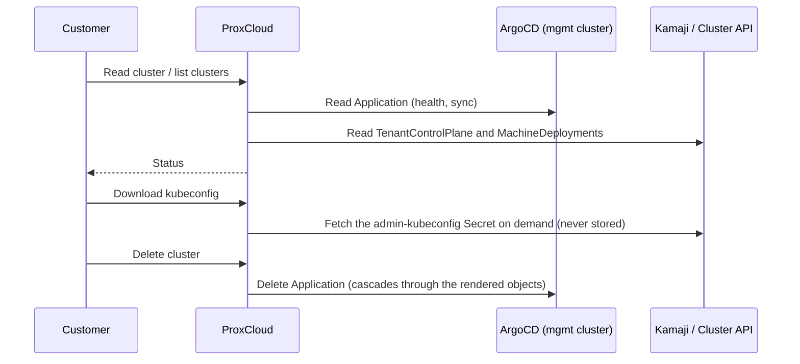

# Managed Kubernetes (kamaji provider) — operator runbook

How to register, operate and debug the `kamaji` managed-Kubernetes provider. A
kamaji provider is a **management cluster** reached over a stored kubeconfig:
each customer cluster is one ArgoCD `Application` that ProxCloud writes to that
cluster's API, and Kamaji runs the cluster's control plane as pods there
(`TenantControlPlane`).

> ## Status on Proxmox
>
> Creating a cluster works: a tenant control plane on Kamaji, worker VMs through CAPMOX, Cilium and MetalLB, with
> workers in the project's pool on the project's network, under tokens minted per cluster and revoked after the delete.
> Verified on PVE 9.2 with CAPI v1.14.4, CAPMOX v0.9.2 and Kamaji CP provider v0.22.0: create, scale-out, RWX volumes on a
> NAS dataset, a tenant LoadBalancer, project suspend and resume, a refused create, delete with everything it held.
> **Block volumes (proxmox-csi) are off by default**, because their token opens other tenants' disks: see
> [section 9](#9-how-a-cluster-lands-on-proxmox). Not available: autoscaling node groups, GPU node groups. Not run: the
> installer's split mode end to end, and a NAS the workers reach without SNAT (the lab has none).

Code: `internal/cloud/kamaji` (config, values builder, Application builder,
service, sync provider), `internal/cloud/kamajik8s` (minimal management-cluster
API client), `internal/platform/project/cloud_kamaji.go` (the
`KUBERNETES_CLUSTER` surface), `internal/platform/externalservice/kamaji.go`
(provider accessors).

## 1. Management-cluster prerequisites

One-time, per management cluster (apply order:
[`deploy/mgmt-cluster/README.md`](../deploy/mgmt-cluster/README.md)):

1. The Kamaji stack is running (Kamaji operator and its DataStore, plus the
   Cluster API machinery the cluster chart uses).
2. **ArgoCD is installed.** ArgoCD is the delivery plane: ProxCloud only writes
   `Application` objects through the Kubernetes API and never talks to the ArgoCD
   API.
3. `deploy/mgmt-cluster/` is applied: `rbac.yaml` (ProxCloud ServiceAccount,
   least-privilege RBAC, token), `appproject.yaml` (AppProject `proxcloud-k8s`,
   the source/destination guardrail), `argocd-health.yaml` (custom health checks
   for `TenantControlPlane` / `Cluster` / `MachineDeployment`).
4. **Chart pinning.** The cluster chart is published to an OCI registry at
   pinned versions. Never `latest`: the provider config and every existing
   cluster pin an exact version, and the registry must keep every pinned version.
   The values contract lives in `internal/cloud/kamaji/values.go` and is pinned by
   `TestBuildValues`. The chart is `deploy/charts/proxmox-kamaji-cluster`, and
   `config.argocd.chartName` has no default: the provider config must name it.

## 2. Provider setup (admin → Cloud providers → Add provider → Kubernetes)

Seed-file twin of the form: `deploy/seed/external-service-dev.json`
(`svc-kamaji-dev`).

| Form field | Config key | Notes |
|---|---|---|
| Management kubeconfig | `secret.kubeconfig` | The ProxCloud ServiceAccount kubeconfig assembled per the recipe in `deploy/mgmt-cluster/rbac.yaml`. Plain token or client certificate only, no exec plugins. Encrypted at rest. |
| Regions | `config.regions` | The region(s) stamped on cached clusters. |
| Services | `config.services` | `{"kubernetes": {"<region>": true}}` — drives the client-portal nav gating and the sync. |
| ArgoCD namespace / project | `config.argocd.namespace` / `.project` | Must match `deploy/mgmt-cluster` (`argocd` / `proxcloud-k8s`). |
| Chart repo / name / version | `config.argocd.chartRepo` / `.chartName` / `.chartVersion` | All three required. OCI repo **without** the `oci://` prefix. The version is the pin for NEW clusters; existing clusters keep their own pin until moved (§3). |
| DataStore | `config.cluster.dataStoreName` | Kamaji DataStore name (default `default`). |
| DNS zone | `config.cluster.dnsZone` | Optional. API FQDN = `<clusterId>.<zone>`. Cluster ids (`pc-c-<8hex>`) never change, and a cluster made before this format keeps the id it has; nothing reads the prefix. |
| Version → image matrix | `config.cluster.versions` | Curated map `k8s version → node image id`: the only versions offered to customers. Textarea grammar: `1.35.4=<image-id>` per line. |
| Image variants | `config.cluster.imageVariants` | Alternative node-image builds of the same version, e.g. a GPU build. Grammar: `1.35.4@nvidia=<image-id>`. |
| RWX dataset size | `config.cluster.rwxGiB` | Optional, API or installer (`services.kamaji.rwx_gib`). See [section 9](#9-how-a-cluster-lands-on-proxmox). |
| Block volumes for tenants | `config.cluster.csiSharedStores` | Optional, API or installer (`services.kamaji.csi_shared_stores`), default off. **Gives up isolation between tenants on the stores**, see [section 9](#9-how-a-cluster-lands-on-proxmox). Needs chart 0.1.5 or later when off. |
| Flavors allowlist | `config.cluster.flavors` | Flavor ids offered for node groups. Empty = no restriction. |

**Changing a setting later.** The installer's `services.kamaji.*` keys take effect only when stage 60 first registers the provider: it skips a provider
whose name already exists, so a re-run neither applies a changed key nor overwrites one set by hand. On an existing site use the
form above, or for the keys it has no field for (`rwxGiB`, `csiSharedStores`) the API. An update replaces each top-level key of
`config` whole, so send the complete `cluster` block, or you lose its versions and URLs:

```sh
# AUTH='Authorization: Bearer <operator token>', API=<api url>/api/v1, ID=<provider id>
curl -s -H "$AUTH" "$API/admin/service/$ID" | jq '{config: {cluster: (.data.config.cluster + {rwxGiB: 100})}}' \
  | curl -s -X PUT -H "$AUTH" -H 'Content-Type: application/json' -d @- "$API/admin/service/$ID"
```

It applies to clusters created afterwards. Existing clusters keep what they were created with: their dataset, their MTU, their
StorageClasses and any CSI token (see "Taking the token back" in [section 9](#9-how-a-cluster-lands-on-proxmox)). `csiSharedStores` must be a JSON `true`; anything else is off.
A numeric key may be a number or a string of digits, since the installer sends strings.

## 3. How a cluster is represented



- Each cluster is one ArgoCD `Application` named `<clusterId>` in the ArgoCD
  namespace: source = the pinned chart, full generated values inline,
  destination = namespace `pc-<projectId>`, project `proxcloud-k8s`, finalizer
  `resources-finalizer.argocd.argoproj.io`.
- **Ownership marker:** ProxCloud only lists, patches and deletes objects labeled
  `app.kubernetes.io/managed-by: proxcloud`. Anything else on the management
  cluster is invisible to it.
- **Sync** (`syncjob.syncKamajiService`, every 15 minutes) reconciles the
  project's `KUBERNETES_CLUSTER` rows from Applications labeled with the project
  id, enriched from the TenantControlPlane and MachineDeployments.
- **Post-create changes** (k8s upgrade, node groups, OIDC, add-ons, kubeconfig
  rotation, platform update) all mutate the stored desired spec and re-apply the
  whole Application. Every cluster pins the chart version it was created with;
  the provider's `chartVersion` only affects new clusters. An existing cluster
  moves through the customer's *Apply platform update* or the admin's per-cluster
  **Bump** / **Bump all** on the provider page. These paths were built against the
  previous infrastructure backend and have not been exercised on Proxmox.

### Deletion and orphan finalization

Delete removes the Application; the resources finalizer makes ArgoCD cascade the
delete through everything the chart rendered. Cleanup of the per-cluster
secrets and, when the project's last cluster is gone, the `pc-*` namespace is
**sync-driven**: `syncjob.sweepKamajiOrphans` runs once per sync cycle as a
service-level sweep, after the cascade completes. It scans the management cluster
itself, so it also reaps leftovers of projects whose ProxCloud record is already
gone. A secret younger than the 30-minute grace window is never touched. Project
teardown also removes the `pc-*` namespace of a project that never had a cluster,
once nothing is pending and no Application of the project is left.

```sh
# namespaces ProxCloud owns, with what's left inside them
kubectl get ns -l app.kubernetes.io/managed-by=proxcloud
kubectl get applications.argoproj.io -n argocd -l app.kubernetes.io/managed-by=proxcloud
kubectl get tenantcontrolplanes,machinedeployments -n pc-<projectId>
```

## 4. Billing

- `kubernetes_cluster` — the flat control-plane fee: a price-plan rule on
  attribute `existence` (e.g. `0.10`/hour), charged once the API endpoint exists
  (`internal/cloud/billingresource/kubernetescluster.go`). Worker VMs bill through
  the ordinary instance rules; never add k8s rules for them.
- Example rules live in `deploy/seed/price-plan-seed.json`.

## 5. Troubleshooting

Start from the ArgoCD Application — it aggregates everything the chart rendered:

```sh
# health + sync state of every ProxCloud cluster
kubectl get applications.argoproj.io -n argocd -l app.kubernetes.io/managed-by=proxcloud
# one cluster's full resource tree with per-resource health (or use the ArgoCD UI)
argocd app get <cluster-id> --show-operation
kubectl get application <cluster-id> -n argocd -o jsonpath='{.status.health}{"\n"}{.status.sync}'
```

| Symptom | Look at |
|---|---|
| Create fails with `Could not mint the cluster's Proxmox tokens` | The portal token lacks a grant: [proxmox-permissions.md](proxmox-permissions.md#managed-kubernetes). The message names the path. |
| Machines stuck, CAPMOX logs `not authorized to access endpoint` | PVE refused the cluster's token. The PVE access log (`/var/log/pveproxy/access.log`) names the call. `GET /cluster/status` answering 403 is normal and ignored. A refused clone is checked against the template's NICs too. |
| `error waiting for agent` for a few minutes | Normal while the clone boots. |
| Tenant `LoadBalancer` Service `<pending>` for up to 15 minutes after create | The MetalLB pool arrives by ClusterResourceSet, which retries until the chart's CRDs and MetalLB's webhook answer, with CAPI's growing backoff between tries: on the lab it applied 8 minutes after the cluster was Available. The Application reads `Progressing` until then; the portal shows the cluster READY once the control plane, every node group and the sync are done. |
| Application `OutOfSync` / `SyncFailed` | `argocd app get <cluster-id>` sync error. "not permitted in project proxcloud-k8s" → the chart needs a cluster-scoped resource; add exactly that group/kind to `deploy/mgmt-cluster/appproject.yaml`. Chart pull errors → registry or pin problem (§1.4). |
| Application Healthy but cluster unusable | Health checks not loaded or wrong: verify the `argocd-health.yaml` keys exist in `argocd-cm` and the application controller was restarted. |
| Cluster stuck `PROGRESSING`, no endpoint | `kubectl get tcp -n pc-<projectId>` → TenantControlPlane status. Pending CP pods → management-cluster capacity or DataStore. |
| Delete hangs | The Application keeps its finalizer while the cascade runs; inspect what is left in the tree (`argocd app get`). Remove the finalizer by hand only if you accept orphaning the rendered objects, then clean up per §3. |
| Orphaned namespaces/secrets | §3 orphan-finalization check. |
| Cluster missing from the portal | The `kubernetes` service toggle for the region is off, or the Application lacks the ProxCloud labels. |

## 9. How a cluster lands on Proxmox

What the create path resolves (`internal/platform/project/cloud_kamaji_create.go`):

| What | From | Note |
|---|---|---|
| Workers' pool | the project's pool | they sync and bill as servers of their flavor (`fl-`, `sp-` tags) |
| Network | the customer's pick, one of the project's networks | the zone must have no DHCP (EVPN, VLAN) |
| Quota | the project's limits, like servers | every worker counts against `servers`, `vcpus`, `ramMb` and `diskGb`; a create or node group edit over them answers 409 and takes nothing |
| Addresses | 16 for workers, 8 for tenant LoadBalancers, reserved from the top of the subnet | hence at most 15 workers: a rolling replacement needs a spare |
| Credentials | `capmox@pve!<id>` (management side), `csi@pve!<id>` only with `csiSharedStores` (reaches the tenant cluster) | minted at create, revoked after the delete cascade |

**Node images.** `config.cluster.versions` maps a version to its template per PVE node, as printed by
`images/k8s-node-template.sh`: `{"1.35.10": "pve1=9210,pve2=9211"}`. PVE clones to local storage only on the
template's node, so a node group has one MachineDeployment per entry, its replicas split evenly, the first entries
taking the remainder. The zone label comes from that pin, so no cloud controller manager is needed.

**Reaching the platform.** Workers sit on a tenant vnet with no route to the management network. The API-server
endpoint is an address on the services subnet, which tenants reach over their normal egress: MetalLB. So is
proxmox-csi's PVE API with `csiSharedStores`: a `pve-api` Service forwarding to the PVE nodes (`config.cluster.pveCsiUrl`).

**Block volumes.** A provider offers its storage profiles to tenant clusters through proxmox-csi only with
`config.cluster.csiSharedStores: true`. The plugin's token reaches the tenant cluster, where a cluster-admin can read it, and
**PVE's ACLs do not hold it to the project**: to attach or delete a disk, PVE checks `Datastore.Allocate` on the store and
not the VM that owns the disk, and proxmox-csi cannot work without that privilege, since all its disks are named
`vm-9999-pvc-*`. Scoping the token to the project's pool does not help. Seen on PVE 9.2 with a token on the project's pool
and the store only: it cannot read another project's pool or VM config, but it lists every disk on the store, attaches
another project's PVC or boot disk to its own worker (a pod then read the files), and passes PVE's check to delete one (the
task ran and failed only because that disk was in use). Moving the plugin to the management side would not close this, as a
tenant can create a `PersistentVolume` naming any disk. Turn the setting on only for tenants who trust each other, or on a
store they alone use.
A disk is named after its PV alone, so the portal cannot tell whose it is: a PVC still there when the cluster is deleted
leaves its disk on the store, unbilled. Delete PVCs first. A cluster created with the setting off has no proxmox-csi, no CSI token and no
`csi-proxmox` namespace, and `shared-file` is the default StorageClass if it has a dataset. Without a TrueNAS provider on
the project it has no StorageClass at all. A store per project would give real isolation on block volumes. It is not built:
such a store needs a ZFS dataset or RBD namespace per project, and we found no PVE API call that creates one.

**Taking the token back.** The setting decides what a cluster is created with. Turning it off, or upgrading from a version
that always minted the token, does nothing to existing clusters: they keep the plugin, its StorageClasses and a live token
until they are deleted. To take one back, per cluster (`<id>` is the cluster id, `pveum user token list csi@pve` lists them):

1. In the tenant cluster, delete PVCs on those classes and wait for their disks to go. Afterwards the plugin can no longer detach or delete them: a pod that moves answers `proxmox API error 401` on attach, a disk left behind stays on the store unbilled, and a worker replaced while one is attached waits at `WaitingForVolumeDetach`.
2. On a PVE node: `pveum user token remove csi@pve <id>`. This is the step that closes the hole. PVE drops the token's ACLs with it, and a copy left in the tenant cluster is dead.
3. Remove the plugin. This takes chart 0.1.5 or later, because an older chart keeps the plugin with no StorageClass. A cluster from before this setting is on 0.1.4 or older and needs a **Bump** first: with the provider's `chartVersion` at 0.1.5 or later, Bump the cluster on the provider page. Then, on the management cluster:
   ```sh
   kubectl -n argocd patch application <id> --type=json -p '[{"op":"replace","path":"/spec/source/helm/valuesObject/proxmox/csi/storageClasses","value":[]}]'
   kubectl -n pc-<projectId> delete secret <id>-csi-config
   ```
   ArgoCD prunes the plugin's HelmChartProxy, CAAPH uninstalls it and its StorageClasses go, and `shared-file` becomes the default class if the cluster has one. The tenant's `csi-proxmox` namespace and the dead Secret in it stay until the tenant deletes them.

A later delete of the cluster finishes as usual: a token already gone counts as revoked. Keep the `csi@pve` user, even with no token left under it. A release asks PVE to delete that user's token for the cluster, and with the user gone PVE answers 403 to the portal's token. That does not count as revoked, so the release never finishes.

**RWX volumes.** `config.cluster.rwxGiB` gives each new cluster on a project with a TrueNAS provider one NAS dataset
of that size and the `shared-file` StorageClass (csi-driver-nfs, `ReadWriteMany`), the default class unless proxmox-csi
classes are offered. The dataset is an ordinary share of the project named `k8s-<clusterId>`: it bills as a share,
counts against the share quota, can be resized on the Shares page, and its export follows the project's addresses.
PVCs are subdirectories of it named after their PV, so `refquota` caps them together, not one by one, and a new PVC with an old name starts empty. They are mode `0777`, since the NAS squashes root and a non-root pod could not write otherwise. It is destroyed with the cluster, by the sweep after the delete cascade (30 minutes after the cluster was created at the earliest).
For the same reason the CSI controller deletes a PVC's directory as `nobody`: a directory a non-root pod created with mode `755` and filled cannot be removed, the PV stays `Released` with `permission denied` in its events, and its data counts against the `refquota` until the pod's user removes it or the cluster goes. Have such pods use `umask 000`, or empty the volume before deleting the PVC.
Workers reach it over their egress, so the NAS must see them under the project's addresses: no NAT on the way. A subnet
that leaves through its exit node's SNAT, the usual case on EVPN, arrives under a node's address. Where a
NAT cannot be avoided, the TrueNAS provider's `snatSources` keeps its address on the dataset's export, which gives up
isolation between every tenant behind that NAT (see "TrueNAS file shares" in `cloud-integration.md`). The isolation rules
drop tenant traffic to the nodes' management network, so a NAS with only an address there cannot be mounted at all:
`mountHost` must be an address tenants can reach.
Full-tier sites (ceph-csi CephFS) are not built yet.

**A create that fails.** Quota is checked first, so a create over it takes nothing. The marker secret is written before the create takes anything else. A failure releases the addresses, tokens and dataset at once, and if that release fails too (NAS or PVE down), the marker stays and the sweep retries it after the grace window. A release only reaches the NAS named by the cluster's share row, so a broken NAS holding nothing of the cluster blocks nothing. The exception is a cluster on a shared worker pool: its addresses are on every export of the project, so they stay reserved until the NAS takes them off.

**`sharedWorkers`.** For a site that will not give the portal token the right to mint tokens,
`config.cluster.sharedWorkers` (`pool`, `bridge`, `gateway`, `prefix`, `first`, `last`, `capiTokenId`, `csiTokenId`;
`secret.sharedCapiSecret`, `secret.sharedCsiSecret`) puts every cluster on one operator-run pool, network and
credential. **Tenants then share a network and a CSI token any of them can read, and workers neither sync nor bill.**
Lab and evaluation only.

**CAPMOX pitfalls found on PVE 9.2.**

- `not authorized to access endpoint` (upstream issue #513): a manager-level credential
  (`capmox-manager-credentials`, `PROXMOX_URL`) **silently wins over every `ProxmoxCluster.credentialsRef`**
  (`pkg/scope/cluster.go`), so clones run under a token that was never meant for them. Keep the manager
  credential empty: `clusterctl init` with `PROXMOX_URL=""`.
- `no pid returned from agent exec command`: reading cloud-init's status needs `VM.GuestAgent.Unrestricted` on PVE 9,
  which is root in every guest of the pool. The chart sets `checks.skipCloudInitStatus`; the Node joining is the signal.
- A machine whose clone was in flight across a CAPMOX restart can end up "ready" while stopped and unconfigured. Delete
  the Machine and CAPI replaces it.
