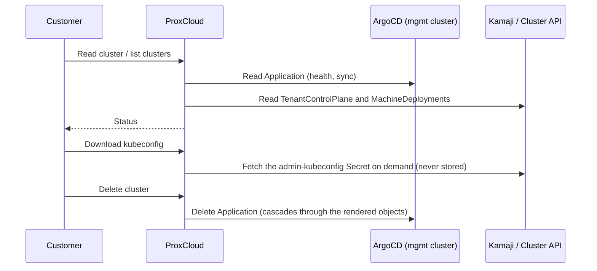

# Managed Kubernetes (kamaji provider) — operator runbook

How to register, operate and debug the `kamaji` managed-Kubernetes provider. A
kamaji provider is a **management cluster** reached over a stored kubeconfig:
each customer cluster is one ArgoCD `Application` that ProxCloud writes to that
cluster's API, and Kamaji runs the cluster's control plane as pods there
(`TenantControlPlane`).

> ## Status on Proxmox
>
> **Evidence boundary:** the operations below describe historical development-lab
> acceptance of the managed-provider flow, not a blanket production certification
> or a clean install from published release artifacts. The new static ISO template
> builder is a separate path: configuration/tests pass, but live ISO boot, installed
> reboot and Goss acceptance have not yet run.
>
> Creating a cluster was verified on that lab: a tenant control plane on Kamaji, worker VMs through CAPMOX, Cilium and MetalLB, with
> workers in the project's pool on the project's network, under tokens minted per cluster and revoked after the delete.
> Verified on PVE 9.2 with CAPI v1.14.4, CAPMOX v0.9.2 and Kamaji CP provider v0.22.0: create, scale-out, RWX volumes on a
> NAS dataset, a tenant LoadBalancer, project suspend and resume, a refused create, delete with everything it held.
> **Block volumes (proxmox-csi) come through the CSI gateway**, which keeps every PVE credential out of the tenant
> cluster: a new cluster gets them when the portal runs the gateway (on in the installer's split mode), the compute
> provider holds its token and the Kubernetes provider pins chart 0.1.7 or later. Without the gateway a cluster gets
> no block volumes: see [section 9](#9-how-a-cluster-lands-on-proxmox). Not available: autoscaling node groups, GPU node groups. Not run: the
> installer's split mode end to end, and a NAS the workers reach without SNAT (the lab has none).

Code: `internal/cloud/kamaji` (config, values builder, Application builder,
service, sync provider), `internal/cloud/kamajik8s` (minimal management-cluster
API client), `internal/platform/project/cloud_kamaji.go` (the
`KUBERNETES_CLUSTER` surface), `internal/platform/externalservice/kamaji.go`
(provider accessors).

## 1. Management-cluster prerequisites

One-time, per management cluster (apply order:
[`deploy/mgmt-cluster/README.md`](../deploy/mgmt-cluster/README.md)):

1. The Kamaji stack is running (Kamaji operator and its DataStore, plus the
   Cluster API machinery the cluster chart uses).
2. **ArgoCD is installed.** ArgoCD is the delivery plane: ProxCloud only writes
   `Application` objects through the Kubernetes API and never talks to the ArgoCD
   API.
3. `deploy/mgmt-cluster/` is applied: `rbac.yaml` (ProxCloud ServiceAccount,
   least-privilege RBAC, token), `appproject.yaml` (AppProject `proxcloud-k8s`,
   the source/destination guardrail), `argocd-health.yaml` (custom health checks
   for `TenantControlPlane` / `Cluster` / `MachineDeployment`).
4. **Chart pinning.** Publish/copy the cluster chart to the registry your ArgoCD
   can reach and verify the exact version exists before registering it. A chart
   directory/version in this checkout is **not** proof of a public OCI artifact;
   no public ProxCloud chart release has been published yet. Installer stage 50
   packages the checkout's charts into its services-cluster registry, a separate
   path from the GitHub tag-based chart workflow. Never `latest`: the provider and
   every existing cluster pin an exact version, and the registry must keep it.
   The values contract lives in `internal/cloud/kamaji/values.go` and is pinned by
   `TestBuildValues`. The chart is `deploy/charts/proxmox-kamaji-cluster`, and
   `config.argocd.chartName` has no default: the provider config must name it.

### Node-template build network

Building a Kubernetes node image does **not** require DHCP as a Kubernetes
prerequisite. The manual `k8s-node-templates` Actions workflow defaults to
`network_mode=static`: existing `BUILD_IP` (host CIDR), `BUILD_GATEWAY`,
`BUILD_NAMESERVER` and optional build VLAN Repository Secrets generate a private
local NoCloud `cidata` ISO. The live installer and installed build OS receive the
same fixed-MAC Netplan configuration; Packer has an explicit SSH address, with no
guest-to-runner HTTP seed route. Direct script use still defaults to legacy DHCP,
so set `PVE_BUILD_NETWORK_MODE=static` explicitly.

The runner needs xorriso/OpenSSL and access to template disks plus an ISO-capable
store (`PVE_ISO_STORAGE`, optionally different from `PVE_TEMPLATE_STORAGE`). Keep
the reserved build address outside all allocators. Static guest provisioning,
reboot and Goss precede final guest sanitization, exact seed detachment/deletion
and build-NIC removal; private logs/seed files must never become public artifacts.
A killed runner is not cleanup proof. Do not adopt an old same-name template as
clean just because its NIC was removed, or start a competing DHCP server as a
workaround. See the [template pipeline](../images/README.md#static-mode-workflow-default-no-dhcp)
and [quickstart command](quickstart.md#d-managed-kubernetes-databases-and-sandboxes-split).
The installer consumes the output node→VMID map; stage 50 does not call this build
or import Actions Secrets. Runtime acceptance of the new static ISO path remains
pending for the chosen Kubernetes version; successful Debian/Ubuntu OS cloud-image
canaries do not prove it.

## 2. Provider setup (admin → Cloud providers → Add provider → Kubernetes)

Seed-file twin of the form: `deploy/seed/external-service-dev.json`
(`svc-kamaji-dev`).

| Form field | Config key | Notes |
|---|---|---|
| Management kubeconfig | `secret.kubeconfig` | The ProxCloud ServiceAccount kubeconfig assembled per the recipe in `deploy/mgmt-cluster/rbac.yaml`. Plain token or client certificate only, no exec plugins. Encrypted at rest. |
| Regions | `config.regions` | The region(s) stamped on cached clusters. |
| Services | `config.services` | `{"kubernetes": {"<region>": true}}` — drives the client-portal nav gating and the sync. |
| ArgoCD namespace / project | `config.argocd.namespace` / `.project` | Must match `deploy/mgmt-cluster` (`argocd` / `proxcloud-k8s`). |
| Chart repo / name / version | `config.argocd.chartRepo` / `.chartName` / `.chartVersion` | All three required. OCI repo **without** the `oci://` prefix. The version is the pin for NEW clusters; existing clusters keep their own pin until moved (§3). |
| DataStore | `config.cluster.dataStoreName` | Kamaji DataStore name (default `default`). |
| DNS zone | `config.cluster.dnsZone` | Optional. API FQDN = `<clusterId>.<zone>`. Cluster ids (`pc-c-<8hex>`) never change, and a cluster made before this format keeps the id it has; nothing reads the prefix. |
| Version → image matrix | `config.cluster.versions` | Curated map `k8s version → node image id`: the only versions offered to customers. Textarea grammar: `1.35.4=<image-id>` per line. |
| Image variants | `config.cluster.imageVariants` | Alternative node-image builds of the same version, e.g. a GPU build. Grammar: `1.35.4@nvidia=<image-id>`. |
| RWX dataset size | `config.cluster.rwxGiB` | Optional, API or installer (`services.kamaji.rwx_gib`). See [section 9](#9-how-a-cluster-lands-on-proxmox). |
| Block volumes for tenants | — | Through the CSI gateway only, with no credential in the tenant ([section 9](#9-how-a-cluster-lands-on-proxmox)). `csiSharedStores` and `pveCsiUrl` were removed: the API answers 400 to a `cluster` block that still has one, and the form drops them on save. |
| Flavors allowlist | `config.cluster.flavors` | Flavor ids offered for node groups. Empty = no restriction. |

**Changing a setting later.** The installer's `services.kamaji.*` keys take effect only when stage 60 first registers the provider: it skips a provider
whose name already exists, so a re-run neither applies a changed key nor overwrites one set by hand. On an existing site use the
form above, or for the keys it has no field for (`rwxGiB`) the API. An update replaces each top-level key of
`config` whole, so send the complete `cluster` block, or you lose its versions and URLs:

```sh
# AUTH='Authorization: Bearer <operator token>', API=<api url>/api/v1, ID=<provider id>
curl -s -H "$AUTH" "$API/admin/service/$ID" | jq '{config: {cluster: (.data.config.cluster | del(.csiSharedStores, .pveCsiUrl)) + {rwxGiB: 100}}}' \
  | curl -s -X PUT -H "$AUTH" -H 'Content-Type: application/json' -d @- "$API/admin/service/$ID"
```

It applies to clusters created afterwards. Existing clusters keep what they were created with: their dataset, their MTU, their
StorageClasses and any CSI token (see "Taking the token back" in [section 9](#9-how-a-cluster-lands-on-proxmox)).
A numeric key may be a number or a string of digits, since the installer sends strings.

## 3. How a cluster is represented



- Each cluster is one ArgoCD `Application` named `<clusterId>` in the ArgoCD
  namespace: source = the pinned chart, full generated values inline,
  destination = namespace `pc-<projectId>`, project `proxcloud-k8s`, finalizer
  `resources-finalizer.argocd.argoproj.io`.
- **Ownership marker:** ProxCloud only lists, patches and deletes objects labeled
  `app.kubernetes.io/managed-by: proxcloud`. Anything else on the management
  cluster is invisible to it.
- **Sync** (`syncjob.syncKamajiService`, every 15 minutes) reconciles the
  project's `KUBERNETES_CLUSTER` rows from Applications labeled with the project
  id, enriched from the TenantControlPlane and MachineDeployments.
- **Post-create changes** (k8s upgrade, node groups, OIDC, add-ons, kubeconfig
  rotation, platform update) all mutate the stored desired spec and re-apply the
  whole Application. Every cluster pins the chart version it was created with;
  the provider's `chartVersion` only affects new clusters. An existing cluster
  moves through the customer's *Apply platform update* or the admin's per-cluster
  **Bump** / **Bump all** on the provider page. The admin Bump was run on Proxmox
  (0.1.5 to 0.1.6 on the lab: ArgoCD synced the new pin, the workers stayed); the
  customer's *Apply platform update* has not been.

### Deletion and orphan finalization

Delete removes the Application; the resources finalizer makes ArgoCD cascade the
delete through everything the chart rendered. Cleanup of the per-cluster
secrets and, when the project's last cluster is gone, the `pc-*` namespace is
**sync-driven**: `syncjob.sweepKamajiOrphans` runs once per sync cycle as a
service-level sweep, after the cascade completes. It scans the management cluster
itself, so it also reaps leftovers of projects whose ProxCloud record is already
gone. A secret younger than the 30-minute grace window is never touched. Project
teardown also removes the `pc-*` namespace of a project that never had a cluster,
once nothing is pending and no Application of the project is left.

```sh
# namespaces ProxCloud owns, with what's left inside them
kubectl get ns -l app.kubernetes.io/managed-by=proxcloud
kubectl get applications.argoproj.io -n argocd -l app.kubernetes.io/managed-by=proxcloud
kubectl get tenantcontrolplanes,machinedeployments -n pc-<projectId>
```

## 4. Billing

- `kubernetes_cluster` — the flat control-plane fee: a price-plan rule on
  attribute `existence` (e.g. `0.10`/hour), charged once the API endpoint exists
  (`internal/cloud/billingresource/kubernetescluster.go`). Worker VMs bill through
  the ordinary instance rules; never add k8s rules for them.
- Example rules live in `deploy/seed/price-plan-seed.json`.

## 5. Troubleshooting

Start from the ArgoCD Application — it aggregates everything the chart rendered:

```sh
# health + sync state of every ProxCloud cluster
kubectl get applications.argoproj.io -n argocd -l app.kubernetes.io/managed-by=proxcloud
# one cluster's full resource tree with per-resource health (or use the ArgoCD UI)
argocd app get <cluster-id> --show-operation
kubectl get application <cluster-id> -n argocd -o jsonpath='{.status.health}{"\n"}{.status.sync}'
```

| Symptom | Look at |
|---|---|
| Create fails with `Could not mint the cluster's Proxmox tokens` | The portal token lacks a grant: [proxmox-permissions.md](proxmox-permissions.md#managed-kubernetes). The message names the path. |
| Machines stuck, CAPMOX logs `not authorized to access endpoint` | PVE refused the cluster's token. The PVE access log (`/var/log/pveproxy/access.log`) names the call. `GET /cluster/status` answering 403 is normal and ignored. A refused clone is checked against the template's NICs too. |
| `error waiting for agent` for a few minutes | Normal while the clone boots. |
| Tenant `LoadBalancer` Service `<pending>` for up to 15 minutes after create | The MetalLB pool arrives by ClusterResourceSet, which retries until the chart's CRDs and MetalLB's webhook answer, with CAPI's growing backoff between tries: on the lab it applied 8 minutes after the cluster was Available. The Application reads `Progressing` until then; the portal shows the cluster READY once the control plane, every node group and the sync are done and the ClusterResourceSet is the one part left, for up to 30 minutes after create. A cluster still `PROGRESSING` past that: `kubectl get clusterresourceset -n pc-<projectId>` and its `ResourcesApplied` condition. |
| Application `OutOfSync` / `SyncFailed` | `argocd app get <cluster-id>` sync error. "not permitted in project proxcloud-k8s" → the chart needs a cluster-scoped resource; add exactly that group/kind to `deploy/mgmt-cluster/appproject.yaml`. Chart pull errors → registry or pin problem (§1.4). |
| Application Healthy but cluster unusable | Health checks not loaded or wrong: verify the `argocd-health.yaml` keys exist in `argocd-cm` and the application controller was restarted. |
| Cluster stuck `PROGRESSING`, no endpoint | `kubectl get tcp -n pc-<projectId>` → TenantControlPlane status. Pending CP pods → management-cluster capacity or DataStore. |
| Delete hangs | The Application keeps its finalizer while the cascade runs; inspect what is left in the tree (`argocd app get`). Remove the finalizer by hand only if you accept orphaning the rendered objects, then clean up per §3. |
| Orphaned namespaces/secrets | §3 orphan-finalization check. |
| Cluster missing from the portal | The `kubernetes` service toggle for the region is off, or the Application lacks the ProxCloud labels. |

## 9. How a cluster lands on Proxmox

What the create path resolves (`internal/platform/project/cloud_kamaji_create.go`):

| What | From | Note |
|---|---|---|
| Workers' pool | the project's pool | they sync and bill as servers of their flavor (`fl-`, `sp-` tags) |
| Network | the customer's pick, one of the project's networks | the zone must have no DHCP (EVPN, VLAN) |
| Quota | the project's limits, like servers | every worker counts against `servers`, `vcpus`, `ramMb` and `diskGb`; a create or node group edit over them answers 409 and takes nothing |
| Addresses | 16 for workers, 8 for tenant LoadBalancers, reserved from the top of the subnet | hence at most 15 workers: a rolling replacement needs a spare |
| Credentials | `capmox@pve!<id>` (management side); no CSI token, block volumes use the CSI gateway's | minted at create, revoked after the delete cascade (with a `csi@pve!<id>` an older cluster may still hold) |
| Bootstrap ISO store | the Proxmox provider's `config.isoStorage`, default `local` | must be node-local, see "Bootstrap ISOs" below |

**Node images.** `config.cluster.versions` maps a version to its template per PVE node, as printed by
`images/k8s-node-template.sh`: `{"1.35.10": "pve1=9210,pve2=9211"}`. PVE clones to local storage only on the
template's node, so a node group has one MachineDeployment per entry, its replicas split evenly, the first entries
taking the remainder. The zone label comes from that pin, so no cloud controller manager is needed.

**Reaching the platform.** Workers sit on a tenant vnet with no route to the management network. The API-server
endpoint is an address on the services subnet, which tenants reach over their normal egress: MetalLB. Nothing in a
tenant reaches the PVE API: proxmox-csi's controller runs on the services cluster and calls the CSI gateway.

Earlier releases gave tenant workers a `pve-api` Service on the services subnet that forwarded to the PVE nodes
(`config.cluster.pveCsiUrl`), for a proxmox-csi controller inside the tenant. Stage 60 (`make upgrade` runs it)
deletes it once no cluster's `<id>-csi-config` on the services cluster still holds a token and no cluster Application
has StorageClasses without `proxmox.csi.gateway` (a migration whose Application patch failed), and otherwise names the
clusters to move first ("Moving a cluster onto the CSI gateway" below). By hand:
`kubectl -n proxcloud-system delete svc/pve-api endpointslice/pve-api` on the services cluster. The services cluster's own
proxmox-csi calls the PVE API directly and never used it.

**Node credentials (NodeRestriction).** Kamaji's default admission plugin list leaves out `NodeRestriction`, so on a
tenant API server without it a worker's kubelet credential (`/var/lib/kubelet/pki/kubelet-client-current.pem`, readable
by anything that gets root on the node) can label, taint and cordon any other Node, set `node-restriction.kubernetes.io/`
labels, and read any Secret of the cluster by creating a pod bound to its own node that mounts it. Chart 0.1.6 sets
`KamajiControlPlane.spec.admissionControllers` to Kamaji's list plus `NodeRestriction` (`kamajiControlPlane.admissionControllers`
in the chart values; the portal does not render the key, so the chart default applies). A node can then change only its own
Node and create only mirror pods, which may not reference Secrets. Measured on the lab, Kubernetes 1.35.10, same cluster
before and after a Bump from 0.1.5:

| As a worker's kubelet credential | 0.1.5 | 0.1.6 |
|---|---|---|
| PATCH another Node: label, taint, cordon | allowed (200) | refused: `is not allowed to modify node` |
| create a pod bound to itself mounting a Secret, then read the Secret | allowed, Secret read | refused: `can only create mirror pods`; a mirror pod: `may not reference secrets` |
| label its own Node `node-restriction.kubernetes.io/…` | allowed | refused |

Kubelet heartbeats, Cilium, the proxmox-csi node plugin (PVC attach and mount), MetalLB (L2 announcement) and pods,
`exec` and `logs` kept working, and a worker joining afterwards registered with its node group's label and taint. The
API server rolls in under a minute; `exec` and `logs` answer `No agent available` for about 30 seconds after, until the
konnectivity agents reconnect. A cluster created before 0.1.6 gets the plugin with a **Bump** onto 0.1.6 or later; nothing
on the workers changes.

**Bootstrap ISOs.** CAPMOX writes each new worker's user-data, kubeadm join token included, to
`user-data-<vmid>.iso`, mounts it as a CD, and after the node has joined unmounts and deletes it. The token
lives 15 minutes (CABPK's default) but is renewed until the machine is up, so a node that never joins keeps a
live one. Whoever can read the store can join a node of their own to the cluster. CAPMOX v0.9.2 passes no store
to go-proxmox, which uploads to the first enabled `iso` store in `GET /nodes/<node>/storage` as the token sees
it, and PVE lists stores in Perl hash order: with two iso stores visible the pick changes from call to call.
So each cluster's token sees one iso store, the provider's `config.isoStorage` (default `local`, PVE's stock
directory store on every node), and a create answers 409 when that store is shared (NFS, CIFS, CephFS, ...),
takes no ISO images, when the boot store takes ISO images as well, or when `capmox@pve` itself lacks
`PVEDatastoreAdmin` there. The services cluster's token follows the same rule (installer `services.iso_storage`,
default `local`, checked in preflight). Clusters on `sharedWorkers` use the operator's token: give it
`PVEDatastoreAdmin` on one node-local store and no other iso store.

Clusters created before this release have their token's ISO grant on the old store (`nas-templates` on an
installer site). After upgrading the portal, the sync's sweep moves each one: it grants the new store and
revokes the old, once no `user-data-*.iso` is left on the old store (a node still booting from it would
otherwise keep its file for ever, since CAPMOX deletes it only on stores its token sees). Until then the log
says `bootstrap ISO move waits for a node to join` with the file's name. A node that starts booting from the old
store while its grant is being taken away gets the old store back, and the move waits for it the same way. A
worker that never joins holds every old cluster's move until it is removed. Test connection on the Proxmox provider
warns when `isoStorage` is shared or takes no ISO images: existing clusters only ever move to that store, so a
shared one would otherwise leave them where they are without a word. The user grant comes first; the create and
the move read it off the ACL list the way PVE does, so a grant through a group or a parent path with propagate
counts. Give it on any node, or by stage 10 (`make install` and `make upgrade` run it, writing only what is
missing):

```sh
pveum acl modify /storage/local --users capmox@pve --roles PVEDatastoreAdmin --propagate 0
# check one cluster after the next sync: Datastore.* on local, nothing on the old store
pveum user token permissions capmox@pve <clusterId> --path /storage/local
pveum user token permissions capmox@pve <clusterId> --path /storage/nas-templates
```

**Block volumes.** Why no PVE token goes to a tenant cluster, which earlier releases did with
`config.cluster.csiSharedStores: true`: the plugin's token reaches the tenant cluster, where a cluster-admin can read it, and
**PVE's ACLs do not hold it to the project**: to attach or delete a disk, PVE checks `Datastore.Allocate` on the store and
not the VM that owns the disk, and proxmox-csi cannot work without that privilege, since all its disks are named
`vm-9999-pvc-*`. Scoping the token to the project's pool does not help. Seen on PVE 9.2 with a token on the project's pool
and the store only: it cannot read another project's pool or VM config, but it lists every disk on the store, attaches
another project's PVC or boot disk to its own worker (a pod then read the files), and passes PVE's check to delete one (the
task ran and failed only because that disk was in use). Moving the plugin to the management side would not close this, as a
tenant can create a `PersistentVolume` naming any disk. Hence the gateway below, which checks every call.

**Block volumes through the CSI gateway.** The replacement keeps every PVE credential out of the tenant
cluster. The portal API serves a CSI gateway (`internal/cloud/csigw`, its own TLS listener, `PROXCLOUD_CSI_GATEWAY_ADDR`,
off by default) that the proxmox-csi controller calls as if it were PVE, with a credential per cluster
(`csi@proxcloud!<clusterId>`). The gateway allows only the calls proxmox-csi-plugin v0.22.0 makes and checks each one: a
disk is the cluster's when the gateway's `csiVolume` registry says it created it for that cluster (written before the disk,
so a name is taken once), a VM when it is in the cluster's pool with its `pc-k8s-<clusterId>` tag right now (read on
every call, since PVE reuses a freed vmid at once), a task when the gateway
answered with its UPID. A crafted `volumeHandle`, NodeID or StorageClass is only an input it checks; another cluster's disk
does not even show in a listing, so a delete of it is a no-op and an attach finds nothing. It refuses replication,
`/cluster/nextid`, VM create, migrate and `/access/ticket`, and records every refusal in the audit log. It calls PVE with
one token, `csi@pve!gateway` ([proxmox-permissions.md](proxmox-permissions.md#the-csi-gateway-token)).

A **new** cluster takes this path when the portal has `PROXCLOUD_CSI_GATEWAY_URL` and its CA
([configuration.md](configuration.md)), the compute provider holds the gateway token (`config.csiGatewayTokenId`,
`secret.csiGatewaySecret`) and the workers are the project's (not `sharedWorkers`). Every storage profile is then a
StorageClass, and chart 0.1.7 or later is needed: with an older `chartVersion` on the Kubernetes provider the create
answers 503. Without the gateway a new cluster gets no proxmox-csi at all.

- The create mints the cluster's credential and writes `<id>-csi-gateway` (the controller's `config.yaml` and the
  gateway CA) next to the cloud secret on the services cluster. No CSI token is minted on PVE, and the resource set
  carries only the privileged `csi-proxmox` namespace.
- The chart runs the controller in `pc-<projectId>` on the services cluster (`templates/csi-controller.yaml`): the plugin,
  attacher, provisioner and resizer, each with the Kamaji admin kubeconfig (`admin.svc`, the in-cluster address, so the
  API allowlist does not apply). Leases and storage capacity objects stay in the tenant's `csi-proxmox`; the lease names
  depend on the driver name only. The tenant keeps the node plugin, the CSIDriver and the StorageClasses, with the
  upstream controller at 0 replicas and no config Secret. Snapshots are not offered.
- The tenant's disks are VOLUME rows of the project (`data.volume.k8sCluster`), from the registry, at the size PVE
  reports, and bill like volumes from the disk's creation. The portal refuses to delete or change them itself (409):
  the PersistentVolumeClaim owns them. The sync's reconcile leaves a `creating` row alone for 15 minutes; after that it
  makes the row `ready` if PVE has the disk (a create whose answer was lost) and drops it if not. It closes a row whose
  disk is gone, and takes size and volid from PVE.
- Once a deleted cluster's workers are gone, the release revokes the credential, then deletes every disk the registry
  still holds for it, `Retain` PersistentVolumes included: with the cluster gone nothing can mount them. A disk PVE
  refuses to delete (still in use) keeps the cluster's marker, and the sweep tries again; the cluster's PVE tokens,
  addresses and dataset are released in the meantime.

Deployments: the chart's `api.csiGateway` (its own port, a Service with `externalTrafficPolicy: Local`, a certificate from
a CA made with cert-manager, a NetworkPolicy that admits the port from `allowedCIDRs` only); `make install` in split mode
turns it on with the services nodes (`services.network.nodes`) as the only sources, at the first mgmt node's address.
A Local Service answers only on a node running an API pod, so with three mgmt nodes the installer pins the API to the
first. Existing clusters keep the tenant-side controller until an operator moves them (below).

A PersistentVolume on a node-local store (`zfspool`, `lvmthin`) carries its PVE node as its zone, so its pod runs only on
workers of that node; on a shared store (NFS, RBD) it follows the pod to any worker.

**Moving a cluster onto the CSI gateway.** A cluster made by an earlier release with `csiSharedStores` keeps the
tenant-side controller and its `csi@pve!<id>` token until an operator moves it, one cluster at a time:

```sh
# what it would do; writes nothing
curl -X POST -H "Authorization: Bearer $ADMIN_TOKEN" \
  "$API/api/v1/admin/service/<kubernetesProviderId>/k8s-clusters/<clusterId>/csi-gateway?dryRun=true"
# do it
curl -X POST -H "Authorization: Bearer $ADMIN_TOKEN" \
  "$API/api/v1/admin/service/<kubernetesProviderId>/k8s-clusters/<clusterId>/csi-gateway"
```

It needs what a new cluster needs (the portal's gateway URL and CA, the gateway token on the compute provider, the
project's own workers) and a Kubernetes provider pinned to chart 0.1.7 or later, which the cluster is bumped onto. The
portal reads the tenant API through the cluster's Kamaji admin kubeconfig, at the control plane's LoadBalancer
address: a cluster whose API allowlist leaves the portal out cannot be moved until it is added.

1. **Adopt.** The portal reads the cluster's PersistentVolumes of driver `csi.proxmox.sinextra.dev`, those of every
   other cluster of the provider, and the services cluster's own (Kamaji etcd, the registry and DBaaS use the same
   `vm-9999-pvc-` names on the same stores; this needs `list persistentvolumes` in `deploy/mgmt-cluster/rbac.yaml`, so
   apply it again on an existing site before migrating: `make upgrade` does not). A PV's disk enters the gateway's
   registry as the cluster's when that PV is the only one naming it, PVE lists it on one of the cluster's stores, it is
   attached to the cluster's workers and to nothing else, and no registry row holds it. Any other PV is refused with its
   reason: another PV names the disk too (a crafted PV, or a disk passed between clusters), the registry holds it for
   another cluster, another VM has it attached, no worker of the cluster has it attached, it is not on PVE, its name is
   not one proxmox-csi gives a volume, it is on another region or store, or some cluster's PVs could not be read (the
   disk could be theirs). A disk nobody else names is not proof it is the cluster's: a disk left by a deleted cluster or
   by another portal on the same PVE, or a services-cluster disk while its pod restarts, is named by nobody. So a PV whose
   pod is not running (scaled to 0, or no pod at all) is refused until the operator has checked the disk and names the
   PV in `?adoptDetached=<pv>,<pv>`; migrate while the cluster's pods run. A refusal stops the migration with 409 and the
   report; `?force=true` goes on without adopting them, and a pod of a refused PV cannot attach afterwards. `-pvc-` disks
   on the cluster's stores that no PV names, no row holds and no VM has attached are listed as `orphans`, never deleted.
   Adopted disks bill from now on (the PVE sync never counted them before) and are not checked against the project's
   quota.
2. **Switch.** The portal mints the cluster's gateway credential, writes `<id>-csi-gateway`, cuts `<id>-csi-config` down
   to the `csi-proxmox` namespace, and in one Application apply pins the provider's chart with the gateway values.
   CAAPH takes the tenant's controller to 0 replicas and the services-side controller takes over the same leases. Pods
   keep their volumes: their I/O does not pass through the controller. On the lab the switch took about 10 seconds.
3. **Clean up.** It deletes the tenant's `csi-proxmox/proxmox-csi-plugin` Secret (the resource set does not delete what
   it no longer carries), then revokes `csi@pve!<id>`. It then reads the PVs again: one the old controller made after
   the first read is listed in `late`, unadopted, and its pod cannot attach; run the migration again for it. The token
   is revoked right after the Application apply, without waiting for ArgoCD to roll out the services-side controller:
   afterwards, check on the services cluster that the cluster's csi controller Deployment is Ready. A cluster being
   deleted is refused.

Running it again is safe: adopted rows stay, a switched cluster is not switched again, and a Secret or token already gone
counts as done. Its CAPI token stays.

For an older cluster not yet moved, a disk is named after its PV alone, so the portal cannot tell whose it is: a PVC still
there when the cluster is deleted leaves its disk on the store, unbilled. Delete PVCs first. A cluster created without the gateway has no proxmox-csi, no CSI token and no
`csi-proxmox` namespace, and `shared-file` is the default StorageClass if it has a dataset. Without a TrueNAS provider on
the project it has no StorageClass at all. A store per project would give real isolation on block volumes. It is not built:
such a store needs a ZFS dataset or RBD namespace per project, and we found no PVE API call that creates one.

**Taking the token back.** Upgrading does nothing to existing clusters made with `csiSharedStores` (or by a version
that always minted the token): they keep the plugin, its StorageClasses and a live token until they are moved or
deleted. A portal with the CSI gateway moves such a cluster onto it, volumes and all ("Moving a cluster onto the CSI
gateway" above). Without the gateway, to take one back, per cluster (`<id>` is the cluster id, `pveum user token list csi@pve` lists them):

1. In the tenant cluster, delete PVCs on those classes and wait for their disks to go. Afterwards the plugin can no longer detach or delete them: a pod that moves answers `proxmox API error 401` on attach, a disk left behind stays on the store unbilled, and a worker replaced while one is attached waits at `WaitingForVolumeDetach`.
2. On a PVE node: `pveum user token remove csi@pve <id>`. This is the step that closes the hole. PVE drops the token's ACLs with it, and a copy left in the tenant cluster is dead.
3. Remove the plugin. This takes chart 0.1.5 or later, because an older chart keeps the plugin with no StorageClass. A cluster from before this setting is on 0.1.4 or older and needs a **Bump** first: with the provider's `chartVersion` at 0.1.5 or later, Bump the cluster on the provider page. Then, on the management cluster:
   ```sh
   kubectl -n argocd patch application <id> --type=json -p '[{"op":"replace","path":"/spec/source/helm/valuesObject/proxmox/csi/storageClasses","value":[]}]'
   kubectl -n pc-<projectId> delete secret <id>-csi-config
   ```
   ArgoCD prunes the plugin's HelmChartProxy, CAAPH uninstalls it and its StorageClasses go, and `shared-file` becomes the default class if the cluster has one. The tenant's `csi-proxmox` namespace and the dead Secret in it stay until the tenant deletes them.

A later delete of the cluster finishes as usual: a token already gone counts as revoked. Keep the `csi@pve` user, even with no token left under it. A release asks PVE to delete that user's token for the cluster, and with the user gone PVE answers 403 to the portal's token. That does not count as revoked, so the release never finishes.

**RWX volumes.** `config.cluster.rwxGiB` gives each new cluster on a project with a TrueNAS provider one NAS dataset
of that size and the `shared-file` StorageClass (csi-driver-nfs, `ReadWriteMany`), the default class unless proxmox-csi
classes are offered. The dataset is an ordinary share of the project named `k8s-<clusterId>`: it bills as a share,
counts against the share quota, can be resized on the Shares page, and its export follows the project's addresses.
PVCs are subdirectories of it named after their PV, so `refquota` caps them together, not one by one, and a new PVC with an old name starts empty. They are mode `0777`, since the NAS squashes root and a non-root pod could not write otherwise. It is destroyed with the cluster, by the sweep after the delete cascade (30 minutes after the cluster was created at the earliest).
For the same reason the CSI controller deletes a PVC's directory as `nobody`: a directory a non-root pod created with mode `755` and filled cannot be removed, the PV stays `Released` with `permission denied` in its events, and its data counts against the `refquota` until the pod's user removes it or the cluster goes. Have such pods use `umask 000`, or empty the volume before deleting the PVC.
Workers reach it over their egress, so the NAS must see them under the project's addresses: no NAT on the way. A subnet
that leaves through its exit node's SNAT, the usual case on EVPN, arrives under a node's address. Where a
NAT cannot be avoided, the TrueNAS provider's `snatSources` keeps its address on the dataset's export, which gives up
isolation between every tenant behind that NAT (see "TrueNAS file shares" in `cloud-integration.md`). The isolation rules
drop tenant traffic to the nodes' management network, so a NAS with only an address there cannot be mounted at all:
`mountHost` must be an address tenants can reach.
Full-tier sites (ceph-csi CephFS) are not built yet.

**A create that fails.** Quota is checked first, so a create over it takes nothing. The marker secret is written before the create takes anything else. A failure releases the addresses, tokens and dataset at once, and if that release fails too (NAS or PVE down), the marker stays and the sweep retries it after the grace window. A release only reaches the NAS named by the cluster's share row, so a broken NAS holding nothing of the cluster blocks nothing. The exception is a cluster on a shared worker pool: its addresses are on every export of the project, so they stay reserved until the NAS takes them off.

**`sharedWorkers`.** For a site that will not give the portal token the right to mint tokens,
`config.cluster.sharedWorkers` (`pool`, `bridge`, `gateway`, `prefix`, `first`, `last`, `capiTokenId`, `csiTokenId`;
`secret.sharedCapiSecret`, `secret.sharedCsiSecret`) puts every cluster on one operator-run pool, network and
credential. **Tenants then share a network and a CSI token any of them can read, and workers neither sync nor bill.**
Their proxmox-csi runs in the tenant with that token and calls the PVE API at `pveApiUrl` (else the Proxmox provider's
`apiUrl`), so the shared bridge must reach it. Lab and evaluation only.

**CAPMOX pitfalls found on PVE 9.2.**

- `not authorized to access endpoint` (upstream issue #513): a manager-level credential
  (`capmox-manager-credentials`, `PROXMOX_URL`) **silently wins over every `ProxmoxCluster.credentialsRef`**
  (`pkg/scope/cluster.go`), so clones run under a token that was never meant for them. Keep the manager
  credential empty: `clusterctl init` with `PROXMOX_URL=""`.
- `no pid returned from agent exec command`: reading cloud-init's status needs `VM.GuestAgent.Unrestricted` on PVE 9,
  which is root in every guest of the pool. The chart sets `checks.skipCloudInitStatus`; the Node joining is the signal.
- A machine whose clone was in flight across a CAPMOX restart can end up "ready" while stopped and unconfigured. Delete
  the Machine and CAPI replaces it.
