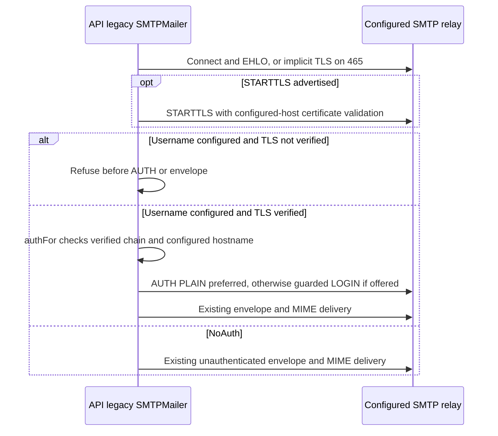

# Legacy SMTP credential TLS boundary

## Operator contract

The existing legacy `SMTPMailer` requires verified TLS whenever its configured
username is nonempty. Port `465` retains implicit TLS; other ports require a
successful STARTTLS upgrade before credentials can be used. The certificate must
be trusted by the process root store and valid for the configured host (DNS name
or IP SAN). There is no plaintext LOGIN exception for localhost, no insecure TLS
switch and no fallback after failed negotiation. A relay that omits STARTTLS,
even if it also omits AUTH, is refused before AUTH, MAIL, RCPT or DATA.

An empty username, including the existing explicit integration `NoAuth` mode,
continues to support unauthenticated cleartext relays. STARTTLS remains
opportunistic for that mode; an advertised but failed upgrade still aborts.
This compatibility is not a confidentiality guarantee for unauthenticated mail.
Verified TLS with no AUTH advertisement retains its existing no-AUTH behavior.
PLAIN remains preferred over LOGIN when both are advertised.

Operators should configure a trusted relay certificate and the matching host,
not disable validation. This patch changes no stored credentials, integration
flags, provider settings or deployment resources, and performs no live send.

## C1–C4 view

- **C1 — trust boundary:** the API's configured SMTP principal crosses to an
  external relay only through authenticated TLS. An unauthenticated EHLO response
  cannot choose whether credential confidentiality is required.
- **C2 — containers:** the existing API process and external SMTP relay are
  unchanged. There is no new service, store, queue or network endpoint.
- **C3 — component:** only the legacy mail transport is changed. Environment and
  stored-integration resolution still select the same mailer; no outbox adapter,
  dispatcher, producer, cipher or key lifecycle is enabled or modified.
- **C4 — code:** `SMTPMailer.Send` negotiates TLS using the configured host.
  `authFor` first preserves the empty-username path, then checks the actual SMTP
  connection's completed TLS handshake, verified chain and leaf hostname before
  examining AUTH capabilities. Host verification uses the certificate, not SNI:
  valid IP literals need not send SNI. `loginAuth.Start` independently requires
  non-nil server information, TLS and the exact expected SMTP host. Its small
  authorization state prevents `Next` from releasing credentials before an
  accepted `Start` or after completion. Security/authentication errors are fixed
  strings and do not echo credentials or peer authentication responses.

## Bounded validation and limits

The new tests use generated disposable certificates with a private per-test root
pool, dummy credentials, `net.Pipe` and isolated loopback fake SMTP peers. They
exercise actual `net/smtp` clients, verified STARTTLS and implicit TLS, PLAIN
preference, LOGIN host/TLS checks, TLS 1.2/1.3 DNS and IP identities, certificate
failures, stripped TLS/AUTH and NoAuth compatibility. Socket deadlines and finite
peer command limits bound I/O. They do not alter global root settings or bypass
certificate verification. Existing MIME/attachment, noop, integration, cipher
and outbox test assertions are retained unchanged.

Target-controlled builds/tests for this security fix must run only in the
Parent-approved OS-enforced sandbox with a reviewed read-only source copy. No
host test execution or live SMTP smoke send is an acceptable substitute. A
focused stdlib-only fixture can compile the exact whole mail transport and
message files plus the new tests; that does not replace the normal package and
repository gates. Synthetic success does not prove a deployed relay, real mail
acceptance, production credentials, or published-release readiness. This patch
adds no timeout/context transport redesign and does not claim one.
